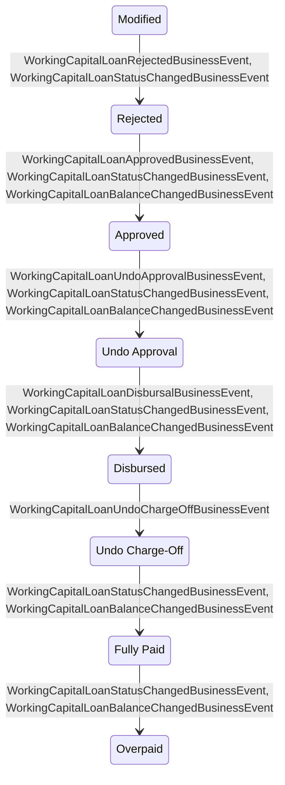
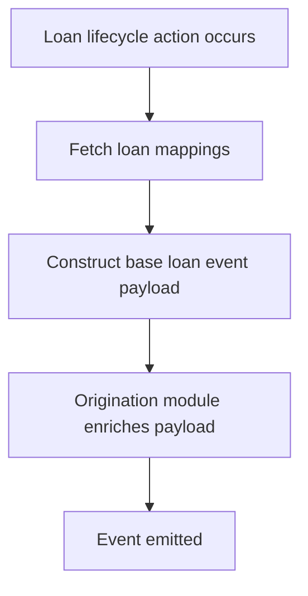

# Events and Notifications

## Event overview and purpose

Business events tell integrators when a loan contract changes state or when an accrual transaction is created or replayed. Use them to react to contract termination, balance changes, and accrual activity outside the user interface.

The following business events fire for contract termination:

- LoanContractTerminationPostBusinessEvent is fired for contract termination.

## Repayment due notifications

The system sends repayment due notifications for loans that have been disbursed and still have an outstanding balance.

US Pay Monthly customers receive notifications on this schedule:

- A notification is sent 10 days before the payment due date.
- If the upcoming installment still has a balance pending 1 day before the due date, another payment reminder is sent.

Repayment due notification configuration:

- You can configure notification dates at product level.
- Configuration defaults to the global default.
- The system sends LoanRepaymentDueBusinessEvent and LoanRepaymentOverdueBusinessEvent based on the configuration.

## Loan account changed event fields

The LoanAccountDataV1 loan account changed event adds six camelCase fields that report unpaid interest, delinquent interest, interest refunds and interest waivers on the loan.

The table lists each added field, its event name, type and meaning.

| Event field | Type | Meaning |
| --- | --- | --- |
| totalUnpaidAccruedDueInterest | BigDecimal | Total unpaid posted interest amount on the loan |
| totalUnpaidAccruedNotDueInterest | BigDecimal | Total unpaid accrued interest calculated from the last non-monetary interest activity posting date and not yet posted on the billing period |
| delinquentInterest | BigDecimal | Delinquent amount with interest portion |
| totalInterestRefund | BigDecimal | Total refund amount when a merchant or agent initiates a disbursement refund that is not reversed |
| totalInterestPaymentWaiver | BigDecimal | Total interest waiver amount when PayPal initiates an interest waiver transaction that is not reversed |

## Transaction business events

Loan transaction business events include a reverted flag so downstream systems can identify reversed transactions. Reversing a Working Capital loan transaction publishes WorkingCapitalLoanAdjustTransactionBusinessEvent with transactionToAdjust set to the reversed transaction details and newTransactionDetail set to null. Reprocessing an existing Working Capital loan transaction with changed allocation publishes WorkingCapitalLoanAdjustTransactionBusinessEvent with transactionToAdjust set to the transaction details with the old allocation and newTransactionDetail set to the transaction details with the new allocation.

## Working Capital loan lifecycle events

Working Capital loan lifecycle events publish when you modify, reject, approve, undo approval, disburse, undo charge-off, fully pay, or overpay a Working Capital loan. Other topics cover balance, delinquency, breach, and transaction events separately.

Lifecycle actions publish the following events:

- Modifying a Working Capital loan publishes WorkingCapitalLoanApplicationModifiedBusinessEvent.
- Rejecting a Working Capital loan publishes WorkingCapitalLoanRejectedBusinessEvent and WorkingCapitalLoanStatusChangedBusinessEvent.
- Approving a Working Capital loan publishes WorkingCapitalLoanApprovedBusinessEvent, WorkingCapitalLoanStatusChangedBusinessEvent, and WorkingCapitalLoanBalanceChangedBusinessEvent.
- Undoing approval of a Working Capital loan publishes WorkingCapitalLoanUndoApprovalBusinessEvent, WorkingCapitalLoanStatusChangedBusinessEvent, and WorkingCapitalLoanBalanceChangedBusinessEvent.
- Disbursing a Working Capital loan publishes WorkingCapitalLoanDisbursalBusinessEvent, WorkingCapitalLoanStatusChangedBusinessEvent, and WorkingCapitalLoanBalanceChangedBusinessEvent.
- Undoing charge-off of a Working Capital loan publishes WorkingCapitalLoanUndoChargeOffBusinessEvent.
- A Working Capital loan becoming fully-paid publishes WorkingCapitalLoanStatusChangedBusinessEvent and WorkingCapitalLoanBalanceChangedBusinessEvent.
- A Working Capital loan becoming overpaid publishes WorkingCapitalLoanStatusChangedBusinessEvent and WorkingCapitalLoanBalanceChangedBusinessEvent.

## Working Capital loan balance events

A Working Capital loan balance change from a monetary transaction triggers WorkingCapitalLoanBalanceChangedBusinessEvent. Changes to the delinquency amount or past due amount do not trigger any Working Capital loan business event. WorkingCapitalLoanCOBApiFilter must be registered and wired so it ensures up-to-date close of business (COB) state before monetary transactions on Working Capital loans.

## Working Capital loan delinquency events

Working Capital loan delinquency events publish when delinquency changes state on a Working Capital loan.

The system publishes the following events:

- A Working Capital loan delinquency range change triggers WorkingCapitalLoanDelinquencyRangeChangeBusinessEvent only once the range is changed or lifted.
- Pausing delinquency triggers WorkingCapitalLoanDelinquencyPauseBusinessEvent.
- Resuming delinquency triggers WorkingCapitalLoanDelinquencyResumeBusinessEvent.
- Rescheduling delinquency triggers WorkingCapitalLoanDelinquencyRescheduleBusinessEvent.
- Resetting delinquency triggers WorkingCapitalLoanDelinquencyResetBusinessEvent.
- Undoing a delinquency reset triggers WorkingCapitalLoanDelinquencyUndoResetBusinessEvent.
- Disabling delinquency triggers WorkingCapitalLoanDelinquencyDisableBusinessEvent.
- Enabling delinquency triggers WorkingCapitalLoanDelinquencyEnableBusinessEvent.

## Working Capital loan breach events

The system publishes business events when a Working Capital loan breach changes state.

| Change | Event |
| --- | --- |
| Breach or not breach change | WorkingCapitalLoanBreachChangeBusinessEvent |
| Breach past due change | WorkingCapitalLoanBreachPastDueChangeBusinessEvent |
| Near-breach change | WorkingCapitalLoanNearBreachChangeBusinessEvent |
| Pausing breach | WorkingCapitalLoanBreachPauseBusinessEvent |
| Resuming breach | WorkingCapitalLoanBreachResumeBusinessEvent |
| Rescheduling breach | WorkingCapitalLoanBreachRescheduleBusinessEvent |
| Resetting breach | WorkingCapitalLoanBreachResetBusinessEvent |
| Undoing a breach reset | WorkingCapitalLoanBreachUndoResetBusinessEvent |
| Disabling breach | WorkingCapitalLoanBreachDisableBusinessEvent |
| Enabling breach | WorkingCapitalLoanBreachEnableBusinessEvent |

```mermaid
stateDiagram-v2
  state "Breach" as n1
  state "Past Due" as n2
  state "Near Breach" as n3
  state "Paused" as n4
  state "Resumed" as n5
  state "Rescheduled" as n6
  state "Reset" as n7
  state "Undo Reset" as n8
  state "Disabled" as n9
  state "Enabled" as n10
  n1 --> n1 : WorkingCapitalLoanBreachChangeBusinessEvent
  n2 --> n2 : WorkingCapitalLoanBreachPastDueChangeBusinessEvent
  n3 --> n3 : WorkingCapitalLoanNearBreachChangeBusinessEvent
  n4 --> n4 : WorkingCapitalLoanBreachPauseBusinessEvent
  n5 --> n5 : WorkingCapitalLoanBreachResumeBusinessEvent
  n6 --> n6 : WorkingCapitalLoanBreachRescheduleBusinessEvent
  n7 --> n7 : WorkingCapitalLoanBreachResetBusinessEvent
  n8 --> n8 : WorkingCapitalLoanBreachUndoResetBusinessEvent
  n9 --> n9 : WorkingCapitalLoanBreachDisableBusinessEvent
  n10 --> n10 : WorkingCapitalLoanBreachEnableBusinessEvent
```

## Working Capital loan transaction events

A Working Capital loan publishes a transaction business event for each repayment, goodwill credit, discount fee, discount fee adjustment, discount fee amortization, discount fee amortization adjustment, disbursal, accrual, accrual adjustment, and write-off.

Transaction events for Working Capital loans:

| Transaction | Event |
| --- | --- |
| Repayment | WorkingCapitalLoanRepaymentTransactionBusinessEvent |
| Goodwill credit | WorkingCapitalLoanGoodWillCreditTransactionBusinessEvent |
| Discount fee | WorkingCapitalLoanDiscountFeeTransactionBusinessEvent |
| Discount fee adjustment | WorkingCapitalLoanDiscountFeeAdjustmentTransactionBusinessEvent |
| Discount fee amortization | WorkingCapitalLoanDiscountFeeAmortizationTransactionBusinessEvent |
| Discount fee amortization adjustment | WorkingCapitalLoanDiscountFeeAmortizationAdjustmentTransactionBusinessEvent |
| Disbursal | WorkingCapitalLoanDisbursalTransactionBusinessEvent |
| Accrual | WorkingCapitalLoanAccrualTransactionBusinessEvent |
| Accrual adjustment | WorkingCapitalLoanAccrualAdjustmentTransactionBusinessEvent |
| Write-off | WorkingCapitalLoanWriteOffTransactionBusinessEvent |

## External event configuration and Avro schemas

External business events use Avro schemas. You enable or disable each event type separately on the external-event configuration page, and term-loan events are unaffected by the new Working Capital event types. The new business events are stored in m_external_event_configuration and are disabled by default. External business events add an optional originators field as an array of records.

The new business events and their Avro schemas are:

- LoanDeferredChargeTransactionCreatedBusinessEvent
- LoanDeferredChargeAmortizationTransactionCreatedBusinessEvent
- LoanDeferredChargeAmortizationAdjustmentTransactionCreatedBusinessEvent

## Delinquency calculation pause

Each LoanBusinessEvent includes delinquency calculation data so consumers can see whether delinquency calculation is paused and, if so, the pause period dates.

The LoanBusinessEventSerializer populates the field value, and CollectionDataV1 is extended with delinquencyCalculationPaused without introducing CollectionDataV2.

## Delinquency actions API

You can retrieve and submit delinquency actions for a loan using either its internal ID or its external ID.

| Endpoint | Method | Purpose |
| --- | --- | --- |
| /loans/{loanid}/delinquency-actions | GET | Retrieve all delinquency actions for a loan |
| /loans/external-id/{loanExternalId}/delinquency-actions | GET | Retrieve all delinquency actions for a loan by external ID |
| /loans/{loanid}/delinquency-actions | POST | Submit a new delinquency action for a loan |
| /loans/external-id/{loanExternalId}/delinquency-actions | POST | Submit a new delinquency action for a loan by external ID |

## Event publication flow

When a loan lifecycle action occurs, such as disbursement or repayment, the event publisher constructs a base loan event payload. Mappings for the loan are fetched on any loan and loan transaction-centric event publication. The origination module enriches the payload with originator(s), and the event is emitted so consumers can compute merchant revenue sharing externally. The customer module adds a listener for the LoanStatusChangedBusinessEvent.

## Merchant originator reporting

Merchant originator reporting joins originator mapping during report execution and outputs merchantOriginatorId in Trial Balance and Transaction Summary exports.

## Delinquency range change event

When the delinquency range changes, the system publishes a LoanDelinquencyRangeChangeBusinessEvent.

## Worked examples

This example tracks total_unpaid_posted_interest on a loan around cut-off. The figures are illustrative: principal is 1,000.00, the annual interest rate is 12 percent, installments are monthly, and months have 30 days. The monthly interest posting is 10.00. On the installment date the field is zero before cut-off because the interest has not yet been posted. After cut-off the posting makes the interest unpaid and the field becomes 10.00. On the next day, after the installment is paid, the field returns to zero.

| Date | Stage | total_unpaid_posted_interest |
| --- | --- | --- |
| 05/01 | Before cut-off | 0.00 |
| 05/01 | After cut-off (interest posted) | 10.00 |
| 05/02 | After repayment | 0.00 |

If the previous month's posted interest had remained unpaid, the before-cut-off value would start at 10.00 and the after-cut-off value would be 20.00, because the carried-over amount is added to the new posting.

This example tracks total_unpaid_accrued_interest as it accrues daily. The figures are illustrative: principal is 2,000.00, the annual interest rate is 18 percent, and months have 30 days, so the daily accrual is 1.00. Each day the field increases by one day's accrued interest until a payment or posting clears it.

| Date | total_unpaid_accrued_interest |
| --- | --- |
| 06/02 | 1.00 |
| 06/03 | 2.00 |
| 06/04 | 3.00 |
| 06/05 | 4.00 |

The table shows that accrued interest grows by a fixed daily amount.
