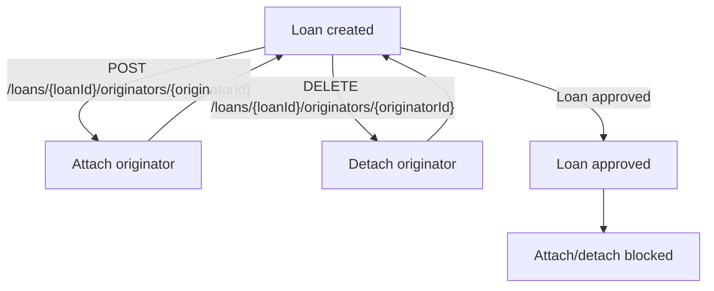
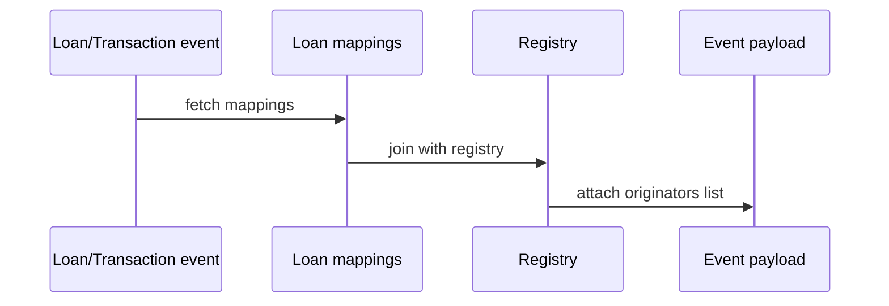

# Loan Originator Metadata

## Loan origination overview

Loan originator metadata attributes loan income and revenue to a loan originator, such as a merchant, broker, affiliate, platform or channel, for revenue share and reporting. The loan origination function is optional and not all Fineract users use it. The module is implemented as an optional module with optional schema and optional event and report extensions.

Basic properties of loan origination are stored.

- A loan can have multiple originators.
- Originator External ID is the Originator ID or revenue share ID used for reporting and sharing.
- Event changes are backward compatible through optional fields.

## Originator ID and originator details

The Originator ID identifies the merchant or channel that originated a loan. The field may be null or absent for loans that are not originated by large merchants.

Rules for the Originator ID:

- The system accepts and stores an Originator ID during loan creation.
- No additional logic, validation, or transformations are applied to the field.
- No automatic revenue-share calculations are performed.
- The Retrieve a Loan API includes the Originator ID in its response payload.

## Originator registry

The Originator Registry stores canonical partner records for loan origination, including the partner name, external ID, type, channel type, and status. Each record has a unique external ID.

| Field | Required | Values |
| --- | --- | --- |
| originator_external_id | Yes | Unique string |
| originator_name | No | String |
| originator_type_cv_id | No | MERCHANT, BROKER, AFFILIATE, PLATFORM |
| origination_channel_type_cv_id | No | ONLINE, IN_STORE, API, AGGREGATOR |
| status | Yes | ACTIVE, PENDING, INACTIVE |
| created_on, created_by, last_modified_on, last_modified_by | Yes | Auto filled |

Validation rules:

- The originator external ID must be unique.
- Code values must exist for originator type and channel type when provided.

## Originator lifecycle management

You can create, view, update, and delete loan originators through the API and UI. Status defaults to ACTIVE when not provided, and any provided code or status values must be valid.

Create an originator:

- POST /loan-originators creates an originator.
- The response returns both resourceId and resourceExternalId.
- POST /loan-originators returns HTTP 404 if originator type or channel type does not exist.
- HTTP 400 is returned if a required parameter is missing or the data format is incorrect.

Update an originator:

- PUT /loan-originators/{originatorId} and /loan-originators/external-id/{originatorExternalId} update status and fields.
- PUT update returns HTTP 200 with resourceId and resourceExternalId.
- PUT update returns HTTP 400 if a required parameter is missing or the data format is incorrect.
- PUT update returns HTTP 403 if a duplication-related error occurs.
- PUT update returns HTTP 404 if originator type or channel type does not exist.

Delete an originator:

- DELETE /loan-originators/{originatorId} and /loan-originators/external-id/{originatorExternalId} delete an originator.
- DELETE originator has no request body.
- DELETE originator returns HTTP 404 if the targeted originator does not exist.

Fetch originators:

- GET /loan-originators and /loan-originators/external-id/{originatorExternalId} fetch existing originators.
- GET fetch originators has no request body.
- GET fetch originators returns HTTP 200 with a list of originators including id, name, status, originatorTypeId, externalId, and channelTypeId.
- HTTP 404 is returned if provided value(s) do not exist.

## Attaching and detaching originators on a loan

You can attach an originator to a loan or detach one from a loan while the loan is created but not yet approved. After approval, attach and detach operations are blocked. Multiple originators can be attached to a single loan.

Rules for attaching or detaching an originator:

- Loan id is mandatory.
- Originator id is mandatory.
- Only ACTIVE status originators can be attached to a loan.
- An originator cannot be added twice to the same loan.
- An originator cannot be removed twice from the same loan.

API calls:

- POST /loans/{loanId}/originators/{originatorId} attaches an originator to a loan and has no request body.
- DELETE /loans/{loanId}/originators/{originatorId} detaches an originator from a loan and has no request body.
- GET /loans/{loanId}/originators retrieves originators for a loan.

| Operation | Success response | Failure response |
| --- | --- | --- |
| Attach originator | No response body specified | HTTP 404 if the loan or originator does not exist |
| Detach originator | HTTP 200 with loan id, loan external id, originator id, originator external id | HTTP 404 if the loan or originator does not exist |

> **Note:** Attach and detach endpoints require ATTACH_LOAN_ORIGINATOR and DETACH_LOAN_ORIGINATOR permissions respectively.

## Fetching originator details

Use GET /loans/{loanId}/originators or GET /loans/external-id/{loanExternalId}/originators to fetch originator details for a loan. The request has no body.

The response includes an originators list with these fields:

- id
- name
- status
- typeId
- externalId
- channelTypeId
- partnerTypeId

Rules:

- If the loan does not exist, the API returns HTTP 404.
- If no originator entries exist for the loan, the originators list is empty.

## Inline originator creation during loan application

You can create an originator and attach it to a loan application at the same time when the configuration is enabled. The system matches an existing originator by external ID to avoid duplicates.

Configuration:

- The setting enable_originator_creation_during_loan_application controls whether an originator can be created during loan application.
- The default value is false.

## Loan creation with originators

You can provide originator details when you create a loan. POST /loans creates and attaches originators immediately as part of the loan creation flow.

## Permissions and security

Originator endpoints are secured under four permissions: CREATE_LOAN_ORIGINATOR, UPDATE_LOAN_ORIGINATOR, DELETE_LOAN_ORIGINATOR, and READ_LOAN_ORIGINATOR.

## Module enablement and configuration

When enabled, originator repository services are created conditionally. The module is packaged as the separate fineract-loan-origination module. The originators field is optional and defaults to null to preserve backward compatibility for consumers.

## Database schema and mapping

The Loan entity is not modified with originator fields; only the loan id is used for mapping. Originator mapping is stored in the m_loan_originator_mapping table.

| Column | Type | Required | Description |
| --- | --- | --- | --- |
| id | PK | Yes | Primary key |
| loan_id | FK to m_loan | Yes | Links the mapping to a loan |
| originator_id | FK to m_loan_originator | Yes | Links the mapping to an originator |
| created_on | Auto filled | Yes | Record creation timestamp |
| created_by | Auto filled | Yes | User who created the record |
| last_modified_on | Auto filled | Yes | Last modification timestamp |
| last_modified_by | Auto filled | Yes | User who last modified the record |

## Business events

Originator details appear in loan lifecycle business events, loan transaction business events, and optionally in LoanCharge business events. The system fetches loan mappings, joins them with originator details from the registry to build the originators list, and attaches that list to the event payload.

External business events (Avro) include the following optional originators fields:

- LoanAccountDataV1.avsc includes an optional originators field as a list of attached originators to the loan.
- LoanTransactionDataV1.avsc includes an optional originators field as a list.
- The originators field defaults to null to preserve backward compatibility.

## Reporting

Reporting includes the Trial Summary Report and the Trial Balance Report. Attaching the originator external id updates these target reports.

## WCP loan module support

Loan origination is supported on the WCP loan module. All loan origination features available for term loans are available on WCP loans. You can map an originator to a WCP loan and fetch the originators assigned to a WCP loan. Originator linking, unlinking, the originators tab, and listing by originator across term and WCP loans are supported.

## API endpoints and responses

## Changed terms flag

The changedTerms flag shows whether disbursement or re-age changes the number of terms on a loan. The system calculates the number of terms before and after the action runs.

## Worked examples

A merchant originates a loan through the optional loan origination feature. The figures below are illustrative. The originator is Acme Merchants, identified by external ID MERCH-100, with status ACTIVE, originator type id 10 and channel type id 20. The loan amount is 1,000 with 3 monthly installments. The client creates the originator, then creates a loan that carries the same originator in its originators list so the merchant is linked at loan level.

| Step | Action | Input | Result |
| --- | --- | --- | --- |
| 1 | Create originator | POST /loan-originators {name: "Acme Merchants", externalId: "MERCH-100", status: "ACTIVE", originatorTypeId: 10, channelTypeId: 20} | 200; originator id 50, externalId MERCH-100 |
| 2 | Create loan with originator | POST /loans {principal: 1000, termMonths: 3, originators: [{externalId: "MERCH-100", name: "Acme Merchants", typeId: 10, channelTypeId: 20}]} | 200; loan id 1001, originators list contains id 50, externalId MERCH-100 |
| 3 | Retrieve loan with associations | GET /loans/1001?associations=originators | 200; loan id 1001, originators list includes id 50, name Acme Merchants, status ACTIVE, externalId MERCH-100, typeId 10, channelTypeId 20 |

This example shows that the originator external id is persisted at loan level and returned by the Retrieve a Loan API when originator associations are requested.

An originator can be attached to and detached from a loan while the loan is created but not yet approved. Loan 1002 is not yet approved. Originator id 51, external ID MERCH-200, name Beta Brokers, status ACTIVE, originator type id 10, channel type id 20 exists. Attaching links the originator to the loan; detaching removes the link. If the originator status were PENDING instead of ACTIVE, the attach request would be rejected because only ACTIVE originators may be attached to a loan.

| Step | Action | Input | Result | Originators on loan after step |
| --- | --- | --- | --- | --- |
| 1 | Attach originator | POST /loans/1002/originators {originatorId: 51} | 200; loan id 1002, loan external id LOAN-1002, originator id 51, externalId MERCH-200 | [51 MERCH-200] |
| 2 | Fetch originators for loan | GET /loans/1002/originators | 200; list with id 51, name Beta Brokers, status ACTIVE, externalId MERCH-200, typeId 10, channelTypeId 20 | [51 MERCH-200] |
| 3 | Detach originator | DELETE /loans/1002/originators/51 | 200; loan id 1002, loan external id LOAN-1002, originator id 51, externalId MERCH-200 | [] |

Detaching removes the association so a subsequent fetch returns an empty list; attaching the same originator twice is not allowed, and attach or detach is blocked after the loan is approved.
