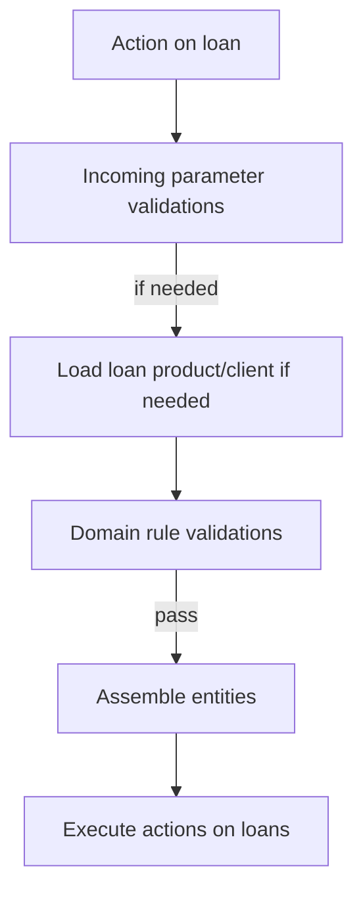

# Loan Entity Design

## Loan entity scope

The Loan entity contains only its fields, setters, getters and lightweight methods that manipulate its own state. It no longer contains helper classes, JSON data or logic, transaction processing dependencies, DTO creation logic, validations, checks, or complex business logic. Those responsibilities live in services, assemblers, mappers and dedicated utility classes. The caller service triggers transaction reprocessing, and loan status change happens as one of the last steps of monetary transaction handling.

## Enum field types

The Loan, LoanProduct and LoanTransaction entities use the underlying enum type as the data type instead of Integer. A converter is used when the enum does not match with the ordinal value.

Enum fields include:

- Loan: loanType, termPeriodFrequencyType, loanStatus and loanSubStatus.
- LoanTransaction: typeOf.

## Validation placement and order

Validator classes run as one of the first steps of an action on the loan, such as loan creation, loan disbursement, or loan repayment. They throw exceptions based on incoming parameters or on the actual state of the loan.

Validation order:

- Incoming parameter validations run before entity assembly and raise PlatformApiDataValidationException.
- Domain rule validations run after entity assembly and raise GeneralPlatformDomainRuleException.
- After validations pass, entities are assembled and actions on the loans are executed.

Loading dependencies:

- Some validations require loading the loan product or client before they can run.

