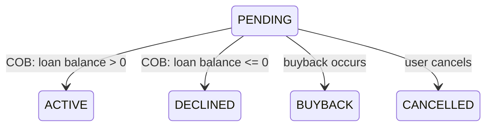

# Asset Ownership Transfer

## Asset ownership transfer overview

Asset ownership transfer lets you assign ownership of a loan at any point in its life cycle. You submit ownership changes in real time, and Fineract applies the update during close of business (COB), the nightly job that posts interest and fees. Fineract publishes events for all ownership-related activities and provides POST and GET APIs to support them.

The manual journal entry screen supports ownership selection as follows:

- The "asset Owners" drop down field appears only when asset externalization is turned on.
- You can specify the asset owner for a manual journal entry you pass.

## External asset owner creation

Create an external asset owner to record who owns an asset outside the system. The external ID must be unique and non-null. A successful creation returns HTTP 200 with OK and the created external ID.

## Asset sale

An asset sale transfers ownership of an asset on a loan account. It applies when no active ownership record exists on the loan account.

The sale succeeds when:

- The loan account is in ACTIVE state.
- The loan account has previous inactive ownership records and no active ownership record, or no ownership record at all.

On success, the system persists:

- Asset Owner ID
- Sale transaction ID
- Purchase price ratio
- Date/time of ownership change

On success, the system also:

- Marks ownership as active.
- Publishes an event for the ownership change.

At close of business (COB), the nightly job that posts interest and fees, the system posts the asset sale transaction using the closing balance of the loan account:

- DR 145600, CR 112601/112603
- DR 112601/112603, CR 145600

The system declines the sale and records no ownership changes when:

- The loan account is closed.
- The loan account balance is 0.00 at COB.
- The loan account balance is less than 0.00 at COB.
- An active ownership record already exists on the loan account.
- The loan account is not found by the RT API call to Fineract SOR.

## Asset buyback

An asset buyback changes ownership on a loan account that has an active ownership record. At close of business (COB), the nightly job that posts interest and fees, the system posts the asset sale transaction using the loan account's closing balance.

The buyback succeeds when:

- The loan is active and has an active ownership record.
- The loan is a FRAUD loan with no active ownership record.

On success, the system:

- Changes the active Asset Owner ID to inactive and persists it.
- Persists the buyback transaction ID and buyback amount memo.
- Records the date and time of the ownership change.
- Publishes an event.

At COB on success, the system posts two journal entries:

- DR 145600, CR 112601/112603
- DR 112601/112603, CR 145600

The buyback is declined when:

- The loan is closed and has an active ownership record.
- There is no active ownership record on the loan account.
- The loan account is not found by the RT API call to Fineract SOR.

When declined:

- No changes to loan ownership are recorded.
- The response is declined.

## Transfer lifecycle and states

An asset ownership transfer starts in PENDING state and moves to a final state during close of business processing or when a buyback occurs. You can cancel a transfer only while it is PENDING. You can initiate SALE and BUYBACK transfers on active, closed, and overpaid loan accounts; sale and buyback on active loans are available for the whole lifecycle of the loan.

The transfer progresses from PENDING to one of four final states:

| From state | Condition | To state |
| --- | --- | --- |
| PENDING | Loan balance is greater than 0 during close of business | ACTIVE |
| PENDING | Loan balance is less than or equal to 0 during close of business | DECLINED |
| PENDING | Buyback occurs | BUYBACK |
| PENDING | Transfer is cancelled | CANCELLED |

ACTIVE, BUYBACK, DECLINED, and CANCELLED are final states.

## Close of business processing

Close of business processing creates asset ownership transfer entries using the balance at close of business day.

On the settlement date, a sale transaction is created during close of business to move the loan balance from pending settlement to the investor. A batch process runs at close of business on settlement day.

## GL entries for sale and buyback

At the close of business of the settlement date, the system passes GL entries for the loan balance amount when ownership of a loan is sold or bought back. The accounts used depend on whether the transaction is a sale or a buyback.

| Transaction | GL entry at close of business | Accounting entry |
| --- | --- | --- |
| Sale of ownership | DR Loan/Fee Rec-Investor CR Loan/Fee Rec-PayPal | CR 112601 /112603 - DR 146000 - PayPal CR 146000 - DR 112601 /112603 - Investor |
| Buyback | DR Loan/Fee Rec-PayPal CR Loan/Fee Rec-Investor | DR 112601 /112603 - CR 146000 - PayPal DR 146000 - CR 112601 /112603 - Investor |

## Ownership effects on charges, payments, and delinquency

After an asset sale, ownership changes affect how monetary transactions, fees, payments, delinquency, and charge-offs are handled.

Ownership effects:

- Fineract captures all monetary transaction GL entries according to PayPal's defined ownership.
- Fees applied to a loan post-sale are owned by the investor, not PayPal.
- All payment allocation rules remain the same pre and post-sale.
- Past due and delinquency tracking remain the same pre and post-sale.
- Charge-off rules remain the same as PayPal-owned loan accounts for investor-owned loan accounts.
