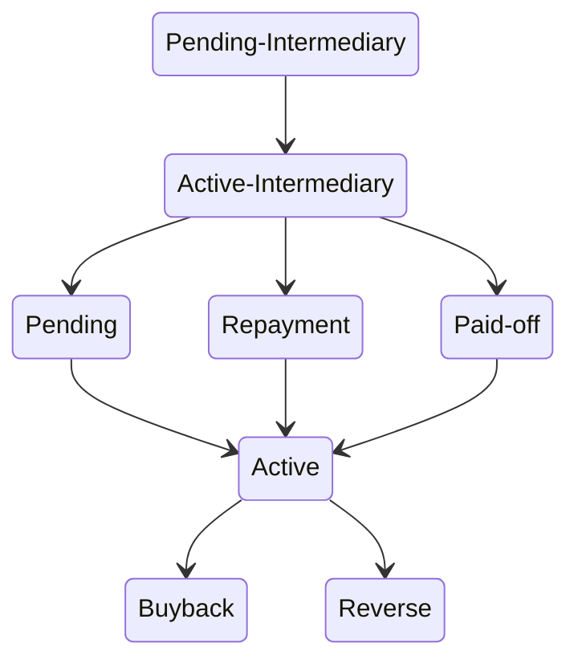

# Investor Module 2.0

## Investor Module 2.0 overview

Investor Module 2.0 lets you sell a loan account before the sale is complete.

## Intermediary sale lifecycle

An intermediary sale lets you start a sale on an active loan account before the actual sale takes place. The sale moves through Pending-Intermediary and Active-Intermediary statuses before it reaches Pending and then Active status. The COB job processes Pending-Intermediary sales each night.

Lifecycle steps:

- You initiate the intermediary sale on an active loan account, which sets the sale status to Pending-Intermediary.
- The COB job picks up the Pending-Intermediary sale and sets its status to Active-Intermediary.
- The COB job declines the Pending-Intermediary sale when the loan account is closed or overpaid.
- You initiate the sale on an Active-Intermediary loan account, which sets the sale status to Pending.
- The COB job picks up the Pending sale and sets its status to Active.

## Status transitions and allowed sequences

An asset transfer moves through statuses in a fixed sequence. Each lifecycle starts at Pending-Intermediary and ends at Buyback, Reverse, or another terminal status. Some status change orders are not allowed.

| Lifecycle | Status sequence |
| --- | --- |
| Pending-Active-Settled-Buyback | Pending-Intermediary → Active-Intermediary → Active → Buyback |
| Active-Repayment-Settle-Reverse | Pending-Intermediary → Active-Intermediary → Repayment → Active → Reverse |
| Settle-Zero-Balance-Reverse | Pending-Intermediary → Active-Intermediary → Paid-off → Active → Reverse |
| Asset transfer | Pending-Intermediary → Active-Intermediary → Repayment → Buyback |
| Asset transfer | Pending-Intermediary → Active-Intermediary → Active → Buyback |
| Asset transfer | Pending-Intermediary → Active-Intermediary → Repayment → Active → Reverse |
| Asset transfer | Pending-Intermediary → Active-Intermediary → Paid-off → Active → Reverse |

| Lifecycle | Asset transfer record status sequence |
| --- | --- |
| Pending-Active-Settled-Buyback | PENDING-Intermediary, ACTIVE-Intermediary, PENDING, ACTIVE, BUYBACK |
| Active-Repayment-Settle-Reverse | PENDING-Intermediary, ACTIVE-Intermediary, PENDING, ACTIVE |
| Settle-Zero-Balance-Reverse | PENDING-Intermediary, ACTIVE-Intermediary, PENDING, ACTIVE |

The following status change orders are not allowed:

- Pending-Intermediary → Pending → Active
- Pending-Intermediary → Active
- Pending-Intermediary → Active-Intermediary → Decline
- Pending-Intermediary → Active-Intermediary → Pending → Active → Decline

## Buyback and decline

You can buy back a loan account when its status is Active, which moves it to Buyback status. You can buy back an intermediary loan account when its status is Active-Intermediary, which moves it to Buyback-Intermediary status. Both actions are invoked through the API.

When a loan account is in Active-Intermediary state:

- You can move it to the next status.
- You can cancel the decline status through the API, and this action has no accounting entries.

## COB processing rules

The close of business (COB) job processes loan accounts based on their status and balance state.

| Loan status | Closed or overpaid | COB result |
| --- | --- | --- |
| Pending | Yes or no | Moves to Active |
| Pending-Intermediary | Yes | Moves to Declined |
| Pending-Intermediary | No | Stays in Pending-Intermediary |
| Active | Yes or no | Stays in Active |
| Active-Intermediary | Yes or no | Stays in Active-Intermediary |

## Accounting entries

The system posts accounting entries only for monetary transactions. It does not post entries for zero amounts.

The following status changes create no accounting entries:

- When the status changes from Pending to Active on a loan with zero balance, no accounting entries are passed for zero amount, the status transfers to the new asset owner, and any new monetary transaction after that is tagged to the new asset owner.

## Worked examples

A loan account has a principal of 1,000 and a current balance of 1,000; the figures are illustrative. On day 1 the owner starts an intermediary sale to owner 999, which creates status PENDING-Intermediary with no accounting entries. At COB the account moves to ACTIVE-Intermediary. On day 2 a repayment of 200 reduces the balance to 800 and is tagged to owner 999. On day 5 owner 999 starts a sale to owner 10001, creating status PENDING with no accounting entries. At COB the account moves to ACTIVE with owner 10001. On day 10 a buyback is invoked from ACTIVE.

| Day | Event | Status before | Status after | Owner | Account | Debit | Credit | Posted? |
| --- | --- | --- | --- | --- | --- | --- | --- | --- |
| 1 | Start intermediary sale | – | PENDING-Intermediary | 999 | – | – | – | No |
| 1 | COB | PENDING-Intermediary | ACTIVE-Intermediary | 999 | 146000 All | 1,000.00 | 1,000.00 | Yes |
| 1 | COB | ACTIVE-Intermediary | ACTIVE-Intermediary | 999 | 112601 Principal | 900.00 | 900.00 | Yes |
| 1 | COB | ACTIVE-Intermediary | ACTIVE-Intermediary | 999 | 112603 Fees | 50.00 | 50.00 | Yes |
| 1 | COB | ACTIVE-Intermediary | ACTIVE-Intermediary | 999 | 112603 Interest | 50.00 | 50.00 | Yes |
| 2 | Repayment | ACTIVE-Intermediary | ACTIVE-Intermediary | 999 | 145023 All | 200.00 | – | Yes |
| 2 | Repayment | ACTIVE-Intermediary | ACTIVE-Intermediary | 999 | 112601 Principal | – | 150.00 | Yes |
| 2 | Repayment | ACTIVE-Intermediary | ACTIVE-Intermediary | 999 | 112603 Fees | – | 50.00 | Yes |
| 5 | Start sale | ACTIVE-Intermediary | PENDING | 10001 | – | – | – | No |
| 5 | COB | PENDING | ACTIVE | 10001 | 146000 All | 800.00 | 800.00 | Yes |
| 5 | COB | ACTIVE | ACTIVE | 10001 | 112601 Principal | 800.00 | 800.00 | Yes |
| 10 | Buyback | ACTIVE | BUYBACK | 10001 | – | – | – | No |

The example shows that PENDING-Intermediary and PENDING are created by API with no accounting entries, COB advances the account to ACTIVE-Intermediary and then ACTIVE, repayments while in ACTIVE-Intermediary are tagged to the intermediary owner, and a buyback from ACTIVE creates BUYBACK with no accounting entries at initiation.

A loan account is repaid to a balance of 0; the figures are illustrative. On day 5 the owner starts a sale to owner 10001 while the balance is 0, creating status PENDING with no accounting entries. At COB the account moves to ACTIVE with owner 10001; COB posts zero amounts, so no accounting entries are passed, but the status and owner transfer. On day 10 a repayment reversal restores the balance to 1,000 and is tagged to owner 10001. If the account had been in PENDING-Intermediary while closed or overpaid, COB would move it to DECLINED; in ACTIVE-Intermediary it would remain unchanged.

| Day | Event | Balance before | Balance after | Status before | Status after | Owner | Account | Debit | Credit | Posted? |
| --- | --- | --- | --- | --- | --- | --- | --- | --- | --- | --- |
| 5 | Repayment to zero | 1,000.00 | 0.00 | – | – | – | 145023 All | 1,000.00 | – | Yes |
| 5 | Repayment to zero | 1,000.00 | 0.00 | – | – | – | 112601 Principal | – | 900.00 | Yes |
| 5 | Repayment to zero | 1,000.00 | 0.00 | – | – | – | 112603 Fees | – | 100.00 | Yes |
| 5 | Start sale | 0.00 | 0.00 | – | PENDING | 10001 | – | – | – | No |
| 5 | COB | 0.00 | 0.00 | PENDING | ACTIVE | 10001 | 146000 All | 0.00 | 0.00 | No |
| 5 | COB | 0.00 | 0.00 | ACTIVE | ACTIVE | 10001 | 112601 Principal | 0.00 | 0.00 | No |
| 10 | Repayment reversal | 0.00 | 1,000.00 | ACTIVE | ACTIVE | 10001 | 145023 All | – | 1,000.00 | Yes |
| 10 | Repayment reversal | 0.00 | 1,000.00 | ACTIVE | ACTIVE | 10001 | 112601 Principal | 900.00 | – | Yes |
| 10 | Repayment reversal | 0.00 | 1,000.00 | ACTIVE | ACTIVE | 10001 | 112603 Fees | 100.00 | – | Yes |

The example shows that a zero balance still transfers ownership and status at COB, that zero amounts are not posted as accounting entries, and that transactions after the transfer are tagged to the new owner.
