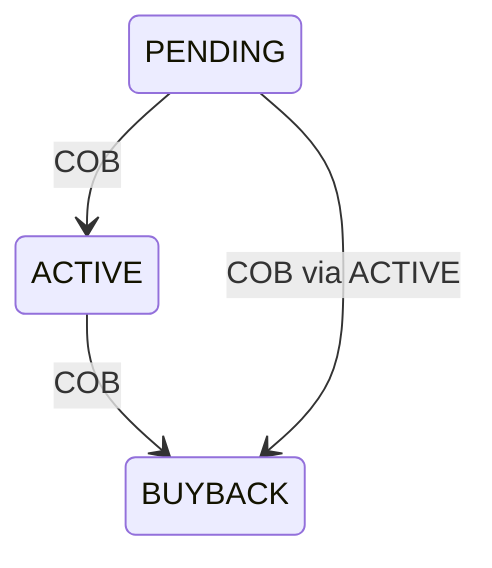

# Investor Module

## Investor Module overview

The Investor Module, also known as the asset Externalization module, supports selling and buying back loan account assets from one owner to another.

Ownership transfer records use these fields.

| Field | Meaning |
| --- | --- |
| Effective date range | The period, inclusively bounded by start and end dates, during which the ownership entry is valid. |
| Externalization status | Stores loan id, status, and effective date range with from and to dates. |
| Externalisation request and history | Stores incoming externalisation requests and executed externalisation request outcomes. |

## Roles and users

An investor is a legal entity referred to as an external owner. A business manager is an employee of the organisation who offers the loan to its customer and either makes a decision on asset sale or whose work uses data related to it.

## Ownership transfer fields

An investor can transfer ownership of a loan using Asset Owner ID, optional Sales Transaction ID, Purchase Price Ratio, and Settlement Date. Asset Owner ID identifies the investor who owns the loan. Sales Transaction ID is an external transaction ID that the system generates if you do not provide one. Purchase Price Ratio is a percentage from 0% to 100% representing the fraction of investor ownership in the loan. Settlement Date is the last date the previous owner holds the asset; new ownership starts the next day.

Ownership transfer fields

| Field | Type | Required | Constraints |
| --- | --- | --- | --- |
| Asset Owner ID | String | Required for SALE | Any string value, no specific format, maximum 100 characters |
| Sales Transaction ID | String | Optional | Any string value, no specific format, maximum 100 characters; generated if not provided |
| Purchase Price Ratio | Number | Required for SALE | Percentage between 0% and 100% |
| Settlement Date | DATE | Required | Cannot be in the past |

## Eligibility and timing

Ownership transfer requests are accepted only for loans with status ACTIVE; any other status is rejected.

During COB, the system processes an ownership transfer when its settlement date arrives:

- The transfer becomes active when the loan balance is greater than 0.
- The transfer becomes declined when the loan balance is less than or equal to 0.

> **Note:** A rejected ownership transfer response returns HTTP 403 with a reason.

## Transfer statuses

A transfer can have one of five statuses. PENDING means the request has been made but COB has not yet made it active. ACTIVE means the transfer is active and all journal entries are made against the investor. BUYBACK means the loan's ownership was bought back. DECLINED means the request has been made but COB has not run and the loan was paid back or overpaid, so there is nothing for the investor to buy. CANCELLED means the request was made but cancelled before execution.

## Initiating a sale or buyback

You initiate a sale or buyback by posting a transfer request for a loan. A sale identifies the loan by its internal id, while a buyback identifies it by its external id.

Request details

| Command | Target | URL | Body fields |
| --- | --- | --- | --- |
| sale | Loan by id | POST /external-asset-owners/transfers?loanId=1&command=sale | settlement_date, owner_external_id, transfer_external_id, purchase_price_ratio, dateformat, locale |
| buyback | Loan by external id | POST /external-asset-owners/transfers?loanExternalId=35462342345234523764&command=buyback | settlement_date, owner_external_id, transfer_external_id, purchase_price_ratio, dateformat, locale |

You cancel a transfer by posting a cancel request that identifies the loan by its external id and names the transfer to cancel.

Cancel request details

| Command | Target | URL | Body field |
| --- | --- | --- | --- |
| cancel | Loan by external id | POST /external-asset-owners/transfers?loanExternalId=35462342345234523764&command=cancel | transfer_external_id |

## Transfer responses

A transfer response returns the technical details of an ownership transfer, including its resource id, owner id, status, and sales transaction id.

| Response type | Fields |
| --- | --- |
| Sale | resourceId, resourceExternalId, subResourceId, subResourceExternalId, changes with settlementDate, ownerExternalId, transferExternalId, purchasePriceRatio, dateformat, locale |
| Buyback | resourceId, resourceExternalId, subResourceId, subResourceExternalId, changes with settlementDate, ownerExternalId, transferExternalId, purchasePriceRatio, dateformat, locale |
| Cancel | resourceId, resourceExternalId, subResourceId, subResourceExternalId, changes with transfer_external_id, status CANCELLED, subStatus USER_REQUESTED, dateformat, locale |

The ownership transfer response includes:

- resource id (internal id)
- owner id
- sales transaction id (generated if not provided)

Technical information associated with a transfer includes:

- transfer timestamp
- effective date range from submitted on date to 9999-12-31

## Fetching transfers

Fetch transfer requests using GET /external-asset-owners/transfers with a transfer external ID, loan ID, or loan external ID. Create asset transfer requests using POST /external-asset-owners/transfers/loans/<loan_id>?command=<action> or POST /external-asset-owners/transfers/loans/external-id/<loan_external_id>?command=<action>.

The response body includes:

- totalFilteredRecords
- pageItems with transferId, owner.externalId, loan.id, loan.externalId, transferExternalId, purchasePriceRatio, settlementDate, status, effectiveFrom, effectiveTo, dateformat, and locale

## COB processing

The system completes actual transfers during close of business (COB) processing and creates journal entries when asset ownership status changes.

Journal entries are created during COB for these ownership status changes:

- PENDING to ACTIVE.
- PENDING to BUYBACK through PENDING → ACTIVE then ACTIVE → BUYBACK.
- ACTIVE to BUYBACK.

## Buyback

A business manager can buy back loans with pending or active ownership transfer from investors when the loan account becomes fraud or for any other reason. Buyback is another activity with its own external Buyback Transfer ID.

When both PENDING and BUYBACK transfers are cancelled:

- No journal entries are made.

## Journal entries and accounting

The system creates accounting entries for investor journal entries using the configured mappings. Interest entries post to the Interest receivables GL mapping. The same posting date applies to both the moving-from and moving-to entries during a portfolio transfer. Storing a journal entry also creates a new relationship entry when the entry is owned by an external owner. A mapping table stores the relationship between journal entries and external investors. The Accounting module and Investor module are coupled through internal business events.

## Journal entry APIs

Use the journal entry APIs to fetch journal entries for a transfer or for an owner.

Fetch transfer journal entries with:

- GET /external-asset-owners/transfers/external-id/{ownerExternalId}/journal-entries

Fetch owner journal entries with:

- GET /external-asset-owners/owners/external-id/{ownerExternalId}/journal-entries

The transfer journal entries response body includes:

| Field | Description |
| --- | --- |
| transferData.transferId | Identifier of the transfer |
| transferData.owner.externalId | External identifier of the owner |
| transferData.loan.loanId | Identifier of the loan |
| transferData.loan.externalId | External identifier of the loan |
| transferData.details.detailsId | Identifier of the transfer details |
| transferData.details.totalOutstanding | Total outstanding amount |
| transferData.details.totalPrincipalOutstanding | Total principal outstanding |
| transferData.details.totalInterestOutstanding | Total interest outstanding |
| transferData.details.totalFeeChargesOutstanding | Total fee charges outstanding |
| transferData.details.totalPenaltyChargesOutstanding | Total penalty charges outstanding |
| transferData.details.totalOverpaid | Total overpaid amount |
| transferData.details.transferExternalId | External identifier of the transfer |
| transferData.details.purchasePriceRatio | Purchase price ratio |
| transferData.details.settlementDate | Settlement date |
| transferData.details.status | Status of the transfer |
| transferData.details.subStatus | Sub-status of the transfer |
| transferData.details.effectiveFrom | Effective from date |
| transferData.details.effectiveTo | Effective to date |
| journalEntryData.content | Journal entry content |
| journalEntryData.pageable | Pagination information |

The owner journal entries response body includes:

| Field | Description |
| --- | --- |
| ownerData.externalId | External identifier of the owner |
| journalEntryData.content | Journal entry content |
| journalEntryData.pageable | Pagination information |

## Audit and reporting

An auditor can see the history of a loan's ownership changes. Only transfer initiation is captured by API.

A loan transaction has no relationship to an external investor.

Storing the relationship between a journal entry and an external owner enables auditing, easier fetching of owner journal entries, and less complex reporting queries.

## UI screens and views

When the investor module is enabled in the environment configuration file, you can view asset owner details at the loan account level. The investor screen shows loan account details associated with investors and summarises the total loan amount at each investor level. Investors and their total balance appear as a pie chart, and you can drill down to each loan account by clicking on any loan from the view screen.

On the loan account view screen, you can see:

- The status of each transfer of the loan account once updated in the close of business (COB).
- The history of all previous transfer requests and their status.
- The current owner of the loan account, highlighted by the UI.
- Asset transfer details with amount allocations on a separate tab similar to transactions.

## Interest balance handling

Sale and buyback amounts include all balances on the loan, including any interest due.

## Worked examples

A business manager sells an active loan to the external owner Investor A. The loan carries a principal balance of 1,000.00 and interest due of 100.00, so the asset transfer amount is 1,100.00. The purchase price ratio is 100 percent, and the settlement date is in the future. These figures are illustrative.

The sale posts the full balance, including interest, from the organization’s books to the external owner through a clearing account.

| Step | Account | Debit | Credit | Owner |
| --- | --- | --- | --- | --- |
| 1 | Receivable/clearing account | 1,100.00 |  | (none) |
| 2 | Loan receivables |  | 1,000.00 | (none) |
| 3 | Interest fees receivables |  | 100.00 | (none) |
| 4 | Receivable/clearing account |  | 1,100.00 | (none) |
| 5 | Loan receivables | 1,000.00 |  | Investor A |
| 6 | Interest fees receivables | 100.00 |  | Investor A |
| Total |  | 2,200.00 | 2,200.00 |  |

A business manager buys back the same loan from Investor A after the loan account becomes fraud. The buyback amount includes all balances on the loan: principal of 1,000.00 and interest due of 100.00, totaling 1,100.00.

The buyback reverses the sale and returns the loan balances, including interest, to the organization’s books.

| Step | Account | Debit | Credit | Owner |
| --- | --- | --- | --- | --- |
| 1 | Receivable/clearing account |  | 1,100.00 | (none) |
| 2 | Loan receivables | 1,000.00 |  | (none) |
| 3 | Interest fees receivables | 100.00 |  | (none) |
| 4 | Receivable/clearing account | 1,100.00 |  | (none) |
| 5 | Loan receivables |  | 1,000.00 | Investor A |
| 6 | Interest fees receivables |  | 100.00 | Investor A |
| Total |  | 2,200.00 | 2,200.00 |  |
