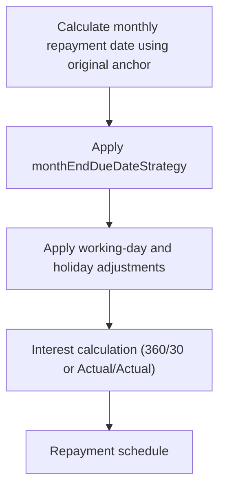
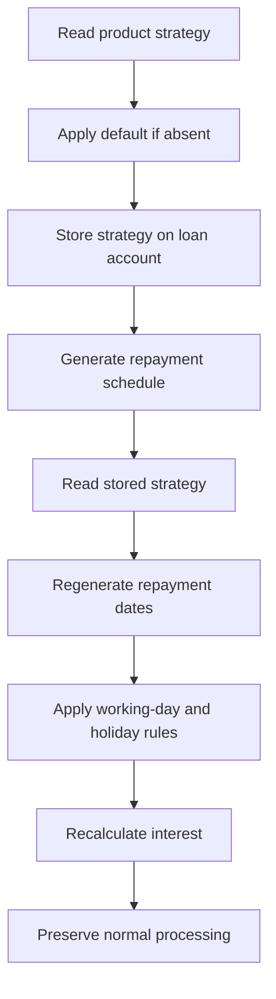

# Repayment Due Date Strategy

## Repayment due date strategy

The repayment due date strategy controls how Apache Fineract sets monthly repayment dates when the original repayment day does not exist in a target month. Financial institutions choose the handling method, and the choice applies to monthly repayment date generation. Interest calculations remain consistent with the configured day-count convention.

When the original repayment day does not exist in the target month, the strategy can do one of the following:

- Roll the repayment date forward to the first day of the following month.
- Adjust the repayment date to the last day of the month.

## Month-end due date strategies

Interest behaviour under each convention:

- Under 360/30 with monthly frequency, rolling a repayment date forward because the original day does not exist must not change the interest calculated for each regular monthly period.
- Under Actual/Actual, interest is calculated using the actual number of calendar days between repayment dates.
- Rolling a repayment date forward under Actual/Actual changes the number of days in the affected repayment periods and may change the amount of interest charged.

Effect of rolling under Actual/Actual:

| Period | Effect |
| --- | --- |
| Period 1 | Accrues one additional day of interest on the higher outstanding balance. |
| Period 2 | Accrues one fewer day of interest on the reduced outstanding balance. |
| Total interest | May change because the interest increase and decrease are calculated on different principal balances. |

> **Note:** Numerical examples under Actual/Actual use unrounded amounts before display rounding.

## Configuration and inheritance

The `monthEndDueDateStrategy` setting controls how a loan account handles due dates that fall at the end of a month. You set it on a loan product, and each loan account inherits the product's strategy when you submit the loan. The strategy stays with the loan account for schedule regeneration, rescheduling and interest recalculation.

The strategy applies to both loan product types:

- Cumulative loan products support `monthEndDueDateStrategy`.
- Progressive loan products support `monthEndDueDateStrategy`.

| Context | Default when not provided | Null value treated as |
| --- | --- | --- |
| Loan product | `LAST_DAY_OF_MONTH` | `LAST_DAY_OF_MONTH` |
| Existing records with null values | `LAST_DAY_OF_MONTH` | `LAST_DAY_OF_MONTH` |

The system persists the strategy for both the loan product and the loan account, so it remains available after application restart and during future schedule regeneration.

You can configure and read the strategy through these operations:

- Loan product create API
- Loan product update API
- Loan product read API
- Loan product template API
- Loan submission
- Loan read operations

## Eligibility and timing

It applies to every repayment due date, including the final installment. Rolling a due date does not change the original repayment anchor, and subsequent dates are always calculated from the original anchor rather than the previously adjusted due date. Daily, weekly, and yearly repayment frequencies keep their existing behavior. Existing loan products without the new attribute generate identical repayment schedules and interest calculations as before.

## Date calculation rules

The monthly repayment due date strategy applies when the repayment frequency is monthly, the target month has fewer days than the original anchor day, and the strategy is FIRST_DAY_OF_NEXT_MONTH.

The adjusted due date depends on the anchor day and the strategy:

- When the anchor day exceeds the number of days in the target month and the strategy is FIRST_DAY_OF_NEXT_MONTH, the adjusted due date is the first day of the month following the target month.
- When the anchor day exceeds the number of days in the target month and the strategy is not FIRST_DAY_OF_NEXT_MONTH, the adjusted due date is the last day of the target month.

Implementation rules:

- Roll-forward does not rely on `LocalDate.plusMonths` alone, because that operation clamps invalid days to the last valid day.

## Processing order

The schedule generation process evaluates monthEndDueDateStrategy whenever it calculates a monthly repayment date. It calculates the monthly repayment date using the original anchor, applies the month-end due date strategy, then applies the existing working-day and holiday adjustment rules to produce the final repayment due date.

Processing order:

- Calculate the monthly repayment date using the original anchor.
- Apply monthEndDueDateStrategy.
- Apply the existing working-day and holiday adjustment rules.

If the anchor day does not exist in the month, the due date strategy uses either the last day of the month or the first day of the next month before working-day and holiday rules are applied.

Holiday processing must not unintentionally reverse an already rolled repayment date to the last day of the previous month.

## Schedule generation

Schedule generation applies the configured month-end due date strategy to every repayment date it produces.

| Strategy value | Effect on repayment date |
| --- | --- |
| LAST_DAY_OF_MONTH | Repayment dates fall on the last day of the month. |
| FIRST_DAY_OF_NEXT_MONTH | Repayment dates fall on the first day of the next month. |

The attribute applies to both cumulative and progressive schedule generation, and both generators use the shared date calculation functionality so initial generation, regeneration, progressive EMI calculation, fixed-length maturity calculation, and holiday adjustment processing interpret the strategy consistently.

## Implementation and testing

The implementation follows Fineract enum conventions, including `ApiFacingEnum`, code, and human-readable name where required. The shared date generation path runs `DefaultScheduledDateGenerator.generateNextRepaymentDate(...)`, `getRepaymentPeriodDate(...)`, and `adjustDate(...)`.

At loan submission:

- Read the strategy configured on the loan product.
- Apply the default if the product value is absent.
- Store the strategy on the loan account.
- Generate the repayment schedule using the captured strategy.

At schedule regeneration:

- Read the stored strategy from the loan account.
- Recalculate interest according to the configured day-count convention.

## Worked examples

A loan is disbursed on 31 January with monthly repayments anchored on the 31st and three installments. The figures are illustrative. When the target month does not contain the 31st, the due date is adjusted according to the configured month-end due date strategy; the original anchor is restored for the next installment. Both strategies preserve the original anchor for subsequent installments.

| Period | Target month | Anchor day | Days in target | LAST_DAY_OF_MONTH | FIRST_DAY_OF_NEXT_MONTH |
| --- | --- | --- | --- | --- | --- |
| 1 | February | 31 | 28 | 28 February | 1 March |
| 2 | March | 31 | 31 | 31 March | 31 March |
| 3 | April | 31 | 30 | 30 April | 1 May |

A loan is disbursed on 30 January under the 360/30 convention. Initial principal is 1,200, the annual interest rate is 12%, and 200 of principal is repaid after the first period, leaving 1,000 outstanding for the second period. Interest for each period is outstanding principal × annual rate × 30 / 360. Under 360/30, both strategies produce identical interest because every affected interval is priced as a 30-day month.

| Period | Strategy | Interval | Interest fraction | Outstanding principal | Interest |
| --- | --- | --- | --- | --- | --- |
| 1 | LAST_DAY_OF_MONTH | 30 Jan → 28 Feb | 30/360 | 1,200.00 | 12.00 |
| 1 | FIRST_DAY_OF_NEXT_MONTH | 30 Jan → 1 Mar | 30/360 | 1,200.00 | 12.00 |
| 2 | LAST_DAY_OF_MONTH | 28 Feb → 30 Mar | 30/360 | 1,000.00 | 10.00 |
| 2 | FIRST_DAY_OF_NEXT_MONTH | 1 Mar → 30 Mar | 30/360 | 1,000.00 | 10.00 |
| Total | Both strategies | — | — | — | 22.00 |

The same loan is priced under Actual/Actual. Initial principal is 1,200, the annual interest rate is 12%, and 200 of principal is repaid after the first period, leaving 1,000 outstanding for the second period. Interest is outstanding principal × annual rate × actual calendar days / 365. Under Actual/Actual, the rolled period gains one interest day on the higher balance while the following period loses one day on the lower balance, so total interest changes slightly.

| Period | Strategy | Interval | Actual days | Fraction | Outstanding principal | Interest |
| --- | --- | --- | --- | --- | --- | --- |
| 1 | LAST_DAY_OF_MONTH | 30 Jan → 28 Feb | 29 | 29/365 | 1,200.00 | 11.44 |
| 1 | FIRST_DAY_OF_NEXT_MONTH | 30 Jan → 1 Mar | 30 | 30/365 | 1,200.00 | 11.84 |
| 2 | LAST_DAY_OF_MONTH | 28 Feb → 30 Mar | 30 | 30/365 | 1,000.00 | 9.86 |
| 2 | FIRST_DAY_OF_NEXT_MONTH | 1 Mar → 30 Mar | 29 | 29/365 | 1,000.00 | 9.53 |
| Total | LAST_DAY_OF_MONTH | — | — | — | — | 21.30 |
| Total | FIRST_DAY_OF_NEXT_MONTH | — | — | — | — | 21.37 |
