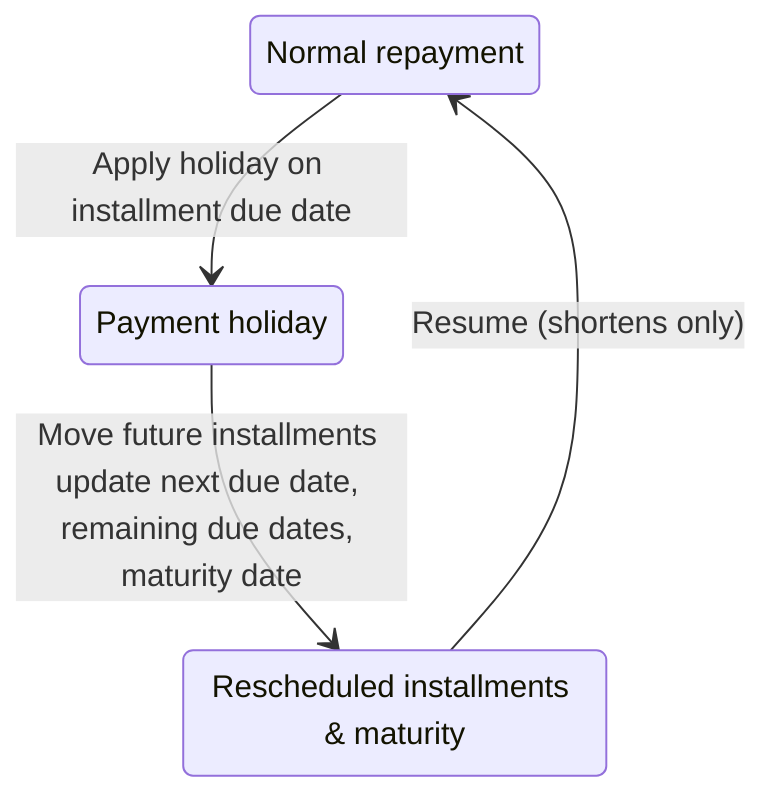

# Payment Holidays

A payment holiday pauses repayments for a set period and moves future installments forward. The system updates the repayment next due date, remaining schedule payment due dates, and maturity date. Delinquency and pause calculations are handled automatically because future installments move with the holiday period.

Rules for applying a payment holiday:

- Apply a payment holiday on an installment due date.
- Do not apply a payment holiday after the maturity date.
- Do not apply a payment holiday on a backdated date; if the date has passed, the system returns an error.
- The down-payment installment is not affected.
- Installments already due are not extended; only future installments are extended.
- Fee and penalty due dates in the future move forward to the next payment due date.
- For multi-disbursement loans where the first down payment is past due and the second down payment is received, apply the payment holiday on the date of the second down payment.
- Account changed events are triggered when payment holidays are applied.

| Holiday length | What the API can update |
| --- | --- |
| 1-month payment holiday | Repayment next due date, remaining schedule payment due dates, maturity date |
| 2-month payment holiday | Repayment next due date, remaining schedule payment due dates, maturity date |
| 2-month payment holiday with past-due installments | Repayment next due date, remaining schedule payment due dates, maturity date |

> **Note:** The N+1 installment is treated as a regular installment while applying the holiday and is rescheduled as per the holiday set.

A four-installment loan is created and disbursed on 1 August with a principal of 1,000.00 and a maturity date of 1 November. Installments of 250.00 are due on 8/1, 9/1, 10/1, and 11/1. A 25% down payment of 250.00 is made on 8/1, so that installment is 0.00 and the remaining principal is 750.00. On 5 August a one-month payment holiday is approved. The figures in this example are illustrative. The down-payment installment stays at 0.00, the remaining installments shift forward by one month, and the maturity date moves to 1 December.

| Step | Date | Event | Installment due | Principal balance |
| --- | --- | --- | --- | --- |
| 1 | 1-Aug | Loan disbursed | — | 1,000.00 |
| 2 | 8/1 | Down payment of 250.00 | 0.00 | 750.00 |
| 3 | 5-Aug | One-month holiday approved; maturity 1-Nov to 1-Dec | — | 750.00 |
| 4 | 10/1 | Installment shifted from 9/1 | 250.00 | 500.00 |
| 5 | 11/1 | Installment shifted from 10/1 | 250.00 | 250.00 |
| 6 | 12/1 | Installment shifted from 11/1 | 250.00 | 0.00 |

The same four-installment loan with a principal of 1,000.00, a 25% down payment of 250.00 on 8/1, and remaining installments of 250.00 due on 9/1, 10/1, and 11/1. On 5 August a two-month payment holiday is approved instead of one month. With a two-month holiday the remaining installments and the maturity date shift forward by two months instead of one.

| Step | Date | Event | Installment due | Principal balance |
| --- | --- | --- | --- | --- |
| 1 | 1-Aug | Loan disbursed | — | 1,000.00 |
| 2 | 8/1 | Down payment of 250.00 | 0.00 | 750.00 |
| 3 | 5-Aug | Two-month holiday approved; maturity 1-Nov to 1-Jan | — | 750.00 |
| 4 | 11/1 | Installment shifted from 9/1 | 250.00 | 500.00 |
| 5 | 12/1 | Installment shifted from 10/1 | 250.00 | 250.00 |
| 6 | 1-Jan | Installment shifted from 11/1 | 250.00 | 0.00 |

A four-installment loan with a principal of 1,000.00 has installments of 250.00 due on 8/1, 9/1, 10/1, and 11/1. The down payment on 8/1 fails, so the principal stays at 1,000.00 and the 8/1 installment remains 250.00. On 5 August a two-month payment holiday is approved while 8/1 is already past due. Installments already due are not extended; only future installments move forward, and the maturity date moves to 1 January.

| Step | Date | Event | Installment due | Principal balance |
| --- | --- | --- | --- | --- |
| 1 | 1-Aug | Loan disbursed | — | 1,000.00 |
| 2 | 8/1 | Down payment fails; installment remains due | 250.00 | 1,000.00 |
| 3 | 5-Aug | Two-month holiday approved; maturity 1-Nov to 1-Jan | — | 1,000.00 |
| 4 | 11/1 | Installment shifted from 9/1 | 250.00 | 1,000.00 |
| 5 | 12/1 | Installment shifted from 10/1 | 250.00 | 1,000.00 |
| 6 | 1-Jan | Installment shifted from 11/1 | 250.00 | 1,000.00 |

A four-installment loan with a principal of 1,000.00 has installments of 250.00 due on 8/1, 9/1, 10/1, and 11/1. The down payment is reversed on 2 August, returning the principal to 1,000.00. An NSF fee of 15.00 is added to the penalty balance, making the 9/1 installment 265.00. A payment of 250.00 on 8/1 brings the principal to 750.00 while the penalty balance stays at 15.00. On 5 August a one-month payment holiday is approved. Future fee and penalty due dates move forward with the installments they attach to, so the 265.00 installment moves from 9/1 to 10/1.

| Step | Date | Event | Installment due | Principal balance | Penalty balance |
| --- | --- | --- | --- | --- | --- |
| 1 | 1-Aug | Loan disbursed | — | 1,000.00 | 0.00 |
| 2 | 2-Aug | Down payment reversed | — | 1,000.00 | 0.00 |
| 3 | 2-Aug | NSF fee of 15.00 applied; 9/1 becomes 265.00 | — | 1,000.00 | 15.00 |
| 4 | 3-Aug | Payment of 250.00 on 8/1 | 0.00 | 750.00 | 15.00 |
| 5 | 5-Aug | One-month holiday approved; maturity 1-Nov to 1-Dec | — | 750.00 | 15.00 |
| 6 | 10/1 | Installment shifted from 9/1 | 265.00 | 500.00 | 0.00 |
| 7 | 11/1 | Installment shifted from 10/1 | 250.00 | 250.00 | 0.00 |
| 8 | 12/1 | Installment shifted from 11/1 | 250.00 | 0.00 | 0.00 |
