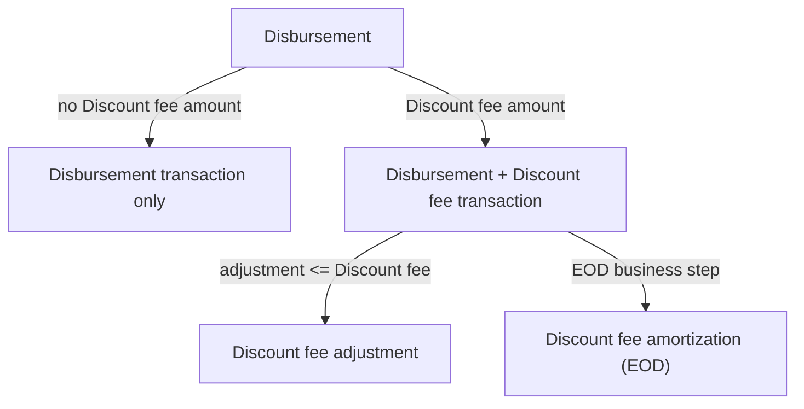

# Buy-Down Fees

## Buy-Down Fees overview

Buy-down fees let merchants collect fees at disbursement and amortize them into interest income over the loan lifecycle. They are a unique transaction type posted to the loan account and are treated as an income portion, either interest or fees income. Buy-down fees apply only to progressive loans and do not affect the loan schedule calculation, recalculation, or interest calculation. They are not visible in customer-facing schedules or statements.

You can add buy-down fees at disbursement through:

- The API.
- The UI.

Buy-down fees on a loan:

- Inherit from the loan product.
- Require buy-down fees to be enabled on the loan product.

## Adding Buy-Down Fees

You can add buy-down fees to a loan after disbursement, once the loan is active. The transaction date can be any date on or after the first disbursement date.

The following fields are supported:

- Payment type, note, and external id are supported.
- The calculation mode comes from configuration, with FLAT as the default and only option.
- The amount you provide is the transaction amount of the buy-down fees.

When you add buy-down fees, the system creates a new transaction of type Buy Down fees for the buy-down fees amount.

## Amortization and income recognition

Buy-down fees amortize daily like capitalized income to recognize deferred income over the life of the loan. The system keeps a current deferred fee balance at the loan level and tracks how much of it has been amortized and how much remains.

Amortization rules:

- Buy-down fees support equal amortization and formula-based amortization, based on the configured amortization strategy.
- Equal amortization divides the fee by the number of days between the buy-down fee date and the loan maturity date.
- Formula-based amortization divides the not yet amortized capitalized income by the number of days between the current date and the loan maturity date.
- The system rounds the calculated amount using the configured rounding mode.
- Daily recognition creates a Buy Down fee Amortization transaction for each daily interest recognition and triggers a new business event.
- The GL mapping used depends on whether the fee is configured as Fee or Interest.

Early payoff and corrections:

- If the loan is preclosed, the system recognizes all remaining not yet amortized income as income in one shot.
- If more deferred income is recognized at end of day than should be, a Buy Down fee amortization Adjustment transaction can correct the amount.
- Once a loan is paid off, no reversal undoes the realized income.

## Buy-Down Fees Adjustment

A buy-down fee adjustment adjusts or credits the deferred income of an existing buy-down fee transaction. It works as a credit transaction that reduces the buy-down fees balance from amortization and has no impact on the loan balance.

Rules for creating a buy-down fee adjustment:

- You can add a buy-down fee adjustment to the loan account through API or UI.
- You can invoke an adjustment only on an existing buy-down fee transaction.
- The adjustment transaction date cannot be earlier than the original transaction date.
- The total adjustment amount cannot exceed the original transaction amount.
- Multiple adjustments are allowed on the same original buy-down fee transaction.
- The created adjustment transaction lists relations with relation type ADJUSTMENT between the original buy-down fee transaction and the adjustment transaction.
- Creating an adjustment updates the related buy-down fee balance by adding the amount to amountAdjustment.
- Buy-down fee adjustment can be done backdated.
- There is no allocation strategy for buy-down fees adjustment.

Rules for reversing a buy-down fee adjustment:

- A not yet reversed buy-down fee adjustment transaction can be reversed.
- Mirror journal entries are passed for the reversal entry of a reversed buy-down fee adjustment transaction.
- Reversing an adjustment updates the related buy-down fee balance by subtracting the amount from amountAdjustment.

Accounting behaviour:

| Behaviour | Detail |
| --- | --- |
| Accounting entries | Work like a mirror of buy-down fees entries. |
| Loan balance impact | None. |

## Reversing Buy-Down Fees

You can reverse a Buy Down fees transaction only if no unreversed Buy Down fees Adjustment belongs to it. Reversing it deletes the related buy down fee balance and corrects all already amortized amounts through a Buy Down fees amortization adjustment transaction that uses mirror journal entries of Buy Down fees amortization.

## Charge-off and payoff

When a loan balance is charged off, any balance in deferred income is charged off as well. Charge-off also charges off the Buy Down fees, and no daily amortization occurs after the charge-off date. The system calculates the amount that should already have been amortized and corrects any differences with normal amortization journal entries.

Charge-off processing:

- Move any not yet recognized balance to Charge-off and create final amortization with journal entries.
- Create a relation (RELATED) between the charge-off final amortization transaction and the charge-off transaction.

Undoing a charge-off does not undo the amortization transaction because it is a catch-up. Instead, undo charge-off undoes the charge-off final amortization transaction and adjusts accounting entries.

## Accounting entries

Buy-Down fees accounting entries depend on whether the loan is merchant or non-merchant lending. For non-merchant loans, the system uses the Fund Source parameter mapped GL for accounting because the EXPENSE parameter is hidden.

Accounting entries for non-merchant Buy-Down fees:

| Entry type | Debit | Credit |
| --- | --- | --- |
| Initial fee posting | Parameter Buy Down fees Expense (Type: EXPENSE, GL: buydown expense) | Parameter Deferred Income mapping (Type: Liability, GL: Deferred Income) |
| Buy Down fees | Parameter Fund Source Type ASSET GL cash at hand | Parameter Deferred Income mapping Type Liability GL Deferred Income |
| Buy Down fees amortization | Parameter Deferred Income mapping Type Liability GL Deferred Income | Parameter Buy Down fees Amortization Type Income GL Interest/fees Income |
| Buy Down fees amortization in charge-off | Parameter Deferred Income mapping Type Liability GL Deferred Income | Charge-off expense/charge-off expense-bad dept GL credit loss-bad dept/credit loss-bad dept-fraud |
| Buy Down fees Adjustment | Parameter Deferred Income mapping Type Liability GL Deferred Income | Parameter Fund Source Type ASSET GL cash at hand |

Accounting entries for preclose pay-off and write-off:

| Entry type | Debit | Credit |
| --- | --- | --- |
| Preclose pay-off | Parameter Deferred Income mapping (Type: Liability, GL: Deferred Income) | Parameter Buy Down fees Amortization (Type: Income, GL: Interest/fees Income) |
| Preclose write-off | Parameter Deferred Income mapping (Type: Liability, GL: Deferred Income) | Parameter Losses written off (Type: Expense, GL: Written off) |

## Loan product configuration

Buy Down fees configuration at the loan product level includes status Enable, calculation mode FLAT, strategy EQUAL_AMORTIZATION (default), and income type FEE (default) or INTEREST. When Buy Down fees is enabled on a loan product, new GL account mappings are added for periodical accounting: an Expense account named Buy Down Expense and an Income account named Buy Down fees Amortization. Both accounts are available only for progressive loans if Buy Down fees is enabled.

Buy Down fees GL account mappings on a loan product.

| Account | Type | Purpose |
| --- | --- | --- |
| Buy Down Expense | Expense | Periodical accounting |
| Buy Down fees Amortization | Income | Periodical accounting |

Configuration behaviour:

- Mandatory fields apply when Buy Down fees is enabled.
- New mappings are returned as part of loan product details.
- Mappings can be updated during loan product update.

## Balance tracking and events

The system tracks Buy Down fees balances on a loan and on each Buy Down fees transaction. The database stores the loan link, the Buy Down fees transaction link, the Buy Down fees amount, the date of Buy Down fees, not yet recognized income, charged-off Buy Down fees amount, and adjustment Buy Down fees amount.

Fineract triggers external business events for these Buy Down fees events:

- Adding Buy Down fees to the loan triggers a NEW Buy Down fees transaction event.
- Adjusting existing Buy Down fees triggers a NEW Buy Down fees Adjustment transaction event.
- Buy Down fees amortization triggers a NEW Buy Down fees Amortization transaction event.
- Reversal of Buy Down fees or adjustment transaction triggers the EXISTING LoanTransactionAdjustment event.
- End-of-day Buy Down fees amortization adjustment triggers a NEW transaction event.

An API fetches Buy Down fees information including:

- Buy down fee amount
- Transaction
- Amortized amount
- Not yet amortized amount
- Adjusted amount

The Template API for Buy Down Fee transaction retrieves:

- The maximum amount allowed.
- The maximum amount allowed to be adjusted on the loan.

## Discount fee

A Discount fee is a Buy-Down fee charged at disbursement. The command to add Buy-Down fees is buyDownFee.

Rules for a Discount fee transaction:

- A Discount fee transaction requires a transaction amount, default value, classification, and payment type.
- A Discount fee must occur on the same day as the disbursement.
- Only one Discount transaction is allowed per disbursement, and the system relates it to that disbursement.
- A disbursement without a Discount fee amount creates one disbursement transaction.
- A disbursement with a Discount fee creates one disbursement transaction and one Discount fee transaction together, and no additional Discount fee can be added.

Rules for a Discount fee adjustment:

- The adjustment amount cannot be more than the Discount fee.
- A Discount fee adjustment requires classification and payment type.
- A Discount fee adjustment behaves like capitalized income adjustment.

What the system stores and updates:

- The Discount transaction is stored in the transaction table, allocations in the allocation table, accounting entries are created from the allocation, balances are stored in the balances table and updated after the transaction, and external business events are triggered.

## Validation and implementation notes

When you reverse a Buy Down fees transaction, COB handles the Buy Down fees amortization adjustment transaction.

## Worked examples

A progressive loan of 1,000 is disbursed on 1 January at a 12% annual interest rate with 30-day months and three monthly installments. A buy-down fee of 180 is posted at disbursement as deferred income; the figures are illustrative. The fee does not alter the repayment schedule or interest calculation. It creates a deferred income balance of 180 that is amortized in equal daily portions of 2.00 over the 90 days from disbursement to maturity, so each 30-day month recognizes 60.00 of fee income. The repayment schedule is identical to a loan without a buy-down fee; only the deferred income balance changes.

| Date | Event | Loan balance | Deferred income | Fee income |
| --- | --- | --- | --- | --- |
| 1 January | Disbursement of 1,000.00 | 1,000.00 | 0.00 | 0.00 |
| 1 January | Buy-down fee of 180.00 posted | 1,000.00 | 180.00 | 0.00 |
| 1 February | Repayment 339.99; 30 days of fee amortization | 670.01 | 120.00 | 60.00 |
| 1 March | Repayment 339.99; 30 days of fee amortization | 336.72 | 60.00 | 60.00 |
| 1 April | Final repayment 340.09; 30 days of fee amortization | 0.00 | 0.00 | 60.00 |
| Totals |  |  |  | 180.00 |

The same loan of 1,000 with a 180 buy-down fee is repaid early on 1 March, two months before maturity. The repayment schedule runs normally through 1 February. On the payoff date, the remaining deferred income of 60.00 is recognized in full as income; no further daily amortization occurs and no reversal is made after payoff.

| Date | Event | Loan balance | Deferred income | Fee income |
| --- | --- | --- | --- | --- |
| 1 January | Disbursement of 1,000.00 and fee of 180.00 | 1,000.00 | 180.00 | 0.00 |
| 1 February | Repayment 339.99; 30 days of fee amortization | 670.01 | 120.00 | 60.00 |
| 1 March | Payoff of 676.71; 30 days of fee amortization plus remaining 60.00 | 0.00 | 0.00 | 120.00 |
| Totals |  |  |  | 180.00 |

The same loan of 1,000 with a 180 buy-down fee is charged off on 1 March after the February repayment. Daily amortization stops on the charge-off date. The remaining deferred income of 60.00 is moved to charge-off expense in a single entry; if the charge-off is later reversed, only the charge-off final amortization is undone, while earlier catch-up amortization entries remain.

| Date | Event | Loan balance | Deferred income | Fee income |
| --- | --- | --- | --- | --- |
| 1 January | Disbursement of 1,000.00 and fee of 180.00 | 1,000.00 | 180.00 | 0.00 |
| 1 February | Repayment 339.99; 30 days of fee amortization | 670.01 | 120.00 | 60.00 |
| 1 March | Charge-off of 670.01; 30 days of fee amortization plus remaining 60.00 charged off | 670.01 | 0.00 | 120.00 |
| Totals |  |  |  | 180.00 |

A buy-down fee of 180 is posted on 1 January. On 1 March, a credit adjustment of 40.00 is applied to that same fee transaction. The adjustment reduces the deferred income balance by 40.00 and leaves the loan balance unchanged. Multiple adjustments are permitted, but their total cannot exceed the original fee amount, and an adjustment cannot be dated before the original fee.

| Date | Event | Original fee | Adjustment | Deferred income | Loan balance |
| --- | --- | --- | --- | --- | --- |
| 1 January | Buy-down fee posted | 180.00 | 0.00 | 180.00 | 1,000.00 |
| 1 March | Credit adjustment of 40.00 | 180.00 | 40.00 | 140.00 | 1,000.00 |
