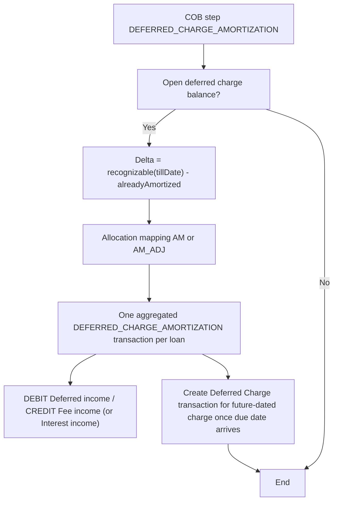
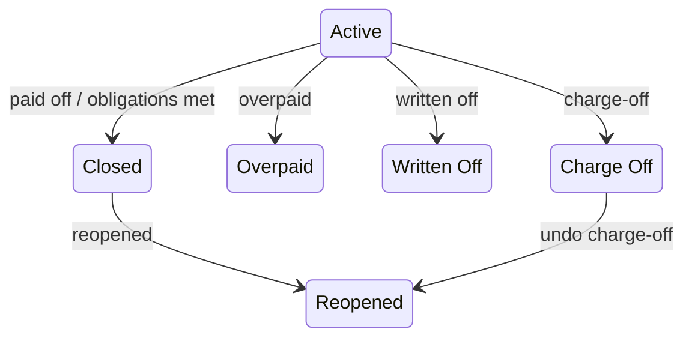

# Charge Amortization

## Charge amortization overview

Charge amortization spreads certain loan charge income over the loan term instead of recognizing it all at once. It applies to charges such as origination, arrangement, and processing fees that accounting standards require to be deferred and recognized as a yield adjustment.

Today Fineract recognizes charge income depending on the product's accounting rule: ACCRUAL_PERIODIC accrues periodically, ACCRUAL_UPFRONT accrues fully at disbursement, CASH_BASED is recognized when paid, and NONE creates no journal entries. None of today's accounting rules can spread a fee's income over the loan term or over a fixed number of days independently of when the fee is due or paid.

Default NONE everywhere; existing charges, products and loans behave the same, no data migration is needed, and API changes only add fields.

## Eligibility and supported charges

Charge amortization applies only to progressive loans (advanced-payment-allocation-strategy) and only to loan fees. Eligible charge time types are DISBURSEMENT, TRANCHE_DISBURSEMENT and SPECIFIED_DUE_DATE. It does not apply to cumulative loans, installment or overdue fees, or savings charges, and it does not recalculate historical periods under the effective rate method.

## Charge amortization configuration

Each charge can have an amortization schedule. A loan charge definition sets an amortization period type of NONE (default), FULL_LOAN_TERM or NUMBER_OF_DAYS; NUMBER_OF_DAYS requires a positive integer amortization days value. It also sets an amortization calculation type of FLAT (default) or EFFECTIVE_RATE, and an amortization income type of FEE (default) or INTEREST. The charge definition's amortization configuration is copied onto the loan charge when the loan charge is created; later changes to the charge definition do not affect existing loan charges.

Charge amortization applies to a loan product only when its enable charge amortization flag is on.

- The flag defaults to false.
- Charge amortization is allowed with ACCRUAL_PERIODIC, ACCRUAL_UPFRONT and NONE, and rejected for CASH_BASED.
- A product can optionally override the charge-level amortization configuration for each attached charge.

Amortization period type options.

| Period type | Requirement |
| --- | --- |
| NONE | Default; no amortization days value required. |
| FULL_LOAN_TERM | No amortization days value required. |
| NUMBER_OF_DAYS | Requires a positive integer amortization days value. |

Amortization calculation and income type options.

| Type | Options | Default |
| --- | --- | --- |
| Calculation type | FLAT or EFFECTIVE_RATE | FLAT |
| Income type | FEE or INTEREST | FEE |

## Accounting rules and journal entries

When you apply an amortized charge, its full amount goes to deferred income liability and the receivable is booked against it. Daily amortization moves income from deferred income into income. Accrual does not recognize income for an amortized charge, so income is never counted twice. Amortized charges are excluded from all accrual processing: periodic, upfront, accrual adjustment, accrual activity, and accrual on closure or charge-off.

Journal entries for amortized charges:

| Event | Debit | Credit |
| --- | --- | --- |
| Charge becomes effective | Fee receivable | Deferred income |
| Daily amortization | Deferred income | Fee income or Interest income |
| Amortization reversal | Fee income or Interest income | Deferred income |
| Repayment of the charge | Fund source | Fee receivable |
| Waiver or charge adjustment | Deferred income | Fee receivable |
| Closure (paid off or overpaid) | Deferred income | Fee income or Interest income |
| Closure (written off) | Deferred income | Losses written off |
| Charge-off | Deferred income | Charge-off expense, fraud expense, or the account mapped to the reason |

Transaction types and their journal lines:

| Transaction type | Debit | Credit |
| --- | --- | --- |
| DEFERRED_CHARGE | FEES_RECEIVABLE | DEFERRED_INCOME_LIABILITY |
| DEFERRED_CHARGE_AMORTIZATION (not charged off) | DEFERRED_INCOME_LIABILITY | INCOME_FROM_FEES or the income account mapped to the charge, or INTEREST_ON_LOANS; LOSSES_WRITTEN_OFF if the loan is written off |
| DEFERRED_CHARGE_AMORTIZATION (charged off) | DEFERRED_INCOME_LIABILITY | The account mapped to the charge-off reason, otherwise CHARGE_OFF_EXPENSE or CHARGE_OFF_FRAUD_EXPENSE |
| DEFERRED_CHARGE_AMORTIZATION_ADJUSTMENT | Fee income or interest income | DEFERRED_INCOME_LIABILITY |
| WAIVE_CHARGES or CHARGE_ADJUSTMENT on an amortized charge | DEFERRED_INCOME_LIABILITY | FEES_RECEIVABLE |
| Repayment (fee portion) | Fund source | FEES_RECEIVABLE |

All posting rules go in AccrualBasedAccountingProcessorForLoan. With accrual accounting, the product must have GL mappings for fee receivable, deferred income liability, fee income, and interest income if any attached charge uses income type INTEREST. When a loan has several amortized charges, their amounts are combined into one transaction per day; the amount per charge stays traceable through allocation mappings, the read API, and fee income accounts mapped to individual charges.

## Amortization calculation methods

Two calculation methods amortize charge amounts over the amortization window: FLAT and EFFECTIVE_RATE. FLAT spreads the amount evenly by day over the window. EFFECTIVE_RATE uses a level-yield method based on the loan's contractual cash flows and amortizes all effective-rate charges on a loan as one group before splitting the result back to each charge.

FLAT rules:

- Waivers and adjustments reduce the amount still to recognize from their date onward.
- A change in maturity spreads the remaining amount over the days left.
- Recognizable(tillDate) equals the sum over adjustment segments of `unrecognized_at_segment_start * days_in_segment / days_from_segment_start_to_window_end`.

EFFECTIVE_RATE rules:

- The starting net carrying amount N0 equals disbursed principal minus the sum of effective-rate charge amounts collected at t0; charges collected later count as cash inflows on their due dates.
- Contractual cash flow CFi equals principal plus interest plus any effective-rate charge portion due on each installment date ti, taken from the progressive schedule model.
- The rate r is solved such that `sum(CFi / (1+r)^(di/365)) = N0`, using Newton–Raphson with bisection fallback, following the product's days-in-year setting.
- For period k, EIR income k equals `C k-1 * ((1+r)^(days k/365) - 1)`, amortization k equals EIR income k minus contractual interest k, and `C k = C k-1 + EIR income k - CF k`.

## Amortization window and timing

The amortization window runs from the balance date to either window_end_date or the loan's current maturity date, whichever comes first. A NUMBER_OF_DAYS window ends at min(start + X, maturity). A COB run for business date D recognizes income through the end of D, using tillDate + 1 as the exclusive end.

## Daily COB amortization

Charge amortization recognizes the portion of deferred income as income each day at close of business (COB), the nightly job that posts interest and fees. The system keeps the fee balance during amortization and creates one aggregated Deferred Charge Amortization transaction per loan at end of day (EOD).

## Transaction types and balancing

The system calculates the difference between the discount fee amortization balance on the schedule and the total discount fee amortization transactions minus total discount fee amortization adjustment transactions. A positive difference creates a Discount fee amortization transaction for the difference amount. A negative difference creates a Discount fee amortization adjustment transaction for the difference amount. When the difference is zero, no transaction is created. At end of day, the system recalculates and posts any difference as of the current date. When a loan is fully paid or overpaid, the system creates the transaction immediately and updates realized and unrealized discount fee income balances.

| Difference | Transaction created |
| --- | --- |
| Positive | Discount fee amortization transaction |
| Negative | Discount fee amortization adjustment transaction |
| Zero | No transaction |

## Closure, charge-off, sale, and reopening

When a loan closes, is overpaid, is written off, is sold or transferred to an external asset owner, or is reopened, the remaining deferred charge balance is recognized or released according to the event.

Closure and overpayment:

- When the loan reaches closed obligations met or overpaid, the remaining deferred balance is recognized in one shot on the closed or overpaid date.
- When written off, the remaining amount is released and credited to Losses written off.
- When reopened after closure, the next run recalculates against the real window and reverses any over-recognized income.

Charge-off:

- Before charge-off, amortization catches up to the business date.
- On charge-off, the remaining amount is released linked to the charge-off with RELATED; charged_off_amount equals unrecognized_amount, then unrecognized_amount becomes 0.
- The credit goes to charge-off expense, charge-off fraud expense, or the account mapped to the charge-off reason.

Sale or transfer:

- When an external asset owner sale or transfer settles, the remaining balance is recognized on the settlement date.

Undo disbursement:

- Undoing disbursement reverses or removes all Deferred Charge transactions, amortizations and balances.

Business events:

- Before LoanCloseBusinessEvent, release on closure without journal entries.
- After LoanBalanceChangedBusinessEvent, release on closure with journal entries.
- Before LoanChargeOffPreBusinessEvent, catch up to the business date.
- After LoanChargeOffPostBusinessEvent, release linked to the charge-off.
- After LoanUndoChargeOffBusinessEvent, reverse the release and restore the balance.

## Waivers, adjustments, deletions, and reversals

When a charge is waived or adjusted, amount_adjustment grows from that date, amortization is recalculated, and income already recognized above the new amount is reversed with AM_ADJ. When a loan charge is deleted or inactivated, the DEFERRED_CHARGE transaction is reversed and the balance is marked deleted; all recognized income is reversed with AM_ADJ, then the balance is closed. For a backdated repayment or reversal (replay), there is no effect for FLAT; EFFECTIVE_RATE is recalculated only if the cash flows changed.

## Reschedule, re-age, and maturity changes

A reschedule, re-age, re-amortization, or maturity change sets the full loan term to the new maturity, leaves the number of days unchanged except for the maturity cap, and recalculates the effective rate going forward using the current carrying amount, the unrecognized balance, and the remaining cash flows.

## Discount fee amortization

Discount fee amortization applies to discount fee transactions at disbursement, after disbursement on the effective disbursement date, or when disbursement and discount fee occur in one transaction.

Adjustments follow these rules:

- You can make partial adjustments multiple times until the remaining amount reaches zero.
- An adjustment greater than the remaining amount is rejected.
- You can backdate an adjustment or undo it.
- You can undo a discount fee adjustment on a repaid or closed loan.

## Database schema and indexes

The m_loan_deferred_charge_balance table has an index on (loan_id, is_closed). The m_loan_amortization_allocation_mapping table is reused unchanged.

## Business events and listeners

The LoanDeferredChargeAmortizationEventService mirrors LoanCapitalizedIncomeAmortizationEventService and handles charge amortization events for loans. Each listener first checks that enableChargeAmortization is on and that the loan has open balances.

## Events and permissions

Business events and Avro schemas exist for every new transaction type and are registered in the external event configuration, where they are disabled by default. The new read endpoints use the existing READ_LOAN permission; configuration changes use the existing charge and loan product permissions.

## Read API endpoints

Use these endpoints to read charge amortization data for a loan. POST/PUT /charges and GET /charges/template add amortizationPeriodType, amortizationDays, amortizationCalculationType, amortizationIncomeType and the template options. POST/PUT /loanproducts adds enableChargeAmortization and the accounting mapping validation.

Charge-level endpoints:

- GET /loans/{loanId}/deferred-charges returns the balance per charge: amount, adjustment, recognized, unrecognized, charged-off, window, and configuration.
- GET /loans/{loanId}/deferred-charges/{loanChargeId}/amortization-schedule returns projected and actual amortization rows per installment period for one charge.

## Worked examples

A progressive loan is disbursed on day 1 with a 120-day term (four 30-day months). A disbursement fee of 1,200.00 is configured with amortization period type FULL_LOAN_TERM, calculation type FLAT, and income type FEE. The figures are illustrative. When the charge is applied, a DEFERRED_CHARGE transaction debits FEES_RECEIVABLE 1,200.00 and credits DEFERRED_INCOME_LIABILITY 1,200.00, and the fee is repaid the same day by debiting the fund source and crediting FEES_RECEIVABLE 1,200.00. Each COB run books a DEFERRED_CHARGE_AMORTIZATION of 10.00 per day (1,200.00 divided by 120 days), debiting DEFERRED_INCOME_LIABILITY and crediting INCOME_FROM_FEES. Amounts are cumulative, so the entry for any date equals recognizable income to date minus income already amortized, which prevents rounding drift. If the loan is paid off before maturity, the remaining deferred balance is released in one shot on the closure date. With NUMBER_OF_DAYS instead of FULL_LOAN_TERM, the window ends at the earlier of the configured day count or maturity, so the daily amount is larger and recognition stops earlier.

The example shows that the full deferred amount is recognized by maturity or early closure, with any unrecognized balance released in one shot when the loan is paid off.

| Business date | Event | Debit | Credit | Cumulative fee income | Unrecognized deferred balance |
| --- | --- | --- | --- | --- | --- |
| Day 1 | Charge applied (DEFERRED_CHARGE) | FEES_RECEIVABLE 1,200.00 | DEFERRED_INCOME_LIABILITY 1,200.00 | 0.00 | 1,200.00 |
| Day 1 | Fee repaid | Fund source 1,200.00 | FEES_RECEIVABLE 1,200.00 | 0.00 | 1,200.00 |
| Day 1 | Daily amortization | DEFERRED_INCOME_LIABILITY 10.00 | INCOME_FROM_FEES 10.00 | 10.00 | 1,190.00 |
| Day 30 | Daily amortization (days 2–30) | DEFERRED_INCOME_LIABILITY 290.00 | INCOME_FROM_FEES 290.00 | 300.00 | 900.00 |
| Day 60 | Daily amortization (days 31–60) | DEFERRED_INCOME_LIABILITY 300.00 | INCOME_FROM_FEES 300.00 | 600.00 | 600.00 |
| Day 90 | Daily amortization (days 61–90) | DEFERRED_INCOME_LIABILITY 300.00 | INCOME_FROM_FEES 300.00 | 900.00 | 300.00 |
| Day 91 | Loan paid off — one-shot release | DEFERRED_INCOME_LIABILITY 300.00 | INCOME_FROM_FEES 300.00 | 1,200.00 | 0.00 |
