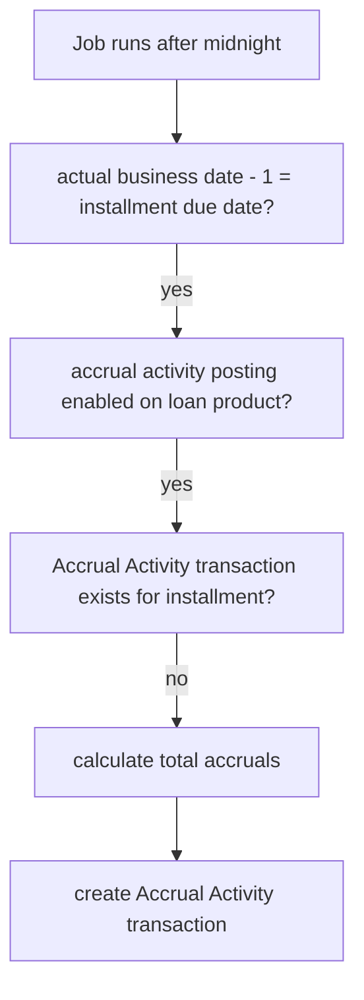

# Accrual Activity on Installment Dates

## Accrual activity transaction

The accrual activity transaction is a non-monetary transaction posted on each installment due date for active loans. It records the income portion amount, such as interest, fees and penalties income, without creating accounting entries or changing balances or the repayment schedule. The system throws an accrual activity event when the transaction is created, using LoanTransactionDataV1.

The system handles accrual activity transactions as follows:

- If a loan is pre-closed, one accrual activity entry is posted as of the last transaction date.
- If a pre-closed loan is reopened due to a new disbursement or chargeback, accrual activity is created for the next installments up to the current date, with interest calculated from the previously posted accrual activity on the earlier preclose date.
- If a loan is fully paid or overpaid earlier than planned, a final accrual activity transaction is created that includes all income portions up to that date.
- If a closed loan is reopened, the previously created accrual activity transaction is found and reverted.
- If a loan is closed, the final accrual activity transaction can be created by listening to the loan status changed event.

Reverse and replay behaviour:

- The accrual activity transaction is reversed and replayed whenever the income portion amount changes during schedule recalculations, such as reversal of an older repayment.
- The system stores and sends both the previous and new income portion values during reverse and replay.
- During transaction and charge reprocessing, if accrual balances change on the installment, the original accrual activity transaction is reverted and a new transaction is created.

Scope:

- Accrual activity creates a new transaction type at each installment level within the total interest accrued for that installment period.

## Enabling accrual activity

Accrual activity transaction posting is configured at loan product level. It is available only when accrual accounting is enabled, and the accrual activity posting job is disabled by default.

| Loan product | Interest recalculation | Accrual activity posting |
| --- | --- | --- |
| PIN30_INTEREST_DECLINING_BALANCE_DAILY_RECALCULATION_COMPOUNDING_NONE_ACCRUAL_ACTIVITY | Enabled | Enabled |

## Accrual activity posting job

The accrual activity posting job runs after midnight, around 2AM, after the Apply penalty to overdue loans job. It runs only for loans whose loan product has accrual activity posting enabled. For each such loan, the job checks whether actual business date minus 1 day equals the due date of any installment. If it finds such an installment and no Accrual Activity transaction exists for that installment, it calculates the total accruals of that installment and creates a new transaction.

## Worked examples

An active loan of 1,000 carries an annual interest rate of 12% and is repaid in 3 equal monthly installments over 30-day months; the figures are illustrative. Each month’s interest income portion is 10.00. On every installment due date, the system posts one non-monetary accrual activity transaction for that income portion. The entry is created only because the loan is active on the due date. It does not create accounting entries, does not change the principal balance, and does not alter the repayment schedule. An accrual activity event is emitted using LoanTransactionDataV1 when the transaction is created. This example shows that accrual activity posts the income portion on each due date as a non-monetary transaction while leaving the balance and schedule unchanged.

| Due date | Interest income portion | Accrual activity posted | Principal balance after entry |
| --- | --- | --- | --- |
| 30 | 10.00 | 10.00 | 1,000.00 |
| 60 | 10.00 | 10.00 | 1,000.00 |
| 90 | 10.00 | 10.00 | 1,000.00 |

A 1,000 loan at 12% annual interest with 3 monthly installments over 30-day months is pre-closed on the first installment due date. The system posts a single accrual activity entry as of that last transaction date, covering the income portion due up to then. If the loan is re-opened after a new disbursement or chargeback, that entry is reverted and accrual activity is recreated for the remaining installments up to the current date, with interest calculated from the accrual activity posted on the pre-close date. With a 360-day year, half a month of interest on 1,000 is 5.00. This example shows that pre-closure produces one final accrual entry, while re-opening reverts it and accrues interest from the pre-close basis.

| Step | Date | Action | Accrual activity amount | Principal balance | Loan status |
| --- | --- | --- | --- | --- | --- |
| 1 | Day 0 | Disbursement | - | 1,000.00 | Active |
| 2 | Day 30 | Installment 1 due; accrual posted | 10.00 | 1,000.00 | Active |
| 3 | Day 30 | Pre-closure; final entry as of last transaction date | 10.00 | 1,000.00 | Pre-closed |
| 4 | Day 45 | Re-opened; prior entry reverted, new accrual posted | 5.00 | 1,000.00 | Active |

If the 1,000 loan is fully paid on day 45, before the last installment is due, the system creates a final accrual activity transaction that includes all income portions up to that date, totaling 15.00. If the loan is re-opened, that final entry is reverted. When a schedule recalculation changes an income portion, the original accrual activity transaction is reversed and replayed; the transaction carries both the previous and new income values, creates no accounting entries, and leaves balances unchanged. This example shows that early payoff triggers a final cumulative accrual entry, and that income portion changes are handled by reverse and replay with both values preserved.

| Step | Date | Action | Accrual activity amount | Previous value | New value | Principal balance |
| --- | --- | --- | --- | --- | --- | --- |
| 1 | Day 0 | Disbursement | - | - | - | 1,000.00 |
| 2 | Day 30 | Installment 1 due; accrual posted | 10.00 | - | - | 1,000.00 |
| 3 | Day 45 | Early payoff; final accrual posted | 15.00 | - | - | 1,000.00 |
| 4 | Day 45 | Income portion recalculated; original reversed and replayed | 12.00 | 15.00 | 12.00 | 1,000.00 |
