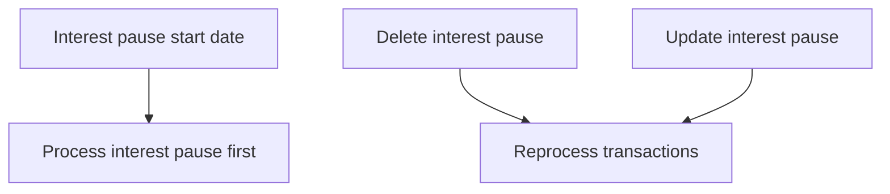

# Pausing and Resuming Accruals

## About interest pause

Interest pause stops interest from accruing for a configured number of days and works like an interest-free period. It applies only to progressive loans with recalculate interest set to true. Interest pause is not the same as grace interest, where interest accrues even though it is not collected and accumulates for future installments.

## Eligibility and timing

You can pause interest accrual on an active loan between any dates in the loan life cycle using a start date and an end date. The start date cannot be on or after the maturity date.

Conditions for pausing interest:

- The loan must be active.

## Pause period dates

An interest pause period needs both a start date and an end date. The start date is inclusive and the end date is inclusive for interest pause calculation. If the start date equals the end date, interest is paused for only that day. The end date cannot be earlier than the start date or later than the actual maturity date.

## How interest pause works

While an interest pause is active, no interest is calculated for the days the pause covers.

The pause is modeled as two interest rate changes:

- Interest rate changes to 0 from the pause start date, inclusive.
- Interest rate changes back to the original rate from the pause end date, inclusive.

## Multiple pauses and overlap

You can pause interest multiple times during a loan life cycle, but pause periods cannot overlap.

## Backdated pauses and recalculation

You can set a backdated start date for an interest pause. If repayments fall between the backdated start date and the pause date, those repayments are reversed and replayed, and any difference in interest recognition is adjusted at the next close of business (COB), the nightly job that posts interest and fees.

## Resume behavior

When you resume an interest pause, interest accrual restarts at the loan's defined interest rate with the next close of business (COB) processing.

## Installments and charges

During an interest pause, the EMI amount stays the same. Charges based on interest are recalculated with 0 interest, while charges independent of interest remain unchanged. Penalties based on late payment of interest become 0. Charges calculated as a percentage of amount, percentage of principal amount, or flat charges are not affected by an interest pause.

The last unpaid installment amount might be lower because of lower interest from the interest pause.

- The last unpaid installment amount might be lower due to lower interest from the interest pause.

Updating or deleting an interest pause resets interest-based charges.

- Update and delete of an interest pause reset interest based charges.

Charge and penalty reversal rules:

- Charge/penalties added do not have any impact from interest pause.
- Only charge/penalties created based on % interest will be reversed and replayed based on new interest.
- The charge calculated based on interest should be recalculated based on new interest when a pause is applied.

## Accrual transactions

The system posts no accrual transaction for interest during the pause period.

## Pay-off, charge-off, and reschedule

The interest pause calculation stays the same for pay-off, charge-off, and reschedule calculations.

## Database model

The database stores interest pauses in the m_loan_term_variations table, reusing the existing loan term model with the term type INTEREST_PAUSE. Audit fields record who created or updated each row and when.

Each interest pause row has these fields:

| Field | Value | Required |
| --- | --- | --- |
| loan_id | ID of the loan | not null |
| term_type | INTEREST_PAUSE | not null |
| applicable_date | Start date of the pause | not null |
| date_value | End date of the pause | not null |
| decimal_value | NULL | NULL |
| is_specific_to_installment | FALSE | FALSE |
| is_active | Boolean | not null, indexed |
| applied_on_loan_status | 300 (ACTIVE) | not null |
| parent_id | NULL | NULL |
| created by | User who created the row | audit field |
| created on date | Date the row was created | audit field |
| updated by | User who last updated the row | audit field |
| updated on date | Date the row was last updated | audit field |

## UI display

Interest pauses appear under the Term variations tab in a new group named Interest pauses. Term variations are grouped by term type, such as Interest pauses and Due date.

Each interest pause entry shows:

- The start date of the pause period.
- The end date of the pause period.
- The number of days, calculated as end date minus start date plus one.

## UI actions

You add an interest pause from the action menu in the top right corner under the More submenu. On the Term variations tab, you can modify and delete existing interest pause periods. Deleting an interest pause requires confirmation.

## Event processing

The system processes interest pauses as events on the start date, and the interest pause is the first event processed on that date.

The system reprocesses transactions to reflect changes when you:

- delete an interest pause
- update an interest pause

## Create interest pause

Use POST /v1/loans/{loanId}/interest-pauses or POST /v1/loans/external-id/{loanExternalId}/interest-pauses. The response returns HTTP 200 with a resourceId representing the loan term variations id.

The request body contains these mandatory fields:

- startDate
- endDate
- dateFormat
- locale

The system rejects invalid dates as follows:

- A date that does not match the dateFormat and locale returns HTTP 400 indicating the parameter is invalid.
- A start date earlier than the loan start date returns HTTP 403 with the message Interest pause start date cannot be earlier than loan start date.
- An end date later than the loan maturity date returns HTTP 403 with the message Interest pause end date cannot be later than loan maturity date.
- An end date not later than the start date returns HTTP 403 with the message Interest pause end date must be later than the interest pause start date.

## List interest pauses

List interest pauses for a loan using either its internal ID or its external ID. Results are ordered by start date, oldest first.

Endpoints:

- GET /v1/loans/{loanId}/interest-pauses
- GET /v1/loans/external-id/{loanExternalId}/interest-pauses

Each pause returns:

- id
- startDate
- endDate
- dateFormat
- locale

Interest pause periods also appear in the loan details response GET /v1/loans/{loanId} when association=all and in the loan details business event.

## Update interest pause

Use PUT /v1/loans/{loanId}/interest-pauses/{loan-term-variation-id} to update an existing interest pause. The request body includes startDate, endDate, dateFormat, and locale. The response body includes resourceId and changes, where changes may include endDate if the end date changed.

## Delete interest pause

Deleting an interest pause is a logical deletion. Use DELETE /v1/loans/{loanId}/interest-pauses/{loan-term-variation-id} with no request body.

The API returns:

- A successful deletion returns HTTP 204 with no response body.
- Deleting a non-existent interest pause returns HTTP 404.
- Deleting an interest pause on a closed loan returns HTTP 403 with the message Loan is not active.

## Pause formula conditions

| Condition 1 | Condition 2 | Condition 3 | Result |
| --- | --- | --- | --- |
| TRUE | TRUE | FALSE | TRUE |
| TRUE | FALSE | TRUE | TRUE |
| FALSE | FALSE | FALSE | FALSE |

## Worked examples

This example shows an interest pause inside a single accrual period. The figures are illustrative: a progressive loan with recalculate interest set to true has a principal of 1,000, an annual interest rate of 12 percent, three monthly installments, 30-day months, and a 360-day year. The loan is disbursed on the first day of month one and installments fall due on the first day of months two, three, and four. A pause runs from the sixth to the tenth day of month two, so five days are paused and interest accrues on the remaining twenty-five days of that period. The pause start date is inclusive, the end date is inclusive, and interest resumes on the day after the end date. The EMI does not change during the pause.

| Period | Opening balance | Paused days | Eligible days | Interest | EMI | Principal repaid | Closing balance |
| --- | --- | --- | --- | --- | --- | --- | --- |
| Month 1 | 1,000.00 | 0 | 30 | 10.00 | 340.03 | 330.03 | 669.97 |
| Month 2 (pause) | 669.97 | 5 | 25 | 5.58 | 340.03 | 334.45 | 335.52 |
| Month 3 | 335.52 | 0 | 30 | 3.36 | 338.88 | 335.52 | 0.00 |
| Total |  |  |  | 18.94 | 1,018.94 | 1,000.00 |  |

The pause lowers the interest charged in month two, leaves the EMI unchanged, and makes the final installment smaller because less interest is due.

This example shows a backdated interest pause after a repayment has already been made. The same illustrative loan is used: principal 1,000, annual interest 12 percent, three monthly installments, 30-day months, and a 360-day year. The first installment is paid on the first day of month two. A backdated pause is then applied from the sixth to the tenth day of month one, pausing five days. Because a repayment exists between the backdated start date and the pause request, the repayment is reversed, month-one interest is recomputed with twenty-five eligible days, and the repayment is replayed. An accrual adjustment is posted at the next COB if the interest recognition changes.

| Event | EMI | Principal | Interest | Balance after event |
| --- | --- | --- | --- | --- |
| Original repayment, month 2 day 1 | 340.03 | 330.03 | 10.00 | 669.97 |
| Reversal of that repayment | -340.03 | -330.03 | -10.00 | 1,000.00 |
| Replayed repayment with pause | 340.03 | 331.70 | 8.33 | 668.30 |
| Month 2 installment, month 3 day 1 | 340.03 | 333.35 | 6.68 | 334.95 |
| Final installment, month 4 day 1 | 338.30 | 334.95 | 3.35 | 0.00 |
| Total | 1,018.36 | 1,000.00 | 18.36 |  |

A backdated pause reverses later repayments, replays them with the reduced interest, and posts any accrual adjustment at the next COB.

This example shows multiple non-overlapping interest pauses. The same illustrative loan is used: principal 1,000, annual interest 12 percent, three monthly installments, 30-day months, and a 360-day year. One pause runs from the sixth to the tenth day of month two, and a second pause runs from the sixth to the tenth day of month three. The periods do not overlap, so each pause is honored separately and interest is suspended for five days in each affected period. Overlapping pauses are not allowed.

| Period | Opening balance | Paused days | Eligible days | Interest | EMI | Principal repaid | Closing balance |
| --- | --- | --- | --- | --- | --- | --- | --- |
| Month 1 | 1,000.00 | 0 | 30 | 10.00 | 340.03 | 330.03 | 669.97 |
| Month 2 (first pause) | 669.97 | 5 | 25 | 5.58 | 340.03 | 334.45 | 335.52 |
| Month 3 (second pause) | 335.52 | 5 | 25 | 2.80 | 338.32 | 335.52 | 0.00 |
| Total |  |  | 10 | 18.38 | 1,018.38 | 1,000.00 |  |

Multiple non-overlapping pauses reduce interest in each affected period, while the EMI stays fixed until the final installment absorbs the lower balance.
