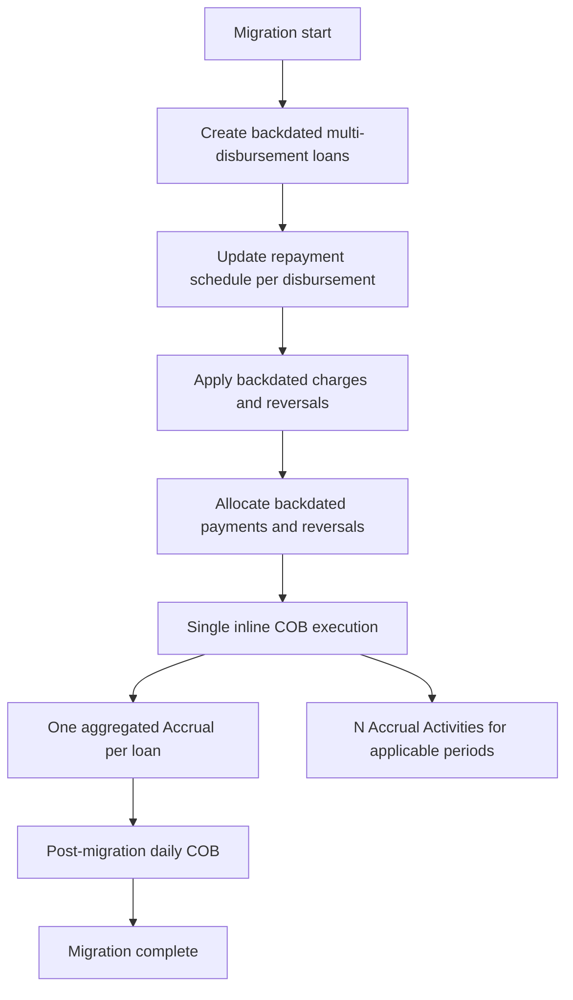

# Backbook Migration

## Backbook Migration overview

Backbook Migration supports migrating legacy loan portfolios with historical accuracy, including backdated transactions and audit trail preservation. Backdated actions such as interest pause and capitalized income calculate interest as of the backdated date.

The migration flow moves data in two stages:

- Legacy System to Migration Engine via EXTRACT & MAP.
- Migration Engine to MifosX via LOAD & VALIDATE.

## Migration COB and accrual processing

During migration, no daily COB runs. A single inline COB execution occurs before migration completes and creates one aggregated Accrual per loan, differentiated by loan status. For active loans it creates N Accrual Activities for active periods only; for closed loans it creates one aggregated Accrual ending at the closure date with no activities post-closure. The single COB execution results in an aggregated accrual entry for consolidated disbursements plus accrual activities for each overdue period, and generates aggregated accruals including charge components. After migration, daily COB runs normally on the consolidated loan schedule and generates incremental accruals. Future installments remain unprocessed until their due dates are reached, then process normally. Post-migration COB continues accurate charge processing. The service that retrieves the loan IDs for the COB job is org.apache.fineract.cob.loan.RetrieveAllNonClosedLoanIdServiceImpl#retrieveLoanCOBPartitions.

Run COB or inline COB:

- Every day to create accruals.
- For each day after the repayment.

## Accrual calculation rules

Accrual recognition depends on loan status: preclosed loans accrue until the closure date, active loans accrue until the current date, and overpaid loans receive no ongoing accrual during backdated processing.

Backdated processing applies different accrual treatment by loan status:

- Active loans receive full accrual treatment.
- Closed loans receive final accrual treatment.
- Overpaid loans receive no ongoing accrual treatment.

Pre-close interest calculation rules:

| restFrequencyType | preCloseInterestCalculationStrategy | Effective settings | Interest calculation |
| --- | --- | --- | --- |
| DAILY | TILL_REST_FREQUENCY_DATE | SAME_AS_REPAYMENT_PERIOD and TILL_REST_FREQUENCY_DATE | Interest is calculated at the end of the actual period. |
| SAME_AS_REPAYMENT_PERIOD | TILL_PRE_CLOSURE_DATE | SAME_AS_REPAYMENT_PERIOD and TILL_REST_FREQUENCY_DATE | Interest is calculated at the end of the actual period. |

## Accrual activity bugs

Accrual activity can be created on loans that are already closed or overpaid, including backdated loans, regular loans created on the current date, and loans that remain overpaid when the credit balance refund step is ignored. Accrual activity is excluded from the transaction summary report.

When an accrual activity is reversed and replayed, manually_adjusted_or_reversed is marked as false in m_loan_transaction and in the LoanAdjustTransactionBusinessEvent, so downstream systems cannot determine if the transaction is an adjustment.

totalUnpaidPayableNotDueInterest remains 0 even though accruals were created for the previous 4 days, although it should hold the cumulative unpaid interest amount once an accrual is created.

For a progressive loan schedule with interest recalculation true and accounting None, fetching loan details fails with HTTP 500 when a charge-off occurs on the due date of the 2nd period after an on-time repayment for the 1st period because reverse-replay is not allowed.

In AdvancedPaymentScheduleTransactionProcessor processAllocationsHorizontally IN_ADVANCE case, when transactionAmountUnprocessed is 0.06 and numberOfInstallments is 11, evenPortion is 0.01 and balanceAdjustment is -0.05, which can make evenPortion negative.

## Interest calculation bugs

For progressive interest bearing loans with interest recalculation disabled, negative numbers appear on transactions when a Merchant Issued Refund is processed.

The same condition causes these incorrect values:

- totalUnpaidPayableNotDueInterest can be negative.
- ProgressiveLoanSummaryDataProvider computeTotalUnpaidPayableNotDueInterestAmountOnActualPeriod calculates totalUnpaidPayableNotDueInterest incorrectly because it does not expect more interest paid than the actual due, but with interest recalculation false it is possible.

## Rounding mode

The rounding mode decides how money amounts are rounded during calculations. It comes from the database and determines the MathContext used by MoneyHelper. By default, the rounding mode is HALF_EVEN (6) and cannot be changed in Fineract.

> **Note:** A way to change the initial rounding mode shall be provided, either by setting the initial value from application.properties or by allowing changes to trap_door configuration if no loans, savings, or similar records were created.

## Configuration lookup errors

Fineract raises an exception when a global configuration lookup fails.

The lookup fails when:

- The global configuration does not exist with the name, and Fineract raises: Configuration property " + propertyName + " does not exist.
- The configuration identifier does not exist, and Fineract raises: Configuration identifier " + configId + " does not exist.

> **Note:** Fetching a global configuration entry by name that does not exist returns HTTP 500 instead of 404.

> **Note:** Fetching a configuration by a nonexistent id returns HTTP 500 instead of 404.

GET Loan details is the only available API that retrieves loan transactions, but it does not support filtering loan transactions based on type.

## External event issues

External events use a bigint ID in the database but were sent as an int in external business events. Events publishing has an issue when the sequence ID goes beyond Integer.MAX_VALUE. Part of this issue was fixed, but a piece of code in MessageFactory was missed and still results in issues.

## Fraud flag accounting

Fraud flag accounting controls how general ledger entries are created when transactions are replayed after a fraud tag is applied to a loan.

Accounting entries depend on when the transaction occurred relative to the fraud tag:

- Transactions made before the fraud tag keep their non-fraud accounting entries during replay after the fraud tag is in place.
- Backdated transactions made after the fraud tag was applied receive fraud-related general ledger accounting entries.

## Goodwill credit journal entries

Goodwill credit journal entries are not valid after reverse and replay; allocations go to the chargeoff GL account even though the account is not charged off.

## Disbursement charge calculation

The disbursement charge is calculated from the disbursement amount.

- The disbursement charge amount should be calculated based on disbursement amount plus interest.

## Multi-disbursal loans

You can request further disbursement on the UI for a multi-disbursal loan, including when the loan is closed or overpaid.

## Interest Refund transactions

You can create an Interest Refund transaction manually for a Payout Refund or Merchant Issued Refund transaction only when no Interest Refund transaction already exists for that refund. The transaction date is optional; if you provide it, it must match the target refund transaction date. Fineract calculates the interest refund amount on the fly as it would if it created the transaction automatically. Fineract sets a transaction relationship between the target refund transaction and the Interest Refund transaction, and reverses the Interest Refund transaction automatically if you reverse the refund transaction.

## Migration scenario details

Migration scenario details cover configuration combinations used during backbook migration, including MIR allocation, downpayment allocation, default allocation, disbursement charge calculation types, multidisbursal loans without expected tranches, and loans with a downpayment.

| Configuration | Value |
| --- | --- |
| MIR configured to use | LAST_INSTALLMENT |
| MIR allocation | LAST_INSTALLMENT |
| DP allocation | NEXT_INSTALLMENT |
| Default allocation | REAMORTIZATION |
| Disbursement charge calculation type | % loan amount + interest, amount = 2.00 |
| Disbursement charge calculation type | % amount, amount = 2.00 |
| Multidisbursal loan | Doesn’t expect tranche with enabled ‘Disallow Expected Disbursements’ setting on loan level |
| Multidisbursal loan | Enabled 25% downpayment |

## Approved amount API

You can change the approved loan amount using either the loan ID or the external loan ID. The request body contains the new amount and the locale. A successful response returns HTTP 200 with the old approved amount and the new approved amount changes, and triggers the LoanApprovedAmountChangedBusinessEvent.

Error responses:

- HTTP 400 Bad Request when fields are missing or have an incorrect data type.
- HTTP 403 Domain rule exception when the new approved amount fails validation, such as being lower than total already disbursed or expected disbursement amounts.

Request body fields:

| Field | Type | Example |
| --- | --- | --- |
| amount | BigDecimal | 150.50 |
| locale | String | en |

## Available disbursement amount API

Use the available disbursement amount API to update the available disbursement amount of a loan. You can call it by loan ID or by external ID. The available disbursement amount equals the approved loan amount minus the total disbursed amount minus total capitalized income when capitalized income functionality is enabled.

| Endpoint | Updates |
| --- | --- |
| PUT /loans/<loan_id>/available-disbursement-amount | Available disbursement amount of a loan by loan ID |
| PUT /loans/external-id/<loan_external_id>/available-disbursement-amount | Available disbursement amount of a loan by external ID |

Responses:

- A successful response returns HTTP 200 with CommandProcessingResult including old available disbursement amount, new available disbursement amount, old approved amount, and new approved amount.
- An error response returns HTTP 400 Bad Request when fields are missing or have an incorrect data type.
- An error response returns HTTP 403 Domain rule exception when the new available amount fails validation.

## Interest Refund API

The Interest Refund API creates an Interest Refund transaction on a loan transaction. You can identify the loan by its internal ID or external ID, and the transaction by its internal ID or external ID.

| Endpoint | Loan identifier | Transaction identifier |
| --- | --- | --- |
| /loans/<loan_id>/transactions/<transaction_id>?command=interest-refund | Internal loan ID | Internal transaction ID |
| /loans/external-id/<loan_external_id>/transactions/<transaction_id>?command=interest-refund | External loan ID | Internal transaction ID |
| /loans/<loan_id>/transactions/external-id/<transaction_external_id>?command=interest-refund | Internal loan ID | External transaction ID |
| /loans/external-id/<loan_external_id>/transactions/external-id/<transaction_external_id>?command=interest-refund | External loan ID | External transaction ID |

## Worked examples

A legacy installment loan is migrated with a backdated disbursement and a backdated repayment. The figures are illustrative: principal of 900, annual interest rate of 12 percent, a 360-day year with 30-day months, and a repayment of 300 on day 11. Close of business runs on day 30.

| Day | Event | Balance at start | Days | Daily interest | Interest posted | Balance at end |
| --- | --- | --- | --- | --- | --- | --- |
| 1 | Disburse 900 | 0 | - | - | - | 900 |
| 1-10 | Accrue interest | 900 | 10 | 0.30 | 3.00 | 900 |
| 11 | Repay 300 | 900 | - | - | - | 600 |
| 11-30 | Accrue interest | 600 | 20 | 0.20 | 4.00 | 600 |
| 30 | COB aggregated accrual | - | - | - | 7.00 | 600 |

A single COB execution creates one aggregated accrual entry of 7.00 for the active period and produces no accrual activities after the final day.

A merchant issued refund is applied to a migrated loan after a late repayment. Interest is calculated on the gross disbursed amount, not on the amount net of the refund. Setup: disbursement of 900 on day 1, annual interest rate of 12 percent, 360-day year, repayment of 600 on day 31, and a merchant issued refund of 300 on day 32.

| Treatment | Disbursement base | Interest days 1-30 | Interest day 31 | Interest day 32 | Total interest |
| --- | --- | --- | --- | --- | --- |
| Correct: gross disbursement | 900 | 9.00 | 0.30 | 0.10 | 9.40 |
| Incorrect: net of refund | 600 | 6.00 | 0.20 | - | 6.20 |

The refundable interest is the difference between the two totals; netting the refund against the disbursement understates interest by 3.20.
