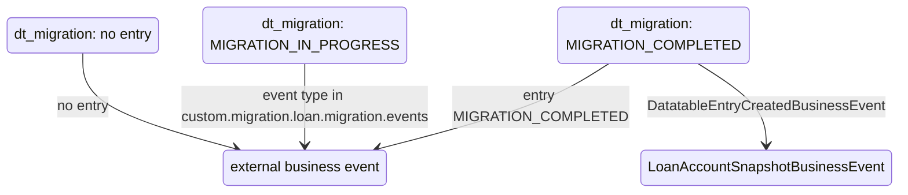

# Migration Tracking

## Migration tracking overview

Migration tracking records every Fineract activity during migration, including entities, transactions, journal entries and charges. External events are marked as migration events, and a migration flag differentiates migration activity from activity after migration. The loan creation API supports the migration flag so a loan can be marked as migrated without emitting a LoanCreatedBusinessEvent that lacks migration information.

## Migration APIs

Use the migration APIs to start, track, and read the migration status of a loan. You can identify a loan by its internal ID or its external ID.

Start migration with one of these POST requests:

- POST v1/loans/{loanId}/migration
- POST v1/loans/external-id/{loanExternalId}/migration

The request body must include:

- action (mandatory): MIGRATION_IN_PROGRESS, MIGRATION_COMPLETED, or MIGRATION_FAILED

The POST response returns:

- resourceId

Read migration status with one of these GET requests:

- GET v1/loans/{loanId}/migration
- GET v1/loans/external-id/{loanExternalId}/migration

The GET response returns:

- status (mandatory): MIGRATION_COMPLETED, MIGRATION_IN_PROGRESS, or MIGRATION_FAILED
- migrationStartDateTime (optional)
- migrationEndDateTime (optional)
- locale
- dateformat

Create a loan application with migration tracking by adding:

- POST v1/loans with query param migration=true

## Migration state and datatable

The dt_migration datatable records migration state as a status field of type varchar(100).

The system sends an external business event when:

- The dt_migration datatable has no entry.
- The dt_migration datatable has an entry of MIGRATION_COMPLETED.
- The dt_migration datatable has an entry of MIGRATION_IN_PROGRESS, no MIGRATION_COMPLETED entry, and the business event type appears in custom.migration.loan.migration.events.

Datatable changes trigger business events:

- A DatatableEntryCreatedBusinessEvent fires when a new datatable entry is added.
- A DatatableEntryUpdatedBusinessEvent fires when an existing datatable entry is updated.
- A DatatableEntryDeletedBusinessEvent fires when an existing datatable entry is removed.

A custom module listener can react to datatable entry creation:

- By default there is no listener for DatatableEntryCreatedBusinessEvent.
- If a MIGRATION_COMPLETED datatable entry is created, the listener triggers a LoanAccountSnapshotBusinessEvent.

## Business events during migration

Business events track loan migration. When migration of a loan is marked as completed, the system triggers a LoanAccountSnapshotBusinessEvent containing body account details as a snapshot. When migration is marked as FINISHED, the system triggers a LoanMigrationCompletedBusinessEvent containing loan details.

Business events carry a migration flag. The flag is true while migration is ongoing and is no longer set after migration finishes.

While a loan is under migration, the system creates and sends only external business events explicitly enabled for migration.

A configuration can filter which external events are sent during migration, for example sending only loan transaction events and no account details.

A configuration can run for the final day of migrations, covering every income up to the final run date in one run and producing aggregated accrual entries instead of individual accrual transactions for each day.

During migration, accrual activity follows these rules:

- One Accrual Activity is created for each period on the due date of the period if the period is backdated, unless the period was early repaid.
- After migration finishes, COB runs daily for proper income recognition.

## Custom data and serializers

Custom data carries migration details or a migration flag on loan and loan transaction business events. It is a Map<String, byte[]> field, and custom serializers can supply its values.

| Event serializer | Business event |
| --- | --- |
| InvestorBusinessEventSerializer | LoanOwnershipTransferDataV1 |
| LoanProductBusinessEventSerializer | LoanProductDataV1 |
| LoanChargeBusinessEventSerializer | LoanChargeDataV1 |
| LoanAdjustTransactionBusinessEventSerializer | LoanTransactionAdjustmentDataV1 |
| LoanRepaymentBusinessEventSerializer | LoanRepaymentDueDataV1 |
| LoanDelinquencyRangeChangeBusinessEventSerializer | LoanAccountDelinquencyRangeDataV1 |

The custom serializer applies to every loan and loan transaction external business event and always puts the last entry of the dt_migration datatable for the loan into the customData field.

## Migration flag and schema

A migration flag tells downstream systems whether an external business event concerns a loan where migration is ongoing. The flag is a boolean field on the MessageV1 Avro schema and an optional field on the ExternalEvent entity (m_external_event).

## Event configuration

External business events can be sent during migration. The m_external_event_configuration table includes enabled_for_migration to select which events are sent. The custom.migration.loan.migration.events list in application.properties controls the events, and defaults to LoanCreatedBusinessEvent, LoanDisbursalBusinessEvent, and LoanTransactionMakeRepaymentPostBusinessEvent.

DatatableBusinessEvent fields:

| Field | Type | Description |
| --- | --- | --- |
| entityType | EntityTables | Entity type of the datatable entry. |
| entityId | Long | Primary key of the entity. |
| datatableName | String | Name of the datatable table. |
| appTableId | Long | Primary key of the datatable entry. |
| data | Map<String, Object> | Key column name and value column value. |
