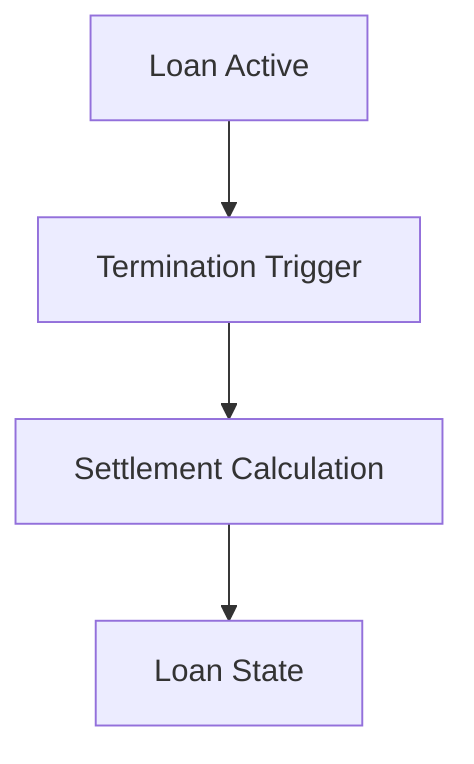

# Contract Termination

## Contract termination overview

Contract termination ends an active loan. A user with permission can perform it through the API or UI as of the current date; backdated termination is not supported. The system captures a reason code and starts the termination workflow, which moves the loan from Active through a termination trigger and settlement calculation to its final loan state. Termination is reversible.

Termination trigger event types:

- Reschedule / Default
- Admin Cancellation

## Eligibility and permissions

Contract termination applies to loans that are active, progressive, not already contract terminated, and not charged-off. You must have contract termination permission to perform it. The system creates a non-monetary transaction as of the current date. The contract termination amount equals principal outstanding plus calculated interest outstanding plus outstanding charges as of the current date, calculated the same way as charge-off balances.

## How to perform contract termination

You can perform contract termination on an active loan through the API using command=contract-termination. You do not need to provide a transaction date, payment type, payment details, or transaction amount. You can provide an external ID and a note. The template API returns outstanding balances till the current date.

## Schedule and balance changes

Contract termination accelerates all installments so they become due on the contract termination date. The loan repayment schedule is recalculated, all future installments are removed, and outstanding balances move to the current installment. Interest through the contract termination date and the outstanding principal form the due amount.

| Change | Effect |
| --- | --- |
| Maturity date | Updated to the contract termination date. |
| Future installments | Removed from the repayment schedule. |
| Outstanding balances | Moved to the current installment. |
| Charges due after the new maturity date | Placed on an additional installment. |
| Interest accrual | Stops after the final installment; no further calculations occur. |

Contract termination uses the same behavior as the charge-off accelerate maturity date strategy.

## Interest and accrual

Accrual and accrual activity stop after termination, and no future accruals occur. Termination balances are calculated similarly to charge-off balances, and current date accrual is created similarly as it happens at charge-off.

## Status and sub-status

After contract termination, the loan status remains ACTIVE and the sub-status becomes CONTRACT_TERMINATED.

## Delinquency and charges

Delinquency bucketing continues per the accelerated schedule, and days past due are calculated from the new due dates. Charges after maturity apply on the additional installment, and N+1 charges are allowed after the termination date.

## Charge-off interaction

You can charge off a terminated loan account, and you can charge back a terminated loan account. Charge-off does not change the repayment schedule after termination. You cannot perform contract termination again after termination, and you cannot charge off a loan before contract termination.

## Reversal and undoing

You can reverse a contract termination. The system marks the transaction as reversed, recalculates the repayment schedule, and reapplies all transactions accordingly.

During reversal, you can provide:

- Notes.
- External ID.

After reversal:

- The loan sub-status is removed.
- You can terminate the loan again.

Contract termination reversal follows the same reverse-replay behaviour as a charge-off transaction: new balances are calculated, the transaction is reverse-replayed, and the repayment schedule reflects the changes.

## Backdated transactions and reverse-replay

Backdated payments and reversals are allowed after contract termination. When a backdated transaction occurs, the system reverse-replays the termination and reapplies all transactions in order, regenerating the schedule if the transaction occurred before termination. Reverse-replay handling is similar to charged-off loans with acceleration.

Rules for backdated transactions and reverse-replay:

- Transaction reversals are allowed before or after termination.
- Backdated transactions trigger reverse-replay.
- During reverse-replay, all transactions are reapplied in order.
- If a transaction occurs before termination during reverse-replay, the schedule is regenerated.

Termination before the contract termination date:

- If contract termination was done before the contract termination date, the schedule is regenerated and all transactions are applied.
- This behaves similarly to a loan charged off with the accelerate maturity date strategy.

## Events and transaction details

Contract termination uses the transaction type CONTRACT_TERMINATION. It is a non-monetary transaction with no allocation rules, so no transaction amount is displayed. The system uses only the current date; backdating is not allowed. No accounting entry activity occurs for contract termination.

Contract termination fires these events:

- An Account Changed event is triggered during Contract Termination activity.
- The system fires LoanContractTerminationPostBusinessEvent.
- The system fires LoanBalanceChangedBusinessEvent as a regular loan transaction event.
- The system fires LoanAdjustTransactionBusinessEvent as a regular loan transaction event.

Reversal fires this event:

- The system fires LoanAdjustTransactionBusinessEvent for contract termination reversal.

## Special case after maturity date

If you terminate a contract after the maturity date, existing installments and the maturity date remain unchanged, and interest is calculated only until the maturity date.

## N+1 installment

Contract termination does not impact the N+1 installment.
