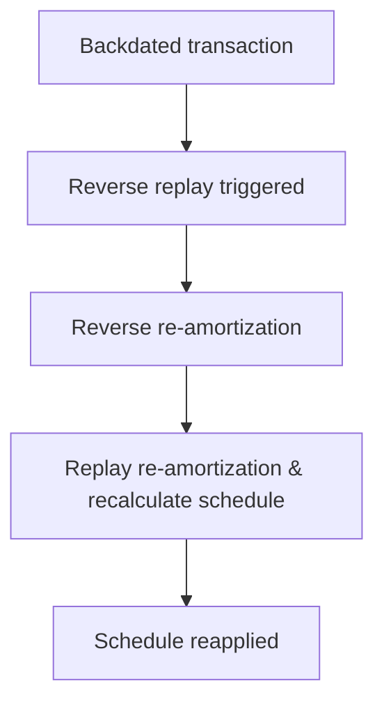
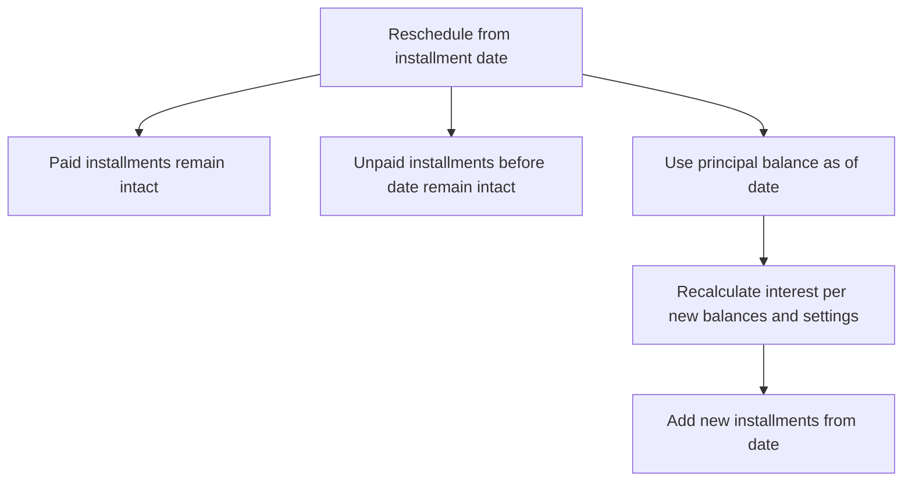

# Re-amortization

## Re-amortization overview

Re-amortization provides relief to customers with past due payments by spreading the overdue amount across future installments so the loan no longer has a past due balance. It is available for non-interest bearing loans, and the existing schedule end date typically remains the same.

The re-amortization flow works as follows:

- The system identifies the overdue amount.
- The system spreads the overdue amount to future installments.
- Future installments increase and the loan moves out of overdue.

## Eligibility and supported loans

Re-amortization applies only to active loan accounts that use the Interest bearing Progressive loan repayment strategy. It cannot be applied after the maturity date.

Charge-off loan accounts:

- Re-amortization is allowed on charge-off loan accounts.

## Interest handling options

You choose how re-amortization handles interest, charges, penalties and fees. The options are Default Behavior, Waive options and Equal Overdue Interest Split. All three re-calculate the actual interest and equated monthly installment (EMI) based on the new principal balance.

| Interest handling option | Overdue interest including chargeback interest | Overdue charge including chargeback charge | Fees and penalties due after re-amortization |
| --- | --- | --- | --- |
| Default Behavior | Moved to the first installment after the re-amortization date | Remains as is on the existing installment | Remain as is |
| Waive options | Waived off | Remains as is on the existing installments | Remain as is |
| Equal Overdue Interest Split | Equally split among future installments | Equally split among new installments | Remain as is |

## Applying re-amortization

Re-amortization redistributes the past due principal amount across the remaining future installments of a loan account. It is applied as of the current business date and does not change the maturity date. The loan amount is distributed to existing future installments only.

The following amounts are re-amortized or left unchanged:

- The complete past due principal amount plus the current day due amount is re-amortized when an installment falls on the same day as re-amortization.
- Partial paid amounts on installments before re-amortization remain as they are; only the unpaid amount is re-amortized.
- Only principal is re-amortized; outstanding fees and penalties remain outstanding for their particular installments and must be paid or waived.
- Charges and interest remain as they are for their respective installments.
- The N+1 installment is not impacted by re-amortization; no amount is re-amortized to it.
- Future down-payment installments, if they exist, are considered for re-amortization.
- Chargeback amounts remain as they are.

The following timing rules apply:

- Re-amortization applies only to future installments; it is not applied to installments that fall on the same day as re-amortization.
- All future installments from the date re-amortization is applied go through re-amortization.
- A loan cannot be re-amortized after the new maturity date.
- The schedule shows unpaid principal as zero for unpaid installments on or before the re-amortized date.

The following behavior applies to interest:

- For interest bearing loans, interest is recalculated based on the new principal balances and as per the loan configuration.
- Interest recalculation for re-amortization is on hold because progressive repayment schedule handling or advance repayment strategy does not support interest loan accounts.

> **Note:** No validation is done from Fineract for existing unpaid charge or interest.

## Schedule behavior after re-amortization

It recalculates the current and all future installments based on the current outstanding principal, without changing the repayment schedule structure, due dates, accruals, payable interest, fees, penalties, or paid amounts. Interest calculation follows the re-amortization interest handling setting, and all transaction types and features continue to work normally on the re-amortized schedule. Interest waiver and equal overdue interest split behavior apply to both non-interest bearing and interest bearing loan accounts.

Past due periods:

- The EMI for each past due period is set to the total amount of the paid balances plus charges and is not re-amortized.

Fees and penalties:

- Fees and penalties remain where they were and are not re-amortized.

## Multiple re-amortizations

You can re-amortize a loan account more than once, but not on the same date. Each re-amortization after the first must use the same interest options as the first re-amortization. No additional events or parameters are required for re-amortization.

## Undoing re-amortization

You can undo the last re-amortization applied to a loan account. Undoing recalculates the schedule and replays it at that time.

Undo is allowed only when:

- Re-amortization is the latest transaction on the loan.
- There are no future payments done after re-amortization (non reversed payments only).

## Accruals and delinquency

Re-amortization recalculates accruals as of the re-amortization business date at end of day (COB, the nightly job that posts interest and fees).

Accrual activity is handled as follows:

- Periodic accrual is calculated and posted periodically based on the new installment interest.
- Accrual activity of overdue installments being re-amortized is reversed or reverse-replayed on the re-amortization business date in real time.
- Any backdated repayment or reversal before the re-amortization date recalculates and posts the difference accrual or accrual adjustment as of current business date EOD.
- Any backdated repayment that results in installment recalculation before re-amortization creates a new accrual activity as of the installment date in real time.
- Any backdated repayment reversal that results in installment recalculation and re-amortization reverses the respective accrual activity transaction in real time.
- Accrual activity is posted regularly as per the new future installment dates on installment dates at EOD.

Delinquency and events are handled as follows:

- Delinquency calculation is triggered when re-amortization is triggered on the loan account.
- Re-amortization triggers the DelinquencyRangeChange event and AccountStatusChange event when the repayment schedule and delinquency buckets are modified.

Installment adjustment:

- The installment after the last one is adjusted as part of reverse replay.

## Backdated transactions and reverse replay

You can post backdated transactions on a loan account after re-amortization. Any backdated transaction triggers reverse replay, which reverses and replays the re-amortization based on the new past due amount.

The following events change the past due amount and cause reverse replay:

- Undoing old repayments.
- Posting backdated repayments.
- Posting backdated disbursements.
- Adding backdated charges.
- Undoing re-amortization.

After reverse replay:

- The repayment schedule is recalculated and reapplied.
- The schedule replays the re-amortization and installment amounts based on the new past due principal amount plus the current date due amount when an installment falls on the same day as re-amortization.

## Preview and API

You can preview a re-amortization schedule through both the UI and the API.

## Extend repayment schedule

Extending the repayment schedule keeps already paid installments intact and leaves unpaid installments before the reschedule from installment date unchanged. The system recalculates interest from that date using the principal balance as of that date and the loan account settings, then adds new installments covering the existing installments from that date plus the number of installments to extend.

