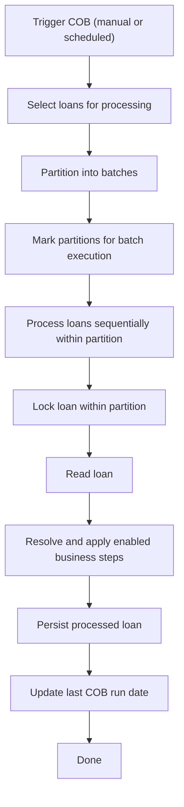
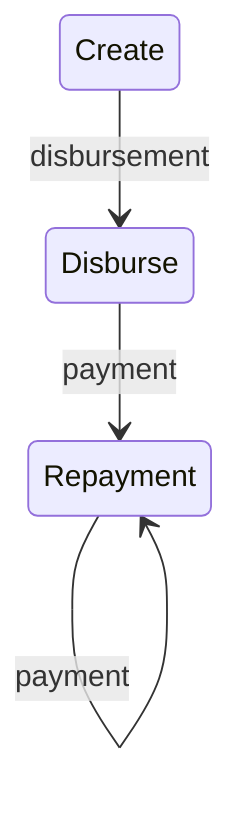

# Batch Jobs

## Working Capital COB job

The Working Capital close of business (COB) job applies enabled business steps to each selected Working Capital loan on a business date. You can trigger it manually or schedule it to run automatically. It also supports catch-up processing for past dates. Inline COB execution runs synchronously through an API call for specific loan IDs.

The COB processing steps are:

- Select loans for processing.
- Partition selected loans into batches based on a configured size.
- Mark partitions for batch execution.
- Process loans sequentially within each partition.
- Apply a lock on loans within a single partition.
- Read each loan.
- Resolve and determine applicable business steps.
- Apply business steps based on configuration where steps can be enabled or disabled and executed in a configurable order.
- Persist the processed loan.
- Update the last COB run date on the loan.

Catch-up behaviour:

- If a day passes and no payments land on a Working Capital loan when the COB runs, it fills the actual column as if a 0 amount repayment landed on the day.
- The Catch-Up COB API processes COB for past dates and ensures that missed COB executions are applied as if they had run daily on schedule.

Business step behaviour:

- The COB business step calls classifyDelinquency(loan, businessDate.plusDays(1)) with no grace-day adjustment.
- COB execution executes the relevant business steps on the provided business date.

> **Note:** COB execution supports optional listeners for both before and after job execution.

## Amortization calculation types

The system supports two amortization calculation types: Fix payment amount and Fix EIR. Each type determines which values you provide and which values the system calculates and stores at the loan account level.

| Amortization calculation type | Provided | Calculated |
| --- | --- | --- |
| Fix payment amount | Period payment amount | Total days, Daily EIR, Annual EIR |
| Fix EIR | Annual EIR | Period payment amount, Total days, Daily EIR |

Projected amortization is calculated using expected payment behavior.

## Projected amortization schedule

The Projected Amortization Schedule shows projected amortization amounts, deferred income balance, and the expected timeline of recognition for Working Capital loans. The system generates it automatically at loan creation and maintains it across the full loan lifecycle. It represents the current state of the loan and updates dynamically based on approval, disbursement, and repayment activity.

The schedule lifecycle follows these stages:

- Create: generateModel builds the initial schedule from application parameters.
- Disburse: addDisbursement recalculates the schedule with actual disbursement amounts and dates while preserving applied payments.
- Repayment: applyPayment records the payment and performs a full schedule rebuild.

Every state change triggers a full rebuild of the projected amortization schedule in this sequence:

- Aggregate payments.
- Build payment list (1 to loanTerm, actual or null).
- Balances.
- Payment analysis.
- Cursor amortizations.
- Excess distribution.
- Tail.
- Net amortization.
- Assemble rows.
- Trim.

The system replays amortization transactions along with payment transactions and schedule reprocessing.

## EIR recalculation

EIR recalculation aligns future cash flows with a revised repayment percentage rate. You trigger it by updating the repayment percentage rate through the UI or API, with an effective date of the current business date only. The system splits the schedule into a historical portion that stays unchanged and a future portion that it recomputes. It applies the updated rate to all future repayment calculations and all future amortization calculations, recalculating EIR based on the remaining outstanding balance, remaining deferred income, and updated repayment projections.

## Transaction framework

The transaction framework keeps accounting consistent and accurate across transaction types, supports backdated processing and reprocessing, and replays write-off transactions and their accounting entries for backdated repayments or reversals before the write-off date.

| Transaction type | Standard accounting entry |
| --- | --- |
| Charge | Debits Charge Receivable / Loan Account and credits Fee Income / Penalty Income Account |

## Transaction fields

Every transaction captures the following fields.

| Field | Description |
| --- | --- |
| Transaction ID | System-generated identifier for the transaction. |
| External ID | Identifier used for integrations. |
| Transaction Type | Type of transaction. |
| Transaction Date | Business date of the transaction. |
| Created Date / System Date | Date and time the transaction was created. |
| Currency | Currency of the transaction. |
| Principal Component | Principal amount of the transaction. |
| Fee Component | Fee amount of the transaction. |
| Penalty Component | Penalty amount of the transaction. |
| Outstanding Balance | Balance after the transaction posts. |
| Payment Reference / Mode | Reference or mode of payment. |
| Reversal Flag | Indicates whether the transaction is a reversal, if applicable. |
| Linked Transaction ID | Identifier of the linked transaction for reversals. |
| Notes / Remarks | Free-text notes or remarks. |

## Prepayment transaction

The prepayment transaction lets a borrower fully settle and close an active loan account by paying the exact outstanding amount required as of a specified payoff date. It behaves similarly to a standard repayment transaction, and the system automatically calculates the payoff amount required to close the loan. The system supports backdated prepayment transactions.

The following rules apply to the prepayment date:

- The Prepayment Date must be less than or equal to the Current Business Date.
- The Prepayment Date must be greater than or equal to the Latest Payment Transaction Date.

The following rules apply to calculated amounts:

- Users cannot modify any calculated amounts during a prepayment transaction.

## Payout Refund transaction

The Payout Refund transaction recovers previously disbursed loan funds from fraudulent WCP loan accounts by reducing the outstanding principal and fees balance according to the allocation rule. It applies to WCP loans with an active status.

Rules for the Payout Refund transaction:

- The transaction name is Payout Refund.
- The system allows backdated Payout Refund transactions, similar to a repayment transaction.
- For backdated Payout Refund transactions, the system recalculates and posts the amortization transaction as of the current date.
- The transaction calculates and posts the amortization transaction at close of business (COB).
- The system allows overpayments when the refund exceeds the remaining principal balance.

## Write-off

Write-off clears all outstanding dues on an active loan account, including principal, fees, and penalties, closes the account, and removes the outstanding balances from the accounting books. You cannot write off a charged-off account.

## Range Schedule

A range schedule generates and maintains a repayment schedule for loans based on configurable repayment intervals and percentage allocations. The system generates the schedule from user-defined parameters and continues until repayment allocation is completed or the loan closure condition is met.

Period generation rules:

- The system creates one period at a time.
- The system generates the next period when the current date crosses the last period due date.

## Delinquency pause

You can pause delinquency on a loan that has active status. A pause period requires a start date and an end date, and the start date must be before the end date and not before the loan's first disbursement date. A pause cannot start within an already evaluated range schedule period where minPaymentCriteriaMet is not null, and pause periods cannot overlap with other existing pause periods.

## Resume Delinquency

Resume Delinquency restarts delinquency schedule and calculation during an active delinquency pause period. It affects only delinquency and does not change breach management.

## Delinquency reschedule

Delinquency reschedule applies only to loans with active status. After a reset, delinquency evaluation restarts from the current evaluation period. Once delinquency disable is applied, evaluation stops for the account from the disable date onward.

## Delinquency reset

A Delinquency reset clears delinquency status on an account. You can reset an account multiple times over time, but only once per day. A user with appropriate permissions can undo or delete a reset. During the reset process, the Restart Period from Reset Date option is optional.

## Breach Management

Breach Management identifies, monitors, and resolves violations of predefined loan conditions and merchant performance thresholds. The range schedule tracks breach, expected payments, actual payments, and outstanding balances across defined time periods, giving visibility into expected versus actual payments within those periods. Dynamic schedule generation is supported based on user-defined payment parameters.

## Breach pause

Breach pause stops breach evaluation for an account during a defined pause period. You can create multiple pause records for an account, and you can backdate a pause entry. The system creates one period at a time.

Rules for breach pause:

- Overlapping pause periods are not permitted and the system validates this.
- Once breach disable is applied, breach evaluation stops for the account from the disable date onward.
- Recalculations respect system controls such as reset, disable, and reschedule rules.

## Breach period update

The breach period update sets the start date and recalculates the expected amount for the current period.

Rules for the start date:

- The system sets startDate to the current business date.
- start_date is a DATE NOT NULL field; for PAUSE it is user-provided, for RESCHEDULE it is automatically set to the current business date.

Expected amount update:

- The system identifies the current period, which contains the business date, and updates its expectedAmount based on the new minimum payment percentage or flat amount set.

## Breach Reset

Breach Reset marks a breached Working Capital Product (WCP) account as regularized once compliance is restored, restarts breach monitoring cycles from the current evaluation period, and stops further penal actions where applicable. You can reset an account multiple times over time, but only once per account per day. A user with appropriate permissions can undo or delete a breach reset.

## Breach Past Due Amount

The Breach Past Due Amount is the cumulative past due amount up to the last completed period. It continues to be computed during pause periods and carries forward cumulatively across periods until fully resolved or reset.

## Payment Holiday

Payment holidays let you defer repayments without marking the account as delinquent. They do not affect Effective Interest Rate (EIR) calculation, amortization, or income recognition. You can enter backdated payment holidays, and an account can have multiple payment holiday periods. Overlapping payment holiday periods are not permitted.

Discount fees amortization:

- The source of deferred income for Discount fees Amortization is Discount fees.

## Re-age

Re-age regularizes delinquent merchant loan accounts by resetting Days Past Due (DPD) to zero after the borrower meets defined repayment conditions, without restructuring the loan. You can perform re-age only as of the current system date. The system allows multiple re-age actions on an account over time, but only one re-age per account per day.

Re-age resets the following evaluations as of the re-age date:

- Delinquency evaluation resets as of the re-age date.
- Breach evaluation resets as of the re-age date.
- New evaluations commence from the re-age date based on the current outstanding or balance amounts.
- Near Breach evaluation continues to function as per existing configuration without interruption or reset.
- The existing breach past due amount continues to be tracked independently.

## Close of Business process

The Close of Business (COB) process runs daily scheduled end-of-day processing. The COB business date determines which date is being closed. In catch-up processing, internal logic can set the COB business date dynamically.

The COB job processes open loans when:

- The last COB run date equals the previous business date.
- The last COB run date is null, meaning COB has never run for the loan.

Catch-Up COB processing starts from:

- The last COB run date stored at the loan account level.
- The current COB business date when no previous COB run date exists.

## Product payment allocation rule

The product payment allocation rule defines how incoming transactions are allocated for loans created from a product, using default payment allocation logic at product level by transaction type.

The rule supports:

- Per-transaction-type allocation ordering.

## Abbreviations

EIR stands for Effective Interest Rate. COB stands for Close of Business (end-of-day processing).

## Working Capital loan product fields

A Working Capital loan product is identified by its product identifier and name fields, and its validity is set by its start and close dates. Its financial terms include principal amount, period payment rate, repayment frequency, amortization type, NPV day count, and discount. Identification fields include account number and external ID, both unique.

| Field group | Fields |
| --- | --- |
| Product identifier | id |
| Product name | name, short_name, external_id |
| Product dates | start_date, close_date |
| NPV day count | npv_day_count |
| Principal amount | principal_amount, min_principal_amount, max_principal_amount |
| Period payment rate | period_payment_rate, min_period_payment_rate, max_period_payment_rate |
| Repayment frequency | repayment_every, repayment_frequency_enum |
| Financial terms | principal_amount_proposed, approved_principal, principal_amount, period_payment_rate, repayment_every, repayment_frequency_enum, amortization_type, npv_day_count, discount |
| Identification | account_no, external_id |

## m_wc_loan_product table

The `m_wc_loan_product` table stores one row per Working Capital loan product and identifies each product by its name and short name.

| Column | Type | Nullability | Constraint |
| --- | --- | --- | --- |
| id | bigint | Not null | Primary key, generated by default as identity |
| name | varchar(100) | Not null | Unique |
| short_name | varchar(4) | Not null | Unique |
| currency_code | varchar(3) | Not null |  |
| currency_digits | smallint | Not null |  |
| amortization_type | varchar(50) | Not null |  |
| npv_day_count | integer | Not null |  |
| principal_amount | numeric(19, 6) | Not null |  |
| period_payment_rate | numeric(19, 6) | Not null |  |
| repayment_every | integer | Not null |  |
| repayment_frequency_enum | varchar(50) | Not null |  |

## m_wc_loan_product_configurable_attributes table

The table `m_wc_loan_product_configurable_attributes` stores optional flags that control which working capital loan product attributes can be overridden.

| Column | Type | Required | Description |
| --- | --- | --- | --- |
| id | bigint | Yes | Primary key, generated by default as identity |
| wc_loan_product_id | bigint | Yes | Unique reference to `m_wc_loan_product` |
| delinquency_bucket_classification_overridable | boolean | No | Whether delinquency bucket classification can be overridden |
| discount_default_overridable | boolean | No | Whether discount default can be overridden |
| period_payment_frequency_overridable | boolean | No | Whether period payment frequency can be overridden |
| period_payment_frequency_type_overridable | boolean | No | Whether period payment frequency type can be overridden |

## m_wc_loan_product_payment_allocation_rule table

The `m_wc_loan_product_payment_allocation_rule` table stores payment allocation rules for Working Capital loan products. Each rule links a loan product to a transaction type and the allocation types that apply to it.

| Field | Description |
| --- | --- |
| wc_loan_product_id | Identifies the Working Capital loan product the rule belongs to. |
| transaction_type | Identifies the transaction type the rule applies to. |
| allocation_types | Lists the allocation types used when processing the transaction. |
| Audit columns | Record creation and modification details for the rule. |

## Working Capital loan tables

Working Capital loan tables store amortization schedules, internal notes, payment allocation rules, and processing locks for a loan.

## Datatable API

The Datatable API lists datatable definitions and retrieves datatable entries for a specific application table.

Fetch datatable lists and entries with these endpoints:

- Fetch datatable lists filtered by application table with GET /v1/datatables?apptable=m_wc_loan or GET /v1/datatables?apptable=m_wc_loan_product.
- Fetch datatable entries with GET /v1/datatables/{datatable}/{apptableId}.
- Fetch a specific multi-row entry with GET /v1/datatables/{datatable}/{apptableId}/{datatableId}.

## Working Capital loan product API

Use the Working Capital loan product API to fetch loan products.

## Submit Loan Application

Submit a Working Capital loan application by sending a POST request to working-capital-loans. The response returns the resource ID, external ID, office ID, client ID, and loan ID.

The request includes:

- clientId
- productId
- fundId
- accountNo
- externalId
- principalAmount
- totalPayment
- submittedOnDate
- expectedDisbursementDate
- submittedOnNote
- periodPaymentRate
- repaymentEvery
- repaymentFrequencyType
- discount
- delinquencyBucketId
- paymentAllocationRules
- locale
- dateFormat

## Modify Loan Application

You can modify an existing working capital loan application using the PUT working-capital-loans/<loanId> endpoint or the PUT working-capital-loans/external-id/<loanExternalId> endpoint.

The request can include:

- clientId
- productId
- fundId
- accountNo
- externalId
- principalAmount
- totalPayment
- submittedOnDate
- expectedDisbursementDate
- submittedOnNote
- periodPaymentRate
- repaymentEvery
- repaymentFrequencyType
- discount
- delinquencyBucketId
- paymentAllocationRules
- locale
- dateFormat

## Reject Loan Application

Use the Reject Loan Application endpoints to reject a working capital loan application that is submitted and pending approval. The rejection sets the loan status to Rejected.

Send one of these requests:

- POST working-capital-loans/<loanId>?command=reject
- POST working-capital-loans/external-id/<loanExternalId>?command=reject

Include these fields in the request:

- rejectedOnDate
- note
- locale
- dateFormat

## EIR formula

The system calculates the effective interest rate (EIR) using EIR = RATE(loanTerm, -expectedPayment, netDisbursement).

The RATE function solves pv×(1+r)^n + pmt×((1+r)^n−1)/r = 0 using Newton-Raphson with:

- an initial guess of 2×(pmt×n+pv)/(pv×n)
- a fallback of 0.01
- a tolerance of 1E-10
- a maximum of 100 iterations

## Worked examples

A Working Capital loan is disbursed with a principal of 1,000 and a discount fee of 100, so the borrower receives 900 and the principal due becomes 1,000. The figures are illustrative. On the next business date the borrower repays 100 toward principal. The COB job is triggered manually and runs synchronously for that business date. Its business steps apply the repayment, reduce the outstanding principal, and amortize a share of the deferred discount fee. Before and after job execution listeners may run, and the delinquency step classifies the loan for the following business date with no grace-day adjustment. Whether a charge is present or not, the discount fee amortization result is unchanged in this setup.

| Step | Business Date | Event | Principal Due | Principal Outstanding | Discount Fee Recognized | Discount Fee Unrecognized | Actual Repayment |
| --- | --- | --- | --- | --- | --- | --- | --- |
| 1 | Day 0 | Disbursement | 900.00 | 900.00 | 0.00 | 0.00 | - |
| 2 | Day 0 | Discount fee added | 1,000.00 | 1,000.00 | 0.00 | 100.00 | - |
| 3 | Day 1 | Repayment applied | 1,000.00 | 900.00 | 0.00 | 100.00 | 100.00 |
| 4 | Day 1 | End-of-day amortization | 1,000.00 | 900.00 | 10.00 | 90.00 | - |

The same loan has an outstanding principal of 1,000 and an unrecognized discount fee of 100. The last COB run date is Day 0. No repayments arrive on Day 1 or Day 2. When catch-up COB runs on Day 2, it processes each missed business date in order. For every date with no payment, the actual column is filled as if a zero-amount repayment landed, the principal and fee balances remain unchanged, and classifyDelinquency is called for the next business date. The job runs inline and synchronously, with optional before and after listeners. The example shows that a day without payment records a zero actual repayment and that catch-up advances one business date at a time from the last COB run date.

| Catch-up Step | Business Date | Actual Repayment | Principal Outstanding | Discount Fee Recognized | Delinquency Classified For |
| --- | --- | --- | --- | --- | --- |
| 1 | Day 1 | 0.00 | 1,000.00 | 0.00 | Day 2 |
| 2 | Day 2 | 0.00 | 1,000.00 | 0.00 | Day 3 |
