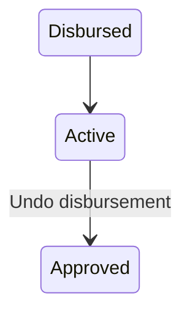
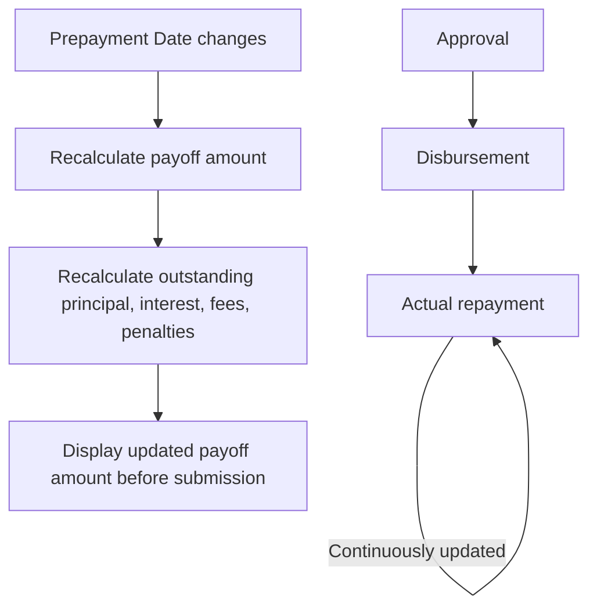

# Transaction Types

## Transaction types overview

Transaction types record how money moves on a loan account. They include repayment, discount, credit balance refund, disbursement, charge adjustment, discount fee adjustment, payout refund, transaction reversal, write-off, discount fee amortization accounting, repayment on charge-off loans, goodwill credit on charge-off loans, payout refund accounting, backdated transactions, overpayment and loan status, undo disbursement, loan creation fields and defaults, flat amortization, repayment percentage rate changes, transaction processing and storage, amortization schedule, amortization calculation, services, API endpoints, loan lifecycle commands, data model and scoping, UI behavior, accrual, written-off loans, money-in transaction rules, fully paid loans, glossary, projected balances, accounting, batch jobs, breach management, delinquency restrictions, and charges, refunds and chargebacks.

New transaction types include:

- Refund transactions.
- Chargeback transactions.
- Goodwill credit transactions.
- Interest waiver transactions.
- Merchant issue refund transactions.
- Payout transactions.
- Refund interest payment transactions.
- Re-amortization transactions.

A principal adjustment balance increases the principal to be paid for credit balance refund edge cases where the refund issued more money back to the customer than it should based on current state.

## Repayment

A Repayment transaction records money received toward a loan. You can post it on active, closed, or charge-off loan accounts. On a charge-off loan it behaves like a normal repayment on an active loan, except for accounting handling. On a closed loan it is treated as an overpayment and moves the loan to overpaid status. You can post repayment to close a loan as fully paid, and you can post repayment on closed loan accounts that are fully paid or overpaid.

A Repayment transaction requires:

- Transaction amount.
- Transaction date.
- Classification.
- Payment type.

Real-time allocation covers:

- Principal.
- Deferred Income Amortization.

After posting, the system:

- Updates the amortization schedule with the repayment payment.
- Stores the transaction in the transaction table.
- Stores allocations in the allocation table.
- Stores and updates balances in the balances table.
- Creates accounting entries based on the allocation.
- Triggers external business events.

Outcomes:

- Repayments can be closed as fully paid or overpaid based on the updated amortization schedule.
- You can undo a repayment transaction.

Accounting, transaction behaviour, and balances:

| Area | Behaviour |
| --- | --- |
| Accounting | Same as existing. |
| Transaction | Same as existing. |
| Balances | New, based on the balances table. |

## Discount

Discount allocates in real time to Principal. Its accounting and transaction behaviour match existing behaviour, while balances are new based on the balances table. The amortization schedule reflects and calculates Discount fee as capitalized.

Discount fee amortization occurs only when:

- A payment was made.
- The loan has a Discount fee.

The system uses the close of business (COB) date as the transaction date for Discount fee amortization.

## Credit Balance Refund

A Credit Balance Refund refunds excess funds to the borrower when a loan account is overpaid. It reduces or eliminates the credit balance and triggers accounting entries and journal entries. You can initiate it when the loan is overpaid, and it requires a transaction amount, transaction date, classification, and payment type.

Processing and storage:

- The transaction is stored in the transaction table.
- Balances are stored in the balances table and updated after the transaction.
- Accounting entries are created based on the allocation.
- External business events are triggered.
- Real-time allocation covers overpayment.

Accounting and balances:

- Accounting is the same as existing.
- The transaction is the same as existing.
- Balances are new based on the balances table.
- Status change is new with WC loan details.

## Disbursement

A disbursement allocates funds to the loan principal in real time. Its accounting, transaction handling, and balances follow the existing approach, with new balances based on the balances table.

Undo disbursement is not allowed when any monetary transaction other than Disbursement or Discount exists on the loan account.

- Undo disbursement is not allowed if there was any monetary transaction except Disbursement and Discount.

Creating a loan account with a discount set up results in an error when overriding select terms and settings in loan accounts is disabled.

- Creating a loan account with discount set up results in an error when overriding select terms and settings in loan accounts is disabled.

## Charge Adjustment

Charge Adjustment behaves like a repayment and decreases the income of the target charge, with the amount allocated as repayment. It pays principal directly. It adds charge adjustment balance to the balances table, maintains its value, increases total payment and total paid principal if applicable, and decreases principal outstanding. It is related to an existing charge through a transaction relationship. The total charge adjustment amount cannot exceed the original charge amount and cannot be earlier than the date the original charge was added to the loan. Charge Adjustment can be reverted at any time with no validation on reversal. Charge Adjustment does not handle backdated transactions, business events, or closed, charged-off or written-off loans; reversal is handled separately.

## Discount Fee Adjustment

A Discount Fee Adjustment reduces the discount on a loan and allocates the full adjustment amount to the principal portion. You can post multiple adjustments until the remaining adjustable discount reaches zero. The system uses the close of business date as the transaction date.

Processing rules:

- The system creates a linked adjustment transaction of type DISCOUNT_FEE_ADJUSTMENT linked to the parent Discount Fee transaction through relatedResourceId.
- The system stores the transaction allocation in m_wc_loan_transaction_allocation with the full amount allocated to the principal portion.
- The system reduces the loan-level discount by the adjustment amount, with a minimum of zero.
- The system recalculates principalOutstanding from disbursement plus the updated discount.
- The system restates projected amortization by regenerating the schedule with the new discount and disbursement parameters.
- The system re-applies all recorded actual repayments from the previous model.
- The system recalculates EIR-based projected payments, NPV, and deferred balance.
- The system raises the WorkingCapitalLoanDiscountFeeAdjustmentTransactionBusinessEvent.
- The system posts new accounting entries for the adjustment.
- The system reprocesses amortization, outstanding balances, and subsequent transactions.

Validation and accounting:

- The system validates the total value of the adjustment against the Discount fee.
- The system updates the Realized and unrealized income balance.
- Accounting follows the existing transaction treatment, with new balances based on the balances table.

Backdated adjustments and reversals:

- When a discount adjustment is posted backdated, the system recalculates the amortization schedule and posts the relevant amortization adjustment or amortization transaction for the difference amount.
- When a discount adjustment transaction is undone, the system reverses the amortization adjustment or amortization transaction posted with it, recalculates the amortization schedule, and posts the relevant amortization adjustment or amortization transaction for the difference amount.

## Payout Refund

Payout Refund is a transaction type for WCP loans. It works like a repayment and reduces the outstanding principal and fees balance according to the allocation rule configured for Payout Refund. You can apply it to active, closed or overpaid WCP loans, enter a transaction amount and date, post it backdated, or undo it. When Accounting is enabled for the WCP product, attached journal entry lines are posted for this transaction type.

## Transaction reversal

You can reverse any monetary transaction. Reversing a transaction does not replay the transaction itself; it reverses its accounting effect and updates the related balances and amortization schedule.

A reversal does the following:

- Creates mirror accounting entries that undo the transaction.
- Creates reversal journal entries.
- Updates paid and outstanding balances and the loan balance.
- Updates the breach schedule.
- Updates the amortization schedule by undoing the payment related to the transaction.
- May change existing transaction allocation, which is then reprocessed based on the configured payment allocation by transaction type.

Validation and reversal details:

- Only non-reversed transactions can be reversed.
- The transaction is marked with the reversal flag and reversed=true.
- A reversal external ID can be provided or auto-generated where applicable.
- A note can be recorded for the reversal.

> **Note:** Recalculation is supported only from the original transaction date.

## Write-off

Write-off zeroes all outstanding balances on an active loan account and closes the loan with written-off status. Written-off status can be undone, but backdated transactions and transaction undo are not supported on written-off loans.

Write-off posts the following journal entries:

- Dr 744008 recoveries Losses Written-off Expense Prin, fees, and Penalty.
- Cr 112603 Fee Receivable Fees Receivable Asset fees.
- Cr 112603 Fee Receivable Penalty Receivable Asset Penalty.
- Cr 112601 Loans Receivable Principal Loan Portfolio Asset Prin.

Undo write-off reverses the balances and posts the following journal entries:

- Dr 112601 Loans Receivable Principal Loan Portfolio Asset Prin.
- Dr 112603 Fee Receivable Fees Receivable Asset fees.
- Dr 112603 Fee Receivable Penalty Receivable Asset Penalty.
- Cr 744008 recoveries Losses Written-off Expense Prin, fees, and Penalty.

## Discount fee amortization accounting

A Discount Fee Amortization transaction posts two journal entries: a debit to GLCode 404000 Interest income (Income from Discount Fee, Income, Allocation Type Int) and a credit to GLCode 240005 Deferred Interest (Deferred Income, Liability, Allocation Type Int).

## Repayment on charge-off loans

A repayment on a charge-off loan posts to recovery and liability accounts instead of reducing the loan balance. The debit goes to the suspense/clearing account, and credits go to recoveries for principal, penalty and fees, with any excess posted to the overpayment liability account.

| Entry type | GL code | Account | Type | Allocation type |
| --- | --- | --- | --- | --- |
| Debit | 145023 | Suspense/clearing account | Liability | Principal, fees, penalty and excess |
| Credit | 744008 | Recoveries | Income | Principal |
| Credit | 744008 | Recoveries | Income | Penalty |
| Credit | 744008 | Recoveries | Income | Fees |
| Credit | 245000 | Other credit liability | Liability | Excess |

## Goodwill Credit on charge-off loans

Goodwill Credit on a charge-off loan behaves like a repayment. It allocates the amount based on configured rules, creates accounting entries, adds the goodwill credit balance to the balances table, increases total payment and total paid principal when applicable, and decreases principal outstanding. Reversing a transaction dated before the charge-off is not supported.

Accounting entries for Goodwill Credit on a charge-off loan:

| Type | GL Code | Account | Category | Allocation Type |
| --- | --- | --- | --- | --- |
| Debit | 744003 | Principal bal adjustment | Expense from Goodwill Credit | Prin, excess |
| Debit | 404008 | Fee Charge off | Income from Goodwill Credit Fees | Fees |
| Debit | 404008 | Fee Charge off | Income from Goodwill Credit Penalty | Penalty |
| Credit | 744008 | recoveries | Income from Recovery Repayment | prin |
| Credit | 744008 | recoveries | Income from Recovery Repayment | fees |
| Credit | 744008 | recoveries | Income from Recovery Repayment | Penalty |
| Credit | 245000 | Other Credit liability | Overpayment Liability | excess |

## Payout Refund accounting

A payout refund payment posts to Fund source GL 145023. The credit account depends on the loan status and the payment component: Principal, Penalty, Fees, or Unallocated Credit (UNC). A payout refund reversal posts the opposite entries to the same accounts. The accounting entries apply to active loans and charge-off loans.

| Loan status | Component | Debit GL | Credit GL |
| --- | --- | --- | --- |
| Active | Penalty | 145023 | 112603 |
| Active | Fees | 145023 | 112603 |
| Active | Principal | 145023 | 112601 |
| Active | Unallocated Credit (UNC) | 145023 | 245000 |
| Charge-off | Penalty | 145023 | 404008 |
| Charge-off | Fees | 145023 | 404008 |
| Charge-off | Principal | 145023 | 744007/740037 |
| Charge-off | Unallocated Credit (UNC) | 145023 | 245000 |

| Loan status | Component | Debit GL | Credit GL |
| --- | --- | --- | --- |
| Active | Penalty | 112603 | 145023 |
| Active | Fees | 112603 | 145023 |
| Active | Principal | 112601 | 145023 |
| Active | Unallocated Credit (UNC) | 245000 | 145023 |
| Charge-off | Penalty | 404008 | 145023 |
| Charge-off | Fees | 404008 | 145023 |
| Charge-off | Principal | 744007/740037 | 145023 |
| Charge-off | Unallocated Credit (UNC) | 245000 | 145023 |

## Backdated transactions

You can post backdated repayments and reverse old transactions after a loan has completed a Credit Balance Refund (CBR). Backdated actions trigger reprocessing and recalculation, and any difference in amortization is adjusted at end of day (COB), the nightly job that posts interest and fees. A CBR transaction is treated in the same way as in term loans during reprocessing.

Transaction allocation rules:

- Transaction allocation and allocation changes occur only if there are charges on the loan and a backdated transaction occurs, based on new chronological order investigating whether the backdated transaction pays any portion of the charge.
- You can reverse any Charge Adjustment on an active or closed loan using a reversal transaction.
- Loan status changes according to the new loan balance created by the reversal transaction.

Reschedule behavior:

- Before reschedule, Current Period has the original expected amount.
- After reschedule, Current Period has the updated expected amount and outstanding is recalculated.

## Overpayment and loan status

A loan moves to overpaid status when its balance becomes zero or negative because of a goodwill credit (GWC), a backdated GWC, a reversal of GWC, a reversal of payment, or a charge-adjustment transaction on a closed loan account. If the credit balance refund amount is greater than the overpaid amount, the system rejects it through validation. Once a loan is overpaid, the overpaid-on date appears on the timeline.

Loan status changes as follows:

- If a backdated GWC makes the loan balance zero, the loan moves to closed status.
- If a backdated GWC makes the loan overpaid, the loan moves to overpaid status.
- If a reversal of GWC is done on a closed loan account, the loan becomes active again.
- If a reversal of payment is done on a closed loan account, the loan becomes active again.

## Undo disbursement

Undo disbursement reverts the current disbursement transaction, its accounting, and balances, moves the loan from Active back to Approved, triggers external business events, and creates a LoanTransaction reversed status change.

## Loan creation fields and defaults

When you create a loan account, Currency, Settings, and Term are copied from the loan product. You can modify Disbursement Amount, Period Payment Rate, Total Payment Value, Discount, Loan Application Submitted Date, Expected Disbursement Date, LP overridables (if enabled), Flat - % amount, Delinquency Bucket Classification, and Period payment frequency; all other values are inherited from the loan product.

| Field | Default | Can you change it? |
| --- | --- | --- |
| Disbursement Amount | Shown | Yes, between Min and Max Values |
| Period Payment Rate | Shown | Yes, between Min and Max Values |
| Total Payment Value | Not set | Yes, you enter it |
| Discount | Shown | Yes |
| Loan Application Submitted Date | Current date if not provided | Yes |

## Flat Amortization

Flat Amortization amortises income in a straight-line manner over the loan tenure. It distributes deferred income equally across the loan term, independent of actual repayment patterns, using simpler calculation logic with a fixed amortization amount per period and minimal recalculation unless tenure changes.

## Repayment percentage rate changes

When you modify the repayment percentage rate, the system recalculates the effective interest rate (EIR), updates dependent values, and recalculates the amortization schedule. The change applies only from the current business date onward; no backdated recalculation is performed.

## Transaction processing and storage

The system captures, processes, displays, and accounts for loan transactions at loan account level. A monetary transaction amount must be greater than zero. WCP supports only single disbursements per loan account.

For prepayment, the following restrictions apply:

- Users cannot enter repayment allocation amounts.
- Users cannot modify principal, interest, fee, or penalty portions.
- Users cannot override the total payoff amount.

All journal entries generated during prepayment processing are identical to those generated by an equivalent repayment transaction.

## Amortization schedule

The amortization schedule is recalculated at approval and disbursement, and continuously updated to reflect actual repayment behavior.

When the prepayment date changes:

- The system recalculates the payoff amount.
- The system recalculates outstanding principal, interest, fees, and penalties as of the selected date.
- The system displays the updated payoff amount before transaction submission.

## Amortization calculation

Amortization calculation determines how much of each payment applies to the discount fee amortization. The system builds the amortization schedule from past and projected payments, then trims trailing zero-forecast rows.

The calculation uses these rules:

- Current day amortized amount equals total amortized amount minus previous total amortized amount.
- Total amortized amount is the sum of the running NPV value of each past and projected payment on the amortization schedule.
- The calculated Discount fee amortization amount is based on the current date total payments versus total amortization amount from the amortization schedule.
- expectedPaymentAmount = (TPV × periodPaymentRate) / npvDayCount.
- Cursor-based actual amortization advances the cursor by actualPayment divided by expectedPayment periods and interpolates partial periods.

The actual repayment transaction calculates and posts Actual Amortization (Income) on the payment date, along with the repayment transaction.

## Services

Working capital loan services handle product and loan lifecycle work: product creation, updates, closure, defaults, and payment allocation rules; loan creation from a product, draft and submitted loan updates, approval, rejection, closure, loan-level payment allocation rules, and notes; expected and actual disbursement, disbursement validation, maturity and balance updates; balance initialization, repayment effects, accrual and realization, and derived totals; loan locking, lock release, and lock error recording; and loan summary, full details, notes, balances, disbursements, and allocation rules.

| Service | Responsibilities |
| --- | --- |
| WorkingCapitalLoanProductWriteService | Create product, update product, close product, maintain configurable attributes, maintain product payment allocation rules |
| WorkingCapitalLoanProductReadService | Fetch product details, fetch product defaults, list active products |
| WorkingCapitalLoanWriteService | Create loan from product, update draft or submitted loan, approve loan, reject loan, close loan, update loan-level payment allocation rules, add notes |
| WorkingCapitalLoanDisbursementService | Record expected disbursement, disburse loan or tranche, validate disbursement totals, update maturity and balance |
| WorkingCapitalLoanBalanceService | Initialize balance, apply repayment effects, apply accrual and realization, recompute derived totals |
| WorkingCapitalLoanLockService | Acquire lock, release lock, record processing error on lock |
| WorkingCapitalLoanReadService | Retrieve loan summary, retrieve full loan details, list notes, balances, disbursements, and allocation rules |

## API endpoints

Use these endpoints to manage Working Capital loans through the API.

| Endpoint | Purpose | Request fields | Response fields |
| --- | --- | --- | --- |
| POST /v1/working-capital-loans/{loanId}/transactions?command=discountFee | Apply a discount fee to a loan | transactionAmount | Not specified |
| POST /v1/working-capital-loans/external-id/{loanExternalId}/transactions?command=discountFee | Apply a discount fee to a loan identified by external ID | transactionAmount | Not specified |
| POST working-capital-loans/{loanId}?command=approve | Approve a loan application | approvedOnDate, approvedLoanAmount, expectedDisbursementDate, discountAmount, note, locale, dateFormat | resourceId, resourceExternalId, officeId, clientId, loanId, changes with status APPROVED |
| POST working-capital-loans/external-id/{loanExternalId}?command=approve | Approve a loan application identified by external ID | approvedOnDate, approvedLoanAmount, expectedDisbursementDate, discountAmount, note, locale, dateFormat | resourceId, resourceExternalId, officeId, clientId, loanId, changes with status APPROVED |
| POST working-capital-loans/{loanId}?command=undoapproval | Undo approval of a loan application | note, locale, dateFormat | resourceId, resourceExternalId, officeId, clientId, loanId, changes with status SUBMITTED_AND_PENDING_APPROVAL and note Undo approval |
| POST working-capital-loans/external-id/{loanExternalId}?command=undoapproval | Undo approval of a loan application identified by external ID | note, locale, dateFormat | resourceId, resourceExternalId, officeId, clientId, loanId, changes with status SUBMITTED_AND_PENDING_APPROVAL and note Undo approval |
| POST working-capital-loans/{loanId}?command=undodisbursal | Undo disbursal of a loan | note, locale, dateFormat | resourceId, resourceExternalId, officeId, clientId, loanId, changes with status APPROVED and note Undo disburse |
| POST working-capital-loans/external-id/{loanExternalId}?command=undodisbursal | Undo disbursal of a loan identified by external ID | note, locale, dateFormat | resourceId, resourceExternalId, officeId, clientId, loanId, changes with status APPROVED and note Undo disburse |

## Loan lifecycle commands

Loan lifecycle commands move a loan between states. Approve moves a loan from Submitted and pending approval to Approved. Undo approval moves it from Approved back to Submitted and pending approval. Undo disbursal moves it from Active back to Approved.

Approve requires:

- approvedOnDate, which must not be a future date and must not be before the submitted date
- expectedDisbursementDate
- approvedLoanAmount less than or equal to the proposed principal
- discountAmount less than or equal to the created discount

Undo approval requires no fields and is only allowed when the loan is Approved.

Undo disbursal requires no fields and is only allowed after disbursement when the loan is Active.

## Data model and scoping

Transaction types apply to Working Capital (WC) loans and Term loans. Datatables created for the WC loan entity are visible only to WC loan products and accounts. Datatables created for the Term loan entity are visible only to Term loan products and accounts.

Data scoping for WC_LOAN restricts record access by the caller's office hierarchy through m_wc_loan to m_client to m_office. Data scoping for WC_LOAN_PRODUCT applies no office filter.

Working Capital loan products use a separate, dedicated product configuration that does not impact existing loan products.

The configurable attributes table defines which product attributes may be overridden at loan account level and indicates whether selected product defaults can be changed during loan creation or update.

The configurable attributes table relates to the WC loan product as follows:

| Field | Description |
| --- | --- |
| wc_loan_product_id | Unique foreign key to m_wc_loan_product |
| delinquency_bucket_classification_overridable | Configurable attribute |
| discount_default_overridable | Configurable attribute |
| period_payment_frequency_overridable | Configurable attribute |
| period_payment_frequency_type_overridable | Configurable attribute |

The balances table stores relevant balances including loan balance, paid balance, outstanding balance, realized income, unrealized income, and etc.

The currency fields are currency_code, currency_digits, and currency_multiplesof.

## UI behavior

You can undo working capital loan transactions from the UI, including from the transaction list view, and you can send undo details to the backend. The UI shows the transaction date returned by the backend for working capital loan transactions. The UI does not provide an Edit button or a Chargeback button for working capital loan transactions.

When a working capital loan is overpaid, the UI menu shows:

- CBR
- Repayment
- Add Loan charge
- Payout Refund

The Discount Fee Adjustment row menu offers:

- Undo Transaction
- View Receipts
- View Journal Entries

View Transaction is available consistently for all working capital loan transaction types and opens the transaction detail view, including Discount Fee Adjustment.

## Accrual

An accrual transaction records charge income when a charge is added to a loan. The system posts it as of the due date or the submitted date, depending on the charge-accrual-date global configuration. When the configuration is submitted_date, the accrual transaction is created in real time when the charge is added.

## Written-off loans

A written-off loan blocks all monetary transactions. You can perform a write-off manually through the UI or API, and you can backdate or reverse it if no monetary transactions exist after the effective write-off date.

## Money-in transaction rules

Money-in transactions include repayment, goodwill credit and payout refund. Each type can apply on-time, backdated, as an undo, on a CLOSED loan, on an OVERPAID loan, or on a CHARGED-OFF loan. Rules can differ between product level and loan level. An overpayment moves the loan to OVERPAID. Payment types follow, and external IDs are auto-generated under.

## Fully paid loans

No monetary transaction occurs once a loan is fully paid.

## Glossary

Total payment volume (TPV) is the total amount expected to be recovered from the borrower over the loan lifecycle. An underpayment is a payment amount that is less than the expected payment for the period. A current state schedule is a schedule that always reflects real-time loan conditions based on actual transactions.

## Worked examples

A repayment reduces the principal outstanding on a loan. The figures are illustrative. A borrower repays 300 on a loan with a principal of 1,000, an annual interest rate of 12%, and 3 monthly installments over 30-day months. The repayment can be posted on an active loan account or on a closed loan account; the calculation is the same in both cases, but on a closed loan the loan moves to overpaid status instead of remaining active.

| Step | Description | Amount | Principal outstanding |
| --- | --- | --- | --- |
| 1 | Opening principal outstanding | - | 1,000.00 |
| 2 | Repayment amount posted | 300.00 | - |
| 3 | Principal portion allocated | 300.00 | 700.00 |
| 4 | Deferred income amortization allocated | 0.00 | 700.00 |

A Credit Balance Refund returns excess funds to the borrower when a loan is overpaid. The figures are illustrative. A loan has a credit balance of 200 after overpayment. A refund of 150 is initiated, requiring a transaction amount, transaction date, classification, and payment type. The refund reduces or eliminates the credit balance and triggers accounting entries.

| Step | Description | Amount | Credit balance |
| --- | --- | --- | --- |
| 1 | Opening credit balance | - | 200.00 |
| 2 | Credit Balance Refund posted | 150.00 | - |
| 3 | Excess refunded to customer | 150.00 | 50.00 |

See also: [Charges, Refunds and Chargebacks](confluence-link:Charges%2C%20Refunds%20and%20Chargebacks), [Delinquency Restrictions](confluence-link:Delinquency%20Restrictions), [Breach Management](confluence-link:Breach%20Management), [Batch Jobs](confluence-link:Batch%20Jobs), [Accounting](confluence-link:Accounting), [Projected Balances](confluence-link:Projected%20Balances).
