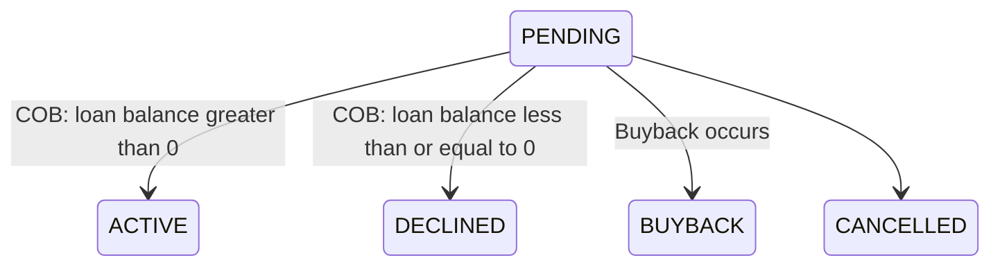

# Asset Ownership Transfer

## Asset ownership transfer overview

You can assign ownership of a loan at any point in its life cycle. Ownership is submitted in real time and updates during close of business (COB), the nightly job that posts interest and fees. Fineract publishes events for all ownership-related activities and provides POST and GET APIs to support them.

## Transfer asset ownership on a loan

Use this screen to submit a loan ownership transfer so the asset can move to an external investor.

1. Select **Institution** > **Clients** and open the client.
2. Under **Loan Accounts**, select the loan account.
3. Open the **Loan Account Actions** menu (the ☰ button next to the account name).
4. Select **Sell Loan** or **Buy Back Loan**.
5. Enter the details described below, then select **Submit**.

| Field | Required | Description |
| --- | --- | --- |
| Settlement Date | Yes | Enter the settlement date for the ownership transfer. |
| Purchase Price Ratio | Yes | Enter the purchase price ratio for the asset sale. |
| Owner External Id | Yes | Enter the external ID of the new asset owner. |
| Transfer External Id | No | Enter the transfer external ID, if applicable. |

The transfer is submitted in real time and starts as PENDING, with the actual ownership update occurring during close of business.

## Sell a loan to an external asset owner

Use the external asset owner tab to sell a loan to an external investor and start an ownership transfer.

1. Select **Institution** > **Clients** and open the client.
2. Under **Loan Accounts**, select the loan account.
3. Select **External Asset Owner**.

The transfer starts as PENDING and moves to ACTIVE at close of business if the loan balance is greater than zero, otherwise it is declined.

## Ownership transfer lifecycle and states

An asset ownership transfer starts in the PENDING state. At close of business (COB), the nightly job that posts interest and fees, the transfer moves to ACTIVE if the loan balance is greater than 0, or to DECLINED if the balance is less than or equal to 0. A transfer can also move from PENDING to BUYBACK when buyback occurs because the asset ownership settlement date is in the future but the account is fraud in the meantime, or to CANCELLED. The final states are ACTIVE, BUYBACK, DECLINED, and CANCELLED.

## Selling loan ownership

Selling loan ownership transfers ownership of the loan to an investor. You can sell ownership only on an active loan that has no active ownership record and a positive balance at close of business (COB), the nightly job that posts interest and fees. On success, the system records the asset owner ID, sale transaction ID, purchase price ratio, and date and time of the ownership change, marks ownership active, and publishes an event.

The system declines the sale and records no ownership change when:

- The loan is closed.
- The loan balance is 0.00 at COB.
- The loan balance is less than 0.00 at COB.
- The loan account cannot be found.
- An active ownership record already exists on the loan account.

## Buying back loan ownership

Buying back loan ownership ends an active ownership record on a loan account. The system records the buyback transaction ID and buyback amount memo, records the date and time of the ownership change, marks ownership inactive, changes the active Asset Owner ID to inactive, and publishes an event.

The buyback succeeds when:

- The loan is active and has an active ownership record.
- The loan is a FRAUD loan with no active ownership record.

The buyback is declined when:

- The loan is closed and has an active ownership record.
- The loan account has no active ownership record.
- The invalid loan account is not found by the RT API call to Fineract SOR.

## Journal entries and external ownership records

The system posts journal entries for an asset owner change or buy back as part of the close of business (COB) jobstep on the settlement date.

The asset owner column of a monetary transaction follows the settlement date plus one rule:

- Any monetary transaction with a business date on or before the settlement date keeps the old investor tagged.
- Any monetary transaction with a business date after the settlement date has the new investor tagged.

The asset owner column is null when:

- There is no active investor for the loan account.
- The loan account belongs to a product where the investor module is disabled.

The system always derives the asset owner column from the current active asset owner as of that business date, regardless of transaction type, backdated transactions, reversals, charge additions or accruals.

External ownership records store the following:

| Record | Stored details |
| --- | --- |
| Externalization status | Loan id, status, and effective date range with from and to dates |
| Externalisation request and history | Incoming externalisation requests and executed externalisation request outcomes |
| Journal entry to external investor mapping | Relationship between journal entries and external investors |

## Transfer timing and balance conditions

Asset ownership transfer entries are created at close of business using the balance at close of business day. The transfer is effective at close of business on the day of request for active loans with a balance greater than 0.00.

## Loan behavior after ownership transfer

After ownership transfers to an investor, the loan keeps the same payment allocation, past due and delinquency tracking, and charge-off rules as before the sale. Fees applied after the sale belong to the investor rather than PayPal.
