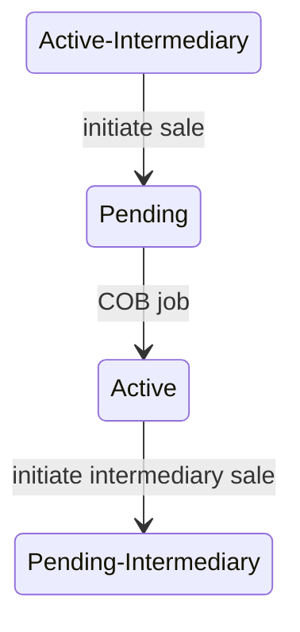
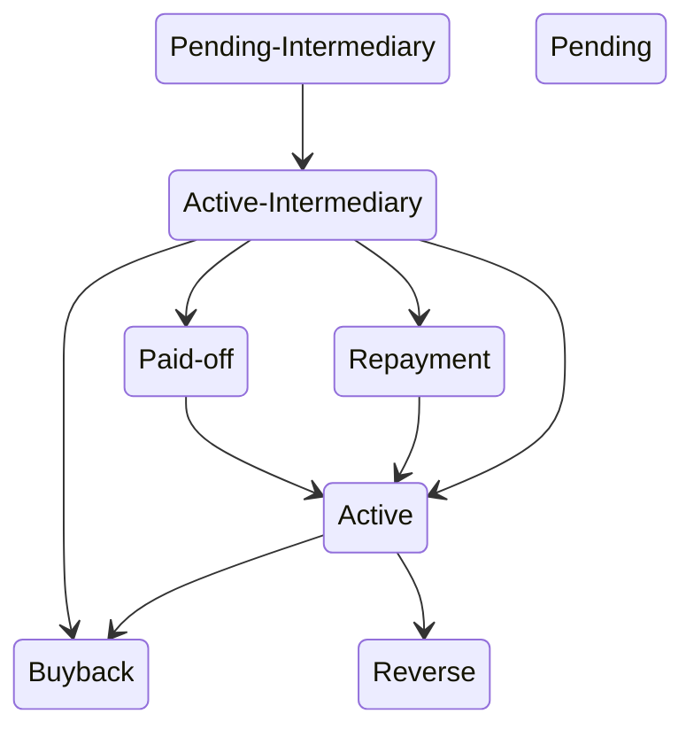

# Investor Module 2.0

## About Investor Module 2.0

Investor Module 2.0 lets you sell a loan account before the sale is complete.

## Intermediary sale statuses

An intermediary sale lets you move a loan through an intermediate sale before the actual sale. The sale starts as Pending-Intermediary, moves to Active-Intermediary, then to Pending, and finally to Active. You provide the owner ID for the intermediary transfer.

## Processing intermediary sale statuses

Pending-Intermediary is invoked through API and has no accounting entries. The close of business (COB) job picks up the sale to make it Active-Intermediary, or declines it when the loan account status is closed or overpaid. Active-Intermediary is processed by COB. Decline can be canceled by you through API from Active-Intermediary and has no accounting entries.

## Moving between sale statuses

You can start a sale on an Active-Intermediary loan account, which moves it to Pending status. The nightly close of business job then picks up the Pending sale and makes it Active. You can also start an intermediary sale on an active loan account, which moves it to Pending-Intermediary status.

## Buyback and buyback-intermediary

Buyback moves an Active loan account to Buyback state through an API call. Buyback-Intermediary moves an Active-Intermediary loan account to Buyback-Intermediary status through an API call.

## Closed or overpaid loans

The close of business (COB) job moves a loan account out of a Pending state even when the loan is closed or overpaid. A Pending loan moves to Active. A Pending-Intermediary loan moves to Declined. An Active-Intermediary loan stays in that state, and you can buy it back or move it to the next status.

COB behaviour by loan account state when the loan is closed or overpaid:

| Loan account state | COB result |
| --- | --- |
| Pending | Moves to Active |
| Pending-Intermediary | Moves to Declined |
| Active-Intermediary | Stays in Active-Intermediary |

For an Active-Intermediary loan that is closed or overpaid:

- You can buy back the loan through Intermediary.
- You can move the loan to the next status.

## Accounting entries

When the status changes from Pending to Active on a loan with a zero balance, the system passes no accounting entries for the zero amount, transfers the status to the new asset owner, and tags any later monetary transaction to the new asset owner.

## Allowed status sequences

Allowed status sequences describe the order in which an asset transfer record can move between statuses.

The following status change orders are not allowed:

- Pending-Intermediary to Pending to Active
- Pending-Intermediary to Active
- Pending-Intermediary to Active-Intermediary to Decline
- Pending-Intermediary to Active-Intermediary to Pending to Active to Decline

| Lifecycle | Status sequence |
| --- | --- |
| Pending-Active-Settled-Buyback | Pending-Intermediary to Active-Intermediary to Active to Buyback |
| Active-Repayment-Settle-Reverse | Pending-Intermediary to Active-Intermediary to Repayment to Active to Reverse |
| Settle-Zero-Balance-Reverse | Pending-Intermediary to Active-Intermediary to Paid-off to Active to Reverse |
| Asset transfer | Pending-Intermediary to Active-Intermediary to Repayment to Buyback |
| Asset transfer | Pending-Intermediary to Active-Intermediary to Active to Buyback |
| Asset transfer | Pending-Intermediary to Active-Intermediary to Repayment to Active to Reverse |
| Asset transfer | Pending-Intermediary to Active-Intermediary to Paid-off to Active to Reverse |

| Lifecycle | Asset transfer record status sequence |
| --- | --- |
| Pending-Active-Settled-Buyback | PENDING-Intermediary, ACTIVE-Intermediary, PENDING, ACTIVE, BUYBACK |
| Active-Repayment-Settle-Reverse | PENDING-Intermediary, ACTIVE-Intermediary, PENDING, ACTIVE |
| Settle-Zero-Balance-Reverse | PENDING-Intermediary, ACTIVE-Intermediary, PENDING, ACTIVE |

## Worked examples

A loan officer starts an intermediate sale of a loan before the sale is complete. The loan balance is 1,000.00. The officer transfers the loan to an intermediary owner 999, creating a Pending-Intermediary record with no accounting entries. At COB the record becomes Active-Intermediary. A repayment of 200.00 reduces the balance to 800.00. The officer then starts a sale to owner 1,001, creating a Pending record, and COB moves it to Active. Finally the officer buys the loan back, creating a Buyback record. The figures are illustrative.

| Step | Event | Status after | Owner | Principal repaid | Balance |
| --- | --- | --- | --- | --- | --- |
| 1 | Start intermediary sale | Pending-Intermediary | 999 | 0.00 | 1,000.00 |
| 2 | COB processes | Active-Intermediary | 999 | 0.00 | 1,000.00 |
| 3 | Repayment of 200.00 | Active-Intermediary | 999 | 200.00 | 800.00 |
| 4 | Start sale | Pending | 1,001 | 200.00 | 800.00 |
| 5 | COB processes | Active | 1,001 | 200.00 | 800.00 |
| 6 | Buyback | Buyback | 1,001 | 200.00 | 800.00 |
| Total |  |  |  | 200.00 |  |

The example shows the full intermediate sale path: Pending-Intermediary to Active-Intermediary at COB, then Pending to Active at the next sale and COB, with buyback possible from Active.

A loan with a zero balance can still change ownership through a sale. The user starts a sale of a loan with balance 0.00 to owner 1,001, creating a Pending record with no accounting entries. At COB the record becomes Active even though the balance is zero. Because the amount is zero, no accounting entries are posted, but the new owner takes over the asset and any later monetary transaction is tagged to that owner. If the same loan were overpaid while in Pending-Intermediary, COB would decline the transfer instead of moving it to Active.

| Step | Event | Status after | Owner | Balance | Accounting entries |
| --- | --- | --- | --- | --- | --- |
| 1 | Start sale | Pending | 1,001 | 0.00 | None |
| 2 | COB processes | Active | 1,001 | 0.00 | None (zero amount) |

The example shows that a zero balance does not block a Pending to Active transfer, and that zero amounts generate no accounting entries while ownership still transfers.
