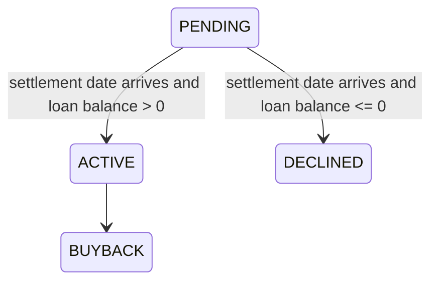

# Investor Module

## Roles involved

An investor is a legal entity referred to as an external owner. A business manager is an employee of the organisation who offers the loan to its customer and either makes a decision on asset sale or whose work uses data related to it. Asset ownership transfer moves an asset portfolio from one owner to another.

## Interest handling on sale and buyback

When you sell an interest-bearing loan to an external investor or buy it back, the sale or buyback amount includes all balances on the loan, including any interest due. Interest balances are handled correctly for both actions, and interest uses the Interest receivables GL mapping.

## Sale fields and values

To transfer ownership of a loan through a sale, you enter an Asset Owner ID, an optional Sales Transaction ID, a Purchase Price Ratio, and a Settlement Date.

| Field | Type | Required for sale | Rules |
| --- | --- | --- | --- |
| Asset Owner ID | String | Yes | Any string, no specific format, maximum 100 characters |
| Sales Transaction ID | String | No | Any string, no specific format, maximum 100 characters |
| Purchase Price Ratio | Number | Yes |  |
| Settlement Date | Date | Yes | Cannot be in the past |

## Eligibility and timing

The system accepts ownership transfer requests only for loans with status ACTIVE. Any other loan status results in rejection.

A rejected ownership transfer response returns:

- HTTP 403 with a reason.

## Transfer response

The ownership transfer response identifies the transferred resource and its new owner, and confirms that the transfer is pending.

| Field | Value |
| --- | --- |
| Resource id | Internal id of the transferred resource |
| Owner id | Id of the new owner |
| Status | PENDING |
| Sales transaction id | Generated if not provided |
| Transfer timestamp | Time of the transfer |
| Effective date range | From the submitted on date to 9999-12-31 |
| Transfer status | PENDING |

## Buyback

A business manager can buy back loans with pending or active ownership transfer from investors when the loan account becomes fraud or for any other reason. Buyback is another activity with its own external Buyback Transfer ID.

When both PENDING and BUYBACK transfers are cancelled:

- No journal entries are made.
- No status change occurs.

## Ownership history and reporting

An auditor can view the history of a loan's ownership changes. Ownership information identifies which GPL loans are PayPal-owned versus investor-owned. A GET API returns ownership details for a loan assigned to an external investor based on the sales transaction ID. Loan transactions are not directly linked to an external investor; they are matched using the posting date or reverted-on date of the transaction and the external owner effective date range. The SOR provides daily investor accounting reports as defined by PayPal.

## Statuses

An investor transfer can have one of five statuses. PENDING means the transfer request has been made but was not made active yet by close of business (COB), the nightly job that posts interest and fees. ACTIVE means the transfer is active and all journal entries are made against the investor. BUYBACK means the loan's ownership was bought back. DECLINED means the request was made but COB has not run and the loan was paid back or overpaid, so there is nothing for the investor to buy. CANCELLED means the request was made but not yet executed, so the transfer can be cancelled.

## Field meanings

| Field | Meaning |
| --- | --- |
| Asset Owner ID | Externally provided string identifying the owner (investor) of a loan (asset). |
| Sales Transaction ID | External transaction ID that must be generated if not provided. |
| Purchase Price Ratio | Percentage between 0% and 100% representing the fraction of investor ownership of a loan. |
| Settlement date | Last date when the previous owner still holds the asset; new ownership starts the very next day. |
| Buyback Transfer ID | Transfer ID of the buyback, different from the one for sale. |
| Effective date range | Period, inclusively bounded by start and end dates, during which the ownership entry is valid. |

## End of day processing

At close of business (COB), the nightly job that posts interest and fees, the system completes any asset ownership transfer whose settlement date has arrived. If the loan balance is greater than 0, the transfer becomes active; if the balance is 0 or less, it becomes declined. When ownership changes from pending to active, or from active to buyback, the system creates journal entries during COB. A buyback path can pass through pending to active and then active to buyback, with journal entries made at each step during COB.

## Worked examples

A loan officer sells an active loan to an external investor. The figures are illustrative. The loan has a principal of 1,200 and outstanding fees of 24, so the total balance to transfer is 1,224. The officer selects the investor as the asset owner, enters a purchase price ratio, and chooses a settlement date that is not in the past. The example shows how the full balance, including fees, moves to the investor.

| Step | Account | Debit | Credit | Owner |
| --- | --- | --- | --- | --- |
| 1 | Receivable/clearing account | 1,224.00 |  | — |
| 2 | Loan Receivables |  | 1,200.00 | — |
| 3 | Interest fees receivables |  | 24.00 | — |
| 4 | Receivable/clearing account |  | 1,224.00 | — |
| 5 | Loan Receivables | 1,200.00 |  | Investor A |
| 6 | Interest fees receivables | 24.00 |  | Investor A |
| Total |  | 2,448.00 | 2,448.00 |  |

A business manager buys back the same loan from the investor because the account has become fraud or for another reason. The loan still shows a principal of 1,200 and outstanding fees of 24, for a total balance of 1,224. The example shows how the buyback returns the full balance, including fees, to the organization's books.

| Step | Account | Debit | Credit | Owner |
| --- | --- | --- | --- | --- |
| 1 | Receivable/clearing account |  | 1,224.00 | — |
| 2 | Loan Receivables | 1,200.00 |  | — |
| 3 | Interest fees receivables | 24.00 |  | — |
| 4 | Receivable/clearing account | 1,224.00 |  | — |
| 5 | Loan Receivables |  | 1,200.00 | Investor A |
| 6 | Interest fees receivables |  | 24.00 | Investor A |
| Total |  | 2,448.00 | 2,448.00 |  |
