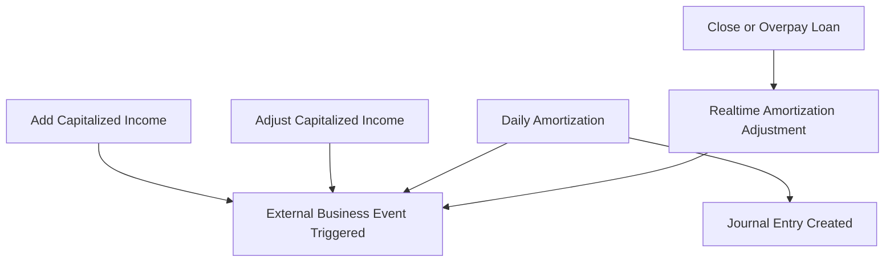

# Capitalized Income

Capitalized income is an amount added to a loan account at disbursement level on the disbursement date only through the API. It is supported for progressive loans only. Once disbursed, a separate transaction type records the capitalized income amount as a normal, monetary transaction. The system treats capitalized income as part of principal, so schedule calculation and interest calculation both use the disbursement amount plus capitalized income. Validation changes so that disbursement amount plus capitalized income must be less than or equal to the applied amount. Any date can be used for capitalized income, and validation matches with the disbursement date.

When you create a loan, the capitalized income configuration is copied from the loan product. Income of capitalized income is recognized on a daily basis periodically. Amortization is based on the configured amortization strategy of the capitalized income, and equal amount amortization is the default and only amortization strategy option. The amortization portion is based on the configuration (Fee vs Interest), and the same configuration decides which GL mapping is used. Fineract tracks the amount of amortized and not yet amortized balances.

If capitalized income is enabled on a loan product, you must configure a new Liability account named Deferred income for periodical accounting. This account is available only for progressive loans if income capitalization is enabled. Configuring Deferred income liability and Income Capitalization income GL mappings on a loan product is allowed if it is a progressive loan and income capitalization is enabled. The GL mapping field is mandatory if income capitalization is enabled, and you can update the GL mapping during a loan product update.

Capitalized Income Adjustment is a new loan transaction type. It works as a Credit Transaction that reduces the Capitalized income balance and reduces loan balances as per the allocation set. The adjustment transaction can have its own Allocation Strategy set, and its accounting entries work like a mirror of Capitalized income entries. Adjustment can be invoked on existing Capitalized Income transactions only, can be done backdated, and the total adjustment amount cannot exceed the original transaction amount.

Charge-off charges off the Capitalized income and no amortization is done after the charge-off date. If a loan is rescheduled and the maturity date changes, the amortization schedule changes with the new maturity date. The system does not support reversal of Capitalized income or Capitalized income adjustment.

## Set up capitalized income on a loan product

Use this screen to turn on capitalized income for a loan product so the income is added to the loan account at disbursement and treated as principal for schedule and interest calculations.

1. Select **Admin** > **Products** > **Loan Products**.
2. Select **Create Loan Product (Classic)**, or open an existing product and select **Edit**.
3. Select **DEFERRED INCOME RECOGNITION**.

| Field | Required | Description |
| --- | --- | --- |
| Enable income capitalization | No | Turn on income capitalization for the loan product. |
| Income capitalization calculation type | Yes | Select how the capitalized income amount is calculated. |
| Income capitalization strategy | Yes | Choose the strategy used to amortize the capitalized income. |
| Income type | Yes | Pick the income type used for capitalized income. |
| Enable Buy down fee | No | Turn on the buy down fee option. |
| Buy down fee calculation type | Yes | Select how the buy down fee amount is calculated. |
| Buy down fee strategy | Yes | Choose the strategy used for the buy down fee. |
| Buy down fee income type | Yes | Pick the income type used for the buy down fee. |
| Merchant Buy down fee | No | Enter the merchant buy down fee amount. |

Capitalized income is copied from the loan product to any loan created from it, and the capitalized income amount is added to the loan at disbursement as a principal portion.

## View capitalized income

The loan deferred income tab shows the capitalized income amount, amortized amount, unrecognized amount, and adjustment amount so you can track how capitalized income is recognized over time.

1. Select **Institution** > **Clients** and open the client.
2. Under **Loan Accounts**, select the loan account.
3. Open the **Buy Down Fees** tab.

You can review the capitalized income balances and see how much has been amortized, how much remains unrecognized, and what adjustments have been applied.

You can add capitalized income after disbursement once the loan is active, and the transaction date can be any date on or after the first disbursement date. Payment type, note, and external ID are supported, and whatever amount you give is the transaction amount.

The following limits apply to capitalized income transactions:

- The transaction date cannot be in the future.
- The adjustment transaction date cannot be earlier than the original transaction date.
- The adjustment transaction date cannot be in the future.
- Adding capitalized income does not change allocation or working for other monetary transactions.

The system tracks capitalized income balances as follows:

- Balances are tracked on a loan and capitalized income transaction basis, with one entry per transaction per loan.
- Balances are stored in the database and maintained over capitalized income events such as adding capitalized income and daily amortization.
- The adjustment amount is deducted from the remaining not yet recognized amount.
- The remaining not yet recognized amount cannot be negative; if it goes negative, the balance is set to zero.

When a loan ends early, capitalized income is handled as follows:

- If the loan is preclosed on the same day, final amortization is done for the balance amount.
- In one shot, all of the remaining not yet recognized amount is recognized as income upon preclose.
- Any not yet recognized balance is moved to charge-off.
- Undoing charge-off undoes this behavior and adjusts these accounting entries.
- Once a loan is paid off, there is no reversal or anything that undoes the realized income.

You can reverse capitalized income transactions under these conditions:

- A not yet reversed Capitalized Income transaction can be reversed if there is no not yet reversed Capitalized Income Adjustment that belongs to this transaction.
- When a Capitalized Income transaction is reversed, all already amortized amounts are corrected in a Capitalized income amortization adjustment transaction with mirror journal entries of Capitalized income amortization.

Capitalized Income records income as principal on a loan and recalculates the repayment schedule with the increased principal.

Each adjustment transaction links to its original Capitalized Income transaction:

- The adjustment transaction lists relations between the original Capitalized Income transaction and the Capitalized Income Adjustment transaction with relation type ADJUSTMENT.
- A Capitalized Income Adjustment transaction that has not yet been reversed can be reversed.
- Mirror journal entries are based on the reversal entry of a Capitalized Income Adjustment transaction.

Accounting entries depend on whether the adjustment amount is lower than or equal to, or higher than, the remaining not yet recognized amount of LoanCapitalizedIncomeBalance.

| Condition | Debit | Credit |
| --- | --- | --- |
| Adjustment amount is lower than or equal to the remaining not yet recognized amount | Capitalized income adjustment | Deferred Income mapping (Liability) and Loan Portfolio (Asset) |
| Adjustment amount is higher than the remaining not yet recognized amount | Capitalized income adjustment and Deferred Income mapping (Liability) | Income from capitalization mapping (Income) and Loan Portfolio (Asset) |

For Capitalized Income Adjustment transactions on closed or overpaid loans:

- The transaction follows the payment allocation strategy set, and the overpaid amount credits the overpaid portion.
- No changes are made to the overpaid portion on the repayment schedule side.
- Accounting for the overpaid portion debits Income from amortization (GL: Interest/fees Income) and credits Overpayment Liability (GL: Overpaid GL).

When Capitalized Income is applied on closed or overpaid loans:

- Future installments from the Capitalized Income posting date are recalculated accordingly.
- The accounting entry remains the same as before, debiting Loan Portfolio (GL: Loan Receivable) and crediting Deferred income mapping (GL: Deferred Income GL).

Reverse-replay handling:

- The Capitalized Income reverse-replay situation applies when the loan was in an overpaid state or goes into an overpaid state.
- Capitalized Income reverse-replay handling is the same as Disbursement transaction handling.
- Capitalized Income Adjustment reverse-replay handling is the same as Repayment transaction handling.

You can make multiple adjustments against the same original transaction.

Configuration options:

| Setting | Options | Default |
| --- | --- | --- |
| Calculation mode | FLAT | FLAT |
| Amortization strategy | Equal amortization | Equal amortization |
| Income type | FEE, INTEREST | FEE |
| Capitalized income status | Enable | Enable |

Accounting entries:

| Transaction | Debits | Credits |
| --- | --- | --- |
| Capitalized Income transaction | Loan Portfolio (Asset) | Deferred Income (Liability) |
| Capitalized Income Amortization transaction | Deferred Income (Liability) | Income from Capitalization (Income) |
| Capitalized Income Adjustment transaction | Deferred Income (Liability) / Income from Capitalization (Income) | Loan Portfolio (Asset) |
| Capitalized Income Amortization Adjustment transaction | Income from Capitalization (Income) | Deferred Income (Liability) |

Capitalized Income amounts are limited as follows:

- Capitalized Income transaction: `maximum = approved loan amount − total disbursed amount − total capitalized income`
- Capitalized Income adjustment: `maximum = Capitalized Income transaction amount − adjustments already made for that transaction`
- The daily amortization amount equals the not yet amortized capitalized income divided by the number of days between the current date and the loan maturity date.
- The system rounds the calculated amortization amount according to the rounding mode configuration.

## Worked examples

A loan officer disburses a progressive loan and adds capitalized income on the same day. The capitalized income is added to the loan principal, so the repayment schedule is calculated on the combined amount. Interest is charged on that higher balance, and the deferred income is amortized daily over the term. The figures below are illustrative.

| Month | Opening balance | EMI | Interest | Principal | Closing balance |
| --- | --- | --- | --- | --- | --- |
| 1 | 1,200.00 | 408.03 | 12.00 | 396.03 | 803.97 |
| 2 | 803.97 | 408.03 | 8.04 | 399.99 | 403.98 |
| 3 | 403.98 | 408.02 | 4.04 | 403.98 | 0.00 |
| Total |  | 1,224.08 | 24.08 | 1,200.00 |  |

If a 50.00 capitalized income adjustment is posted after the first repayment, the balance drops to 753.97 instead of 803.97, and later interest is calculated on the lower amount.

A customer precloses the same loan on the second month date. The outstanding balance plus the interest accrued for that month is due in full. Any capitalized income that has not yet been recognized is recognized in full on the preclose date, and no further amortization is posted.

| Step | Description | Amount | Balance |
| --- | --- | --- | --- |
| 1 | Balance after first repayment |  | 803.97 |
| 2 | Interest accrued for second month | 8.04 | 812.01 |
| 3 | Preclosure payment received | -812.01 | 0.00 |
| 4 | Remaining deferred income recognized | 200.00 |  |

If the loan is charged off on that date instead, amortization stops and the remaining deferred income is charged off rather than recognized as income.
