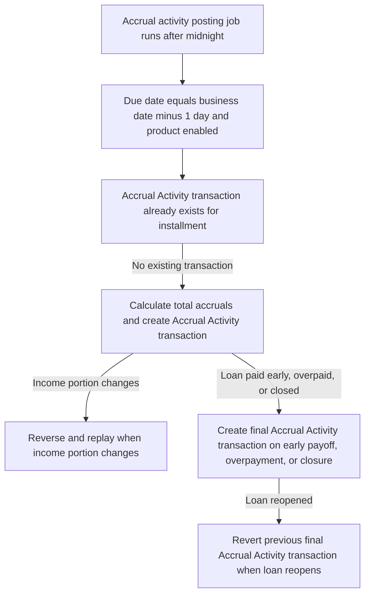
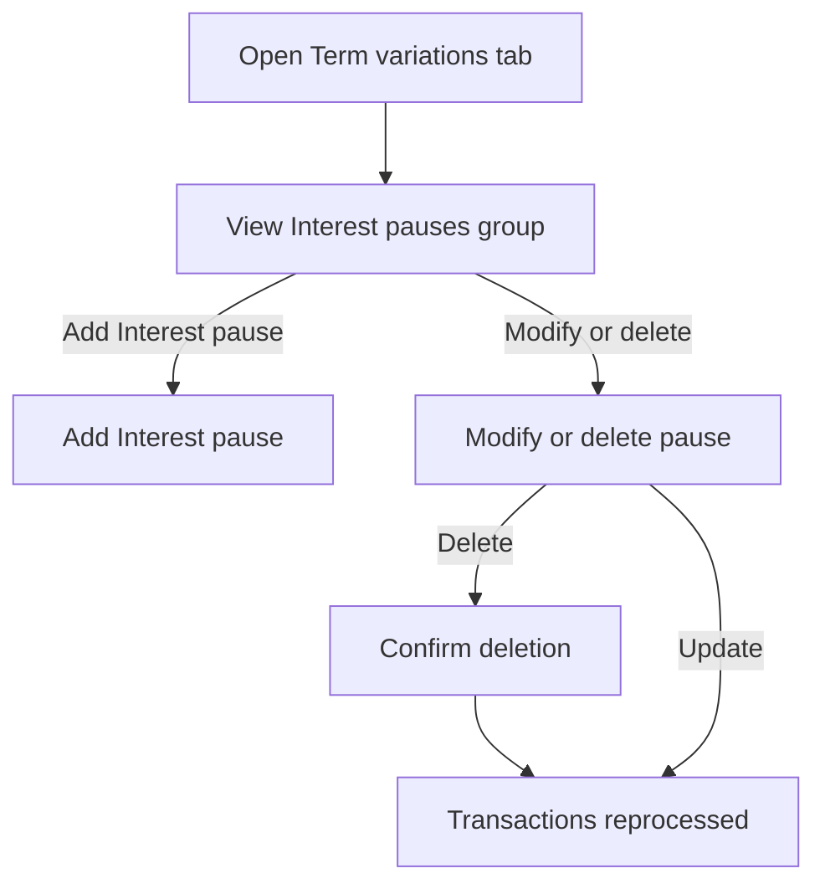

# Accruals

## Progressive Loan Accruals

### About progressive loan accruals

Progressive loan accruals calculate interest daily from the last accrued date or disbursement date to the current accrual date. The system holds the accrued interest until the next billing cycle, when it becomes due and payable as part of the total balance due on the loan.

### Accrual posting period and frequency

The periodic accrual posting job posts accruals on loan accounts according to the set accrual posting period. Each entry posts interest, fees, and penalties calculated for that posting period.

The accrual posting period determines how often accruals post:

- Monthly: accrual posts every month.
- Daily: accrual posts every day.

### Eligibility and exclusions

The accrual job excludes certain loan statuses and balances based on setups defined for your product. Interest accruals continue as usual for loan accounts marked as charge-off.

### How accrual transactions are created

The accrual job calculates interest based on the balances and rates set when the loan was created. For each business day, the Add periodic accruals business step creates an Accrual or Accrual - Adjustment transaction, so no business day is missed. Income recognition happens at end of day.

The job compares the total accrued amount with the calculated amount as of the current date:

- If the adjustment amount is higher than the amount already posted, the job creates an Accrual transaction for the current date with the higher amount.
- If the adjustment amount is lower than the amount already posted but not lower than the latest accrual amount, the job creates an Accrual transaction for the current date with the lower amount.
- If the adjustment amount is lower than both the amount already posted and the latest accrual amount, the job posts the negative difference as an Accrual - Adjustment transaction.

Accrual adjustments:

- Accrual - Adjustment is a new transaction type.
- An Accrual - Adjustment transaction can correct the total amount when extra income was recognized.
- An Accrual - Adjustment transaction decreases the accrued portions on the repayment schedule.
- There is no accrual reverse-replay; the next accrual uses a higher or lower amount, or an Accrual - Adjustment transaction deducts the accrual amount.
- All accrual adjustments happen at end of day as part of the periodic accrual job.

When the job runs:

- The Add Periodic Accrual Transactions job calculates and creates the accrual or accrual adjustment transaction.
- With the close of business job, the Add periodic accrual business step runs as part of closing the actual business day.

### Accrual adjustments and corrections

Backdated repayments and reversals of backdated repayments before the last accrual transaction trigger recalculation of the accrual amount, and the difference is adjusted to the latest accrual transaction only. Recognized income might change when backdated activity causes interest recalculation, when a backdated disbursement happens, or when a previous repayment is reversed and interest is recalculated. Accruals are not recalculated or reverse-replayed as a side effect of any action.

Adjustments apply in these situations:

- Backdated monetary activity may require reverse-replay or creation of additional accrual entries for transitions between Closed obligations met and Overpaid.
- Backdated monetary activity transitions must be handled and recalculated properly.

### Limitations and unsupported behavior

Interest accruals are recalculated only during the close of business (COB) job or the “Add periodic Accrual transactions” job execution.

### Schedule and income recognition

### Worked examples

Figures in this example are illustrative. A loan of $1,000.00 is disbursed on the first day of the month at a 12% annual interest rate, with 30-day months and a daily accrual posting period. To keep the table short, this example uses a five-day billing cycle. Interest accrues on the outstanding balance each day and is held in an accrued-interest bucket until the next billing cycle, when it becomes due. No repayment is made during the period, so the principal balance stays at $1,000.00 and each day’s accrual is interest only.

The example shows that daily accruals post each day but only become due at the end of the billing cycle, while the principal balance is unchanged.

| Day | Balance | Daily accrual | Accrued bucket | Due |
| --- | --- | --- | --- | --- |
| 1 | $1,000.00 | $0.00 | $0.00 | $0.00 |
| 2 | $1,000.00 | $0.33 | $0.33 | $0.00 |
| 3 | $1,000.00 | $0.33 | $0.66 | $0.00 |
| 4 | $1,000.00 | $0.33 | $0.99 | $0.00 |
| 5 | $1,000.00 | $0.33 | $1.32 | $1.32 |

The same $1,000.00 loan and 12% annual rate can use a monthly accrual posting period instead of daily. With monthly posting, the system creates no daily accrual transactions; it calculates the same interest for the month and posts it once as a single accrual on the cycle’s last day. The total interest for the month is unchanged; only the number and timing of accrual transactions differ.

Changing the posting period from daily to monthly does not change the interest amount; it changes how often the accrual transaction is created.

| Posting period | Day 2 | Day 15 | Day 30 | Total posted | Accrual transactions |
| --- | --- | --- | --- | --- | --- |
| Daily | $0.33 | $0.33 | $0.33 | $9.90 | 30 |
| Monthly | $0.00 | $0.00 | $9.90 | $9.90 | 1 |

A backdated repayment can reduce the interest that was already accrued. A loan of $1,000.00 at 12% annual interest uses a monthly posting period and a 30-day month, so the month-end accrual is $9.90. After that accrual posts, a $200.00 principal repayment is backdated to the first day of the month. The balance for the month becomes $800.00, and the recalculated interest is $8.10. Because $8.10 is lower than the $9.90 already posted and lower than the latest accrual, the system does not reverse or replay the old accrual. Instead, it posts an “Accrual - Adjustment” of -$1.80, which reduces the accrued portions on the repayment schedule to $8.10.

The example shows that the system corrects over-accrued interest with an adjustment transaction rather than reversing past accruals.

| Step | Balance | Amount | Accrued interest due | Notes |
| --- | --- | --- | --- | --- |
| Disbursement | $1,000.00 | $0.00 | $0.00 | Loan opened. |
| Month-end accrual | $1,000.00 | $9.90 | $9.90 | Posted as due on billing date. |
| Backdated repayment applied | $800.00 | — | $9.90 | $200.00 principal repaid effective from day 1. |
| Recalculated interest | $800.00 | $8.10 | $8.10 | Lower than the posted amount. |
| Accrual - Adjustment | $800.00 | -$1.80 | $8.10 | Negative difference posted; reduces accrued portions. |

## Accrual Activity on Installment Dates

Accrual activity creates a transaction at each installment level within the total interest accrued for that installment period. It posts on the installment due date for active loans only, covering income portions such as interest, fees and penalties income. The transaction has no accounting entries and does not affect balances or the repayment schedule. A loan product administrator enables or disables accrual activity posting at loan product level, and the setting is available when accrual accounting is enabled. By default, accrual activity posting is not enabled.

The accrual activity posting job runs after midnight, around 2 AM, after the Apply penalty to overdue loans job.

- The job checks whether the actual business date minus one day equals the due date of any installment of a loan where accrual activity posting is enabled.
- If the job finds such an installment and no accrual activity transaction exists for it, the job calculates the total accruals for that installment and creates a new transaction.
- If a loan is pre-closed, one accrual activity entry is posted as of the last transaction date.
- If a pre-closed loan is re-opened due to a new disbursement or chargeback, accrual activity is created for the next installments up to the current date, with interest calculated from the previously posted accrual activity on the earlier pre-close date.
- If a loan goes overpaid, the final accrual is created if applicable.
- If a loan is fully paid or overpaid earlier than planned, a final accrual activity transaction is created that includes all income portions up to that date.
- If a loan is closed, the final accrual activity transaction can be created when the loan status changes.
- If a loan is reopened, any previously created accrual activity transaction is found and reverted.

The accrual activity transaction is reversed and replayed in these situations:

- The income portion amount changes during schedule recalculations, such as reversal of an older repayment.
- During transaction and charge reprocessing, if the accrual balances change on the installment.

> **Note:** The system stores and sends both previous and new income portion values during reverse and replay.

### Enable accrual activity posting on installment due date

Use this screen to turn on accrual activity posting at loan product level so the system can create accrual activity transactions on installment due dates.

1. Select **Admin** > **Products** > **Loan Products**.
2. Select **Create Loan Product (Classic)**, or open an existing product and select **Edit**.
3. Select **ACCOUNTING**.
4. Set the fields described below, then select **Next** to continue through the form and save it at the end.

| Field | Required | Description |
| --- | --- | --- |
| Enable Accrual Activity Posting on Installment Due Date | No | Select this to enable accrual activity transaction posting for the loan product. |
| Advanced Accounting Rules | No | Open the advanced accounting rules for the loan product. |

Accrual activity posting is enabled for the loan product, and the system creates accrual activity transactions for active loans on installment due dates.

### Worked examples

A customer takes out a loan of 1,200 at a 12% annual interest rate, to be repaid in three equal monthly installments over 30-day months. Interest accrues daily at 0.40. The first installment is due on 1 February and consists of 400 principal and 12 interest. These figures are illustrative.

| Date | Event | Accrual activity posted | Principal repaid | Outstanding balance |
| --- | --- | --- | --- | --- |
| 1 January | Loan disbursed | – | – | 1,200.00 |
| 2–31 January | Daily interest accrues (30 days × 0.40) | – | – | 1,200.00 |
| 1 February | Accrual activity posts the installment’s interest income | 12.00 | – | 1,200.00 |
| 1 February | Installment repayment received | – | 400.00 | 800.00 |

This shows that accrual activity posts the income portion on the due date without changing the loan balance; the repayment then reduces the principal.

A loan of 1,200 at 12% annual interest accrues 0.40 per day. When the loan is preclosed on 10 January, the system posts one accrual activity entry as of that last transaction date, covering nine days of interest (3.60). If the loan is reopened later through a new disbursement or chargeback, the system creates accrual activity for the following installments up to the current date, calculating interest from the previously posted preclose entry. With reopening, new entries continue after the preclose date; without it, accrual stops at preclose.

| Date | Event | Accrual activity posted | Principal repaid | Outstanding balance |
| --- | --- | --- | --- | --- |
| 1 January | Loan disbursed | – | – | 1,200.00 |
| 2–10 January | Daily interest accrues (9 days × 0.40) | – | – | 1,200.00 |
| 10 January | Preclose: one accrual activity entry posts income to date | 3.60 | – | 1,200.00 |
| 10 January | Preclose repayment settles the full balance | – | 1,200.00 | 0.00 |

This shows that preclose generates a single accrual entry as of the last transaction date, while reopening restarts accrual for later installments.

A 900 loan at 12% annual interest accrues 0.30 per day. The customer pays the loan off early on 15 January, before the first installment is due. Because the loan is fully paid earlier than planned, the system creates a final accrual activity transaction that includes all income portions from disbursement through the payoff date. If the loan is later reopened, that final entry is reverted.

| Date | Event | Accrual activity posted | Principal repaid | Outstanding balance |
| --- | --- | --- | --- | --- |
| 1 January | Loan disbursed | – | – | 900.00 |
| 2–15 January | Daily interest accrues (14 days × 0.30) | – | – | 900.00 |
| 15 January | Early payoff: final accrual activity posts all income to date | 4.20 | – | 900.00 |
| 15 January | Repayment settles principal and accrued interest | – | 900.00 | 0.00 |

The final accrual activity captures every income portion up to the early payoff date, and reopening the loan would revert that final entry.

## Pausing and Resuming Accruals

### About interest pause

Interest pause permanently defers borrower payments for the configured days, with no interest accrued or recovered later. It applies only to progressive loans with recalculate interest set to true. A moratorium or grace period defers payments temporarily while accrued interest is collected through future installments.

### Add an interest pause

Use this screen to pause interest for a chosen period so that no interest accrues during those days.

1. Select **Institution** > **Clients** and open the client.
2. Under **Loan Accounts**, select the loan account.
3. Select **Add Interest Pause**.
4. Enter the details described below, then select **Submit**.

| Field | Required | Description |
| --- | --- | --- |
| Start Date | Yes | Enter the start date of the interest pause. It can be backdated, but it cannot be on or after the maturity date. |
| End Date | Yes | Enter the end date of the interest pause. It cannot be earlier than the start date or later than the maturity date. |

After you submit, no interest is calculated or accrued for the inclusive pause period, and the pause appears under Interest pauses on the Term variations tab.

### Eligibility and timing

You can pause interest for any period within the loan life cycle by providing a start date and an end date. Interest pause applies only to an active loan, and multiple pauses can occur during the loan life cycle as long as they do not overlap.

The start and end dates must follow these rules:

- The end date cannot be earlier than the start date.
- The pause period must be at least one day.
- The start date cannot be on or after the maturity date.
- The end date cannot go beyond the maturity date.
- The end date cannot be later than the actual maturity date.
- A backdated start date is allowed.

### How interest pause works

Both the start date and end date are inclusive, so interest pauses on the start day and resumes after the end day. If the start and end date are the same, only that day is paused.

During the pause:

- No interest is calculated for the paused days.
- No interest accrual transaction is posted between the start date and end date, inclusive.
- Interest resumes at the original rate from the day after the end date.

The pause works the same way for pay-off, charge-off and reschedule calculations.

If repayments fall between the backdated start date and the pause date, those repayments are reversed and replayed, and any difference in interest recognition is adjusted.

### Charges and penalties

During an interest pause, charges based on interest are recalculated with 0 interest, and penalties based on late payment of interest become 0. Charges independent of interest remain as they are. Charges or penalties added later are not affected by the interest pause. Only charges or penalties created based on a percentage of interest are reversed and replayed based on the new interest.

Updating or deleting an interest pause resets interest-based charges.

- Updating or deleting an interest pause resets interest-based charges.

### Payments and installments

During an interest pause, your EMI amount stays the same. The last unpaid installment may be lower because the pause reduces the interest charged on it.

### Backdated pauses and recalculation

If repayments fall between the backdated date and the current date, the system reverses and replays them and recalculates accruals. If this changes interest recognition, the system makes an accrual adjustment at the next close of business (COB), the nightly job that posts interest and fees.

### Viewing and managing interest pauses

Interest pauses appear under the Term variations tab in a group named Interest pauses. Each entry shows the start date and end date, and the system calculates the number of days as end date minus start date plus one. Entries are listed in ascending order by start date.

You can do the following from the Term variations tab:

- Add an interest pause from the Add Interest pause option in the action menu top right corner under the More submenu.
- Modify an existing interest pause period.
- Delete an existing interest pause period; the system asks for confirmation before deleting.

> **Note:** After you delete or update an interest pause, the system reprocesses transactions to reflect the change.

### Updating and deleting interest pauses

Deleting an interest pause is a logical deletion, so the pause record remains in the system but no longer applies. Updating an interest pause uses the same validation as creating one.

### Worked examples

Situation: a single interest pause inside one installment period. The figures are illustrative. A user sets up an active progressive loan with recalculate interest set to true: principal 1,000, annual interest rate 12 percent, which is 1 percent a month on a 360-day year with 30-day months, and three monthly installments. Interest is charged on the opening balance of each installment. The officer pauses interest from 2/6/24 through 2/8/24, three inclusive days that fall inside the second interest period, so no interest accrues on those days. The EMI does not change.

| Installment | Date | Opening balance | Interest | Principal paid | Payment | Closing balance |
| --- | --- | --- | --- | --- | --- | --- |
| 1 | 2/1/24 | 1,000.00 | 10.00 | 330.03 | 340.03 | 669.97 |
| 2 | 3/1/24 | 669.97 | 6.03 | 334.00 | 340.03 | 335.97 |
| 3 | 4/1/24 | 335.97 | 3.36 | 335.97 | 339.33 | 0.00 |
| Total |  |  | 19.39 | 1,000.00 | 1,019.39 |  |

The example shows that the EMI stays the same, the paused days carry no interest, the balance falls faster, and the final installment is lower; a pause that falls between two periods works the same way, because only the installment whose period contains the pause dates is reduced, and several non-overlapping pauses apply the same reduction each time while overlapping pauses are not allowed.

Situation: a backdated interest pause applied after a repayment has already been posted. A user has the same active progressive loan with recalculate interest set to true: principal 1,000, annual interest rate 12 percent, monthly installments, and 30-day months. The first installment of 340.03 on 2/1/24 has already been paid, leaving a balance of 669.97. The officer then backdates an interest pause to 1/25/24 through 1/27/24, three inclusive days inside the first interest period. Because the repayment on 2/1/24 was posted after the backdated start date, that repayment is reversed, interest for the paused days is removed, and the repayment is replayed with the lower interest; an accrual adjustment posts at the next end of day for any remaining interest-recognition difference.

| Installment | Date | Opening balance | Interest | Principal paid | Payment | Closing balance |
| --- | --- | --- | --- | --- | --- | --- |
| 1 | 2/1/24 | 1,000.00 | 9.00 | 331.03 | 340.03 | 668.97 |
| 2 | 3/1/24 | 668.97 | 6.69 | 333.34 | 340.03 | 335.63 |
| 3 | 4/1/24 | 335.63 | 3.36 | 335.63 | 338.99 | 0.00 |
| Total |  |  | 19.05 | 1,000.00 | 1,019.05 |  |

The example shows that the posted repayment is reversed and replayed at the lower interest, the balance after the pause is lower, total interest is 19.05 instead of 20.07 without the pause, and the final installment is lower, while the EMI stays the same.

## Real-Time Charge Accruals

Real-time charge accruals recognize a charge as income immediately when the charge transaction is posted, instead of waiting for end-of-day processing. This applies to working capital loans and progressive loans. The default setting for both loan types is end-of-day accrual.

| Loan type | Configuration | Options | Default |
| --- | --- | --- | --- |
| Working capital loan | wcl-charge-accrual-time | Real-Time, EOD | EOD |
| Progressive loan | pl-charge-accrual-time | Real-Time, EOD | EOD |

When real-time accrual is selected:

- The system creates an accrual transaction for the charge amount immediately when a new fee or penalty is added.
- If multiple charges are added, the system creates one accrual transaction for each charge.
- Working capital loans support multiple accrual transactions per day.
- The selected setting applies consistently to all applicable charge accrual transactions.
