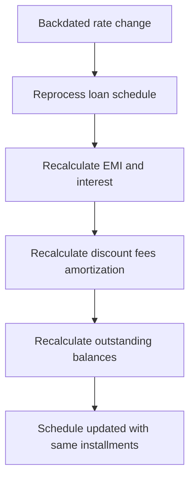

# Rate Changes

## Overview

### About interest rate changes

You can change the interest rate on an active loan account during the loan lifecycle. The change applies to future dates only, starting the day after the current date. Progressive loans are supported.

### Change the interest rate on a loan

Use the loan reschedule screen to change the interest rate for the rest of an active loan's lifecycle.

1. Select **Institution** > **Clients** and open the client.
2. Under **Loan Accounts**, select the loan account.
3. Open the **Loan Account Actions** menu (the ☰ button next to the account name).
4. Select **Reschedule**.
5. Enter the details described below, then select **Submit**.

| Field | Required | Description |
| --- | --- | --- |
| Reschedule from Installment On | Yes | Enter the installment from which the reschedule applies; this field is required. |
| Reason for Rescheduling | Yes | Enter the reason for rescheduling; this field is required. |
| Submitted On | Yes | Enter the date the reschedule was submitted; this field is required. |
| Comments | No | Enter any comments about the reschedule. |
| Adjust interest rates for remainder of loan | No | Select this option to adjust the interest rates for the remainder of the loan. |
| New Interest Rate | No | Enter the new interest rate; there is no restriction on the provided interest rate value. |

After you submit, the EMI is recalculated based on the new interest rate and the future schedule and outstanding balances are instantly recalculated.

### Eligibility and timing

The change can apply from day 1, day 15, or the last day of a period.

Timing rules:

- You can schedule an interest rate change for any date from the business date plus one day onward.
- You cannot set more than one interest rate change to start on the same date.

### How to change the interest rate

You can change a loan's interest rate from a chosen installment onward, with the new rate taking effect immediately. For progressive loans, you can instead set a future date when the new interest rate starts.

### Schedule recalculation and EMI

When you change an interest rate, the system recalculates the EMI for the current period and all future periods that are not fully paid. Installments stay the same; only the EMI changes.

The recalculation works as follows:

- The repayment schedule is recalculated from the reschedule date using the new interest rate.
- Earlier installments up to the interest rate change date keep the old interest rate; new installments from that date use the new rate.
- If the rate changes in the middle of a period, interest is calculated for that period and the EMI changes based on the difference between the last installment and the calculated EMI.
- Interest modification instantly recalculates the future schedule and outstanding balances.

### Interest calculation and refunds

Interest on the next installment uses the new rate. Earlier dates for interest and accrual do not change.

### Events and audit trail

You can view the list of interest rate periods and changes made for a loan account on a new tab for the loan.

### System processing and supported features

The system applies interest rate changes to loan periods during schedule generation and reprocessing. It fetches all interest rate variations and uses them to calculate the proper EMI and interest. The new interest value keeps the interest frequency from the loan product. Progressive loan schedules and advanced payment allocation support interest rate changes through loan term variations. Backdated repayments or reversals remain allowed after an interest modification. There is no restriction on the interest rate value you provide.

### Worked examples

Situation: an active progressive loan with a principal of 1,000, an annual interest rate of 12 %, three monthly instalments and 30-day months. The first instalment falls due on 1 Feb and is paid at the old rate. On business date 10 Feb, a loan officer changes the interest rate to 8 % effective from 1 Mar. The figures are illustrative. The first instalment keeps the 12 % rate; only the unpaid instalments are recalculated at 8 %, so the EMI falls from 340.02 to 338.37 and the final instalment absorbs the cent difference. Choosing a later effective date would keep more instalments at the old rate.

| Due date | Opening balance | EMI | Interest | Principal | Closing balance | Rate |
| --- | --- | --- | --- | --- | --- | --- |
| 1 Feb | 1,000.00 | 340.02 | 10.00 | 330.02 | 669.98 | 12 % |
| 1 Mar | 669.98 | 338.37 | 4.47 | 333.90 | 336.08 | 8 % |
| 1 Apr | 336.08 | 338.32 | 2.24 | 336.08 | 0.00 | 8 % |
| Total |  | 1,016.71 | 16.71 | 1,000.00 |  |  |

Situation: an active progressive loan with a principal of 1,000, an annual interest rate of 12 %, three monthly instalments and 30-day months. The borrower makes an early payment of 340.02 on 15 Jan, covering the first instalment ahead of its 1 Feb due date. On business date 19 Jan, a loan officer changes the interest rate to 8 % effective from 20 Jan. The early payment reduces the balance before the change, and the remaining instalments are recalculated at the new rate from the changed date. The figures are illustrative. An early payment lowers the outstanding balance, so the interest charged after the rate change is calculated on a smaller amount and the future EMI drops accordingly. Applying the change to the last instalment instead of the next would move the entire recalculation to the final payment.

| Date | Opening balance | Payment / EMI | Interest | Principal | Closing balance | Rate |
| --- | --- | --- | --- | --- | --- | --- |
| 15 Jan (early payment) | 1,000.00 | 340.02 | 4.67 | 335.35 | 664.65 | 12 % |
| 1 Mar | 664.65 | 335.68 | 4.43 | 331.25 | 333.40 | 8 % |
| 1 Apr | 333.40 | 335.62 | 2.22 | 333.40 | 0.00 | 8 % |
| Total |  | 1,011.32 | 11.32 | 1,000.00 |  |  |

See also: [Interest Timing: Early and Late Repayment Interest](confluence-link:Interest%20Timing#early-and-late-repayment-interest).

## Backdated Rate Changes

### Backdated interest modification

You can apply an interest modification retroactively, and the system adjusts accrued interest automatically from the applied date.

### Apply a backdated interest rate change

Use the loan reschedule screen to modify the interest rate from a backdated date, which recalculates the repayment schedule with new EMI and interest from the applied schedule date.

1. Select **Institution** > **Clients** and open the client.
2. Under **Loan Accounts**, select the loan account.
3. Open the **Loan Account Actions** menu (the ☰ button next to the account name).
4. Select **Reschedule**.
5. Enter the details described below, then select **Submit**.

| Field | Required | Description |
| --- | --- | --- |
| Reschedule from Installment On | Yes | Select the installment from which the reschedule applies; this field is required. |
| Reason for Rescheduling | Yes | Enter the reason for rescheduling; this field is required. |
| Submitted On | Yes | Enter the date the reschedule was submitted; this field is required. |
| Comments | No | Add any comments about the reschedule. |
| Adjust interest rates for remainder of loan | No | Turn this on to adjust interest rates for the remainder of the loan. |
| New Interest Rate | No | Enter the new interest rate to apply from the backdated date. |

The system recalculates the repayment schedule with a new EMI and interest from the interest applied schedule date, while the number of installments stays the same.

### Eligibility and timing

You can change the interest rate from any date starting on the first disbursement date. Backdated interest modification is supported for progressive loans only.

### Schedule and balance recalculation

When you apply a backdated rate change, the system reprocesses the loan schedule from the interest applied schedule date. The number of installments stays the same; only the EMI and interest change.

The recalculation covers:

- The EMI is recalculated from the date the interest rate was changed and must respect the installment in multiples of configuration.
- Discount fees amortization is recalculated.
- Outstanding balances are recalculated.

### Reverse replay and accounting

A backdated repayment or reversal triggers a reverse replay of previously paid installments that calculated interest under the earlier rate. Paid interest is reverse replayed from the applied date using the new interest rate, and all subsequent transactions and their associated accounting entries are replayed. Accrual adjustments occur during reverse replay as part of the close of business process.

Reverse replay also applies when:

- Backdated interest modification is made on already paid installments.
- Paid installments and unpaid or partially paid installment EMIs change to match the newly calculated EMI.
- Any change in transaction allocations reverses and replays the transactions.

### Charged-off loans

You can backdate interest modification on a loan that is charged off. This applies whether the charge-off configuration is set to regular, accelerate maturity to charge-off date, or zero interest after charge-off. If repayment made before charge-off is reversed and replayed due to backdated interest modification, the accounting entry of the reversed transaction and replayed transaction follows standard accounting rules and not charge-off accounting rules.

### Closed loans

You can keep backdated interest modification open on a closed loan. When you change backdated interest on a closed loan, the system performs chronological reverse-replay and allocates the schedule and transactions accordingly.

### Asset owner changes

You can apply a backdated interest modification to a loan account even after its asset owner changes. If a repayment made before the asset owner change is reversed and replayed because of that modification, the accounting entries for both the reversed transaction and the replayed transaction carry the tag of the current asset owner. A backdated interest modification can also change the loan status, such as from ACTIVE to CLOSED or OVERPAID, or from CLOSED to OVERPAID.

### Overpaid loans

You can apply a backdated interest modification to an overpaid loan once close of business replay (CBR) is complete. Any action that triggers recalculation on a CBR loan treats CBR as a credit transaction during reverse-replay.

### Progressive loans and zero interest

You can change the interest rate on a progressive loan from zero to a higher rate, or from a higher rate to zero. Every progressive loan uses the EmiCalculator and model to calculate the repayment schedule even when the interest rate is zero.

### Worked examples

Situation: a progressive loan is disbursed for 1,000 at 12% annual interest and repaid in 3 monthly installments over 30-day months. At 12% the original schedule has an EMI of 340.02 and total interest of 20.07. Before the first installment is paid, the officer changes the interest rate to 8% and backdates the change to the first installment date, which is on or after the first disbursement date. The figures are illustrative. The system keeps the number of installments at three and recalculates the EMI and interest from the applied date; any already-paid installment is reverse-replayed at the new rate. Changing the rate to 0% or from 0% uses the same recalculation, but only progressive loans allow a move to or from zero. The example shows that the installment count stays at three while the EMI falls from 340.02 to 337.79 and total interest falls from 20.07 to 13.37.

| Installment | Due date | Opening balance | Interest | EMI | Principal repaid | Closing balance |
| --- | --- | --- | --- | --- | --- | --- |
| 1 | 4/1/2025 | 1,000.00 | 6.67 | 337.79 | 331.12 | 668.88 |
| 2 | 5/1/2025 | 668.88 | 4.46 | 337.79 | 333.33 | 335.55 |
| 3 | 6/1/2025 | 335.55 | 2.24 | 337.79 | 335.55 | 0.00 |
| Total |  |  | 13.37 | 1,013.37 | 1,000.00 |  |

Situation: a progressive loan of 1,000 at 12% annual interest, repaid in 3 monthly installments over 30-day months, has already been closed or charged off with a zero balance. The officer backdates a rate change to 8% effective from an earlier installment date. The change is allowed on closed, charged-off, and overpaid progressive loans, and the result is the same whether charge-off accounting is regular, accelerates maturity to the charge-off date, or applies zero interest after charge-off. The figures are illustrative. The system performs a chronological reverse-replay: earlier transactions are reversed and replayed at the new rate, and the schedule and transactions are reallocated accordingly. Accounting entries for reversed and replayed transactions follow standard rules, not charge-off rules, and the loan status can change, for example from closed to overpaid. The example shows that reversing and replaying at the lower rate creates an interest credit, so a closed loan can become overpaid while the accounting entries follow standard rules rather than charge-off rules.

| Installment | Original interest at 12% | Reversed interest | Replayed interest at 8% | Interest difference |
| --- | --- | --- | --- | --- |
| 1 | 10.00 | -10.00 | 6.67 | -3.33 |
| 2 | 6.70 | -6.70 | 4.46 | -2.24 |
| 3 | 3.37 | -3.37 | 2.24 | -1.13 |
| Total | 20.07 | -20.07 | 13.37 | -6.70 |
