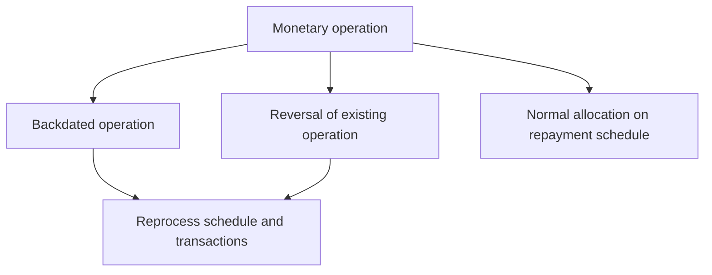

# Delayed Captures and Full-Term Tranches

## Full term tranche and delayed capture

A Full Term Tranche with Delayed Capture lets you create an independent repayment schedule for each disbursement in a multi-disbursement loan. Each tranche follows the full loan term duration rather than fitting within the remaining term, and tranches captured at different times keep consistent repayments. Overlapping periods combine repayment amounts into single installments. This feature is available only for the PROGRESSIVE loan schedule type.

When a later tranche is captured mid-term after an earlier installment:

- The later tranche generates one additional installment to complete its full term independently.

## Enable full term tranches for delayed captures

Use this screen to set up a loan product so each tranche disbursement follows the full loan term schedule instead of fitting within the remaining term.

1. Select **Admin** > **Products**.
2. Select **Create Loan Product**.
3. Select **Classic**.
4. Select **SETTINGS**.
5. Set the fields described below, then select **Next** to continue through the form and save it at the end.

| Field | Required | Description |
| --- | --- | --- |
| Leave this checkbox unchecked if the loan is a single disburse loan. Check this checkbox if the loan is a multi disburse loan. See additional fields for additional information required for this type of loan. | No | Leave this checkbox unchecked if the loan is a single disburse loan. Check this checkbox if the loan is a multi disburse loan. |
| Maximum Tranche count | Yes | Enter the maximum number of tranches allowed for the loan product. |
| When enabled, each tranche disbursement will follow the full loan term schedule instead of fitting within the remaining term. Only available for PROGRESSIVE loan schedule type. | No | When enabled, each tranche disbursement will follow the full loan term schedule instead of fitting within the remaining term. Only available for PROGRESSIVE loan schedule type. |

Each tranche disbursement follows the full loan term schedule instead of fitting within the remaining term.

## Allow full term for each tranche

Use this screen to set whether each tranche disbursement follows the full loan term instead of the remaining installments.

1. Select **Institution** > **Clients** and open the client.
2. Under **Loan Accounts**, select the loan account.
3. Select **Loan Tranche Details**.

When enabled, each tranche disbursement follows the full loan term schedule; when disabled, the system works normally.

## Enabling full term tranche

You can enable or disable it at the loan product and account level. It is disabled by default and works only with the progressive repayment strategy. The full term length option is available when tranche disbursement is enabled at the loan product.

The tranche setting screen includes the following option:

- Allow full term length for each tranche: enable or disable full term tranche.

When full term tranche is enabled:

- The system follows full term schedule calculation for each tranche disbursement.
- You can undo the last disbursement.

When full term tranche is disabled:

- The system works normally.

## Schedule calculation and installment behavior

Installment dates follow the first disbursement date pattern.

When a new installment is created during a disbursement:

- If the next installment fully overlaps the new installment and its due date is on or before the new installment due date, they merge into one installment.
- If the next installment does not overlap or only partially overlaps the new installment and its due date is after the new installment due date, a new installment is created and the next installment becomes shorter.
- A charge added after the maturity date creates a next installment.
- A chargeback added after the maturity date creates a next installment.

## Eligibility and restrictions

You cannot post a disbursement before the last disbursement date; doing so throws LoanDisbursalException with error code "actualdisbursementdate.before.lastdusbursedate". Further disbursements are not allowed on a charged-off or written-off loan account.

## Features that work normally

The following features work normally on tranche loans with full term tranche enabled: downpayment, interest pause, capitalised income, BuyDown fees, charge-back, write-off, contract termination, after repayment or charges, charges and penalties, and charge off. Payment Holiday/Reschedule works on the full term tranche schedule.

## Transaction allocation and monetary operations

Transaction allocation happens normally on the repayment schedule and affects the current schedule. Repayment frequency is every 1 month.

Backdated monetary operations and reversals are handled the same way as normal operations:

- Backdated transactions, charges, reschedules and interest pauses require reprocessing of the repayment schedule and transactions.
- Reversals of existing monetary operations require reprocessing of the repayment schedule and transactions.
- When the last disbursement is undone, the schedule is reprocessed chronologically based on the remaining disbursements and transactions.

## Worked examples

A loan officer sets up a full term tranche loan with a principal of 1,000, an annual interest rate of 12 percent, three monthly installments, and 30-day months. The figures are illustrative. The first disbursement of 1,000 is made on January 1, and the first installment is due on February 1. A second disbursement of 1,000 is captured on February 15, after the first installment. Because full term tranche is enabled, the second tranche runs for the full three-month term instead of being cut to the remaining installments.

| Date | Event | Balance before | Payment | Principal | Interest | Balance after |
| --- | --- | --- | --- | --- | --- | --- |
| 1/1 | Disbursement 1 | – | – | – | – | 1,000.00 |
| 2/1 | Installment 1 | 1,000.00 | 343.33 | 333.33 | 10.00 | 666.67 |
| 2/15 | Disbursement 2 | 666.67 | – | – | – | 1,666.67 |
| 3/1 | Combined installment | 1,666.67 | 678.34 | 666.67 | 11.67 | 1,000.00 |
| 4/1 | Combined installment | 1,000.00 | 676.67 | 666.67 | 10.00 | 333.33 |
| 5/1 | Installment 5 (second tranche only) | 333.33 | 336.66 | 333.33 | 3.33 | 0.00 |

Overlapping installments from the two tranches are combined into single payments on March 1 and April 1, while the second tranche adds one final installment on May 1 to complete its full term independently.

With the full term tranche option disabled, the second disbursement would be fitted to the remaining installments and no extra installment would appear on May 1.

Using the same loan of 1,000 at 12 percent annual interest with three monthly installments, the first disbursement of 1,000 is made on January 1 and the first installment of 343.33 is paid on February 1, leaving a balance of 666.67. A second disbursement of 1,000 is captured on February 15, bringing the balance to 1,666.67. The user then undoes the last disbursement.

| Date | Event | Balance before | Payment | Principal | Interest | Balance after |
| --- | --- | --- | --- | --- | --- | --- |
| 1/1 | Disbursement 1 | – | – | – | – | 1,000.00 |
| 2/1 | Installment 1 | 1,000.00 | 343.33 | 333.33 | 10.00 | 666.67 |
| 2/15 | Disbursement 2 undone | 1,666.67 | – | – | – | 666.67 |
| 3/1 | Installment 2 | 666.67 | 340.01 | 333.34 | 6.67 | 333.33 |
| 4/1 | Installment 3 | 333.33 | 336.66 | 333.33 | 3.33 | 0.00 |

Undoing the last disbursement removes the second tranche and restores the original single-tranche repayment schedule.
