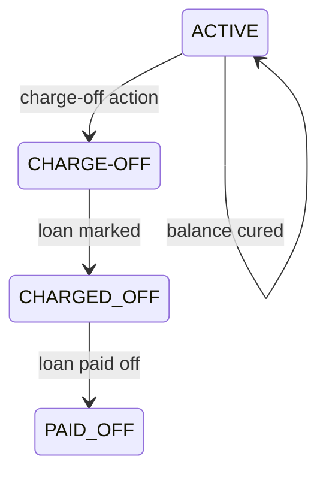

# Charge-Off

## About charge-off

Charge-off lets you recognize a loan as uncollectible after prolonged delinquency or breach by writing off outstanding balances for accounting purposes while optionally continuing recovery efforts. The system writes off all outstanding dues including principal, fees, and penalties. Charge-off is supported only on active loan accounts and cannot be done on a future date. The loan remains active and due for collection at the portfolio level after the accounting write-off. You can trigger charge-off manually through the Charge-off button on the Loan details page or through the API.

## Charge off a loan

Use this screen to write off a delinquent loan's outstanding balances for accounting purposes while the loan remains active.

1. Select **Institution** > **Clients** and open the client.
2. Under **Loan Accounts**, select the loan account.
3. Open the **Loan Account Actions** menu (the ☰ button next to the account name).
4. Select **Charge-Off**.
5. Enter the details described below, then select **Submit**.

| Field | Required | Description |
| --- | --- | --- |
| Transaction Date | Yes | Enter the date of the charge-off transaction. It cannot be a future date. |
| Reason for Charge-Off | Yes | Select the reason for charging off the loan. |
| External Id | No |  |
| Note | No |  |

The system writes off all outstanding dues including principal, fees, and penalties, and posts a new dummy charge-off transaction that has no impact on the loan balance.

## Charge off a loan

Use this screen to write off a delinquent loan's outstanding balances for accounting purposes while the loan remains active.

1. Select **Institution** > **Clients** and open the client.
2. Under **Loan Accounts**, select the loan account.
3. Open the **Loan Account Actions** menu (the ☰ button next to the account name).
4. Select **Charge-Off**.
5. Enter the details described below, then select **Submit**.

| Field | Required | Description |
| --- | --- | --- |
| Charge-Off Date | Yes | Enter the charge-off date. It cannot be a future date. |
| Reason for Charge-Off | No | Select the reason for the charge-off. |
| External Id | No | Enter an external identifier if required. |
| Note | No | Add a note about the charge-off if needed. |

The system posts a new dummy charge-off transaction for the charge-off amount, which has no impact on the loan balance.

## Charge-off amount and date

The charge-off amount is the loan balance as of the charge-off date and cannot be edited. The charge-off date is set when you mark the loan as charge-off. The charge-off template includes charge-off amount and charge-off date fields. Supported fields during charge-off are transaction date, note, locale, date format, charge-off reason ID, and external ID.

## Eligibility and timing

All actions, calculations, and transactions work as they do for a loan that is not marked as charge-off. The loan is considered frozen, though transactions can still happen and the loan does not close.

Charge-off marked loans allow:

- All types of transactions.
- Accounting entries that differ from those for loans not marked as charge-off.

## Marking a loan as charge-off

When you mark a loan as charge-off, the system posts a new charge-off transaction. This transaction links to the accounting entries for the charge-off and does not change the loan balance.

The charge-off transaction:

- Is created for the charge-off amount.

Undoing charge-off:

- The Undo charge-off button appears on the Loan details page only when the loan is already charged-off.

## Accounting entries

Accounting entries stay the same whether you use cash based or accrual based accounting, and they differ before and after charge-off.

Charge-off accounting mappings:

| Transaction type | Portion | Debit account | Credit account |
| --- | --- | --- | --- |
| Charge off Fraud | Interest | Interest income charge off | Fee Receivable |
| Charge off Fraud | Interest income | charge-off interest income | Interest Receivable |
| Charge off Fraud | Fees | Fee Charge off | Fee Receivable |
| Charge off Fraud | Fees income | charge-off fees Income | Fees Receivable |
| Charge off Fraud | Penalty | Fee Charge off | Fee Receivable |
| Charge off Fraud | Penalty income | charge-off Penalty Income | Penalty Receivable |
| Charge off Non Fraud | Interest | Interest income charge off | Fee Receivable |
| Charge off Non Fraud | Interest income | charge-off interest income | Interest Receivable |
| Charge off Non Fraud | Fees | Fee Charge off | Fee Receivable |
| Charge off Non Fraud | Fees income | charge-off fees Income | Fees Receivable |
| Charge off Non Fraud | Penalty | Fee Charge off | Fee Receivable |
| Charge off Non Fraud | Penalty income | charge-off Penalty Income | Penalty Receivable |
| Charge adjustment | Fees | Fee Income | Fee Charge off |
| Charge adjustment | Fees income | income from fees | charge-off fees Income |
| Charge adjustment | Unallocated Credit (UNC) | Fee Income | Other Credit liability |
| Charge adjustment | Fees income (UNC) | income from fees | Overpayment Liability |
| Charge adjustment | Penalty | Fee Income | Fee Charge off |
| Charge adjustment | Penalty income | income from penalties | charge-off Penalty Income |
| OCA Repayment | Interest | Other receivables | recoveries |
| OCA Repayment | Interest | fund source /advance accounting | Income from Recovery payment |
| OCA Repayment | Fees | Other receivables | recoveries |
| OCA Repayment | Fees | fund source /advance accounting | Income from Recovery payment |
| OCA Repayment | Unallocated Credit (UNC) | Other receivables | Other Credit liability |
| OCA Repayment | Unallocated Credit (UNC) | fund source /advance accounting | Overpayment Liability |
| OCA Repayment | Penalty | Other receivables | recoveries |
| OCA Repayment | Penalty | fund source /advance accounting | Income from Recovery payment |

Transaction accounting entries:

| Transaction type | Status | Portion | Debit account | Credit account |
| --- | --- | --- | --- | --- |
| Loan Disbursement Principal | Cash Out |  | 112601 | 145023 |
| Transaction Refund/Provisional Credit Interest - Repayment | Cash in |  | 145023 | 112603 |
| Transaction Refund/Provisional Credit Late Fee Payment | Cash in |  | 145023 | 112603 |
| Transaction Refund/Provisional Credit NSF Fee Payment | Cash in |  | 145023 | 112603 |
| Transaction Refund/Provisional Credit Snooze Fee Payment | Cash in |  | 145023 | 112603 |
| Transaction Refund/Provisional Credit Principal Payment | Cash in |  | 145023 | 112601 |
| Transaction Refund/Provisional Credit Unallocated Credit (UNC) | Cash in |  | 145023 | 245000 |
| Transaction Refund/Provisional Credit Interest - Repayment | Cash in | Charged off Flag Y | 145023 | 404001 |
| Transaction Refund/Provisional Credit Late Fee Payment | Cash in | Charged off Flag Y | 145023 | 404008 |
| Transaction Refund/Provisional Credit NSF Fee Payment | Cash in | Charged off Flag Y | 145023 | 404008 |
| Transaction Refund/Provisional Credit Snooze Fee Payment | Cash in | Charged off Flag Y | 145023 | 404008 |
| Transaction Refund/Provisional Credit Principal Payment | Cash in | Charged off Flag Y | 145023 | 744007/740037 |
| Transaction Refund/Provisional Credit Unallocated Credit (UNC) | Cash in | Charged off Flag Y | 145023 | 245000 |
| Transaction Refund/Provisional Credit Interest - Repayment | Cash Out | Charged off Flag Y | 112603 | 145023 |
| Transaction Refund/Provisional Credit Late Fee Payment | Cash Out | Charged off Flag Y | 112603 | 145023 |
| Transaction Refund/Provisional Credit NSF Fee Payment | Cash Out | Charged off Flag Y | 112603 | 145023 |
| Transaction Refund/Provisional Credit Snooze Fee Payment | Cash Out | Charged off Flag Y | 112603 | 145023 |
| Transaction Refund/Provisional Credit Principal Payment | Cash Out | Charged off Flag Y | 112601 | 145023 |
| Transaction Refund/Provisional Credit Unallocated Credit (UNC) | Cash Out | Charged off Flag Y | 245000 | 145023 |
| Transaction Refund/Provisional Credit Interest - Repayment | Cash Out | Charged off Flag Y and Reversal Indicator Y | 404001 | 145023 |
| Transaction Refund/Provisional Credit Late Fee Payment | Cash Out | Charged off Flag Y and Reversal Indicator Y | 404008 | 145023 |
| Transaction Refund/Provisional Credit NSF Fee Payment | Cash Out | Charged off Flag Y and Reversal Indicator Y | 404008 | 145023 |
| Transaction Refund/Provisional Credit Snooze Fee Payment | Cash Out | Charged off Flag Y and Reversal Indicator Y | 404008 | 145023 |
| Transaction Refund/Provisional Credit Principal Payment | Cash Out | Charged off Flag Y and Reversal Indicator Y | 744007/740037 | 145023 |
| Transaction Refund/Provisional Credit Unallocated Credit (UNC) | Cash Out | Charged off Flag Y and Reversal Indicator Y | 245000 | 145023 |
| Good Will Interest - Repayment | No Cash |  | 404001 | 112603 |
| Good Will Late Fee Payment | No Cash |  | 744003 | 112603 |
| Good Will NSF Fee Payment | No Cash |  | 744003 | 112603 |
| Good Will Snooze Fee Payment | No Cash |  | 744003 | 112603 |
| Good Will Principal Payment | No Cash |  | 744003 | 112601 |
| Good Will Unallocated Credit (UNC) | No Cash |  | 744003 | 245000 |
| Good Will Interest - Repayment | No Cash | Charged off Flag Y | 404001 | 744008 |
| Good Will Late Fee Payment | No Cash | Charged off Flag Y | 744003 | 744008 |
| Good Will NSF Fee Payment | No Cash | Charged off Flag Y | 744003 | 744008 |
| Good Will Snooze Fee Payment | No Cash | Charged off Flag Y | 744003 | 744008 |
| Late Fee Waiver Late Fee Payment | No Cash |  | 404007 | 112603 |
| Late Fee Waiver Late Fee Payment | No Cash | Charged off Flag Y | 404007 | 404008 |
| Late Fee Waiver Late Fee Payment | No Cash | Charged off Flag Y and Reversal Indicator Y | 112603 | 404007 |
| Late Fee Waiver Late Fee Payment | No Cash | Charged off Flag Y and Reversal Indicator Y | 404008 | 404007 |
| NSF Fee Waiver NSF Fee Payment | No Cash |  | 404007 | 112603 |
| NSF Fee Waiver NSF Fee Payment | No Cash | Charged off Flag Y | 404007 | 404008 |
| NSF Fee Waiver NSF Fee Payment | No Cash | Charged off Flag Y and Reversal Indicator Y | 112603 | 404007 |
| NSF Fee Waiver NSF Fee Payment | No Cash | Charged off Flag Y and Reversal Indicator Y | 404008 | 404007 |

## GL mapping setup

Charge-off accounting entries use new GL mapping fields in the loan product Accounting mapping. Mapping each field to a GL account is optional. When you map a field, the system posts charge-off entries to the GL account and GL type shown below. Leave a field blank if you do not want to post that charge-off entry type.

| GL mapping field | GL account | GL type |
| --- | --- | --- |
| Charge-off expense - fraud | Credit Loss/Bad Debt Fraud | Expense |
| Charge-off interest income | Interest income charge off | Income |
| Charge-off fees income | Fee Charge off | Income |
| Charge-off expense | Credit Loss/Bad Debt | Expense |
| Charge-off penalty income | Fee Charge off | Income |

## Interest and amortization

Interest stops accruing on a charge-off loan account, and no interest calculation happens after the charge-off date. Charge-off also charges off the capitalized income, and no daily amortization happens after that date. If you reverse the charge-off, interest accrual resumes from the date it was previously stopped, and the system undoes the final amortization transaction and its accounting entries.

## Transactions after charge-off

After a loan is marked as a charge-off, you can still record chargebacks, refunds and other special case transactions, and post charge-off repayment is treated as a regular payment. Adding charges after charge-off is not allowed, and backdated transactions or reversals of transactions that happened before the charge-off date are not allowed once the loan is marked as a charge-off. Post charge-off transactions are allowed based on configuration, and all accounting follows charge-off-specific rules.

Transactions allowed after charge-off:

- Chargeback transactions are allowed after charge-off.

## Transactions before charge-off

You can reverse or add transactions dated before the charge-off date. A backdated transaction cannot be dated before the last transaction date, and a backdated transaction that dates before the charge-off is not allowed. The system follows standard accounting JE rules for these transactions and reverses and replays the charge-off transaction to increase or decrease the charge-off amount based on the reversal or new posting. Reversing a repayment increases the charge-off amount during the replay. If a backdated transaction fully pays the loan, the system reverses the charge-off transaction and lifts the charge-off flag.

Transaction changes after the charge-off date follow charge-off accounting JE rules.

- The system reprocesses the charge-off transaction with balances changing.

## Reversing charge-off

You can reverse a charge-off only when the charge-off was applied in error. Reversal removes the charge-off tag; it is an exception process, not routine business, and the charge-off status should not be removed after the customer cures or settles the balance.

Reversal is not allowed when:

- Any transaction exists after the charge-off transaction.
- The account is already charged off and a second charge-off or undo charge-off is attempted.

What happens on reversal:

- Undo charge-off requires no parameter.
- The system stores the External Id when undoing a charge-off.
- You can fetch the transaction by external id; this is not the reverse external id.
- The reversed charge-off transaction appears in the transaction response.

## Reverse-replay

You can reverse-replay a charge-off transaction, and the system keeps its distribution up to date.

> **Note:** The system creates journal entries in bulk at the end of reverse-replay and cannot distinguish pre-charge-off entries from post-charge-off entries.

## Restrictions on charge-off loans

You cannot reschedule or restructure installments on a loan marked as charge-off. No fees or penalties apply to a charged-off loan, and the system adds no validations for this.

## Events and API behavior

Charge-off is an accounting treatment and does not change data returned by the existing APIs. The system raises a charge-off business event whenever a charge-off happens for a loan account. At the time a loan is marked to CHARGE-OFF, a transaction change event with the fees and charges array is emitted. Charge-off accelerates the maturity date as of 4/15/2025.

## Worked examples

A loan officer reviews an active loan that is long overdue. The loan has a principal of 1,000.00, an overdue fee of 50.00, and an overdue penalty of 25.00, for a total outstanding balance of 1,075.00. The officer opens the loan account and selects the charge-off action. The system calculates the charge-off amount automatically from the current balance; the user cannot edit it. The figures in this example are illustrative.

| Step | Item | Amount (USD) |
| --- | --- | --- |
| 1 | Outstanding principal | 1,000.00 |
| 2 | Outstanding fees | 50.00 |
| 3 | Outstanding penalties | 25.00 |
| 4 | Charge-off amount (auto-calculated) | 1,075.00 |
| 5 | Loan balance after charge-off | 1,075.00 |
| 6 | Dummy charge-off transaction posted | 1,075.00 |
| 7 | Balance impact of dummy transaction | 0.00 |

The example shows that charge-off writes off the full outstanding amount at the accounting level while the loan stays active and its portfolio balance does not change.

A loan officer discovers that a charge-off was posted in error. No payments or other transactions have been made on the loan since the charge-off. The officer selects the undo charge-off action. The system lifts the charge-off flag and restores the loan to its normal active state. A second charge-off on an already charged-off account, or an undo when later transactions exist, is not allowed.

| Stage | Charge-off flag | Loan balance | Note |
| --- | --- | --- | --- |
| Before undo | Y | 1,075.00 | Loan marked charge-off; dummy transaction posted |
| Undo action | N | 1,075.00 | Charge-off tag lifted; reversed charge-off transaction appears in history |
| After undo | N | 1,075.00 | Loan remains active; no portfolio balance change |

This shows that undoing a charge-off removes only the tag and is possible only when no later transactions exist.

A loan has a balance of 1,000.00 and is marked charge-off on 1 June for the full amount. On 5 June, an officer posts a backdated payment of 200.00 dated 15 May, before the charge-off date. Because the payment predates the charge-off, the system reverses the original charge-off transaction, applies the payment, and replays the charge-off against the reduced balance. The figures are illustrative.

| Event | Date | Amount | Balance after event |
| --- | --- | --- | --- |
| Original charge-off | 1 June | 1,000.00 | 1,000.00 |
| Backdated payment posted | 15 May (effective) | -200.00 | 800.00 |
| Charge-off reversed | 1 June | -1,000.00 | 800.00 |
| Charge-off replayed | 1 June | 800.00 | 800.00 |
| Net change to charge-off amount |  | -200.00 |  |

This shows that pre-charge-off transactions follow standard journal-entry rules and cause the charge-off amount to be reverse-replayed.

See also: [Payment Allocation Strategies](confluence-link:Payment%20Allocation%20Strategies).
