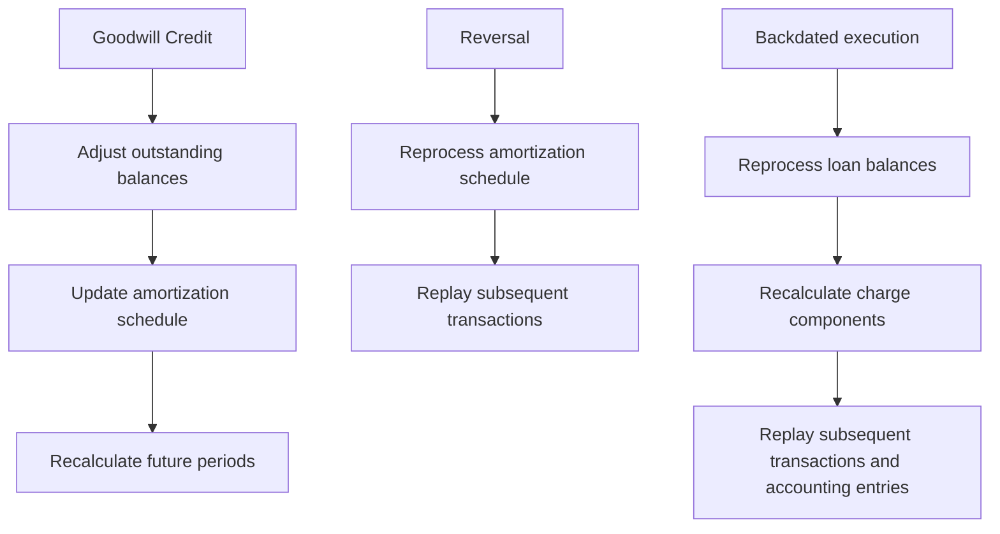

# Credit Adjustments

## Credit adjustments overview

A credit adjustment changes the amount owed on a loan account through transaction types such as a refund, goodwill credit or fees waiver. A debit adjustment reverses one of those transaction types. The loan summary outstanding amount is original plus credit adjustments minus paid, waived and written-off amounts.

The credit adjustment column in the loan summary shows:

- The sum of all chargeback credit on the loan account.
- The amount paid to the loan account through transaction types such as a refund, goodwill credit or fees waiver.

## Payment allocation rules

Payment allocation rules decide how monies are applied to amounts due and to future balances.

Rules cover:

- Monies apply to the interest balance of a single amount due first, from the oldest due amount to the most current due amount.
- For future balances, monies apply to principal balances only.
- Where applicable, future interest accrued but not yet due can be satisfied through early payoff.
- You can define how many future payments are satisfied before the repayment schedule is re-amortized.
- You can define whether monies apply to the next installment due or the last installment due.

## Interest calculation

Interest is calculated on a decreasing balance with equal installments. For each normal repayment installment, interest is based on the outstanding balance. Interest is not allocated for the down-payment installment.

## Pre-closure interest rules

Pre-closure interest rules decide how far interest is calculated when a loan closes early.

Choose one of these rules:

- Calculate till pre-closure date: interest is calculated up to the loan closing date. For example, if the loan closes on 20 February, interest is calculated till 20 February.
- Calculate till rest frequency date: interest is calculated up to the repayment period due date. For example, if the loan closes on 20 February, interest is calculated till the repayment period due date.

## Chargeback credit adjustments

A chargeback credit adjustment offsets or reverses charges that were already paid on a loan. Charge adjustments post as of the current date, so backdated charge adjustments are not supported.

## Discount fee adjustments

A discount fee adjustment reduces the discount fee on a loan. You can post it backdated, but the system creates the adjustment as of the current date, not the backdated transaction date. You can undo the adjustment transaction. Multiple discount fee adjustments are allowed, and the total value is validated against the discount fee. A single adjustment cannot be higher than the discount fee.

## Recognized income adjustments

Recognized income adjustments correct income when an earlier repayment is reversed or when the discount fee is adjusted.

## Credit balance refunds

A Credit Balance Refund (CBR) transaction refunds a customer when a loan is overpaid. You can create a CBR only on a loan in OVERPAID status. The CBR amount matches the overpayment amount and cannot be higher than it; it can be lower, but that does not make sense. You can set the transaction date for the CBR.

What happens after a CBR:

- Backdated transactions are allowed after a CBR.
- If a backdated transaction after a CBR leaves the CBR amount higher than the overpayment amount after reprocessing, the outstanding principal of the actual installment increases by the full CBR amount and the overpayment amount is allocated as repayment for principal.
- On the repayment schedule, the full CBR amount appears as Credit Principal.

## Goodwill credit and reversals

Goodwill credit adjusts outstanding balances, updates the amortization schedule, and recalculates future periods. Reversing a goodwill credit reprocesses the amortization schedule and replays subsequent transactions if applicable. A backdated execution reprocesses loan balances, recalculates charge components, and replays subsequent transactions and accounting entries.

## Worked examples

A customer takes a loan of 1,000 at 12% per year, repaid in 2 monthly installments with 30-day months. The figures are illustrative.

| Due date | Opening balance | Interest | Principal | Closing balance | Payment |
| --- | --- | --- | --- | --- | --- |
| 1 July | 1,000.00 | 10.00 | 497.51 | 502.49 | 507.51 |
| 1 Aug | 502.49 | 5.02 | 502.49 | 0.00 | 507.51 |

Interest falls each month because it is calculated on the lower outstanding balance.

After the first installment, a goodwill credit of 200.00 is posted to the loan as a credit adjustment. The loan is 1,000 at 12% per year, repaid in 2 monthly installments with 30-day months.

| Event | Date | Balance before | Adjustment | Balance after | Interest | Principal | Balance after payment |
| --- | --- | --- | --- | --- | --- | --- | --- |
| 1st installment due | 1 July | 1,000.00 | — | 1,000.00 | 10.00 | 497.51 | 502.49 |
| Goodwill credit posted | 15 July | 502.49 | 200.00 | 302.49 | — | — | 302.49 |
| 2nd installment due | 1 Aug | 302.49 | — | 302.49 | 3.02 | 302.49 | 0.00 |

A debit adjustment of 200.00 would raise the balance to 702.49 and the next interest to 7.02.
