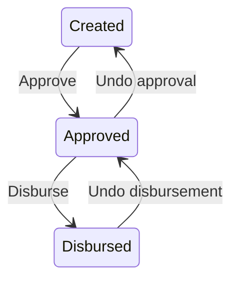
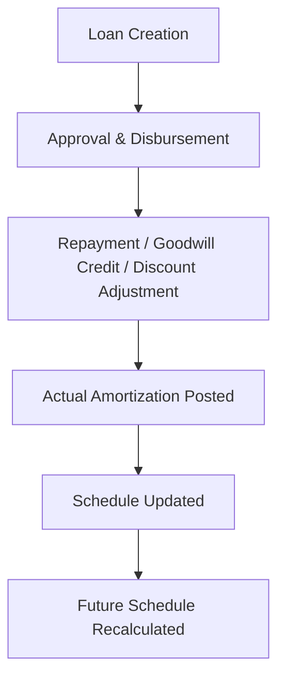

# Effective Interest Rate Product

## About the Working Capital loan product

The Working Capital loan product is a zero-interest, single-disbursement product that uses Effective Interest Rate (EIR)-based calculation aligned with PayPal’s Working Capital financing offerings. It is not a Traditional Term loan with a Traditional full tenure Repayment Schedule.

## Configure effective interest rate product terms

Use this screen to set the principal, payment rate, annual EIR, payment amount, number of repayments, interest rates, floating rate, and repayment timing for an Effective Interest Rate loan product.

1. Select **Admin** > **Products** > **Loan Products**.
2. Select **Create Loan Product (Classic)**, or open an existing product and select **Edit**.
3. Select **TERMS**.
4. Set the fields described below, then select **Next** to continue through the form and save it at the end.

| Field | Required | Description |
| --- | --- | --- |
| Minimum | No | Enter the minimum principal allowed for the loan product. |
| Default | Yes | Enter the default principal allowed for the loan product. |
| Maximum | No | Enter the maximum principal allowed for the loan product. |
| Allow approval / disbursal above loan applied amount | No | Select whether approval or disbursal is allowed above the loan applied amount. |
| Over Amount Calculation Type | Yes | Select the calculation type used for amounts over the applied loan amount. |
| Over Amount | Yes | Enter the over amount used in the over amount calculation. |
| Payment Amount Calculation Strategy | Yes | Select the strategy used to calculate the payment amount. |
| Discount | Yes | Enter the discount applied to the loan product. |
| Installment day calculation from | Yes | Select the basis from which the installment day is calculated. |
| Is interest recognition on disbursement date? | No | Indicate whether interest recognition occurs on the disbursement date. |
| Is Zero Interest Rate? | No | Indicate whether the loan product charges zero interest. |
| Is Linked to floating interest rates? | No | Indicate whether the loan product is linked to floating interest rates. |
| Frequency | Yes | Enter the repayment frequency for the loan product. |
| Floating Rate | Yes | Enter the floating interest rate for the loan product. |
| Differential Rate | Yes | Enter the differential rate applied to the floating interest rate. |
| Is Floating calculation allowed? | No | Indicate whether floating rate calculation is allowed. |
| Terms vary based on loan cycle | No | Indicate whether terms vary based on the loan cycle. |
| Frequency Type | Yes | Select the frequency type for repayments. |
| First repayment day of month | Yes | Enter the first repayment day of the month. |
| Second repayment day of month | Yes | Enter the second repayment day of the month. |
| Fixed Length | No | Enter the fixed maximum length of the loan, which defines the length of the last installment. |
| Minimum days between disbursal and first repayment date | No | Enter the minimum number of days between disbursal and the first repayment date. |

The loan product terms are saved and used to calculate repayment schedules and determine when payments are due.

## Creating and configuring a Working Capital loan product

You can create, modify, and delete Working Capital loan products through the UI or API. It uses input parameters specific to Working Capital product types, while existing fields and configurations behave as they do on term loan products. Mandatory field validation and correct value validation apply to the configuration.

Configuration parameters for a Working Capital loan product include:

- Decimal place is mandatory.
- Charge Name, Currency, Charge Type (Flat amount or Percentage-based), Application Timing (At disbursement or On a specified due date), Calculation Basis (Principal, Outstanding balance, or Flat fixed amount), Penalty Configuration, and Tax Applicability.
- Accounting entry posting for charges, real-time or EOD.
- Bucket configuration, which works similar to Term loans.
- Sample buckets: D00 (01-30), D30 (31-60), D60 (61-90), D90 (91-120), D120 (121-150), D150 (151-180), D180 (181-210), D210 (210-240), D270 (>270).
- COB business steps, controlled by configuration including enablement and execution order.

You can also:

- Set Configurable Terms and Settings on Working Capital loan products.
- Override selected fields during loan creation.
- Delete a Working Capital loan product if it was not yet used anywhere.

## Creating a loan account from a Working Capital product

You can create a loan application from a Working Capital loan product that already exists in the system. All default values from the product are inherited to the loan application screen, and mandatory field checks and correct value checks apply. A selector lets you choose Regular (the default) or Working Capital as the loan product. A Working Capital loan account can be created with Grace Days and Grace Days Start date left blank when the product does not allow overriding terms and settings at the loan account level. Once created, you can modify, approve, or reject the loan account.

## Approving, disbursing, and undoing a loan account

You can approve a loan account that is in created state, disburse an approved loan account, and undo either action. Undoing approval returns the loan account to created state. Undoing disbursement returns it to approval state.

## Discount fields and values

The single Discount field is broken down into three fields: Proposed discount, Approved discount, and Disbursed discount.

Each discount field is entered at a different step:

- Proposed discount is entered or modified at the create loan step.
- Approved discount is entered during the approve loan step.
- Approved discount is reset to zero when undo approve is done.

When attributes override is disallowed, the discount value depends on whether the WC loan product defines a discount value:

| Condition | Result |
| --- | --- |
| Product has a discount value | Proposed discount on loan account creation is the inherited product-level value of 50. |
| Discount field is left empty on approve/disburse screens | Discount is assumed to be the default inherited value from the WC loan product level. |

When attributes override is allowed, the discount value depends on whether the WC loan product defines a discount value:

| Condition | Result |
| --- | --- |
| Product has a discount value, and you remove it when creating the loan | No value remains on the loan account. |
| Discount value is left empty | Discount is set to null or empty as currently implemented. |

## Adding and adjusting discount fees

A discount fee is a monetary transaction applied to a Working Capital loan account. It is charged up front at origination, added to principal to create the total amount to repay, and is effective as of the disbursement date.

You can add a discount fee:

- At the time of loan creation.
- After disbursement, effective as of the disbursement date.

You cannot add a discount fee:

- More than once.
- After disbursement if a discount fee was already added at loan creation or approval.

You can add a discount fee through:

- The user interface.

Discount fee adjustment is allowed only when all of the following are true:

- The loan product type is Working Capital Loan.
- The loan status is Active.
- A non-reversed Discount Fee transaction exists on the loan.
- The adjustment amount is greater than zero.
- The adjustment amount does not exceed the remaining adjustable discount.

The adjustment amount must also meet these validation rules:

- The transaction date must be greater than or equal to the parent Discount Fee date.
- The parent transaction must be an active Discount Fee.

> **Note:** The system drives amortization only; you cannot create direct or manual amortization entries.

## Discount fee amortization

Discount fee amortization calculates how much of a discount fee to recognize as income based on payments made. It runs when a payment is processed and when a loan is fully paid or overpaid. It does not change the loan outstanding balance or any accounting balance. It is a system-generated, non-monetary transaction that gives visibility of deferred income movement, links payments to income recognition, and supports EIR-based tracking without impacting accounting or balances.

The system compares the total actual amortization balance to date against the total discount fee amortization transactions minus total discount fee amortization adjustment transactions:

- If the difference is positive, the system creates a Discount fee amortization transaction for the difference.
- If the difference is negative, the system creates a Discount fee amortization adjustment transaction for the difference.
- If the difference is zero, the system creates no transaction.

Each run also:

- Updates realized discount fee income balance and unrealized discount fee income balance.
- Creates an amortization record for reporting and audit.
- Reduces tracked deferred income in the logical view.

Discount fee amortization transactions are system-generated only:

- You cannot manually create, edit, or delete a Discount fee amortization transaction.

> **Note:** Realized and unrealized discount fee balances are controlled only by the discount fee amortization business step.

## Period Payment Rate modification

You can modify the Period Payment Rate on an Active loan as of a date you choose. Changing the rate recalculates Daily Payment Amount, Total Days, and EIR, and future amortization calculations use the newly calculated values. Previously computed and posted amortizations are not affected. Delinquency and Breach are not impacted because they use their own parameter configurations.

The modification is not allowed on:

- Closed loans
- Overpaid loans
- Charge-off accounts
- Written-off accounts

Period Payment Rate modification does not support:

- Backdated repayments
- Repayment reversal prior to the Period Payment Rate change operation

Undoing and multiple values:

- You can undo a Period Payment Rate modification by reversing the operation.
- Multiple Period Payment Rate modifications are allowed.
- Setting multiple rates on the same day is allowed so it can be easily undone in case of a mistake.
- The system saves the history of EIR and other calculated values during each rate change.
- The current reversed logic for previous entries is kept only for those in the same date.

Payments, even if backdated, consider the rate that is in effect for them based on segments.

## Repayment behavior and status changes

A repayment reduces the outstanding balance. Any repayment amount above the outstanding obligation is stored as overpayment. If repayment creates an overpayment, the loan status changes from ACTIVE to OVERPAID. Payments first pay off the outstanding amount of the oldest past due, delinquent period, then pay off the current period.

A Credit Balance Refund (CBR) is a monetary transaction executed on a loan account in OVERPAID status. CBR is allowed only when the loan status is OVERPAID and the overpayment amount is greater than zero. The transaction amount must be greater than zero and no more than the overpayment amount. The transaction date must follow standard transaction date rules: it cannot be a future date or before the disbursement date.

CBR only reduces the overpayment amount by the refund amount. It results in persistence of transaction and allocation records, and the system evaluates the loan status transition based on the resulting balance fields.

After CBR, if the overpayment amount remains greater than zero, the loan status stays OVERPAID. If the overpayment amount is zero and the obligation is fully met (principal outstanding is zero), the status changes from OVERPAID to CLOSED_OBLIGATIONS_MET.

If a refund amount exceeds the outstanding principal balance, the excess amount results in the loan entering Overpaid status, and the excess amount is recorded as overpayment. A loan status also changes to Overpaid when excess funds exist from a Payout Refund transaction.

## Credit Balance Refund

Conditions and rules:

- You can perform Credit Balance Refund only if the loan account has an available credit balance.
- The refund amount must be the full credit balance.
- The transaction date must comply with business date rules and backdating rules.
- Backdated Credit Balance Refund is supported subject to validations.

Effects:

- Credit Balance Refund triggers accounting entries.
- Credit Balance Refund reversal is allowed subject to no dependency conflicts and valid loan/account status.
- Credit Balance Refund reversal creates a linked reversal transaction.
- Credit Balance Refund reversal reverses the credit balance adjustment and accounting entries.

## Adding charges to loans

You can add a charge to a loan that is closed, overpaid, or past its maturity date. The charge sets a new maturity date equal to the charge due date. If any outstanding balance remains after the charge is added, the system creates delinquency and breach periods for the loan.

Adding a charge to an overpaid loan changes its status as follows:

- If the overpaid amount is greater than the charge amount, the loan remains overpaid.
- If the overpaid amount matches the charge amount, the loan closes.
- If the overpaid amount is lower than the charge amount, the loan becomes active again.

## Charge-off and write-off

Charge-off marks outstanding principal, interest, fees, and penalties as written-off and removes them from the books through accounting entries. It is an accounting classification, not a loan closure. Charge-off reversal is supported subject to configuration and controls.

Charge-off accounting entries:

| Type | Debit GL code | Debit mapping | Credit GL code | Credit mapping |
| --- | --- | --- | --- | --- |
| Principal | 744007/744037 | Credit loss-bad debt / credit loss-bad debt-fraud | 112601 | Loans Receivable Principal |
| Fees | 404008 | Fee Charge off | 112603 | Fees Receivable |
| Penalties | 404008 | Fee Charge off | 112603 | Penalty Receivable |

Charge-off reversal accounting entries:

| Type | Debit GL code | Debit mapping | Credit GL code | Credit mapping |
| --- | --- | --- | --- | --- |
| Fees | 112603 | Fees Receivable | 404008 | Income from ChargeOff Fees |
| Penalties | 112603 | Penalty Receivable | 404008 | Income from ChargeOff Penalties |

Charge-off rules:

- Backdated charge-off is allowed but must not precede the last monetary transaction date.
- Backdated repayments and reversals before the charge-off date are allowed.
- Any transaction or reversal after the charge-off date must strictly follow charge-off accounting rules.
- Charge-off has no automatic impact on delinquency or breach status.

## Amortization schedules and calculations

Amortization schedules project how deferred income is recognized over the life of a loan. The system supports two amortization calculation types: Declining Amortization (EIR-Based) and Flat amortization. Declining Amortization (EIR-Based) is the primary and preferred approach. It amortises income using the Effective Interest Rate (EIR) methodology, based on time value of money, and aligns income recognition with actual cash flows. Its amortization amount varies over time and depends on repayment amounts and payment timing. Flat amortization follows discount fee calculation based on a flat ratio.

Amortization support includes:

- Generation of amortization schedules.
- Dynamic recalculation based on actual cash flows.
- Support for different calculation approaches.

Amortization is triggered by:

- Repayment transactions.
- Goodwill credit transactions.
- Discount and discount adjustments.

Amortization logic depends on:

- Total deferred income.
- Loan principal or outstanding balance.
- Repayment amounts and frequency.
- Loan tenure or expected duration.
- EIR for the declining method.

The amortization schedule is:

- Generated at loan creation.
- Recalculated at approval and disbursement stages.
- Continuously updated to reflect actual repayment behavior.

On each payment, the system:

- Calculates the amortised portion.
- Updates the schedule.
- Generates a Discount fees Amortization transaction (non-monetary).

Discount fees Amortization is automatically created along with:

- Repayment transactions.
- Goodwill Credit transactions.
- Discount fees Adjustment transactions.

The projected amortization schedule includes:

- Projected Amortization amounts.
- Deferred income balance.
- Expected timeline of recognition.

Each record in the projected amortization schedule contains:

- Amortization Installment Number.
- Amortization Installment Date.
- Expected Payment Amount.
- Discount Factor.
- NPV Value.
- Balance.
- Net Amortization Amount.
- Actual Payment Amount.
- Actual Amortization Amount.
- Income Modification.
- Deferred Balance.

Key terms:

- Deferred Balance is the portion of fees, discount, or deferred income that has not yet been amortized or recognized.
- Deferred Balance reduces over time as the loan is amortized.
- Income Modification is the adjustment required when actual amortization differs from expected amortization due to payment behavior such as overpayment, underpayment, or missed payment.

Schedule types:

- Current state schedule always reflects real-time loan conditions based on actual transactions.
- Projected is calculated using expected payment behavior.
- Actual is calculated using real borrower payment activity.

Actual repayments:

- Calculate and post the Actual Amortization (Income) on the payment date.

Calculated and stored values at the loan account level include:

- Period Payment amount.
- Total Days.
- Daily EIR.
- Calc. Annual EIR.

Calculated and stored values based on repayments include:

- Payment amount.
- Actual Amortization (Income).
- Income Modification.
- Deferred balance.

Calculation formulas:

| Formula | Result |
| --- | --- |
| Expected Payment Amount = (Total Payment Value * Period Payment Rate) / NPV Day Count | Money |
| EIR = rate(Loan Term, -Expected Payment Amount, Disbursement Amount) | BigDecimal |
| Days = Disbursement Date - Amortization Installment Date | Whole number |
| Discount Factor = 1 / (1 + EIR) ^ Days | BigDecimal |
| Balance is calculated using the npv formula | Money |
| Actual Amortization Amount is calculated amortization amount based on payment | Money |
| Deferred Balance = Discount Fee / Deferred Balance - Actual Amortized Amount | Money |

Flat amortization calculation:

- Flat amortization uses a ratio of Payable Discount fee for initial Loan balance to calculate the discount fee amortization amount based on the repayment amount.

Declining Amortization schedule generation is based on:

- Minimum expected payment amount.
- Calculated loan term.
- Total deferred income.

Amortization is calculated based on:

- EIR (Effective Interest Rate) methodology or configured logic.

> **Note:** Amortization calculation itself does not directly create accounting entries.

## EIR and rate calculations

The Effective Interest Rate (EIR) is the rate used to discount future cash flows to present value so that the total discounted cash flows equal the initial disbursement amount. It represents the true economic cost or yield of the loan. Daily Payment Amount, Total Days, and EIR are calculated based on Principal Amount, Total Payment Value, Discount Amount, NPV Day count, and Period Payment Rate. Discount Amount is the fee or financial adjustment deducted from or associated with the loan that is amortized over the loan lifecycle.

The IRR based calculation replaces the current RATE based effective interest rate calculation:

- The IRR based calculation can handle a non uniform schedule.
- The RATE based calculation only works for loans which have equal daily payment amounts throughout their lifecycle.

When an actual payment differs from the expected payment:

- Future expected payment periods are recalculated using actual payments as a baseline.
- Past rows are never recalculated; only payment periods after the date the payment landed are recalculated.
- The amortization schedule is calculated accordingly.

## Close of Business processing

Close of Business (COB) processing runs daily scheduled end-of-day processing for Working Capital loans. It starts from the last COB run date stored on the loan account, or from the current COB business date if no previous run date exists.

During COB, the system applies all enabled business steps to each selected loan:

- Select loans for processing.
- Partition selected loans into batches based on a configured size.
- Mark partitions for batch execution.
- Process loans sequentially within each partition.
- Apply a lock on loans within a single partition.
- Read each loan.
- Resolve and determine applicable business steps.
- Apply business steps based on configuration, where steps can be enabled or disabled and executed in a configurable order.
- Persist the processed loan.
- Update the last COB run date on the loan.

If no payments land on a Working Capital loan when COB runs, the system:

- Zero-fills elapsed days on the loan.
- Fills the actual column as if a zero-amount repayment landed on the day.

## Undoing operations

You can undo a disbursement transaction. The system reverses it, but it remains visible on the UI and does not disappear.

Undoing a discount fee is not supported.

- The undo discount button is hidden from the UI.

## Data model and relationships

A product groups the rules that apply to every loan created from it. Many products may belong to one fund, and many loans may use one product. Many loans may reference one fund, and many loans belong to one client.

One product may have one configurable attributes record. That record defines which product attributes may be overridden at loan account level and indicates whether selected product defaults can be changed during loan creation or update.

One loan has one balance. One loan may have many disbursement details, many notes, many payment allocation rules, and at most one account lock.

The amortization model stores projected balances for the future, current balances for the present, and paid balances for the past. Balance invariants require principal_outstanding >= 0, total_paid_principal >= 0, total_payment >= 0, realized_income >= 0, and unrealized_income >= 0.

Loan behavior remains stable even if product rules change later.

The product payment allocation rule defines default payment allocation logic at product level by transaction type.

| Rule | Scope | Supports |
| --- | --- | --- |
| Product payment allocation rule | Product level | Per-transaction-type allocation ordering |

## Validation rules

Validation rules apply to monetary transactions, disbursements, products, loans, and the approve command. Each rule checks a condition before the system accepts the entry or action.

Monetary transaction rules:

- Monetary transaction amount must be greater than zero.

Disbursement rules:

- Disbursement date must not precede loan approval date.
- Disbursement date must comply with backdating rules.
- Disbursement amount must be greater than zero.
- Disbursement amount must not exceed the approved loan amount for single disbursement.
- Disbursement expected amount and actual amount must be non-negative.

Product rules:

- Product name must be unique.
- Product short_name must be unique.
- Product external_id must be unique when provided.
- Product principal_amount must be within min/max when min/max are present.
- Product period_payment_rate must be within min/max when min/max are present.
- Product start_date must be less than or equal to close_date when both are present.
- Product required currency fields must be populated.
- Product required repayment configuration must be populated.

Loan rules:

- Loan account_no must be unique.
- Loan external_id must be unique when provided.
- Loan product_id must exist.
- Loan client_id should exist when required by business flow.
- Loan proposed and approved principal must be non-negative.
- Loan approved principal should respect product min/max if configured.
- Loan approval requires submitted state.
- Loan rejection requires submitted or pending state.
- Loan disbursement requires approved state.
- Loan closure requires business closure criteria.

Approve command rules:

- The approve command transitions from Submitted and pending approval to Approved.
- It requires an approval date and an expected disbursement date.
- It validates that the approval date is not future and not before the submitted date.
- It validates that the approved loan amount is less than or equal to the proposed principal.
- It validates that the discount amount is less than or equal to the created discount.

## Glossary and definitions

EIR stands for Effective Interest Rate. COB stands for Close of Business, the end-of-day processing that posts interest and fees. Amortization is the process of gradually reducing a loan balance over time through payments that include principal recovery and income recognition. An amortization installment is a defined time period within the loan lifecycle for which payment expectations, amortization, and balances are calculated.

Payment amounts for an installment period:

- The Expected Payment Amount is calculated using configured repayment parameters and financial formulas.
- The Actual Payment Amount is the real payment amount received from the borrower within a given installment period.
- The Actual Amortization Amount is calculated based on the actual payment received, reflecting the true reduction of deferred value or balance.

## Scheduling and payment periods

Each payment period lasts exactly one day. Period N falls on the expected disbursement date plus N days. Periods follow sequentially at the defined interval, and schedule generation continues until repayment allocation completes or the loan closure condition is met. Start date and end date are mandatory. At least one disbursement must have an actual disbursement date. Before reschedule, the current period has its original expected amount; after reschedule it has the updated expected amount and the outstanding balance is recalculated.

Minimum payment rules:

- Minimum payment must be a positive percentage of approved principal.
- Minimum payment is recalculated when a period is generated and the current date has crossed the last period's due date.
- Minimum payment is recalculated when a reschedule changes the minimum payment amount or frequency.
- Minimum payment is recalculated after a backdated or reversed monetary transaction, but only for the period where the outstanding loan balance is lower than the originally calculated minimum payment.

Input parameters for payment period calculations:

| Parameter | Type | Description |
| --- | --- | --- |
| Origination fee amount | Money | Upfront discount or fee amortized over the loan lifecycle. |
| Net disbursement amount | Money | Principal disbursed; must be positive. |
| Total payment value | Money | Merchant's total payment value. |
| Period payment rate | BigDecimal | Rate applied to total payment value; for example, 0.18 means 18%. |
| NPV day count | Integer | Day-count convention; for example, 360; must be positive. |
| Expected disbursement date | Date | Loan start date. |

## Accounting entries and GL mappings

Credit Balance Refund (CBR) posts excess amounts between Overpayment Liability and the Fund source. Charge addition and waive post between Fee Receivable and Fee Income.

| Transaction | Debit GL | Credit GL |
| --- | --- | --- |
| CBR | 245000 Other Credit liability (Overpayment Liability) | 145023 Suspence/clearing account (Fund source) |
| CBR Reversal | 145023 Suspence/clearing account (Fund source) | 245000 Other Credit liability (Overpayment Liability) |
| Charge addition | 112603 Fee Receivable (Fees Receivable, Asset) | 404007 Fee Income (Income from Fees, Income) |
| Charge waive | 404007 Fee Income (Income from Fees, Income) | 112603 Fee Receivable (Fees Receivable, Asset) |

## Reversals

A reversal fully reverses the financial impact of a transaction, including its accounting entries. The system creates a linked reversal transaction and reverses the allocated components, such as penalty, fee and principal, along with the outstanding balance impact. A Goodwill Credit reduces the outstanding balance.

See also: [Transaction Types](confluence-link:Transaction%20Types), [Delinquency Restrictions](confluence-link:Delinquency%20Restrictions), [Breach Management](confluence-link:Breach%20Management), [Projected Balances](confluence-link:Projected%20Balances).
