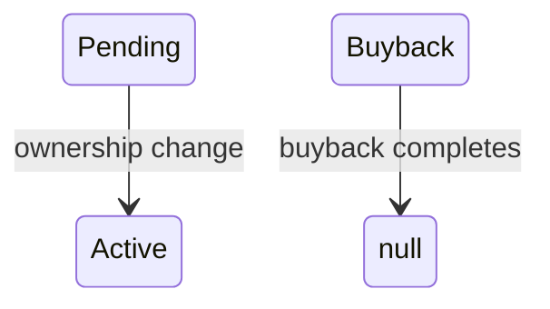

# Asset Externalization

## Asset externalization overview

Asset externalization supports loan sales to investors for the GPL portfolio of products and meets Danube requirements for DE PayIn30 on the Fineract System. It provides securitization concepts within Fineract core functionality and supports real-time ownership and transactional changes related to asset sales through API and event publishing. It also meets all accounting requirements for reporting and tracking GL activity for PayPal and non-PayPal-owned loans, and meets all data reporting obligations related to externalization enhancements. Determination of loan statuses and assignment of loans to an investor happens externally, not on the Fineract System, as does buyback or reassignment of the loan. The credit platform partner router identifies which system of record (SOR) the loan is recorded on and directs traffic accordingly, so domains above the router do not need to know the SOR. The credit ETL domain manages any changes required for storing ownership details in Credit databases. GET APIs from Fineract return ownership information so you can see which GPL loans are PayPal versus investor owned, and a new GET API integration returns ownership information based on the sales transaction ID to get loan details for a loan assigned to an external investor.

## Investor module configuration

The Investor module has two global configuration settings: one to enable or disable the module, and one to enable automatic owner creation, which defaults to true. Configuration can be set as an environment variable.

## Asset owner creation and lookup

The system stores and retrieves ownership data for loan accounts. When a request arrives with an unrecognised owner external id, the system automatically creates an entry in the owner table. Stored ownership data cannot be updated.

## Transfer statuses

A transfer status describes where a loan is in the externalization process and when the settlement takes effect. Each status uses the settlement date relative to the current date to decide whether the loan has been sold, selected for transfer, bought back, or declined. The statuses are Active, Pending, Buyback and Declined.

| Status | Meaning | Settlement date condition |
| --- | --- | --- |
| Active | Loan is sold to investor | Same as or later than the current date |
| Pending | Loan is selected to transfer | Same as or later than the current date |
| Buyback | Buyback is initiated; ownership reverts | Same as or later than the current date |
| Declined | Validations failed (balance) | Not specified |

## Eligibility and validation

The system validates an asset transfer before it starts. It refuses a sale or buyback when the loan balance is zero or negative, when a transfer is already pending or active, or when the settlement date is earlier than the business date. It also declines sales on closed, overpaid, submitted, or approved loan accounts, and returns a proper error message instead of an internal server error for closed or overpaid loans.

Transfer initiation is refused when:

- The loan balance is zero or negative (overpaid).
- A transfer is already pending or active.
- The settlement date is earlier than the business date.
- The loan account is closed, overpaid, submitted, or approved for a sale.

Buyback and pending statuses share unified date handling: effective from and settlement date mean the same thing for both, with no functional change.

## Initiating a transfer

You initiate an asset externalization transfer by calling the POST endpoint. The request stores the asset owner, transfer ID, settlement date, purchase price ratio, status, and created timestamp. The transfer ID is optional; if you do not provide one, the system generates it. The system sets the status and created timestamp. The response includes the transferExternalId field, which contains the ownerExternalId value.

## Canceling a transfer

You can cancel a PENDING sale or an incomplete BUYBACK before it is settled. Cancellation copies the original transfer and sets its substatus to USER_REQUESTED. A transfer event is sent out upon cancellation, and the cancellation references the cancelled record using the transfer external id.

Cancel a transfer using either endpoint:

- POST /transfers/{id}?command=cancel cancels a transfer by its id.
- POST /transfers/external-id/{transferExternalId}?command=cancel cancels a transfer by its transfer external id.

Cancellation fails in these cases:

- The transfer is not PENDING or an incomplete BUYBACK.
- The transfer has already been settled.
- The request has improper parameters.
- A PENDING sale already has a BUYBACK; the error points to the existing BUYBACK.

> **Note:** A cancel request for a PENDING or BUYBACK loan transfer not processed by Close of Business returns OK.

## Close of Business processing

Close of Business processing validates pending asset ownership transfers whose settlement date equals the closed business date. Transfers can only happen after or at the end of Close of Business. The CoB asset ownership executor jobstep performs this validation.

A pending transfer becomes ACTIVE only when the account balance is greater than or equal to 0.

- For a SALE, PENDING transitions to ACTIVE when the account balance is greater than 0.
- For a SALE, PENDING transitions to DECLINED when the account balance is less than or equal to 0.
- For a BUYBACK, ACTIVE transitions to BUYBACK when the account balance is greater than 0.
- For a BUYBACK, ACTIVE transitions to none when the account balance is less than or equal to 0.

When a sale and buyback share the same settlement date, the following apply:

- Both PENDING SALE and PENDING BUYBACK are CANCELLED with no status changes and no journal entries.
- Inline COB does not produce an internal server error.

## Ownership state transitions

Changing the asset owner of a loan account does not change the loan account, its portfolio behaviour, or its accounting. Ownership changes only take effect during Close of Business processing. A loan can be sold again to an investor after states such as DECLINED.

Buyback is accepted when:

- The loan has ACTIVE transfer status.
- The loan has PENDING transfer status with the same effective date.

## Journal entries and GL mapping

The system posts journal entries for asset owner changes and buy backs as part of the close of business jobstep on the settlement date. If the loan account balance is zero or negative before close of business on the settlement date, the asset transaction is declined and no journal entries post.

Monetary transaction journal entries include an asset owner column that stores the current asset owner ID of the loan account. The column is null when there is no active investor, and always null for loan products where the investor module is disabled.

The asset owner column is derived from the current active asset owner as of each business date, regardless of transaction type, backdated transactions, reversals, charge additions, or accruals. Any monetary transaction with a business date on or before the settlement date keeps the old investor; any transaction after the settlement date carries the new investor.

> **Note:** If a repayment posted before the settlement date is reversed after it, the repayment accounting entries have a null asset owner column while the reversal entries carry the new investor.

When the investor module configuration is enabled, you can map a new GL account for asset transfer in the loan product, or use the asset transfer option from financial activity mappings.

GL entries for asset owner change are posted using the closing balance of the loan account.

| GL code | Account | Asset owner |
| --- | --- | --- |
| 146000 | Receivable / clearing account | Null |
| 112601/112603 | Loan receivables / interest fees receivables | Investor |
| 112601/112603 | Loan receivables / interest fees receivables | Null |
| 146000 | Receivable / clearing account | Investor |

GL entries for buy back are posted using the closing balance of the loan account.

| GL code | Account | Asset owner |
| --- | --- | --- |
| 112601/112603 | Loan receivables / interest fees receivables | Null |
| 146000 | Receivable / clearing account | Investor |
| 146000 | Receivable / clearing account | Null |
| 112601/112603 | Loan receivables / interest fees receivables | Investor |

## Balance storage

When a transfer takes place, the system stores the aggregated balance items together with the external owner they relate to. At buyback, it stores the same balance values together with the previous external asset owner ID. Balances are stored during sales events and buyback events, including when interest, fee charges, or penalty charges apply.

## Reports

The Transaction summary with investor report adds asset owner detail to the transaction summary report and groups and totals transactions by asset owner. It includes asset transfer and asset buyback transaction details. Balances equal the journal entry where principal equals the investor side of the 112601 entry and fees equal the investor side of the 112603 entry. The report shows no Asset Transfer or Asset Buyback summary line when Asset Owner ID is null (PayPal).

| Column |
| --- |
| postingdate |
| product |
| glacct |
| description |
| Asset Owner ID |
| beginningbalance |
| debitmovement |
| creditmovement |
| endingbalance |

## Events

The INVESTOR event category emits owner transfer and account snapshot events during close of business (COB) execution when an asset ownership state changes. Events are emitted whether the transfer status is EXECUTED or DECLINED / CANCELLED, and investor-related fields appear only when the investor module is turned on. Events are emitted as before but extended with relevant data.

The following events are emitted for asset externalization:

- LoanOwnershipTransferBusinessEvent extends LoanBusinessEvent and is triggered by any asset ownership state transition; it contains transaction type, transaction date/time, loan account ID, buyback transaction ID, AssetOwnerID, and balance transaction amount.
- AccountChangedEvent carries a business date that matches the settlement date for accounting and is required in addition to the LoanOwnershipTransferBusinessEvent.
- LoanAccountSnapshotBusinessEvent carries loan account data in V1 schema and is sent only when actual ownership changes (Pending to Active, or Buyback to null).

Sales and buyback events include:

- From Owner parameter representing the current owner.
- To Owner parameter representing the party to whom the transfer is done.

Event timing rules:

- COB picks only transfers with effective date equal to the business date and valid_to equal to 9999.12.31.
- The account change event is emitted when ownership change takes place, done by COB when it turns to active or buyback completes.
- For a cancelled sale and buyback on the same day, two events are triggered, one for each transfer.

> **Note:** Assert externalization modifies events to include assert owner information so downstream systems can leverage that data for reporting and analytics.

## API endpoints

Use the following GET endpoints to retrieve ownership history and details of related transfers.

| Endpoint | Retrieves ownership history and transfers for |
| --- | --- |
| GET /loans/{loanId}/external-asset-ownership-history | A loan ID |
| GET /loans/external-asset-ownership-history/{externalId} | A loan external ID |
| GET /external-asset-transfers/{transferId} | An asset transfer ID |

Search external asset owners at /external-asset-owners/search. You can search by a text field in the external ID fields such as owner or transaction ID, and by date ranges for the submitted date, settlement date, or effective date.

## API response fields

The API response includes fields that identify the loan, the transfer, the asset owner, the currency and the outstanding balance. The balance fields show the current outstanding amount split into principal and fee portions.

| Field | Type | Meaning | Example |
| --- | --- | --- | --- |
| loanid | Long | The loan ID. | 123 |
| loanexternalId | String | The loan external ID. | bd1adc6d-c5cb-47f2-a8fc-b398bf02091c |
| type | String | SALE or BUYBACK. | SALE |
| transferExternalId | String | The transfer ID or buyback transfer ID. | 234ffh3h-c5cb-f3f2-a8fc-bc2045dc234a |
| submittedDate | String | The business date when journal entries are actually created; the same as the transfer or COB date. | 2023-05-03 |
| AssetOwnerExternalId | String | The asset owner ID. | INV12 |
| currency | String | The currency, from Fineract source Loan.Currency. | EUR |
| totalOutstandingBalanceAmount | BigDecimal | The current outstanding balance amount. | 1025.00 |
| outstandingPrincipalPortion | BigDecimal | The principal portion of the current balance amount. | 1000.00 |
| outstandingFeePortion | BigDecimal | The fee portion of the current balance amount. | 25.00 |

## Database schema and indexes

Asset externalization uses the m_external_asset_owner_transfer table to track transfer requests and the BATCH_JOB_EXECUTION_PARAMS table for batch job execution parameters.

| Table | Index or constraint | Columns |
| --- | --- | --- |
| m_external_asset_owner_transfer | Index | loan_id |
| m_external_asset_owner_transfer | Composite unique constraint | Status + externalTransferId |
| BATCH_JOB_EXECUTION_PARAMS | Index | JOB_EXECUTION_ID |

> **Note:** The external_transafer_status_external_transfer_id_constraints.xml file specifies context=mysql and may need a context for postgres as well.

## Business listener behavior

Business listeners decide what happens to pending transfers when a loan closes or is overpaid before settlement.

When a loan is closed or overpaid:

- Pending sale transfers are declined.
- Pending buyback transfers are cancelled with a new substatus.

When both a pending sale and a pending buyback exist and the loan is paid fully before settlement but the settlement dates differ:

- The pending sale transfer is declined.
- The pending buyback is cancelled.

## Worked examples

A GPL loan with a principal balance of 1,000.00 and accrued fees of 10.00 is sold from PayPal, which has no asset owner, to the investor with external ID 123456789. The settlement date is 25-05-2023. The figures are illustrative. At Close of Business, the system posts the asset owner change using the closing balance and splits the entries between the null owner and the investor.

| # | GL account | Asset Owner ID | Debit | Credit |
| --- | --- | --- | --- | --- |
| 1 | 146000 Receivable/clearing | null | 1000.00 | - |
| 2 | 112601 Loan receivables | null | - | 1000.00 |
| 3 | 112603 Interest/fee receivables | null | - | 10.00 |
| 4 | 146000 Receivable/clearing | 123456789 | - | 1000.00 |
| 5 | 112601 Loan receivables | 123456789 | 1000.00 | - |
| 6 | 112603 Interest/fee receivables | 123456789 | 10.00 | - |
| Total |  |  | 2010.00 | 2010.00 |

The sale credits the PayPal-side receivable and loan accounts, then debits the same accounts under the investor ID, isolating the investor position for reporting.

Using the same sale of 1,000.00 principal and 10.00 fees to investor 123456789 on 25-05-2023, the trial balance summary on the settlement date splits each GL account by asset owner. Beginning balances are zero. The figures are illustrative.

| GL account | Asset Owner ID | Beginning balance | Debit movement | Credit movement | Ending balance |
| --- | --- | --- | --- | --- | --- |
| 112601 Loans Receivable | null | 0.00 | 0.00 | 1000.00 | -1000.00 |
| 112601 Loans Receivable | 123456789 | 0.00 | 1000.00 | 0.00 | 1000.00 |
| 112603 Interest/Fee Receivable | null | 0.00 | 0.00 | 10.00 | -10.00 |
| 112603 Interest/Fee Receivable | 123456789 | 0.00 | 10.00 | 0.00 | 10.00 |
| 146000 Receivable/clearing | null | 0.00 | 1000.00 | 0.00 | 1000.00 |
| 146000 Receivable/clearing | 123456789 | 0.00 | 0.00 | 1000.00 | -1000.00 |

The trial balance carries an Asset Owner ID column, so the investor position appears separately from the PayPal position.

The transaction summary report groups movements by transaction type, allocation, and asset owner. On a business date, the loan has an asset transfer of principal 1,000.00 and fees 10.00 to investor 123456789, and later an asset buyback of principal -1,000.00 and fees -10.00 from the same investor. A repayment with no investor is not shown because only investor-owned transfer lines are posted. The figures are illustrative. For a buyback, the signs are reversed and ownership moves back to null.

| Date | Product | Transaction type | Reversed | Asset Owner ID | Allocation | Amount |
| --- | --- | --- | --- | --- | --- | --- |
| 25-05-2023 | GPL_DE_PI30 | Asset Transfer | FALSE | 123456789 | Principal | 1000.00 |
| 25-05-2023 | GPL_DE_PI30 | Asset Transfer | FALSE | 123456789 | Fees | 10.00 |
| 30-05-2023 | GPL_DE_PI30 | Asset Buyback | FALSE | 123456789 | Principal | -1000.00 |
| 30-05-2023 | GPL_DE_PI30 | Asset Buyback | FALSE | 123456789 | Fees | -10.00 |

Both transfer directions appear under the investor ID; lines with Asset Owner ID null are omitted from the investor summary.

See also: [Investor Module](investor-module.md).
