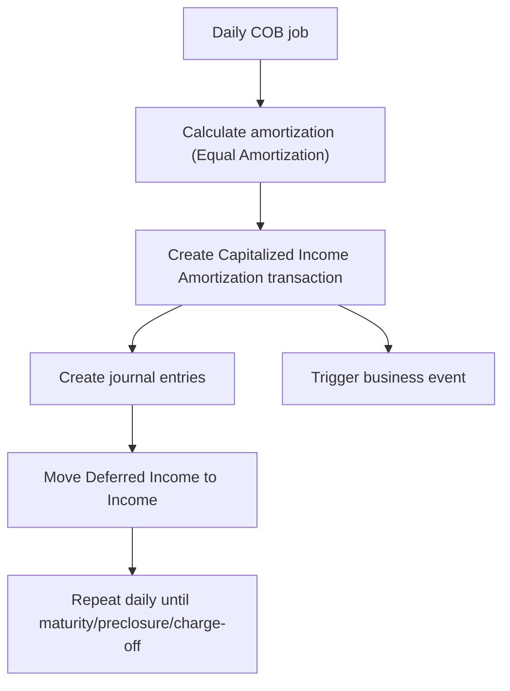
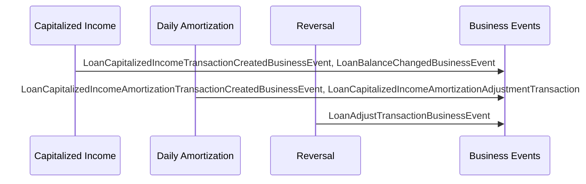

# Capitalized Income

## Capitalized income overview

Capitalized income lets a financial institution recognize deferred income systematically over the loan term by adding income to the principal balance instead of collecting it immediately. The added income becomes part of the total outstanding balance used for future calculations. Capitalized income applies only to progressive loan schedules and is configured at the loan product level. Amortization has two types: capitalized income, which is added to the principal balance and considered for interest calculation, and buy-down fee, which is added to the principal balance but not considered for interest calculation.

## Configuration

Capitalized income configuration is copied from the loan product when a loan is created. It controls whether income capitalization is enabled, how income is calculated, how it is amortized, what income type is used, and which general ledger accounts hold deferred income and income from capitalization.

| Setting | Options | Default |
| --- | --- | --- |
| Enable capitalized income | Enabled or disabled | Disabled |
| Calculation mode | FLAT | FLAT |
| Amortization strategy | EQUAL_AMORTIZATION | EQUAL_AMORTIZATION |
| Income type | FEE or INTEREST | FEE |
| GL mapping | Deferred Income (Liability) and Income from Capitalization (Income) | Not set by default |

With EQUAL_AMORTIZATION, daily capitalized income recognition is done by equal portions over the life of the loan.

## Eligibility and timing

Capitalized income applies only to progressive loans with income capitalization enabled on the loan product and inherited by the loan. You must configure the Deferred income liability account and Income from Capitalization GL mappings before capitalized income can be used.

GL mapping rules:

- The Deferred income liability account is available only for progressive loans when income capitalization is enabled.
- Configuring Deferred income liability and Income Capitalization income GL mappings on a loan product requires a progressive loan with income capitalization enabled.
- The GL mapping field is mandatory when income capitalization is enabled.

## Adding capitalized income

You can add capitalized income to a loan after disbursement through the API using the capitalizedIncome command, once the loan is active. The transaction date can be any date on or after the first disbursement date. Adding capitalized income recalculates the repayment schedule and updates the interest and amortization schedules. Disbursement plus capitalized income must be less than or equal to the approved loan amount.

The request supports these fields:

- transactionDate (mandatory): the date of the capitalized income transaction.
- dateFormat (mandatory): the format of the transaction date.
- locale (mandatory): the locale for the request.
- transactionAmount (mandatory): the amount capitalized as income.
- paymentTypeId (optional): the payment type for the transaction.
- note (optional): a note on the transaction.
- externalId (optional): an external identifier for the transaction.

The response returns:

| Field | Description |
| --- | --- |
| resourceId | The identifier of the created capitalized income transaction. |
| resourceExternalId | The external identifier of the created capitalized income transaction. |

You can retrieve capitalized income limits and details using these endpoints:

| Endpoint | Returns |
| --- | --- |
| GET /loans/{loanId}/transactions/template?command=capitalizedIncome | paymentTypeOptions, currency, date, and amount (maximum amount that can be capitalized: approved amount - disbursed amount - capitalized income) |
| GET /v1/loans/{loanId}/deferredincome | Capitalized income amount, amortized amount, not yet amortized amount, and adjusted amount |

## Schedule and interest impact

The maximum capitalized income amount is:

- Approved amount of the loan minus total disbursed amount minus total capitalized income.

When capitalized income is added, these validations change:

- Disbursement amount plus capitalized income must be less than or equal to applied amount.

## Amortization

Capitalized Income Amortization moves a portion of capitalized income from Deferred Income Liability to recognized income each day until maturity or full amortization. A background job posts the amortization automatically during close of business (COB), the nightly job that posts interest and fees. The system creates a new Capitalized Income Amortization transaction for each daily recognition and triggers a business event when the transaction is created.

The amortization amount follows these rules:

- Divide the not yet amortized capitalized income by the number of days between the current date and the loan maturity date.
- Apply rounding to the calculated amortization amount based on the rounding mode configuration.
- Handle complex scenarios such as backdated transactions and reverse-replay situations.

Amortization stops or completes as follows:

- The final amortization posts on the preclosure date.
- On charge-off, amortization halts and the remaining deferred income is charged off.
- Reversing the original Capitalized Income transaction reverses all associated amortization transactions.

## Charge-off and preclose

Undoing charge-off reverses this behavior and adjusts the related accounting entries.

Preclose recognizes the remaining unrecognized capitalized income immediately:

- Final amortization is done for the balance amount if the loan is preclosed on the same day.

Once a loan is paid off, there is no reversal or undo of realized income.

## Reversal

You can reverse a Capitalized Income transaction manually through dedicated transactions; the system does not reverse it automatically.

A Capitalized Income transaction can be reversed only when:

- It has not already been reversed.
- No Capitalized Income Adjustment belonging to it remains unreversed.

When reversed, all already amortized amounts are corrected in a Capitalized Income Amortization Adjustment transaction with mirror journal entries of Capitalized Income Amortization.

> **Note:** Reversal of capitalized income or adjustment transactions triggers external business events.

## Balances and tracking

Capitalized income balances are tracked on a loan and capitalized income transaction basis, with one entry per transaction per loan. The system stores balances in the database and maintains them over capitalized income events such as adding capitalized income and daily amortization. Loan balances include capitalized_income_derived and capitalized_income_adjustment_derived.

Each capitalized income transaction has its own balance row in m_loan_capitalized_income_balance.

| Column | Description |
| --- | --- |
| id | Balance row identifier |
| version | Row version |
| loan_id | Link to the loan |
| loan_transaction_id | Link to the capitalized income transaction |
| amount | Capitalized income transaction amount |
| date | Capitalized income transaction date |
| unrecognized_amount | Amortization - not yet recognized amount |
| charged_off_amount | Charged-off balance |
| amount_adjustment | Total adjustment amount |
| created_by | User who created the row |
| created_on_utc | Creation timestamp in UTC |
| last_modified_by | User who last modified the row |
| last_modified_on_utc | Last modification timestamp in UTC |

## Accounting entries

| Transaction | Debit | Credit |
| --- | --- | --- |
| Capitalized Income | Loan Portfolio (Asset) | Deferred Income (Liability) |
| Capitalized Income Amortization | Deferred Income (Liability) | Income from Capitalization (Income) |
| Capitalized Income Amortization Adjustment | Income from Capitalization (Income) | Deferred Income (Liability) |

## Business events

| Operation | Business events |
| --- | --- |
| Creating capitalized income | LoanCapitalizedIncomeTransactionCreatedBusinessEvent, LoanBalanceChangedBusinessEvent |
| Daily amortization | LoanCapitalizedIncomeAmortizationTransactionCreatedBusinessEvent, LoanCapitalizedIncomeAmortizationAdjustmentTransactionCreatedBusinessEvent |
| Reversing capitalized income | LoanAdjustTransactionBusinessEvent |
| Adjusting existing capitalized income | External business events |
| Capitalized income amortization | External business events |
| Creating a capitalized income adjustment when the loan closes or is overpaid | Capitalized Income Amortization Adjustment is calculated and created in realtime |

## API endpoints and commands

You configure capitalized income on a loan product through the loan product API, and you retrieve capitalized income amortization information for a loan through the loan API.

Configure capitalized income on a loan product with POST /loanproducts using these mandatory fields:

- enableIncomeCapitalization
- capitalizedIncomeCalculationType
- capitalizedIncomeStrategy
- capitalizedIncomeType

Retrieve capitalized income amortization information for a loan with:

- GET /loans/{loanId}/capitalizedincome

## Worked examples

A progressive loan is disbursed for 1,000 on 1 January. On that same day a capitalized income amount of 100 is added through the API, so the loan principal becomes 1,100 and the amount is booked as deferred income. The loan matures in five days and equal amortization is the default strategy, so 20 of deferred income is recognized each day from 2 January through 6 January. The figures are illustrative.

The table shows the posting of the capitalized income and the daily equal amortization until the deferred income balance reaches zero.

| Date | Deferred income balance | Daily amortization | Income from capitalization | Principal balance |
| --- | --- | --- | --- | --- |
| 1 January | 100.00 | — | — | 1,100.00 |
| 2 January | 80.00 | 20.00 | 20.00 | 1,100.00 |
| 3 January | 60.00 | 20.00 | 20.00 | 1,100.00 |
| 4 January | 40.00 | 20.00 | 20.00 | 1,100.00 |
| 5 January | 20.00 | 20.00 | 20.00 | 1,100.00 |
| 6 January | 0.00 | 20.00 | 20.00 | 1,100.00 |

A capitalized income transaction of 300 was posted on 1 January. By 10 January, 120 has been amortized, leaving 180 not yet recognized. An adjustment posted on or after the original transaction date reduces that unrecognized balance. If the adjustment is 150, it stays within the balance. If the adjustment is 200, it exceeds the balance by 20 and the excess is debited to Income from Capitalization. Only the excess case changes the accounting split.

The adjustment reduces the unrecognized balance; any amount above that balance is debited to Income from Capitalization instead of Deferred Income.

| Case | Adjustment amount | Unrecognized before | Debit Deferred Income | Debit Income from Capitalization | Credit Loan Portfolio | Unrecognized after |
| --- | --- | --- | --- | --- | --- | --- |
| Within limit | 150.00 | 180.00 | 150.00 | — | 150.00 | 30.00 |
| Exceeds limit | 200.00 | 180.00 | 180.00 | 20.00 | 200.00 | 0.00 |

When a capitalized income transaction is reversed, the system generates a capitalized income amortization adjustment that moves already recognized income back to Deferred Income. Suppose 60 of a 100 capitalized income amount has been recognized before the reversal.

The amortization adjustment is the mirror of daily amortization: it debits Income from Capitalization and credits Deferred Income, restoring the deferred balance and reversing the recognized income.

| Event | Debit | Credit | Amount | Deferred income balance | Income from capitalization balance |
| --- | --- | --- | --- | --- | --- |
| Capitalized income posted | Loan Portfolio | Deferred Income | 100.00 | 100.00 | 0.00 |
| Amortization recognized to date | Deferred Income | Income from Capitalization | 60.00 | 40.00 | 60.00 |
| Amortization adjustment on reversal | Income from Capitalization | Deferred Income | 60.00 | 100.00 | 0.00 |

See also: [Fee Classification](classification.md).
