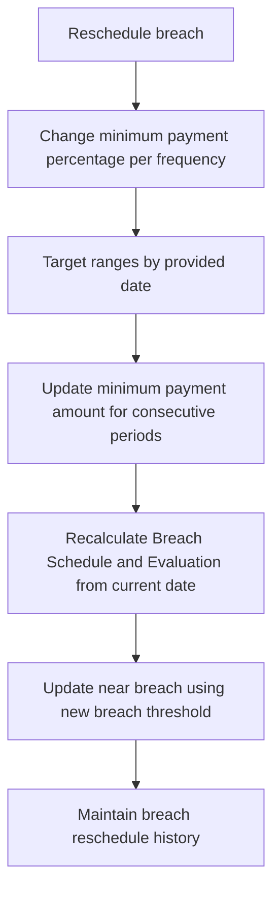
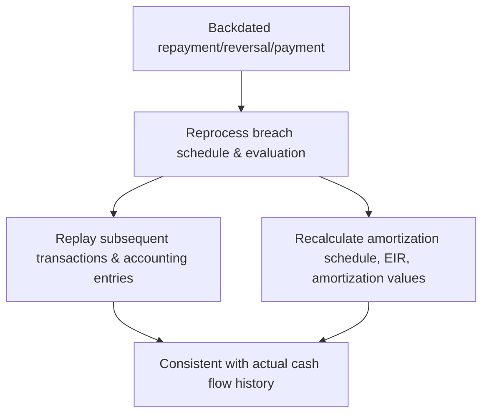

# Breach Management

## Breach management overview

Breach Management identifies, tracks, and resolves violations of predefined loan conditions in Merchant Capital Loan. It supports early detection of risk signals such as repayment delays and revenue declines so you can take timely corrective actions. It also helps minimize credit losses, maintain portfolio health, and ensure compliance with internal risk policies.

## Breach configuration

You configure breach management at the product level for Working Capital (WC) loan products.

| Parameter | Description |
| --- | --- |
| Breach period and rule | Defines the breach period and rule. |
| Name | Unique configuration name. |
| Frequency | Numeric range interval. |
| Frequency Type | Time unit such as days, weeks, or months. |
| Breach amount type | Percentage of loan amount or Flat amount. |
| Breach amount | The breach amount. |
| Breach grace days | Grace days for breach on the WC loan product. |
| Start date type | Start date type for breach on the loan product. |
| Enable Near Breach | Checkbox disabled by default. |
| Near Breach Threshold percentage | Available when Enable Near Breach is enabled. |
| Near Breach Evaluation Frequency | Frequency numeric value representing the range interval and a Frequency Type time unit such as days, weeks, or months. |

## Breach schedule

The Breach Schedule calculates breach and near breach for working capital loan accounts based on parameters set during breach configuration. Each schedule record covers one installment period, starting from the disbursement date.

| Column | Description |
| --- | --- |
| From Date | Start date of the installment period, calculated from the disbursement date and repayment frequency |
| To Date | Period end date of that installment |
| No of Days | Total number of days in the period |
| Min Payment Amount | Calculated based on input parameters |
| Outstanding | Outstanding amount of that period |
| Near breach | True or false |
| Breach | True or false |

## Breach evaluation

Breach evaluation runs at the end of every period as of the current date. The system compares the total payment received in the period with the minimum payment amount. If the payment is greater than or equal to the minimum payment amount, the period is not a breach. If the payment is less than the minimum payment amount, the period is a breach. Breach status is stored at each period level, and paying an excess amount in another period does not change the breach status of a period. Only breach status is maintained; breach days and breach amount are not stored.

Near breach evaluation applies only to Working Capital loans and only when breach is enabled. A period is considered near breach when the percentage of outstanding amount in the period is greater than the near breach threshold percentage, or when the percentage of paid amount in the period is lower than the near breach threshold percentage. Near breach status is stored at each period level, and paying an excess amount in another period does not change the near breach status of a period.

Near breach evaluation occurs one time at most. Multiple near-breach evaluation points can be based on the configured frequency plus frequency type. Evaluation starts from the breach range start date plus the configured length, and the date of evaluation is calculated as breach range start date plus frequency plus frequency type. Near breach frequency and frequency type must be lower than breach frequency and frequency type. When there are multiple near-breach evaluation points, the threshold is divided by the multiplicator.

## Grace days and start dates

Grace days shift the start date of the first period of the breach schedule by the number of days in breachGraceDays.

## Breach reschedule

You can reschedule a breach on an active loan account multiple times, including on the same date. The system keeps a history of each reschedule. A breach reschedule changes the minimum payment percentage per frequency for Working Capital loans. Based on the date you provide, the system targets the appropriate minimum payment or breach ranges and updates the minimum payment amount for all consecutive periods. Breach schedule and evaluation are recalculated from the current date according to the latest reschedule, and the system updates the near breach using the new breach threshold set.

## Breach reset

Breach Reset clears the current breach state so breach evaluation can restart from the current evaluation period. It occurs on the current date and does not change the period dates of the breach schedule unless you select Restart Period from Reset Date.

A Breach Reset does the following:

- Resets all prior periods.
- Removes the breach flag.
- Removes the past due amount.
- Resets the cycle to 0.

The following rules apply:

- No breach period recalculation or other operations occur before the current period.
- Backdated actions before the reset are ignored; transaction date matters.
- You can perform multiple resets on the breach schedule, but only one reset per period is allowed.
- The system maintains all reset history to support undo or deletion of the latest reset.
- Undoing or deleting a reset lifts the reset and recalculates all prior breach periods.

Permissions and records:

- Only a user with the breach reset permission or a super user can perform a Breach Reset.

> **Note:** Backdated repayments before the latest reset are ignored for WC breach.

## Breach pause and resume

Breach Pause applies only to the Breach schedule and affects breach evaluation exclusively; it does not affect delinquency, repayment schedules, or other loan calculations.

Rules for Breach Pause:

- Multiple Breach Pause records are allowed for an account, but overlapping pause periods are not permitted.
- The pause is applied as of the current business date at initiation.
- Backdated Breach Pause entries are allowed, and the system re-triggers and recomputes breach evaluation for the affected period upon application.

Rules for resuming a breach pause:

- Resume is permitted only during an active breach pause period, between the configured pause start date and end date.
- Upon executing the resume action, the pause end date is updated to the resume date.
- The breach pause is considered terminated as of the resume date.
- After resumption, the system recalculates breach based on the revised shortened pause duration.
- There is no undo of resume, backdated resume is not allowed, and multiple resumes are allowed.

## Breach disable and re-enable

Breach Disable stops breach evaluation for an account from the current date onward. You can apply it only once until you reverse it, and you can reverse it and reapply it as of the current date. Backdated disable is not permitted.

When Breach Disable is applied:

- Near Breach evaluation stops.
- Breach Past Due amount evaluation stops.
- Breach Reschedule is not allowed.
- Breach Reset is not allowed.
- Breach Pause is not allowed.

Breach Disable can be re-enabled through the BREACH enable action.

Only a user with the “disable breach” permission or with “all functions” can perform Breach Disable. History is maintained for the action.

## Breach past due amount

Breach Past Due Amount is the cumulative amount that remains unpaid across breach periods. The system calculates it at the end of each breach period as part of breach evaluation during close of business (COB), the nightly job that posts interest and fees. Backdated repayments or adjustments trigger recalculation for the affected periods. A breach reschedule recomputes the amount based on the revised breach schedule, while breach pause has no impact on the calculation. When breach disable is active, calculation stops from the disable date onward. The amount never goes negative and carries forward cumulatively across periods until fully resolved or reset. Periods before a reset remain unchanged, and all subsequent calculations consider only periods from the reset point onward.

Calculation rules:

- Period Past Due Amount = MAX(0, Total Amount Due in the Period − Total Amount Paid in the Period).
- Breach Past Due Amount = Previous Period Past Due Amount + Current Period Past Due Amount.

Timing:

- Backdated transactions and backdated reversals trigger real-time recalculation.

## Near breach

A working capital loan is near breach when the borrower has paid less than the required proportion of the amount due as the breach period nears its end. The required proportion rises as fewer days remain: 33.33% when less than 60 days remain, and 66.66% when less than 30 days remain.

## Backdated transactions and reprocessing

Backdated repayments or reversals trigger reprocessing of the breach schedule and evaluation to keep the account consistent with actual cash flow history.

The system does the following for backdated transactions:

- For backdated repayments, the system reprocesses the schedule and replays all subsequent transactions and accounting entries.
- For backdated transactions, the system recalculates the amortization schedule, recomputes EIR if applicable, and replays all amortization values.
- On reversal, the system reprocesses the amortization schedule and replays subsequent transactions if applicable.

## WC loan balance and disbursement fields

The system stores working capital loan balances in m_wc_loan_balance and disbursement details in m_wc_loan_disbursement_detail. Lifecycle dates and status fields appear on the loan record.

| Table | Fields |
| --- | --- |
| m_wc_loan_balance | wc_loan_id (unique FK), principal_outstanding, total_paid_principal, total_payment, realized_income, unrealized_income, audit columns, version |
| m_wc_loan_disbursement_detail | wc_loan_id, expected_disburse_date, expected_amount, expected_maturity_date, actual_disburse_date, actual_amount, disbursedon_userid |
| Loan lifecycle | loan_status_id, submittedon_date, approvedon_date, approvedon_userid, rejectedon_date, rejectedon_userid, disbursedon_date, closedon_date, closedon_userid, expected_maturedon_date, maturedon_date, last_closed_business_date |

## Reschedule frequency fields

Reschedule frequency fields set how often a rescheduled loan repays. They apply only to RESCHEDULE actions.

| Field | Type | Values | Use |
| --- | --- | --- | --- |
| frequency | INT, nullable | Any integer | New frequency value for RESCHEDULE |
| frequency_type | VARCHAR(50), nullable | DAYS, WEEKS, MONTHS, YEARS | Unit of the new frequency for RESCHEDULE |

## Payment aggregation and account number

The system aggregates payments by date, summing payments made on the same date and requiring them to occupy consecutive day slots starting from day 1. Each loan account number must be unique. Input parameters include originationFeeAmount, netDisbursementAmount, totalPaymentValue, periodPaymentRate, npvDayCount, and expectedDisbursementDate.

## Discount fees accounting

Discount fees post to Loans Receivable Principal and Deferred Interest, while amortization moves Deferred Interest to interest income. Backdated payments recalculate and recreate Discount fees amortization.

Accounting entries

| Transaction | Debit GL | Credit GL |
| --- | --- | --- |
| Discount fees | 112601 Loans Receivable Principal (Asset, Prin, Fees, and Penalty) | 240005 Deferred Interest (Liability, Prin, Fees, and Penalty) |
| Discount fees Adjustment | 240005 Deferred Interest (Liability, Prin, Fees, and Penalty) | 112601 Loans Receivable Principal (Asset, Prin, Fees, and Penalty) |
| Amortization | 240005 Deferred Interest (Liability, Int) | 404000 Interest income (Income, Int) |
| Amortization after charge-off | 240005 Deferred Interest (Liability, Int) | 404000 Interest income (Income, Int) |

## Disbursement accounting

Disbursement posts a debit to GL 112601 Loans Receivable Principal and a credit to GL 145023 Suspence/clearing account. Disbursement reversal posts the opposite entry: a debit to GL 145023 Suspence/clearing account and a credit to GL 112601 Loans Receivable Principal.

## Repayment accounting

Repayment accounting posts the repayment to the suspense/clearing account and reduces the loan receivable principal, while fees and penalties move to fee receivable and any excess goes to other credit liability. Repayment reversal reverses those postings.

| Transaction | Debit | Credit |
| --- | --- | --- |
| Repayment | GL 145023 Suspence/clearing account (Asset/Liability, Prin, Fees, Penalty and excess) | GL 112601 Loans Receivable Principal (Asset, Prin); GL 245000 Other Credit liability (Liability, excess); GL 112603 Fee Receivable (Asset, Penalty); GL 112603 Fee Receivable (Asset, fees) |
| Repayment Reversal | GL 112601 Loans Receivable Principal (Asset, Prin); GL 245000 Other Credit liability (Liability, excess); GL 112603 Fee Receivable (Asset, fees); GL 112603 Fee Receivable (Asset, Penalty) | GL 145023 Suspence/clearing account (Asset/Liability, Prin, Fees, Penalty and excess) |

## Write-off accounting

Write-off accounting posts the principal, fees and penalty of a written-off loan to recoveries and receivable accounts. Write-off reversal restores those amounts to the loan and fee receivable accounts and reduces recoveries. Charge-off reversal moves fee and penalty amounts from fee receivable back to principal and fee charge-off income.

| Transaction | Debit | Credit |
| --- | --- | --- |
| Write-off | GL 744008 recoveries (Expense, Prin, fees, and Penalty) | GL 112603 Fee Receivable (Asset, fees), GL 112603 Fee Receivable (Asset, Penalty), GL 112601 Loans Receivable Principal (Asset, Prin) |
| Write-off Reversal | GL 112601 Loans Receivable Principal (Asset, Prin), GL 112603 Fee Receivable (Asset, fees), GL 112603 Fee Receivable (Asset, Penalty) | GL 744008 recoveries (Expense, Prin, fees, and Penalty) |
| Charge-off Reversal | GL 112603 Fee Receivable (Asset, fees), GL 112603 Fee Receivable (Asset, Penalty) | GL 112601 Loans Receivable Principal (Asset, Prin), GL 404008 Fee Charge off (Income, fees), GL 404008 Fee Charge off (Income, Penalty) |

## CBR accounting

CBR accounting posts a debit to GL 245000 Other Credit liability and a credit to GL 145023 Suspence/clearing account. A CBR reversal posts the opposite entry: a debit to GL 145023 Suspence/clearing account and a credit to GL 245000 Other Credit liability. Backdated CBR is supported subject to validations.

## Goodwill credit accounting

Goodwill credit accounting posts the credit to principal, fees, penalty and excess balances using the GL codes mapped to Goodwill Credit, Goodwill Credit Fees, Goodwill Credit Penalty and Recovery Repayment. The same entries apply after charge-off, with recoveries posted to the recoveries income account and excess posted to Other Credit liability.

| Entry type | GL code | Account type | Balance |
| --- | --- | --- | --- |
| Debit | 744003 Principal bal adjustment | Expense | Principal, excess |
| Debit | 404008 Fee Charge off | Income | Fees |
| Debit | 404008 Fee Charge off | Income | Penalty |
| Credit | 744008 recoveries | Income | Principal |
| Credit | 744008 recoveries | Income | Fees |
| Credit | 744008 recoveries | Income | Penalty |
| Credit | 245000 Other Credit liability | Liability | Excess |

After charge-off, Goodwill Credit debits recoveries for principal, fees and penalty and Other Credit liability for excess, and credits Fee Charge off for fees and penalty.

| Entry type | GL code | Account type | Balance |
| --- | --- | --- | --- |
| Debit | 744008 recoveries | Income | Principal |
| Debit | 744008 recoveries | Income | Fees |
| Debit | 744008 recoveries | Income | Penalty |
| Debit | 245000 Other Credit liability | Liability | Excess |
| Credit | 404008 Fee Charge off | Income | Fees |
| Credit | 404008 Fee Charge off | Income | Penalty |

Goodwill Credit Reversal debits Loans Receivable Principal and Fee Receivable for principal, fees and penalty.

| Entry type | GL code | Account type | Balance |
| --- | --- | --- | --- |
| Debit | 112601 Loans Receivable Principal | Asset | Principal |
| Debit | 112603 Fee Receivable | Asset | Fees |
| Debit | 112603 Fee Receivable | Asset | Penalty |

Goodwill Credit Reversal after charge-off debits recoveries for principal, fees and penalty and Other Credit liability for excess, and credits Fee Charge off for fees and penalty.

| Entry type | GL code | Account type | Balance |
| --- | --- | --- | --- |
| Debit | 744008 recoveries | Income | Principal |
| Debit | 744008 recoveries | Income | Fees |
| Debit | 744008 recoveries | Income | Penalty |
| Debit | 245000 Other Credit liability | Liability | Excess |
| Credit | 404008 Fee Charge off | Income | Fees |
| Credit | 404008 Fee Charge off | Income | Penalty |

## Goodwill credit reversal accounting

| Amount type | Debit GL code | Debit mapping | Credit GL code | Credit mapping |
| --- | --- | --- | --- | --- |
| Principal | 744008 (recoveries) | Income from Recovery Repayment |  |  |
| Fees | 744008 (recoveries) | Income from Recovery Repayment | 404008 (Fee Charge off) | Income from Goodwill Credit Fees |
| Penalty | 744008 (recoveries) | Income from Recovery Repayment | 404008 (Fee Charge off) | Income from Goodwill Credit Penalty |
| Excess | 245000 (Other Credit liability) | Overpayment Liability |  |  |

## Charge addition and waive accounting

Charge addition posts a debit to Fee Receivable and a credit to Fee Income. Charge waive reverses those entries.

| Action | Debit GL | Credit GL |
| --- | --- | --- |
| Charge addition | 112603 Fee Receivable (Asset, fees) | 404007 Fee Income (Income, fees) |
| Charge waive | 404007 Fee Income (Income, fees) | 112603 Fee Receivable (Asset, fees) |

## Repayment after charge-off accounting

Repayment after charge-off posts the repayment to the suspense/clearing account and recognises recoveries for principal, penalty and fees, with any excess going to other credit liability. Reversing that repayment debits the recoveries accounts and credits the suspense/clearing account.

| Transaction | Debit GL | Credit GL |
| --- | --- | --- |
| Repayment after charge-off | 145023 Suspence/clearing account (Asset/Liability, Prin, Fees, and Penalty and excess) | 744008 recoveries (Income, Prin); 245000 Other Credit liability (Liability, excess); 744008 recoveries (Income, Penalty); 744008 recoveries (Income, fees) |
| Repayment Reversal after charge-off | 744008 recoveries (Income, Prin); 245000 Other Credit liability (Liability, excess); 744008 recoveries (Income, Penalty); 744008 recoveries (Income, fees) | 145023 Suspence/clearing account (Asset/Liability, Prin, Fees, and Penalty and excess) |

## CBR after charge-off accounting

CBR after charge-off posts Dr GL 245000 Other Credit liability and Cr GL 145023 Suspence/clearing account. CBR Reversal after charge-off posts Dr GL 145023 Suspence/clearing account and Cr GL 245000 Other Credit liability.

## Delinquency period and income recognition

The delinquency period runs monthly, and income is recognised per payment.

## Breach action tab and UI

The Breach Action tab lists breach actions for a loan.

## Template and schedule APIs

Two APIs fetch breach configuration options: one for breach configuration and one for Near Breach configuration.

## Range schedule

The range schedule tracks delinquency, expected payments, actual payments, and outstanding balances across defined time periods.

Each schedule record includes the following fields:

| Field | Description |
| --- | --- |
| From Date | Start date of the installment period |
| To Date | End date of the installment period |
| Expected Amount | Calculated using % per frequency applied to the configured base amount |
| Paid Amount | Sum of payments made within the date range |
| Outstanding Amount | Expected Amount minus Paid Amount |
| Delinquent days | Number of days between To Date and current date where the outstanding amount is greater than 0 |
| Delinquent amount | Outstanding amount after To Date |

## Delinquency pause and reset

Delinquency pause and reset lets you pause delinquency evaluation for a period and then reset it from the current system date. A pause extends any non-evaluated range schedule periods that overlap with or follow the pause start date by shifting their toDate forward by the pause duration. A reset deletes all future periods not yet evaluated and regenerates them with the new frequency and expected amount. Resets take effect only from the current system date; backdated resets are not permitted.

## Delinquency disable

Delinquency disable applies only as of the current system date and can be applied only once until the current disable is undone or reversed. Undoing a disable re-triggers and recomputes delinquency evaluation as of the undo date.

## Payment allocation order

Consecutive payments pay off the outstanding amount of the oldest past due, delinquent period first, then pay off the current period.

## Minimum payment amount condition

The minimum payment amount condition sets the amount due when the outstanding loan balance exceeds the minimum payment threshold.

## Goodwill credit overview

Goodwill Credit is a monetary transaction applied to a loan account. A lender uses it to credit an amount to the borrower without expecting repayment. It controls customer compensation, adjusts outstanding dues, and records goodwill expenses accurately.

## Goodwill credit effects

A goodwill credit reduces the outstanding loan balance, recalculates the actual amortization amount, adjusts the amortization schedule, posts discount fees amortization transactions, and triggers journal entries.

Future discount fees amortization transactions are based on the updated effective interest rate and the revised amortization schedule.

Income modification is the adjustment required when actual amortization differs from expected amortization because of overpayment, underpayment, or a missed payment.

> **Note:** Income amortization cannot be reversed independently; reversal is only possible by reversing the parent transaction (repayment or goodwill credit).

## Goodwill credit eligibility and validation

You can apply a goodwill credit to a loan that is Active, Charged-Off, or Closed. The credit amount must be greater than zero. A full or partial charge adjustment is supported, and its total amount cannot be higher than the original charge.

## Fraud flag

The fraud flag is set at the loan account level through API or UI.

## Worked examples

A working capital loan is disbursed on 1 January with a breach range that starts on the same date. The breach frequency is set to 3 months, so a near-breach check must use a shorter frequency, such as 1 month or 30 days. The figures below are illustrative. The system calculates the first near-breach evaluation date by adding the near-breach frequency to the breach range start date.

| Breach start | Near-breach frequency | Frequency type | Evaluation date | Allowed? |
| --- | --- | --- | --- | --- |
| 1 January | 1 | Months | 1 February | Yes |
| 1 January | 30 | Days | 31 January | Yes |
| 1 January | 3 | Months | 1 April | No |
| 1 January | 90 | Days | 1 April | No |

Changing the frequency type from months to days moves the evaluation date from 1 February to 31 January, while any near-breach frequency equal to or longer than the breach frequency is rejected.

A 90-day breach range uses near-breach checks every 30 days. The configured near-breach threshold is 100 percent. Because there are three evaluation points, the threshold is divided by the multiplicator of three, giving 33.33 percent for the first 30 days, 66.66 percent for the second 30 days, and 100 percent for the final 30 days. A period is near breach when the paid percentage is lower than the effective threshold for that point.

| Period | From | To | Expected amount | Paid amount | Paid % | Effective threshold | Near breach? |
| --- | --- | --- | --- | --- | --- | --- | --- |
| 1 | Day 1 | Day 30 | 300.00 | 90.00 | 30.00% | 33.33% | True |
| 2 | Day 31 | Day 60 | 300.00 | 150.00 | 50.00% | 66.66% | True |
| 3 | Day 61 | Day 90 | 300.00 | 300.00 | 100.00% | 100.00% | False |

The example shows that the effective near-breach threshold rises as the range progresses, so a payment that passes an early check can fail a later check.

A breach pause runs from 1 March to 10 March, giving a pause length of 10 days. If the operator resumes breach on 6 March, the pause end date moves to 6 March and the pause length becomes 6 days. The system then reprocesses the breach schedule using the shortened pause duration.

| Pause start | Pause end | Resume date | Effective pause end | Pause length (days) | Schedule impact |
| --- | --- | --- | --- | --- | --- |
| 1 March | 10 March | — | 10 March | 10 | Breach evaluation paused |
| 1 March | 6 March | 6 March | 6 March | 6 | Breach evaluation resumes; schedule reprocessed |

Resuming before the configured pause end shortens the pause and triggers a fresh breach evaluation for the affected periods.

Breach past due is cumulative and can never be negative. At the end of each period, the period past due is MAX(0, amount due minus amount paid). The breach past due for the period equals the previous period's breach past due plus the current period past due, and the balance carries forward until resolved or reset.

| Period | Amount due | Amount paid | Period past due | Breach past due (cumulative) |
| --- | --- | --- | --- | --- |
| 1 | 400.00 | 300.00 | 100.00 | 100.00 |
| 2 | 400.00 | 500.00 | 0.00 | 100.00 |
| 3 | 400.00 | 200.00 | 200.00 | 300.00 |

An overpayment in one period does not reduce the cumulative breach past due below zero, and an unpaid amount from an earlier period is carried into later periods.

See also: [Delinquency Restrictions](delinquency-restrictions.md), [Batch Jobs](batch-job-foundation.md), [Accounting](accounting.md), [Projected Balances](projected-balances.md).
