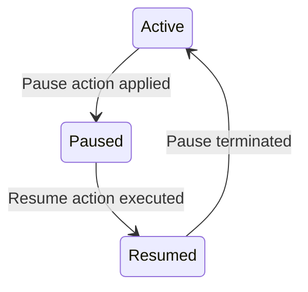

# Delinquency Restrictions

## Range schedule

The Range Schedule calculates overdue, delinquency, and payment holidays for a working capital loan account. The system creates it from the parameters set during delinquency configuration.

Each range schedule installment contains:

| Column | Description |
| --- | --- |
| From Date | Created from input parameters and starts from the disbursement date; start date and grace days affect it. |
| To Date | Period end date of that installment. |
| Expected Amount | Calculated based on input parameters. |
| Paid Amount | Sum of paid amount in that installment period. |
| Outstanding Amount | Difference of expected amount and paid amount. |
| Delinquent days | Number of days since delinquent this period. |
| Delinquent Amount | Amount still outstanding when the period is overdue. |

The installment start date is calculated from the disbursement date and the repayment frequency.

For working capital loans, delinquency configuration requires:

- Minimum payment period and rule.
- Frequency.
- Numeric value representing the range interval.
- Frequency type (time unit of the range interval, such as days, weeks, or months).
- Minimum payment amount type (Percentage of loan amount or Flat amount).
- Minimum payment amount.

Grace days settings:

- Grace days can be 0 or a positive number.
- Grace days define how many extra days are added to the very first start date.

Delinquency ranges must be provided to bucket, with the same behaviour as the existing one.

The start date for delinquency management of working capital loans can be either loan creation date or disbursement date.

Configuration example for product US_PPWC:

| Setting | Value |
| --- | --- |
| Delinquency grace days | 3 |
| Delinquency start type | DISBURSEMENT |
| Bucket ID | 1 |
| Frequency | 90 DAYS |
| Minimum payment | 10.000000 PERCENTAGE |

Delinquency ranges:

| Range | Min age days | Max age days |
| --- | --- | --- |
| D00 | 1 | 1 |
| D02 | 2 | 30 |
| D30 | 31 | 60 |
| D60 | 61 | 90 |
| D90 | 91 | 120 |
| D120 | 121 | 150 |
| D150 | 151 | 180 |
| D180 | 181 | 210 |
| D210 | 211 | 240 |
| D240 | 241 | 270 |
| D270 | 271 | 300 |
| D300 | 301 | 330 |
| D330 | 331 | 360 |
| D360 | 361 | null |

Delinquency configuration values:

| Setting | Options |
| --- | --- |
| Delinquency start type | LOAN_CREATION, DISBURSEMENT |
| Grace days | null, 0, or n |
| Minimum payment base | FLAT, PERCENTAGE |
| Payment period | daily |
| Delinquency period frequency | 30 |
| Delinquency period frequency term | DAY |
| Grace days | 0 |

Delinquency buckets:

| Bucket | Age range |
| --- | --- |
| D30 | 31-60 |
| D60 | 61-90 |
| D90 | 91-120 |
| D120 | 121-150 |
| D150 | 151-180 |
| D180 | 181-210 |
| D210 | 210-240 |
| D270 | >270 |

Add template API to fetch the options.

## Delinquency evaluation

Delinquency evaluation checks whether a Working Capital loan period has become delinquent or has cured, and updates delinquency tags and balances accordingly. It runs periodically based on minimum payment rules and daily at end of day, and can run in real time when monetary events occur, depending on configuration.

Evaluation is triggered when:

- A period is generated because the current date crossed the last period due date.
- A reschedule occurs and the minimum payment amount or frequency changed.
- A backdated or reversed monetary transaction occurred, affecting only the period where the outstanding loan balance is lower than originally calculated.
- A monetary event occurs in real time, when real-time re-evaluation is enabled.

Rules for evaluation:

- Past due is calculated independently for each period and does not carry forward from previous periods.
- Period Past Due Amount equals Total Amount Due for the Period minus Total Amount Paid for the Period.
- Incoming payments are allocated to the oldest unpaid minimum due period, applied to past due periods first, then the current period, with no allocation to future periods.
- After payment or end of day, tags and delinquent amounts are re-evaluated.

Delinquency tag history:

- Delinquency tag history is maintained for audit and tracking purposes.
- Backdated payments or reversals do not affect periods prior to the reset; delinquency calculations continue from the reset period without re-evaluating earlier periods.

## Delinquency pause

Delinquency Pause temporarily suspends delinquency tracking for a Working Capital loan. A PAUSE action is created with a startDate and endDate, and the pause is applied as of the current business date at initiation.

During the pause period:

- The delinquency range schedule is extended — the active and all future periods are shifted forward by the number of pause days.
- Future periods' fromDate values are shifted accordingly to maintain continuity.
- The pause applies only to the Delinquency schedule and evaluation and has no impact on breach management.

Resuming a pause:

- The pause end date is updated to the resume date.
- The system retriggers and recomputes the Delinquency schedule and evaluation based on the new backdated pause.

> **Note:** A user can do a backdated pause for Delinquency Evaluation.

## Delinquency reschedule

Delinquency Reschedule changes the minimum payment amount and/or the frequency of the delinquency range schedule for a Working Capital loan. You can override the product-level configuration for a specific loan without changing the product setup. A delinquency range schedule must already exist for the loan. You can reschedule an active loan account multiple times, even on the same date.

The reschedule action supports two minimum payment options:

- Percentage Amount: calculated based on principal plus discount.
- Flat Amount: you provide the new minimum payment amount.

The following values must meet these rules:

- minimumPayment must be a positive number percentage of approved principal.
- frequency must be a positive integer.
- frequencyType must be one of DAYS, WEEKS, MONTHS, YEARS.

What changes after reschedule:

| Setting | Before reschedule | After reschedule |
| --- | --- | --- |
| Expected Amount | Based on product-level minimum payment config | Percentage of approved principal or flat amount from the reschedule action |
| Frequency | Based on product-level delinquency bucket config | New frequency and frequency type from the reschedule action |

The system identifies the current period that contains the business date and updates its expectedAmount based on the new minimum payment percentage or flat amount. Future periods are deleted and regenerated with the new parameters. Evaluated periods remain unchanged and historical data is preserved.

If multiple reschedule actions exist, the latest one by ID takes precedence for generating new periods during close of business (COB), the nightly job that posts interest and fees. Delinquency Schedule and Evaluation are recalculated according to the latest reschedule, and evaluation of paid amounts can vary and is reevaluated. Any backdated repayments or reversals trigger reprocessing of the Delinquency schedule and evaluation.

## Delinquency reset

Delinquency Reset restarts delinquency monitoring cycles and marks a delinquent WCP account as regularized once compliance is restored. It stops further penal actions if applicable. You can perform multiple resets on the delinquency schedule, but only one reset per period is allowed. A validation message appears if you try to reset a second time on the same delinquency period.

Delinquency Reset offers an optional option to Restart Period from Reset Date:

- If you do not select Restart Period from Reset Date, the reset behaves as before with no changes to existing delinquency period calculations.
- If you select Restart Period from Reset Date, the system considers the delinquency reset date as the new starting point for delinquency period calculations.
- When selected, all existing delinquency periods are reset and a new delinquency period is created starting from the delinquency reset date.
- Subsequent delinquency periods are calculated using this new start date following the existing delinquency-period generation logic.
- Previous delinquency periods remain available for audit and history purposes but do not influence newly generated delinquency periods after the reset.

After a reset, delinquency evaluation restarts from the current evaluation period.

## Delinquency disable

Delinquency Disable stops delinquency evaluation for a loan account from the current date onward. You can use it for business scenarios such as charge-off or write-off. Backdated disable is not permitted.

While Delinquency Disable is active:

- Delinquency Reschedule is not allowed.
- Delinquency Reset is not allowed.
- Delinquency Pause is not allowed.

Permissions and reversal:

- Only a user with the permission "disable Delinquency" or with "all functions" can perform Delinquency Disable.
- Delinquency Disable is allowed only once until the current disable is reversed.
- Delinquency Disable can be reversed or undone.
- When reversed, delinquency evaluation is re-triggered and recomputed as of the undo date.
- After reversal, Delinquency Disable can be applied again as of the current date.

## Delinquency tags and buckets

Delinquency tags identify how far an account is past due, and delinquency buckets group those tags into ranges. Tags run from D00 through D270, and the system keeps a history of tag assignments. Breach evaluations do not keep history.

## Delinquency API

The Delinquency API lets you fetch delinquency information for a loan, retrieve delinquency configuration options, create delinquency actions, and list existing delinquency actions for a loan.

Create delinquency actions with POST /v1/working-capital-loans/{loanId}/delinquency-actions and list them with GET /v1/working-capital-loans/{loanId}/delinquency-actions.

- The action parameter is required and must be pause or reschedule.
- startDate and endDate apply only to pause.
- minimumPayment, frequency, and frequencyType apply only to reschedule.
- frequencyType must be DAYS, WEEKS, MONTHS, or YEARS.
- dateFormat and locale are optional.

## Delinquency database schema

The m_wc_loan_delinquency_action table stores PAUSE and RESCHEDULE actions applied to a Working Capital loan. These actions drive schedule modifications where pause extends periods and reschedule changes expected amounts and frequency, and they provide override parameters for close of business (COB) period generation.

Table columns:

| Column | Type | Nullability | Notes |
| --- | --- | --- | --- |
| id | bigserial | NOT NULL | Primary key |
| wc_loan_id | bigint | NOT NULL | Foreign key to m_wc_loan; ON UPDATE RESTRICT ON DELETE RESTRICT |
| action | varchar(50) | NOT NULL | PAUSE or RESCHEDULE |
| start_date | date | NOT NULL |  |
| end_date | date | nullable | User-provided for PAUSE; null for RESCHEDULE |
| minimum_payment | decimal(19,6) | nullable | Used only for RESCHEDULE as the new minimum payment percentage |
| frequency | int | nullable |  |
| frequency_type | varchar(50) | nullable |  |
| created_by | bigint | NOT NULL |  |
| created_on_utc | timestamp with time zone | NOT NULL |  |
| last_modified_by | bigint | NOT NULL |  |
| last_modified_on_utc | timestamp with time zone | NOT NULL |  |

## Delinquency pause and resume

You can pause Delinquency processing for a defined period and resume it before the pause ends.

Pause and resume rules:

- The Delinquency breach action is permitted only during an active Delinquency pause period, between the configured pause start date and end date.
- Only a user with specific permission or all functions permissions can perform the resume action.
- Only users with permissions or super user should be able to perform this action.

## Reschedule parameter inheritance

When a reschedule action omits a parameter group, the omitted group inherits its value from the latest previous reschedule action that set it. The product or breach configuration is used only when no earlier reschedule ever set that group. This inheritance rule applies identically to the Delinquency reschedule action and the Breach reschedule action.

Delinquency and Breach schedule and evaluation are recalculated according to the resolved inherited parameters. The reschedule action history remains append-only, and each action stores only the fields it was created with.

## Minimum payment based on remaining balance

When a loan's remaining principal balance is lower than the computed minimum payment, the delinquency period's expected amount equals the remaining balance. This rule applies to both product-configuration-based amounts and reschedule-based amounts. The delinquency period is evaluated as minimum payment criteria met once the remaining balance is fully paid.

## Delinquency grace days

Delinquency grace days set a cosmetic delinquency start date at read time: delinquencyStartDate equals the period's fromDate plus delinquencyGraceDays. The system does not apply delinquencyGraceDays when it evaluates delinquency, so a loan is tagged delinquent as soon as the business date passes the period's toDate by even one day.

## Payment allocation

For Working Capital loans, delinquency payments are allocated to the oldest past-due period first, one period at a time, and any excess is never applied to future periods. Allocation always applies charges before principal, in the order penalty, fees and principal. For Breach loans, incoming payments are allocated only to the current period and are not applied to past or future periods.

## Schedule characteristics

The delinquency start date and breach start date are calculated from the loan product's configured delinquency start date plus the configured number of delinquency grace days.

## Repayments and reversals

You can make repayments and reversals on a loan account. A repayment reduces the outstanding balance, updates and adjusts the amortization schedule, allocates the payment across components, and posts accounting entries. Repayments can be regular, partial, or excess (advance) payments. A repayment reversal creates a linked reversal transaction, reverses the allocated components (penalty, fee, principal), reverses the outstanding balance impact, reverses accounting entries, reprocesses the amortization schedule, and replays subsequent transactions if applicable.

Repayment conditions:

- The repayment date must not precede the loan disbursement date.
- The repayment amount must be greater than zero.
- Repayment is allowed if the loan is active, closed, or charged-off.
- Repayment amount follows the allocation strategy set for the Repayment transaction type, or the default strategy if none is set.
- Repayment debits GL code 145023 (Suspence/clearing account) mapped to Fund source for principal, fees, penalty, and excess.
- Repayment credits GL code 744008 (recoveries) mapped to Income from Recovery Repayment for principal, penalty, and fees.
- Repayment credits GL code 245000 (Other Credit liability) mapped to Overpayment Liability for excess.

Repayment reversal conditions:

- Reversal of a repayment transaction is allowed.
- Repayment reversal debits GL code 744008 (recoveries) mapped to Income from Recovery Repayment for principal, penalty, and fees.
- Repayment reversal debits GL code 245000 (Other Credit liability) mapped to Overpayment Liability for excess.
- Repayment reversal credits GL code 145023 (Suspence/clearing account) mapped to Fund source for principal, fees, penalty, and excess.

Special cases:

- Post charge-off repayment is treated as a regular payment and accounting follows charge-off rules.
- Post write-off repayment is treated as recovery income.
- Only recovery payments are allowed on a written-off account.
- If repayment creates overpayment (overpaymentAmount > 0), status transitions from ACTIVE to OVERPAID.

> **Note:** Additional restrictions may apply based on loan status and charge configuration.

## Charge-off and write-off

Charge-off lets a lender recognize a loan as uncollectible after prolonged delinquency or breach by writing off outstanding balances for accounting purposes, while optionally continuing recovery efforts. Charge-off is supported only on active loan accounts.

At the time of charge-off, you may:

- Disable delinquency manually.
- Disable breach tracking.

## Near Breach

Near Breach flags an account when repayment performance approaches but has not reached a breach threshold. It gives an early warning before an actual violation occurs. Near Breach is typically 70–90% of the breach limit; Breach is 100% or beyond. Near Breach is a preventive step; Breach is a correction step.

The system evaluates the following against configurable near breach thresholds:

- Merchant sales.
- Repayment trends.
- The percentage of paid amount in the period.

Configuration parameters:

| Parameter | Description |
| --- | --- |
| Enable Near Breach checkbox | Disabled by default. |
| Name | Available when Enable Near Breach is enabled. |
| Near Breach Threshold | Available when Enable Near Breach is enabled. |
| Near Breach Evaluation Frequency | Available when Enable Near Breach is enabled. Consists of a Frequency numeric value and a Frequency Type time unit such as days, weeks, or months. |
| Near Breach period requirement | 33.33%. |
| Near Breach period evaluation | 30. |

## Payment Holiday

A Payment Holiday applies to Working Capital products, where fixed installment schedules do not apply. It directly affects Delinquency and Breach schedules and evaluation. When you apply it, the system recalculates Delinquency and Breach evaluations for the affected period.

## Overpayment

Overpayment is tracked explicitly in WorkingCapitalLoanBalance.overpaymentAmount. For Working Capital Loan, principalOutstanding never goes below zero.

The overpayment increment is calculated as follows:

- overpaymentIncrement = transactionAmount - amountAppliedToOutstanding

## Hardship Termout

Hardship Termout applies Delinquency Reschedule, Breach Reschedule, Delinquency Reset, and Breach Reset together. Once applied, Near Breach Evaluation stops, and the breach past due amount continues based on the new breach schedule.

## Data model

A product can have one configurable attributes record and many product payment allocation rules, and many loans can use the same product. A loan has one balance and can have many disbursement details, many notes, many payment allocation rules, and at most one account lock. Many loans can reference one delinquency bucket. Relationship fields include client_id, fund_id, product_id, and delinquency_bucket_classification_id.

## Payment schedule basics

A payment schedule lists each payment row for a loan. Row 0 is the disbursement row, and every later row is numbered starting at 1. The payment date for a row equals the expected disbursement date plus the row number in days. An on-time payment is a payment made as expected according to the projected schedule. A missed payment is no payment received during the expected installment period. An overpayment is a payment amount that exceeds the expected payment for the period. The period payment rate is the configured rate used to determine the expected payment per period relative to the total payment value. Re-age adjusts future amortization values after a change in loan parameters or payment activity. Trailing activity such as repayment reversal or charge back can occur.

## Breach configuration example

The breach period frequency is 90 days.

## UI behavior

The user interface does not show Delinquency options when you create a WC loan account. You cannot select or override a Delinquency bucket, and no Delinquency data appears on the Account Details page.

## Minimum payment expected amount

The minimum payment expected amount defines the amount you must pay during each delinquency period. If you pay less than this amount, the period goes into delinquency and the past due amount equals the minimum payment amount minus the amount you paid. Outstanding amount is the expected amount minus the amount you paid.

## Breach reschedule

Breach Reschedule lets you change the minimum payment amount and/or the frequency of the Breach range schedule for a Working Capital loan. The system creates a RESCHEDULE action with the new minimum payment, frequency, and frequency type parameters. After a successful reschedule, the Range Schedule table and Actions list refresh automatically and show recalculated expected amounts without a page reload.

You can set the minimum payment using one of two options:

- Percentage Amount — calculated based on principal plus discount.
- Flat Amount — you enter the new minimum payment amount directly.

| Option | Calculation |
| --- | --- |
| Percentage Amount | expectedAmount = approvedPrincipal * (minimumPayment / 100) |
| Flat Amount | expectedAmount = user entered flat amount |

> **Note:** Delinquency must be configured at the loan account level before you can reschedule a breach. Required parameters are Name, Frequency, Frequency Type, Minimum payment amount type, and Minimum payment amount.

## Breach reset

A breach reset applies only from the current system date; backdated resets are not permitted. A reset tag is added to the period where the reset is applied so evaluation happens from that period only.

Undoing or deleting a breach reset has these effects:

- The breach status reverts to its previous state before the reset.
- Breach evaluation is recomputed accordingly.
- All undo or deletion actions are captured in the audit trail.

## Breach reset restart period

Breach Reset includes an option called Restart Period from Reset Date. When you select it, the system uses the Breach Reset Date as the new starting point for breach period calculations.

If you do not select Restart Period from Reset Date, Breach Reset behaves as it does today and does not change existing breach period calculations.

- If you select Restart Period from Reset Date, the system resets all existing breach periods as part of the breach reset process.
- The system creates a new breach period starting from the Breach Reset Date.
- Any subsequent breach periods are calculated from this new start date using the existing breach period generation logic.
- Previous breach periods remain available for audit and history purposes but do not influence the newly generated breach periods after the reset.

## Breach disable

Breach Disable lets authorized users stop breach evaluation for a loan account during business scenarios such as charge-off or write-off. The disable takes effect only as of the current system date; backdated disable is not permitted.

While Breach Disable is active, the following evaluations and actions are stopped:

- Near Breach evaluation stops.
- Breach Past Due amount evaluation stops.
- Breach Reschedule is not permitted.
- Breach Reset is not permitted.
- Breach Pause is not permitted.

Reversing Breach Disable re-triggers breach evaluation and recomputes it as of the undo date.

## Breach past due amount

Breach Past Due Amount is the amount by which an account remains in breach in the current period. Current Period Past Due Amount means past due calculated for the current period. Breach Past Due Amount is calculated at the end of each Breach Period as defined in the breach schedule and can never be negative.

The following events affect Breach Past Due Amount:

- Backdated repayments or adjustments trigger recalculation for the affected periods.
- A Breach Reschedule recomputes Breach Past Due Amount based on the revised breach schedule.
- Breach Pause has no impact on the calculation.
- Breach Disable stops calculation from the disable date onward.

> **Note:** Backdated payments or reversals update the affected period's Actual Payment Amount, Past Due Amount, and Breach Status, but they do not recalculate subsequent periods or alter the current breach evaluation.

## Breach reset meaning

A breach reset sets the breach past due amount to zero.

## Worked examples

A Working Capital loan is disbursed for 1,000 on 01-Jan-2026. The delinquency configuration sets a minimum payment of 10% of the principal every 30 days, so each period expects 100.00. Grace days are 0, so the first period starts on the disbursement date. The table walks through three 30-day periods through 31-Mar-2026, with payments of 100.00, 50.00, and 0.00 received in each period. The figures are illustrative. The example shows that outstanding and past due grow when a period pays less than expected, and that totals equal the sum of their rows.

| Period | From Date | To Date | Expected Amount | Paid Amount | Outstanding Amount | Past Due Amount |
| --- | --- | --- | --- | --- | --- | --- |
| 1 | 01-Jan-2026 | 30-Jan-2026 | 100.00 | 100.00 | 0.00 | 0.00 |
| 2 | 31-Jan-2026 | 01-Mar-2026 | 100.00 | 50.00 | 50.00 | 50.00 |
| 3 | 02-Mar-2026 | 31-Mar-2026 | 100.00 | 0.00 | 100.00 | 100.00 |
| Total |  |  | 300.00 | 150.00 | 150.00 | 150.00 |

The same loan of 1,000 with a 10% minimum payment every 30 days is disbursed on 01-Jan-2026, but the configuration defines 3 grace days. Grace days are added only to the very first start date, so the first period starts on 04-Jan-2026 instead of 01-Jan-2026. Subsequent periods continue in 30-day steps from that shifted start. With grace days set to 0, the first period would start on the disbursement date and every later date would move three days earlier. The example shows that grace days shift only the opening period, while the interval length and expected amounts stay unchanged.

| Period | From Date | To Date | Expected Amount | Paid Amount | Outstanding Amount | Past Due Amount |
| --- | --- | --- | --- | --- | --- | --- |
| 1 | 04-Jan-2026 | 02-Feb-2026 | 100.00 | 100.00 | 0.00 | 0.00 |
| 2 | 03-Feb-2026 | 04-Mar-2026 | 100.00 | 50.00 | 50.00 | 50.00 |
| 3 | 05-Mar-2026 | 03-Apr-2026 | 100.00 | 0.00 | 100.00 | 100.00 |
| Total |  |  | 300.00 | 150.00 | 150.00 | 150.00 |

A Working Capital loan has an approved principal of 10,000. The product-level delinquency configuration sets 3% every 30 days, so the original expected amount is 300.00 per period. On 01-Mar-2026 a delinquency reschedule changes the minimum payment to 1% with the same 30-day frequency. Periods already evaluated keep their original expected amount; the current period and all future periods use the new expected amount of 100.00. The example shows that evaluated periods preserve their historical expected amounts while future periods are regenerated with the rescheduled percentage.

| Period | From Date | To Date | Expected Amount | Paid Amount | Outstanding Amount | Past Due Amount | Status |
| --- | --- | --- | --- | --- | --- | --- | --- |
| 1 | 01-Jan-2026 | 30-Jan-2026 | 300.00 | 300.00 | 0.00 | 0.00 | Evaluated |
| 2 | 31-Jan-2026 | 01-Mar-2026 | 300.00 | 100.00 | 200.00 | 200.00 | Evaluated |
| 3 | 02-Mar-2026 | 31-Mar-2026 | 100.00 | 0.00 | 100.00 | 100.00 | Rescheduled |
| 4 | 01-Apr-2026 | 30-Apr-2026 | 100.00 | 0.00 | 100.00 | 100.00 | Rescheduled |
| Total |  |  | 800.00 | 400.00 | 400.00 | 400.00 |  |

A loan runs 30-day delinquency periods starting 01-Jan-2026. A delinquency pause is applied from 20-Jan-2026 to 29-Jan-2026, extending the active period and all future periods by 10 days. If the pause is resumed on 25-Jan-2026, the pause lasts 5 days and the shift applied to the active and future periods is reduced accordingly. The table shows period end dates under the original schedule, a 10-day pause, and a 5-day pause. The example shows that resuming a pause early shortens the extension applied to the active and all future periods.

| Period | Original To Date | To Date with 10-Day Pause | To Date with 5-Day Pause |
| --- | --- | --- | --- |
| 1 | 30-Jan-2026 | 09-Feb-2026 | 04-Feb-2026 |
| 2 | 01-Mar-2026 | 11-Mar-2026 | 06-Mar-2026 |
| 3 | 31-Mar-2026 | 10-Apr-2026 | 05-Apr-2026 |

Breach uses a 50% minimum payment every 60 days on a 1,000 loan, so each 60-day breach period expects 400.00. Payments are allocated only to the current breach period. Period past due equals total amount due for the period minus total amount paid for the period, and it is never negative. The example shows that breach past due is the unpaid minimum for the period, floored at zero, and that a later payment can clear the period only when it covers the full expected amount.

| Period | From Date | To Date | Expected Amount | Paid Amount | Past Due Amount | Breach Status |
| --- | --- | --- | --- | --- | --- | --- |
| 1 | 01-Jan-2026 | 01-Mar-2026 | 400.00 | 300.00 | 100.00 | Y |
| 2 | 02-Mar-2026 | 01-May-2026 | 400.00 | 50.00 | 350.00 | Y |
| 3 | 02-May-2026 | 01-Jul-2026 | 400.00 | 425.00 | 0.00 | N |

See also: [Batch Jobs](batch-job-foundation.md), [Projected Balances](projected-balances.md).
