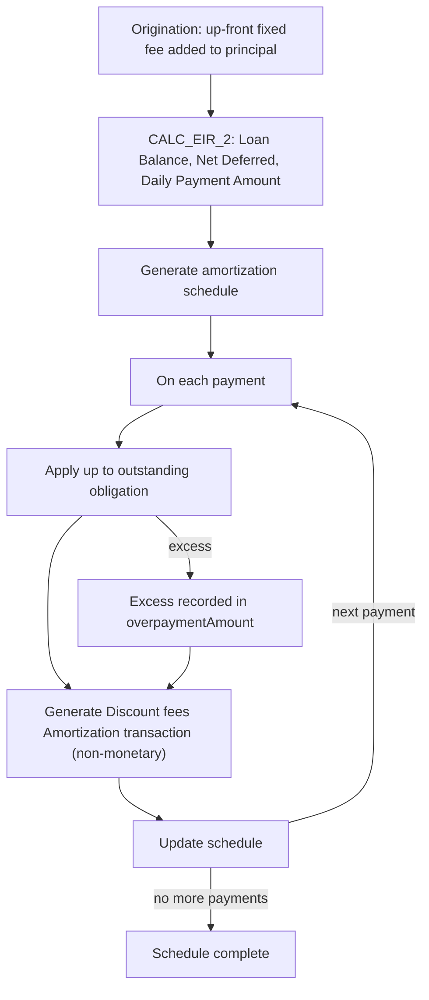
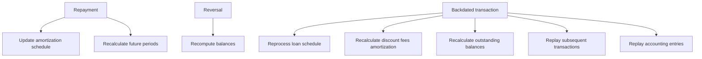

# Effective Interest Rate Product

## Working Capital loan product overview

A Working Capital loan product supports Effective Interest Rate (EIR)-based calculation. It uses its own loan product entity and a dedicated module, fineract-working-capital-loan, without impacting existing loan products. It supports discount- and fee-based working capital financing for merchants, and calculates and amortizes loans with the EIR method. It supports excess payments, fewer payments, and no payment calculation scenarios without impacting financial accuracy.

## Creating and managing Working Capital loan products

Mandatory field validation and correct value validation apply when you configure a Working Capital loan product. Product repositories include WorkingCapitalLoanProductRepository, WorkingCapitalLoanProductConfigurableAttributesRepository, and WorkingCapitalLoanProductPaymentAllocationRuleRepository.

## Loan application from a Working Capital product

You can create a loan application from a Working Capital loan product created in the system. The system creates a new entity for Working Capital loans. All default values from the product are inherited to the loan application screen. Mandatory field checks and correct value checks apply to loan application creation.

## Creating a loan account

You can create a new loan account using this loan product. When the start date basis is Disbursement during loan submission, the system uses the expected disbursement date; during loan approval, it uses the expected disbursement date; before disbursement, it uses null; at disbursement, it uses the actual disbursement date.

## Payment allocation rules

Payment allocation rules for a Working Capital loan product specify only whether a payment pays the principal, fee, or penalty portion. They do not include past due, due, or in advance rules.

## Amortization schedule and EIR calculation

The amortization schedule uses the IRR-based effective interest rate calculation, which supports non-uniform payment schedules. The RATE-based calculation works only for loans with equal daily payment amounts throughout their lifecycle. Totals in the amortization table can be off by a couple of cents because of rounding from the precise model to the loan currency, handled the same way as with progressive loans.

The system calculates the loan term and applies repayments as follows:

- Loan Term = (Principal Amount + Discount Amount) / Expected Payment Amount, rounded to a whole number.
- On repayment, the system applies the amount up to the outstanding obligation to the obligation.
- On repayment, the system records any excess amount in overpaymentAmount.

The effective interest rate calculation uses these inputs and precisions:

- CALC_EIR_2 takes Loan Balance, Net Deferred, and Daily Payment Amount as inputs.
- The annual effective interest rate is calculated from the high-precision daily effective interest rate and rounded to six decimal places.
- From the normalized annual effective interest rate, the system back-calculates the daily effective interest rate, with back-calculated daily effective interest rate and discount factor precision coming from MonetHelper.getMathContext.

## Period Payment Rate modification

You can modify the Period Payment Rate only on an Active loan and only as of the current date. Modification recalculates Daily Payment Amount, Total Days, and EIR, and future amortization calculations use the newly calculated values. Previously computed and posted amortizations are not affected. Modification is not allowed on closed, overpaid, charge-off, or written-off accounts. Backdated repayments and repayment reversals dated before the change are not supported.

## Repayment, reversal, backdated transactions, and goodwill credit

When you make a repayment, the system updates the amortization schedule and recalculates future periods. When you reverse a transaction, the system recomputes balances accordingly.

When you post a backdated transaction, the system reprocesses the loan schedule, recalculates discount fee amortization, recalculates outstanding balances, replays all subsequent transactions, and replays all associated accounting entries.

## Accounting entries

| Transaction type | Debit rows | Credit rows |
| --- | --- | --- |
| Charge Off Principal (Fraud) | FDR accounting driver PPWC, Batch Type Code 5, Batch Alpha Code Blank | FDR accounting driver PPWC, Batch Type Code 5, Batch Alpha Code Blank |
| Charge Off Principal (Non Fraud) | FDR accounting driver PPWC, Batch Type Code 5, Batch Alpha Code Blank | FDR accounting driver PPWC, Batch Type Code 5, Batch Alpha Code Blank |

## APIs and datatables

The Template API returns the available fields and available values for those fields. Product APIs support creating and updating working capital loan products, getting product details, listing products, configuring overridable attributes, and configuring payment allocation rules. Datatable APIs support registering an existing datatable against WCP entities and removing a WCP-scoped datatable.

| API | Endpoint | Purpose |
| --- | --- | --- |
| Template API | Returns available fields and available values | Shows fields and their permitted values |
| Product APIs | Create, update, get details, list products, configure overridable attributes, configure payment allocation rules | Manage working capital loan products |
| Register existing datatable | POST /v1/datatables/register/{datatable}/{apptable} | Registers a datatable against WCP entities |
| Remove datatable | DELETE /v1/datatables/{datatable} | Deletes a WCP-scoped datatable |

See also: [Overview](scope.md), [Charges, Refunds and Chargebacks](cross-cutting.md), [Breach Management](breach-management.md), [Delinquency Restrictions](delinquency-restrictions.md), [Transaction Types](transaction-types.md), [Batch Jobs](batch-job-foundation.md), [Accounting](accounting.md), [Projected Balances](projected-balances.md).
