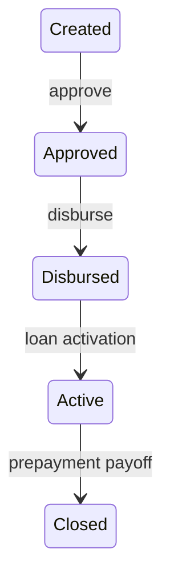

# Overview

## Working capital loan overview

The Working Capital Loan product uses an Effective Interest Rate (EIR)–based calculation that supports PayPal’s Working Capital financing offerings. It applies to zero-interest, discount/fee-based products with flexible, sales-based repayments. The projected amortization schedule dynamically updates based on approval, disbursement, and repayment activity and uses EIR methodology for income recognition, deferral, and Net Present Value (NPV) calculation. WCP is the abbreviation for Working Capital Product. Merchant Term Loan Products use Origination fees with Straight line amortization.

The product does not charge interest or use traditional installment structures:

- No interest is charged on the disbursed loan account.
- No multi-disbursement (tranche) scenarios exist.
- No traditional installments with defined amount allocations exist.
- No partial fee adjustments occur.
- N+1 type special scenarios could exist.

## Unsupported features

Working Capital loans do not support the following features, and requests that use them are rejected rather than silently accepted: flat amortization, prepayment, charge waiver, chargeback, real-time charge accrual, EIR for MTR, Repayment-% API, payment-amount strategies, disbursement charges on working capital products, and tax component on working capital products.

## Product configuration

A working capital loan product is a product template from which loan accounts are created and stored in table m_wc_loan_product. You select Regular (the default) or Working capital as the loan product type. The product defines financial defaults, repayment settings, allowable principal and rate ranges, default delinquency bucket classification, and currency and amortization setup. Each product has a one-to-one relationship with m_wc_loan_product_configurable_attributes and a one-to-many relationship with m_wc_loan_product_payment_allocation_rule. The instantiated account is stored in m_wc_loan.

Product fields must meet these uniqueness and range rules:

| Field | Rule |
| --- | --- |
| name | Must be unique. |
| short_name | Must be unique. |
| external_id | Must be unique when provided. |
| principal_amount | Must be within min/max when min/max are present. |
| period_payment_rate | Must be within min/max when min/max are present. |
| start_date | Must be less than or equal to close_date when both are present. |
| currency fields | Required fields must be populated. |
| repayment configuration | Required configuration must be populated. |

Configuration values:

| Setting | Values |
| --- | --- |
| NPV day count | 360, 365 |
| Period payment frequency | DAYS (1, 7, 30), WEEKS, MONTHS (month-end anchor) |
| Discount timing | none, at approval, at disbursement, added after disbursement, adjusted |
| Delinquency start type | LOAN_CREATION, DISBURSEMENT |
| Delinquency grace days | null, 0, n |
| Minimum payment rule | FLAT, PERCENTAGE |
| Breach / near-breach | none, breach only, breach + near-breach |
| Breach / near-breach grace days | 0, n |
| Allocation | product default, per-transaction-type, loan-level override, DUE / IN_ADVANCE modifiers |
| Charge timing | none, specified-due-date before maturity, after maturity (N+1), penalty vs fee |

Additional configuration rules:

- Frequency shorter than or equal to the loan frequency must be rejected for breach / near-breach.
- The allocations table stores the mapping of the balance portion allocation to transaction.
- The amortization field is amortization_type.

## Loan account creation and lifecycle

A working capital (WC) loan account follows the lifecycle of create, modify, approve, undo-approve, reject, disburse, undo-disburse, and delete. Approval requires a submitted state, and disbursement requires an approved state. Disbursement is a monetary transaction executed on an approved loan account.

A WC loan account can be created with Grace Days and Grace Days Start date left blank when the product does not allow overriding terms and settings on the loan account level. Fields and values remain the same as a regular loan account, including Balance, Fee/penalty due, Fee/penalty paid, and Fee/penalty outstanding.

Discount handling depends on whether the product allows attribute override. When override is disallowed and the product has a defined discount value, the proposed discount value on loan account creation is the inherited product-level value of 50, and leaving the discount field empty on approve or disburse screens means the discount is assumed to be that default inherited value. When override is allowed and the discount value is left empty, the discount is set to null or empty as currently implemented. Removing the discount value during loan creation leaves no value on the loan account.

During approval, the user can modify Principal Amount, Discount Amount, Approved Date, Expected disbursement date, and Notes. Principal Amount and Approved Date are mandatory; Principal Amount defaults to the amount entered during loan creation and can be changed to a lesser amount. Discount Amount is optional, defaults to the amount entered during loan creation, and can be changed to a lesser amount. Expected disbursement date is mandatory and represents the Expected Disbursement of the loan account. Notes is optional.

During disbursal, the user can enter or modify Disbursed on, Disbursement amount, Discount Amount, External ID, Payment Type, Payment Details, and Notes. Disbursed on is mandatory and represents the Actual Disbursement date. Disbursement amount is mandatory, defaults to the approved amount, and can be modified to any amount lesser than the approved amount. Payment Type is a drop down of payment type entities, and Payment Details contains Account No, Cheque No, Routing Code, Receipt No, and Bank code.

Disbursement date must not precede loan approval date and must comply with backdating rules. Disbursement amount must be greater than zero and must not exceed the approved loan amount for single disbursement. Disbursement triggers Journal Entries (JE).

Disbursement reversal is allowed. It creates a linked reversal transaction, reverses all other monetary transactions, reverses principal outstanding, reverses accounting entries, and reverts the loan status to the approved state.

Amortization is driven by payment events and is not independently triggered or scheduled. At least one disbursement must have an actual disbursement date.

> **Note:** Backdated disability is not permitted.

> **Note:** No pre-generated future periods exist.

## Amortization schedule

The amortization schedule for working capital loans shows net disbursement, discount, charges, discount adjustment, paid amounts, and outstanding amounts for each payment period. It contains no negative balances, and the expected running balance, actual running balance, expected running balance of discount fee, and actual running balance of discount fee all reach zero with the last payment period. Aggregated balances are accurate, and loan dates are correct: submitted, approved, disbursed, closed on date, overpaid on date, and maturity date.

The schedule recalculates when the percentage period payment rate changes:

- All balances remain accurate with no negative balances and no leftover or overflow.
- Aggregated balances match global balances.

Each record in the projected amortization schedule contains:

| Field |
| --- |
| Amortization Installment Number |
| Amortization Installment Date |
| Expected Payment Amount |
| Discount Factor |
| NPV Value |
| Balance |
| Net Amortization Amount |
| Actual Payment Amount |
| Actual Amortization Amount |
| Income Modification |
| Deferred Balance |

## Discount fee

A discount fee is a one-time fee applied to a Working Capital loan disbursement. You set it once per loan through the discount fee command. The system validates the related transaction, applies the fee, and tracks realized and unrealized discount fee income across the loan lifecycle.

Validation rules:

- The related transaction must exist, belong to the loan, be a DISBURSEMENT, and not be reversed; otherwise the command is rejected with 400.
- A second discount fee is always rejected with discount.already.set.before.disbursement, so discountFee, totalDiscountFee, schedule, and unrealized income stay consistent.

Accounting behavior by product type:

| Product type | Write-off behavior | Charge-off behavior |
| --- | --- | --- |
| WCLP_ADVANCED_ACCOUNTING | Write-off recognizes the remaining unrealized discount fee on the write-off date by posting a final Discount Fee Amortization with journal entries to the configured write-off expense account. | The discount fee command is rejected with a loan-status error; no transaction, balance, or journal entry is created. |
| NONE or ACC_DEF_REV_AM | Write-off discount fee handling works with transaction-only processing and no journal entries. | Not specified. |

Income and GL balance after charge-off or write-off:

| Measure | Value |
| --- | --- |
| Realized income | Net discount fee |
| Unrealized income | 0.00 |
| GL 240005 balance for the loan | 0.00 |

Reversals:

- Undoing a write-off reverses the final amortization and restores realized and unrealized income.
- Undoing charge-off or write-off reverses the correction derived from active amortization transactions.
- Undo charge-off and the existing discount fee adjustment guard keep working when discount fee is rejected on a charged-off loan.

> **Note:** The final discount fee processing on charge-off and write-off derives the delta from the active amortization transactions, not from the clipped unrealized balance, and posts a positive or negative correction.

## Write-off and charge-off

Write-off permanently closes a loan or account by extinguishing all outstanding dues when recovery is no longer feasible. Charge-off removes outstanding balances from loan asset books and posts accounting entries as per configured charge-off journal entry rules.

Write-off covers:

- All outstanding principal, interest, fees, and penalties are marked as written-off and removed from the books through accounting entries.

## Repayment and allocation

Repayment on disbursement day is supported, and you can undo a disbursement together with its discount. On repayment, the system adjusts outstanding balances. Any repayment amount above the outstanding obligation is stored in overpaymentAmount. Allocation order is penalty, then fee, then principal, with DUE and IN_ADVANCE modifiers. Per-type rules can be set at product level or loan level. Backdated re-age is not permitted. Evaluations and records before the re-age date remain unchanged and are not modified or reprocessed.

## Validation rules

The backend enforces validation rules for working capital loan products, loans, and transactions. Treat `allocation_types` as an ordered collection in code. A working capital loan holds core loan contract data, lifecycle dates and user actions, final account-level financial terms, and links to a client, product, fund, and delinquency bucket. It supports maturity and closure. Many loans belong to one client, use one product, and may reference one fund.

## Business date behavior

Business Date behavior controls the date that WCP features use when they create or submit records. When Business Date is enabled, those features use the configured Business Date for created_date and submitted_date wherever applicable. When Business Date is disabled, they use the current system date and time. The same rule applies across all WCP features and tabs, including Delinquency, Breach, Period Payment Rate, Transactions, Accounting Entries, and Charges.

## Datatables

Datatables let you store custom tabular data against a loan product or loan account. You can explicitly add supported datatables to working capital product (WCP) loan accounts, and view, modify, update, and delete their records where configured datatable rules and your user permissions permit. Datatable functionality splits into Term Loan Product and Term Loan Account for regular loans, and WCP Loan Product and WCP Loan Account for WCP loans. Datatables created for WCP loans are visible only to WCP loan products and accounts; datatables created for Term loans are visible only to Term loan products and accounts. The rest of datatable functionality remains unchanged.

Entity types, application tables, and foreign key columns:

| Entity type | Apptable name | Foreign key column |
| --- | --- | --- |
| WCP Loan Account | m_wc_loan | wc_loan_id |
| WCP Loan Product | m_wc_loan_product | wc_product_loan_id |
| Term Loan Account | m_loan | loan_id |
| Term Loan Product | m_product_loan | product_loan_id |

Datatable strategy supports single-row datatables, which allow only one value for the same loan or product, and multi-row datatables, which allow multiple values for the same loan or product.

Single-row and multi-row datatable storage:

| Type | Entries per parent | Foreign key | Primary key |
| --- | --- | --- | --- |
| Single-row | One | Added as primary key, unique, and indexed | The foreign key column |
| Multi-row | Multiple | Added as non-unique indexed foreign key | The auto-generated id column |

Datatable operations are create datatable, update datatable, fetch datatable, and remove datatable. Datatable entry operations are create a new entry, fetch it, update it, delete it, and fetch it to see the void.

Datatable API endpoints:

| Operation | Endpoint |
| --- | --- |
| Update datatable | PUT /v1/datatables/{datatable} |
| Deregister datatable | POST /v1/datatables/deregister/{datatable} |
| Update a single-row entry | PUT /v1/datatables/{datatable}/{apptableId} |
| Update a multi-row entry | PUT /v1/datatables/{datatable}/{apptableId}/{datatableId} |
| Delete all entries for a parent | DELETE /v1/datatables/{datatable}/{apptableId} |
| Delete a specific multi-row entry | DELETE /v1/datatables/{datatable}/{apptableId}/{datatableId} |

Datatables registered against m_wc_loan appear only for WCP loan accounts and not for m_loan; datatables registered against m_wc_loan_product appear only for WCP loan products and not for m_product_loan. Term loan datatables are not exposed under WCP apptable names.

## Period payment rate

The Period Payment Rate field takes a BigDecimal value. You can modify it only on Active loans.

## API endpoints

Loan APIs support create loan, get loan, list loans, approve loan, reject loan, disburse loan, close loan, add loan note, update payment allocation rules, get loan balance, and get disbursement schedule/details. You can delete a working capital loan product by its ID or external ID.

| Method | Endpoint |
| --- | --- |
| DELETE | /working-capital-loan-products/<loanProductId> |
| DELETE | /working-capital-loan-products/external-id/<loanProductExternalId> |

## Worked examples

A working capital loan projects its cash flows with an effective-interest-rate schedule. The figures below are illustrative: a borrower receives a net disbursement of 900.00, owes a discount fee of 100.00, and repays 1,000.00 in four monthly installments of 250.00. The period effective interest rate is 5.00%. Each future payment is discounted using discountFactor = 1 / (1 + EIR) ^ paymentsLeft; the model returns 1.00 if the result is zero or negative. Row 0 is the disbursement and is entered unclamped. This example shows how the discount factor and NPV value are derived for each installment.

| Period | PaymentsLeft | DiscountFactor | ExpectedPayment | NPVValue | RunningNPV |
| --- | --- | --- | --- | --- | --- |
| 0 (Disbursement) | 4 | 1.0000 | – | -900.00 | -900.00 |
| 1 | 4 | 0.8227 | 250.00 | 205.68 | -694.32 |
| 2 | 3 | 0.8638 | 250.00 | 215.96 | -478.36 |
| 3 | 2 | 0.9070 | 250.00 | 226.76 | -251.60 |
| 4 | 1 | 0.9524 | 250.00 | 238.10 | -13.50 |

When a working capital loan is written off, the remaining unamortized discount fee is recognized immediately so that no deferred income remains on the books. The figures below are illustrative: a loan carries a 100.00 discount fee, and one repayment plus cost-of-business processing have already recognized 10.00 of that fee. The deferred balance is therefore 90.00. On write-off, a final amortization posts the remaining 90.00 as realized income. This example shows the income and ledger movement at write-off.

| Stage | RealizedIncome | UnrealizedIncome | GL240005Balance |
| --- | --- | --- | --- |
| Before write-off | 10.00 | 90.00 | 90.00 credit |
| Write-off adjustment | +90.00 | -90.00 | 90.00 debit |
| After write-off | 100.00 | 0.00 | 0.00 |

A working capital loan can be overpaid when a repayment exceeds the outstanding obligation. The figures below are illustrative: the loan expects 1,000.00 in total, made up of 900.00 principal and 100.00 discount fee. A repayment of 1,050.00 settles the obligation and leaves 50.00 as overpayment, moving the account to OVERPAID. A credit balance refund of 50.00 then clears the overpayment and moves the account to CLOSED_OBLIGATIONS_MET. This example shows how overpayment and refund change the account status.

| Event | PrincipalOutstanding | TotalPaidPrincipal | TotalPayment | RealizedIncome | OverpaymentAmount | Status |
| --- | --- | --- | --- | --- | --- | --- |
| Before repayment | 900.00 | 0.00 | 0.00 | 0.00 | 0.00 | ACTIVE |
| After repayment 1,050.00 | 0.00 | 900.00 | 1,000.00 | 100.00 | 50.00 | OVERPAID |
| After CBR 50.00 | 0.00 | 900.00 | 1,000.00 | 100.00 | 0.00 | CLOSED_OBLIGATIONS_MET |

See also: [Charges, Refunds and Chargebacks](cross-cutting.md), [Breach Management](breach-management.md), [Delinquency Restrictions](delinquency-restrictions.md), [Transaction Types](transaction-types.md), [Batch Jobs](batch-job-foundation.md), [Accounting](accounting.md), [Projected Balances](projected-balances.md).
