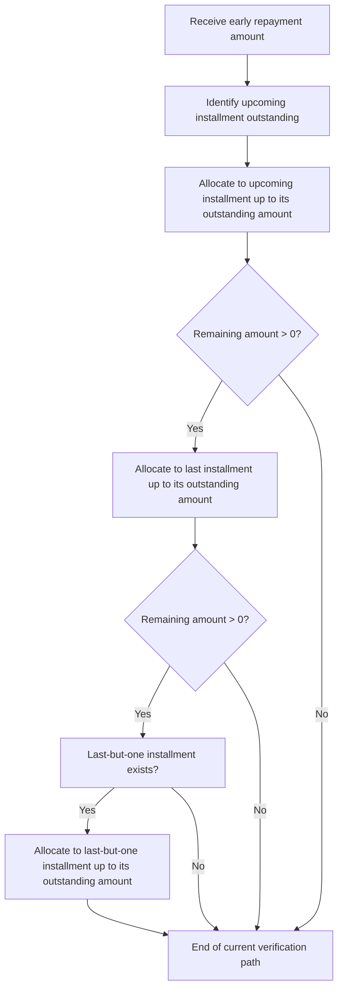

<!-- Labels: developer, advanced-allocation -->
# Advanced payment allocation - Add further in advance allocation rules

The enhancement described for in-advance allocations establishes a prioritized allocation strategy when a borrower makes an early repayment that covers more than the upcoming installment. The verified policy specifies the following order of application: first, apply the unprocessed amount to the upcoming (next) installment; if any portion remains unallocated after this step, apply the remaining amount to the last installment; and if the remaining amount still exceeds the last installment’s outstanding balance, allocate the leftover to the last-but-one installment (and so on, if applicable). The specification explicitly confirms the last-but-one allocation in this scenario, and the TLDR condenses the rule as a mix of “Next installment then Last installment.”

Overview and scope

This document describes how the in-advance allocation behavior operates when an early repayment is larger than the first upcoming installment and potentially larger than the final installment. No API surface, data model, or database schema changes are documented in the reference material for this enhancement. The behavior is described at the level of allocation logic within the repayment/allocation pathway, without reference to specific classes, methods, or persistence details.

Allocation rule details

The confirmed rule follows a staged allocation process that targets installments in a specified order, using the repayment amount as the source to reduce outstanding balances:

- Step 1: Identify the first upcoming installment with an outstanding balance. Allocate to this installment up to its outstanding amount.
- Step 2: If any part of the repayment remains unallocated after Step 1, allocate to the last installment’s outstanding balance, up to that balance.
- Step 3: If the remaining unallocated amount still exceeds the last installment’s outstanding balance, allocate to the last-but-one installment (assuming such an installment exists), up to its outstanding amount. This explicit last-but-one allocation is confirmed by the specification.
- Step 4: If there are additional earlier installments with outstanding balances and unallocated funds remain, the allocation would continue to apply to those installments in reverse chronological order (the specification explicitly confirms only the last-but-one step, not a full enumeration beyond that point).

The process prioritizes recent and terminal installments first, so that the earliest upcoming obligation is settled before moving to the later-end installments, with a controlled fallback to earlier installments as funds permit.

Operational flow (visual)

Below is a high-level depiction of the verified allocation sequence. It is intended to illustrate the decision points without exposing internal implementation details.

Edge cases and examples (conceptual)

- If the repayment amount exactly equals the upcoming installment’s outstanding balance, the allocation completes at Step 1 with no further allocations.
- If the repayment amount exceeds both the upcoming and the last installment outstanding balances, the remaining amount is allocated to the last-but-one installment (subject to its existence and outstanding balance).
- If there are no earlier installments beyond the last (or no last installment exists in the repayment window), the process ends after Step 2.

These behaviors reflect the documented intent for in-advance allocations and establish a total allocation path that respects the ordering: next upcoming, then last, then last-but-one, .

Implications for persistence and accounting

The reference material does not describe changes to APIs, data models, or database schemas for this enhancement. , there is no published contract or schema migration to apply. The behavioral description implies that installment balances are adjusted in response to early repayments according to the specified order, which in turn affects the repayment schedule and related balance tracking. Any downstream accounting entries or ledger impacts would follow from the updated installment balances, consistent with existing accounting rules for interest, principal, and fees, but those specifics are not described in the referenced material.

Notes on integration and verification

- The documented behavior covers the in-advance allocation path for early repayments. No external service interfaces or integration contracts are described as part of this enhancement.
- The two explicit behaviors verified by the reference are: (a) allocation to the upcoming installment first, and (b) allocation to the last installment if funds remain, with a confirmed allocation to the last-but-one installment when applicable.
- When implementing or reviewing this behavior, confirm that the allocation path respects the remaining balance after each step and does not allocate more than the outstanding balance of the targeted installment.

Conclusion

The advanced in-advance allocation rules introduce a deterministic, multi-step allocation strategy that prioritizes the next installment, then the final installment, and, if necessary, the last-but-one installment. This approach follows the described “Next installment then Last installment” rule while explicitly supporting the remaining allocation to the last-but-one installment when the repayment amount exceeds both the upcoming and the last installment balances. There are no documented changes to APIs, data models, or schemas associated with this enhancement in the reference data.