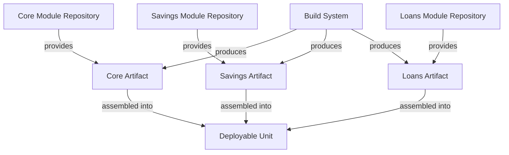

<!-- Labels: developer, architecture -->
# Modularisation of components

The Modularisation of components initiative aims to reduce system complexity and tailor Fineract to actual customer needs by organizing functionality into distinct, independently buildable modules. The core idea is to create multiple Git repositories, move modules to be built as separate artifacts, and define which modules are composed together to form a deployable unit. The proposed solution identifies Savings and Loans as independent modules, with the Core module representing the remaining functionality.

### Scope and boundaries

- Independent modules in separate repositories: The initiative prescribes placing functional areas into standalone repositories so each module can be built and versioned independently. The primary candidate modules identified for independence are the Savings and Loans modules, with the Core functionality treated as the remainder.
- Build-time artifact separation: Each module will be built as a separate artifact. A mechanism will be used to specify which modules are combined to form a deployable unit, enabling flexible composition per customer needs.
- Clear module interaction model: Modules are expected to expose explicit interfaces so other modules or build-time composition logic can compose them into a deployable unit without entangling internal implementation details.

### Architectural model and module boundaries

- Savings module: Encapsulates domain logic, persistence, and services related to savings functionality. The module is intended to operate as an independent artifact with its own build and test lifecycle.
- Loans module: Encapsulates domain logic, persistence, and services related to loan functionality. The module is intended to operate as an independent artifact with its own build and test lifecycle.
- Core module (remaining): Represents functionality not explicitly assigned to Savings or Loans. This module remains part of the broader platform surface but is treated as a distinct, independently buildable artifact in the modularisation plan.
- Data and serialization separation: JSON serialisation/deserialisation work is decoupled from business logic. This separation verifies that JSON processing does not depend on or embed domain services, and that data transfer formats can evolve without impacting service behavior.
- Persistence considerations: Data classes mapped to database entities must not contain business logic. This constraint helps verify a clean separation between the persistence model and domain/service logic, supporting independent module boundaries.

### Build, deployment, and runtime considerations

- Artifact generation: The build system will produce separate artifacts for each module, allowing teams to deploy a chosen combination of modules as a single deployable unit.
- Deployable unit composition: A deployable unit is formed by selecting a subset of module artifacts and their required interfaces. The composition rule determines which modules are included for a given deployment scenario.
- Versioning and compatibility: Each module maintains its own versioning. The integration surface between modules is expressed through explicit interfaces to minimize cross-module coupling.

### API surface and integration contracts

- Verified changes focus on module boundaries and serialization concerns rather than introducing new cross-module API contracts. The primary validated criterion is that JSON serialisation/deserialisation is independent from business logic (service class).
- Data transfer and persistence interfaces are expected to remain stable or evolve independently per module, with data classes mapped to database entities devoid of business logic per the verification notes.

### Verification criteria and expected outcomes

- Acceptance Criterion 1: JSON serialising/deserialising is independent from business logic (service class).
- Acceptance Criterion 2: No business logic on data classes mapped to Database entities.
- Acceptance Criterion 3: Independent modules in git repo.

These criteria describe the verified product behavior for the modularisation initiative and guide the architectural evolution without detailing internal implementation specifics.

### Diagram: module boundaries and deployable composition

### Rationale and consequences

- Simplified, modular build and deployment: By isolating functionality into independent modules, teams can tailor deployment units to customer needs and reduce the blast radius of changes.
- Clear separation of concerns: JSON (de)serialization is decoupled from business logic, reducing the risk that serialization-layer changes impact domain behavior.
- Maintenance and evolution: Independent repositories allows focused lifecycles, allowing the Savings and Loans domains to evolve separately while preserving core platform capabilities.

### Notes for adopters

This document conveys the architectural intent and verified behavioral constraints for the modularisation initiative. It does not specify concrete file paths, internal artifacts, or specific implementation steps beyond the high-level scope described above. As the project progresses, future updates should document exact module boundaries, interfaces, build configurations, and deployment manifests as they become verified and approved.