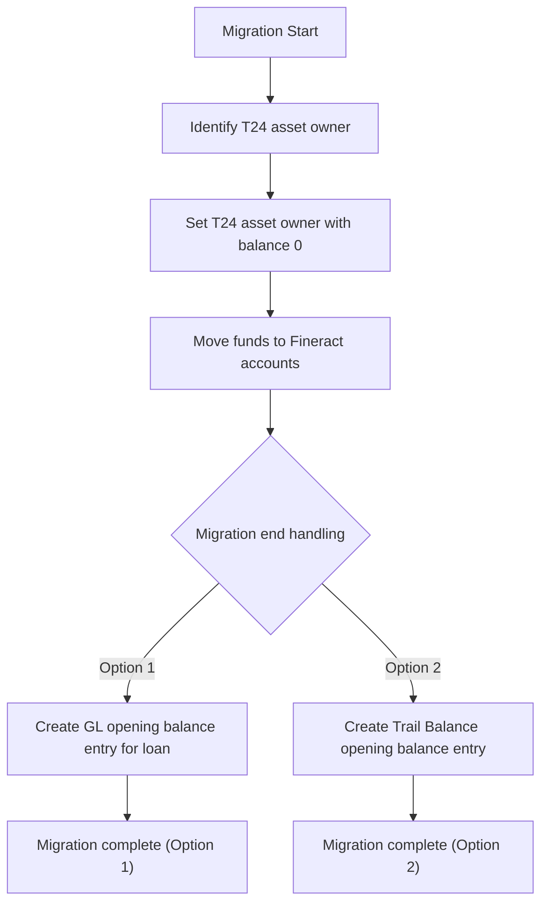

<!-- Labels: developer, asset-owner -->
# Accounting and Asset related changes

This page documents the verified, publication‑ready understanding of the accounting and asset handling changes associated with externalizing assets and moving funds from T24 books to Fineract. The guidance reflects a two‑option approach for migration end behavior, focusing on how opening balances are established in Fineract’s ledgers and reporting.

### Overview
As a GPL credit manager, the system now supports externalizing assets and real‑time loan transfers to external investors. The migration pathway involves moving funds from T24 books to Fineract, with two distinct end‑of‑migration treatment options:

1) Option 1 — Opening balance established via a GL entry at migration end
- An API is provided to set the T24 asset owner with a zero balance, enabling a clean handover from T24 to Fineract.
- At migration completion, the Sale/Buyback interface is modified to create a GL entry that indicates the loan opening balance in Fineract’s ledgers.

2) Option 2 — No GL entries during migration; opening balance captured in trail balance
- The same Asset Externalization enhancements apply, including the ability to assign a T24 asset owner with balance 0.
- At migration end, a trail balance entry is created that shows the opening balance of the loan, including Principal, Interest, Fees, and Penalties.

The intent of these options is to accommodate different accounting treatments during externalization and to provide a verifiable opening balance for migrated loans in the requested reporting scope.

### Scope of changes and affected components
The migration and accounting changes touch several existing components and services, all centered on enabling externalization and accurate balance representation:

- Asset Externalization feature: Enhanced to support real‑time loan transfers to external investors and to allow setting the T24 asset owner with a zero balance as part of the migration workflow.
- Asset Ownership API: Extended (or clarified) to support operations that assign the T24 asset owner and reset the loan balance to zero during the migration prep stage.
- Sale/Buyback API: Updated to accommodate an end‑of‑migration step that records the loan opening balance in a GL entry (Option 1).
- General Ledger (GL) accounting integration: The end‑of‑migration path selects between a GL entry (Option 1) or an item in the trail balance (Option 2) to establish the opening balance of migrated loans.
- Trail Balance reporting: Introduced or extended to report the loan opening balance with breakdowns for Principal, Interest, Fees, and Penalties (Option 2).
- Data integrity and reconciliation: The migration flow enforces consistency between balances, periods, and reporting outputs to preserve accounting truth across the transition.

Note: The changes described here are scoped to the accounting and asset handling workflows involved in externalization. They do not redefine the underlying data models beyond how opening balances and asset ownership are represented during migration.

### Migration options and behavior in detail
The two options described above represent different accounting treatments for the migrated loans. They impact the timing and form of opening balance recognition in Fineract's ledgers.

- Option 1: GL opening balance at migration end
 - After the T24 asset owner is set to a zero balance, the migration process concludes with a GL journal entry that reflects the loan's opening balance in Fineract.
 - This approach provides a single, explicit accounting event that anchors the migrated loan's initial balance in the general ledger.
 - The end‑of‑migration step relies on the Sale/Buyback interface to produce the required GL entry.

- Option 2: Trail balance opening balance at migration end
 - No GL entries are created during the migration itself.
 - At migration end, a trail balance entry is produced that captures the opening balance of the loan, including breakdowns for Principal, Interest, Fees, and Penalties.
 - This approach emphasizes the trail balance as the primary opening balance representation for post‑migration reporting.

Questions raised during design and planning include whether journal entries should be created for every transaction during migration or only for opening/closing balances. The documented options provide a concrete path for either treatment, with trail balance reporting supporting a complete opening balance view when GL entries are not generated during migration.

### API surface changes and behavioral differences
The migration changes depend on augmentations to existing interfaces and workflows:

- Asset Ownership API
 - New capability: assign the T24 asset owner and reset the asset balance to zero as part of the migration prep. This action allows the handover from T24 to Fineract without residual balances in the T24 context.
 - Effect: the asset is prepared for transfer into Fineract ownership with a zeroed balance to avoid duplicating funds during migration.

- Sale/Buyback API (migration end path)
 - Option 1 requires a GL entry to be created at migration end to reflect the loan's opening balance.
 - Option 2 bypasses GL entries during migration; the opening balance is represented in the trail balance report instead.

- Trail Balance reporting
 - For Option 2, the trail balance output includes the opening balance of migrated loans, with explicit breakdowns for Principal, Interest, Fees, and Penalties.

These changes are designed to be compatible with real‑time externalization needs while preserving accurate historical accounting representations for migrated assets.

### Data integrity, reconciliation, and invariants
The migration process adheres to strict integrity constraints to preserve accounting truth across the transition:

- Each period's opening balance must equal the previous period's closing balance.
- Payment allocations must reconcile with the transaction amount.
- Remaining cash and outstanding dues must reconcile across the migration boundary.
- General ledger entries, when present, balance with associated debit and credit lines, where the data is available.
- The opening balance reported in the trail balance (Option 2) must reflect the components of the migrated loan: Principal, Interest, Fees, and Penalties.

These invariants guide testing, validation, and auditability of the migration process.

### Migration workflow (visual diagram)

Explanation: The diagram reflects the two end‑of‑migration paths that determine how the opening balance of migrated loans is represented in the accounting records. Option 1 results in a GL entry, while Option 2 results in a trail balance entry that includes principal and component balances.

### Operational and implementation notes
- The Asset Externalization feature remains the primary mechanism for transferring loans to external investors, with the migration steps so that asset ownership and balances reflect the transition state.
- The choice between Option 1 and Option 2 should follows organizational accounting practices and reporting requirements. If GL entries are preferred for formal balance anchoring, Option 1 is selected; if trail balance reporting suffices for opening balance visibility, Option 2 is selected.
- Validation is required at every milestone to verify: (a) the opened asset ownership state matches the intended migration target, (b) the migrated balances reflect the intended open balance, and (c) reconciliation between asset counts, GL entries, and trail balance outputs exists .

### Examples and reporting considerations
- Opening balance reporting: In Option 2, the trail balance includes the opening balance with the breakdown into Principal, Interest, Fees, and Penalties. This allows external stakeholders to view the migration outcome through standard trail balance reporting without relying on GL journal entries created during the migration window.
- Real‑time transfer: Enhanced real‑time loan transfers to external investors continue to rely on the asset externalization flow, with the additional requirement that the asset owner is set to a zero balance at the start of migration to avoid duplicating funds.

### Summary for architects and contributors
- The technical scope centers on enabling an API‑driven path to set the T24 asset owner to zero balance and on adjusting the end‑of‑migration accounting treatment to open the loan balance in Fineract either via GL (Option 1) or trail balance reporting (Option 2).
- The two options reflect different accounting consequences, with explicit guidance on how the opening balance is represented and reported in each case.
- Integrity guarantees and reconciliations remain a core concern, so that period openings match prior closings and that loan components (Principal, Interest, Fees, Penalties) follows the migrated state.

This page captures the verified behavior and architectural considerations for the Accounting and Asset related changes required to support externalization of assets and real‑time loan transfers from T24 books to Fineract. The described pathways reflect the current implementation decisions and reporting expectations for migration scenarios.