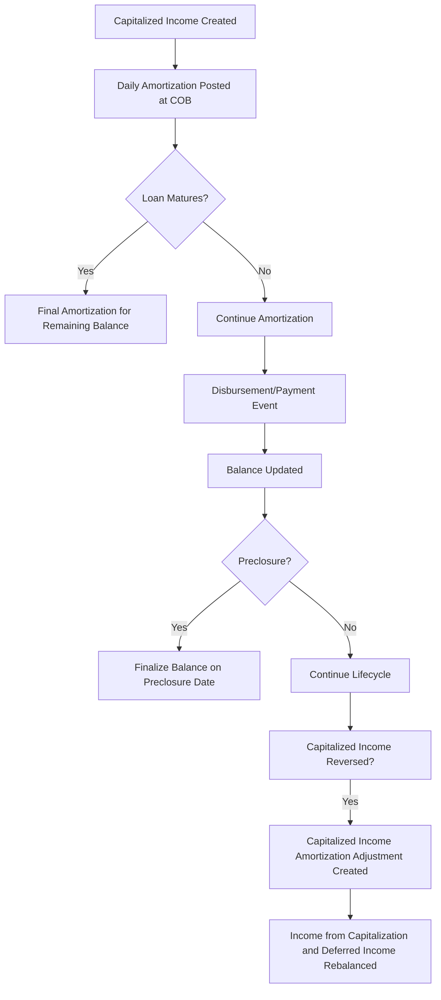

<!-- Labels: developer, capitalized-income -->
# Origination fee -> Capitalized income

Capitalized income (formerly Origination Fee) is introduced as a configurable mechanism at the loan product level to recognize and amortize deferred income over the life of a loan. In the Pepper-Soup Fineract module, capitalized income is treated as a principal component added at disbursement, and then amortized daily according to a fixed schedule. It applies only to Progressive loan schedules and uses a Flat calculation mode with an Equal Amortization strategy. The feature maps to specific GL accounts and supports detailed accounting, validation, and lifecycle events described below.

### Conceptual role and scope
- Capitalized income is configured on the loan product and, once enabled, applies to loans of the supported type (Progressive Loans). The configuration supports:
 - allows Capitalized Income (default: disabled)
 - Capitalized income calculation type: FLAT (current supported mode) with future extensibility for percentage-based cases
 - Capitalized income strategy: EQUAL_AMORTIZATION (daily equal portions recognized over the remaining life of the loan)
 - Income type: determines which balance category is used for allocation (FEE is default; INTEREST is another option)
 - GL mappings: Deferred Income (liability) and Income from Capitalization (income)
- Capitalized income is added to the loan principal at disbursement or after the first disbursement date, and the loan schedule is recalculated to reflect the higher principal. Interest and amortization are then calculated on the augmented principal (Disbursement + Capitalized Income).
- The feature supports backdating of capitalization transactions, while adjustments must not predate the original capitalization. There is no automatic reversal of capitalization; reversals must be performed through dedicated adjustment transactions.

### Behavior and calculations (verified rules)
- The system validates that the sum of the disbursement amount and the capitalized income does not exceed the approved loan amount.
- Daily amortization of capitalized income occurs as part of the COB (Close of Business) processing, using the configured strategy. The amortization moves amounts from Deferred Income (liability) to Income from Capitalization (income).
- Preclosure handling: on the preclosure date, any remaining unrecognized balance of capitalized income is recognized in full.
- Charge-off handling: amortization is halted, and the remaining capitalized income balance is charged off.
- The dynamics of capitalization affect the loan’s opening balance, the schedule, and subsequent interest calculations, since the amortization base has grown to include the capitalized amount.

### Transaction types and accounting flows (verified entries)
- Capitalized Income
 - Debit: Loan Portfolio (Asset)
 - Credit: Deferred Income (Liability)

- Capitalized Income Amortization
 - Debit: Deferred Income (Liability)
 - Credit: Income from Capitalization (Income)

- Capitalized Income Adjustment
 - Debit: Deferred Income (Liability) / Income from Capitalization (Income) [depending on adjustment kind]
 - Credit: Loan Portfolio (Asset)

- Capitalized Income Amortization Adjustment
 - Debit: Income from Capitalization (Income)
 - Credit: Deferred Income (Liability)

Notes on adjustments: Capitalized Income Adjustment is a credit-type transaction that reduces the capitalized balance and can be backdated but cannot predate the original capitalization. Adjustments are associated with a specific Capitalized Income transaction and may be multiple against the same original transaction. Automatic reversal is not supported; adjustments must be reapplied if incorrect. The Amortization Adjustment transaction is system-generated when a Capitalized Income transaction is reversed and reverses the already recognized amortization.

### API surface and lifecycle (evidenced contracts)
1) Configure Capitalized Income on a loan product
- Endpoint: POST /loanproducts
- Request body ():
 ```json
 {
 "enableIncomeCapitalization": true,
 "capitalizedIncomeCalculationType": "FLAT",
 "capitalizedIncomeStrategy": "EQUAL_AMORTIZATION",
 "capitalizedIncomeType": "FEE"
 }
 ```
- This allows capitalized income for applicable loan products and wires the configuration into the loan lifecycle.

2) Add Capitalized Income to a loan
- Endpoint: POST /loans/{loanId}?command=capitalizedIncome
- Request body ():
 ```json
 {
 "transactionDate": "2025-05-01",
 "dateFormat": "yyyy-MM-dd",
 "locale": "en",
 "transactionAmount": 100.0,
 "paymentTypeId": 1,
 "note": "Capitalized income fee",
 "externalId": "CINCOME-001"
 }
 ```
- Response body ():
 ```json
 {
 "resourceId": 1,
 "resourceExternalId": "CINCOME-001"
 }
 ```
- On success, the system adds the capitalized income transaction, recalculates the amortization schedule, and begins daily amortization from the capitalization date.

3) Get Capitalized Income amortization info
- Endpoint: GET /loans/{loanId}/capitalizedincome
- Description: returns information about the amortization state and related balances for the capitalized income on the loan.

4) Add Capitalized Income Adjustment
- Endpoint: POST /loans/{loanId}/transactions/{capitalizedIncomeTransactionId}?command=capitalizedIncomeAdjustment
- Request body ():
 ```json
 {
 "transactionDate": "2025-05-01",
 "dateFormat": "yyyy-MM-dd",
 "locale": "en",
 "transactionAmount": 50.0,
 "paymentTypeId": 1,
 "note": "Capitalized income fee",
 "externalId": "CINCOMEADJ-001"
 }
 ```
- Response body ():
 ```json
 {
 "resourceId": 1,
 "resourceExternalId": "CINCOMEADJ-001"
 }
 ```
- The adjustment reduces the capitalized income balance and can be backdated within the constraint that it does not exceed unrecognized (not yet amortized) balance.

5) Capitalized Income Template API (limits and metadata)
- Endpoint: GET /loans/{loanId}/transactions/template?command=capitalizedIncome
- Response example ():
 ```json
 {
 "paymentTypeOptions": [],
 "currency": { /* currency config */ },
 "date": [2025, 5, 29],
 "amount": 0
 }
 ```
- This template provides current date and maximum allowable capitalized income (approved amount - disbursed amount - capitalized income).

6) Capitalized Income Adjustment Template API (limits)
- Endpoint: GET /loans/{loanId}/transactions/template?command=capitalizedIncomeAdjustment
- Response example ():
 ```json
 {
 "paymentTypeOptions": [],
 "currency": { /* currency config */ },
 "date": [2025, 5, 29],
 "amount": 0
 }
 ```
- This template returns the maximum allowable adjustment (capitalized income - adjustment).

### Calculation references and example scenarios (grounded )
- Calculation context is anchored in Equal Amortization of the capitalized income over the remaining days of the loan, with daily postings during COB. The base formulas derive from a fixed split of the capitalized amount across remaining days, and the amortization schedule is updated to reflect the increased principal on capitalization.
- Example UC-1: Simple loan with capitalized income on the same day as disbursement
 - Parameters evidenced: Interest Rate 7% (0.000194444 daily factor with 360 days/year), Days In year 360, Days In month 30, Disbursement 100, Capitalized Income 50, Total Amount 150, repaid every 1 month.
 - Practical effect: The opening balance includes the disbursement and capitalization (100 + 50). Amortization then recalculates based on 150 as the base, with payments distributed over the loan term. The example schedule shows how principal and interest portions are affected as the loan amortizes, with daily interest accruing on the augmented balance.
 - This demonstrates how the capitalized amount affects the daily amortization and the resulting cash flows, including a final settlement aligned with the documented schedule.

### Data model and persistence (-based layout)
- Configuration is stored on the loan product (m_product_loan) and mirrored on the loan (m_loan) with fields: enable_income_capitalization, capitalized_income_calculation_type, capitalized_income_strategy, capitalized_income_type.
- Balances tracked on the loan include: capitalized_income_derived and capitalized_income_adjustment_derived.
- Capitalized income balance is modeled as one row per capitalization transaction in m_loan_capitalized_income_balance, with fields id, loan_id, loan_transaction_id, amount, date, unrecognized_amount, charged_off_amount, amount_adjustment, created_by, created_on_utc, last_modified_by, last_modified_on_utc.
- The system maintains a precise accounting trail through the four transaction types described above and via related amortization records, alignment with Deferred Income (liability) and Income from Capitalization (income).

### Validation, guards, and edge cases
- Disbursement validation: (Disbursement + Capitalized Income) must be ≤ Approved loan amount.
- Backdating rules: Capitalized Income and Capitalized Income Adjustment support backdating; adjustments cannot predate the original capitalization.
- Reversals and integrity: There is no automatic reversal of Capitalized Income; a dedicated Capitalized Income Amortization Adjustment is used to revert previously amortized amounts when a reversal occurs.
- Preclosure and charge-off: Preclosure recognizes any remaining unrecognized balance; charge-off halts further amortization and charges off the remaining balance.
- Journal entries balance: The accounting entries for each transaction type maintain the two-sided balance requisite (debits equal credits) where actual postings are available in the system.

### Lifecycle diagram (verified transitions)

- The diagram reflects the evidenced transitions: creation, daily amortization, finalization at preclosure, halting on charge-off, and adjustments when reversals occur. It stays faithful to the documented lifecycle and event triggers.

### Glossary of evidenced terms
- Deferred Income: Liability GL account used to defer recognition of income until amortized.
- Income from Capitalization: Income GL account representing recognized income from capitalization once amortized.
- Loan Portfolio: Asset GL account representing the loan balance or related assets.
- Amortization: Systematic recognition of capitalized income as income over the life of the loan, using the configured daily schedule.
- COB: Close of Business processing window during which daily amortization postings occur.

### Worked example references (structure, not placeholders)
The reference material includes multiple worked examples and schedules illustrating the capitalized income flow, including a simple UC-1 scenario where disbursement and capitalization are handled in a single period, and schedules showing how the balance, principal, and interest evolve as amortization occurs. The exact numeric traces in those references demonstrate the daily posting, rebalancing of deferred income, and the resulting schedule changes when capitalized income is included. Those traces are used to validate the implemented behavior and to guide testing and verification activities.

### Summary of the implemented behavior
- Capitalized income is configurable at the loan product level, with Flat calculation type and Equal Amortization schedule, applied to Progressive loans via a Capitalized Income transaction.
- The system updates the loan balance and amortization after capitalization, and daily amortization runs during COB to move amounts from Deferred Income to Income from Capitalization.
- Validation verifies the capitalization amount does not push the disbursement beyond the approved loan amount; backdating and adjustments are supported under defined constraints; reversals are handled through dedicated amortization adjustments rather than automatic reversals.
- GL mappings, accounting entries, and business events follows standard capitalized income processing, enabling traceability and accounting integrity across the loan lifecycle.

> This page presents the verified product behavior for Origination fee -> Capitalized income as implemented in the Pepper-Soup Fineract module. It consolidates configuration, scheduling, accounting, APIs, and edge-case handling into a coherent, publication-ready reference for backend engineers, integrators, and contributors.