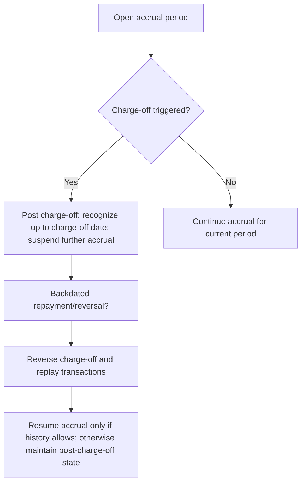

<!-- Labels: developer, charge-off-interest -->
# Interest Accrual Handling for Charge-off loans

This page documents the approved behavior for suspending interest accrual on charge-off loans, including the calculations, scheduling, accounting implications, and edge cases as implemented in Pepper-Soup. The guidance reflects the verified calculations and acceptance criteria described in reference scenarios, which establish how interest accrues up to the charge-off date, how accrual stops thereafter, and how backdated actions interact with charge-off state.

### Conceptual overview

Charge-off processing introduces a discrete boundary in the loan's interest accrual timeline. Interest is accrued and recognized up to the charge-off date, treating the charge-off as a realization of credit loss for the outstanding balance. From the day following the charge-off date, interest accrual is suspended for the affected loan. This verifies that income recognized follows what is actually realized and prevents accrual of interest that is unlikely to be collected.

Key implications of this approach include:

- The interest portion accumulated up to the charge-off date is recognized as part of the charge-off accounting, while future accrual is halted.
- Payments and interest accrual related to periods after the charge-off do not affect the post-charge-off treatment unless a reversal or backdated action occurs.
- If a repayment or reversal is backdated to a time prior to or during the charge-off window, the system performs a reverse-replay of the charge-off events and the associated accrual entries to restore consistency.
- The charge-off date may be any date as long as it is the latest transaction date on the loan account; charge-off cannot be performed on a future date.
- For interest-bearing, progressive loans, an option to accelerate maturity is available. For non-interest bearing, progressive loans, there is an optional (deferred) set of charge-off options.

These rules are designed to preserve financial integrity by so that every period’s opening balance follows the preceding period’s closing balance, and that allocations reconcile with the underlying cash flows and journal entries.

### Technical scope and touched areas

The verified rules operate across several subsystems that influence how a loan's accrual, scheduling, and accounting behave when a charge-off occurs. In summary:

- Interest accrual and loan schedule: The accrual engine computes interest using the defined day-count conventions and stops accrual after the charge-off date. The system uses a fixed 30-day month and a 360-day year for charge-off calculations, consistent with the reference scenarios.
- Charge-off processing: When a charge-off is triggered, the system posts a charge-off event that converts the remaining outstanding balance into a realized loss for the period up to the charge-off date, and transitions the loan into an adapted state where ongoing accrual is suspended.
- Backdating, reversals, and replay: Backdated repayments and reversals trigger a reverse-replay of the charge-off transaction and related accrual entries to preserve consistency with the corrected cash flow history.
- Accounting mappings: The charge-off event results in associated journal entries that reflect principal loss and interest income adjustments, mapped to the product- or configuration-specific GL accounts.
- Scheduling integrity: The design preserves the invariant that each period’s opening balance equals the prior period’s closing balance (subject to charge-off and any reversals).

The following sections describe the behavior in detail and provide precise rules and calculations as evidenced by the reference data.

### Verified behavioral rules (Acceptance Criteria)

- Interest will be calculated up to the charge-off date as the charge-off interest portion.
- Interest accrual is stopped starting the day after the charge-off date; no accrual occurs beyond that point unless a reversal or backdated action reopens it.
- Installment timing beyond the charge-off date (N+1 installments) has no impact on charge-off calculations.
- Backdated repayments and reversals trigger the reverse-replay of all transactions and the charge-off transaction itself, restoring consistency with the corrected history.
- The charge-off date can be any date that is the latest transaction on the loan account; a charge-off cannot be executed on a future date.
- Accelerate maturity is an available option for interest-bearing, progressive loan products.
- Optional (deferred) charge-off options are available for non-interest bearing, progressive loan products.
- For charges that are due after the charge-off date, and for accruals recognized on a submitted-on date with acceleration, the charge-off may kick in before the due date, depending on the configured maturity acceleration behavior.

These rules are demonstrated by the calculations and scenarios in the reference materials, which consistently apply a fixed day-count convention and a defined interest rate to compute the interest portion up to the charge-off, then suspend accrual thereafter.

### Calculation model and day-count conventions

The reference scenarios use the following constants for charge-off calculations:

- Interest rate: 7% per year (0.000194444 per day when using 360-day year and 30-day months)
- Days in year: 360
- Days in month: 30
- Principal example for reference: 100 (unit values used in scenario tables)
- Repaid every: 1.00 month (monthly installments in the illustrated schedules)

With these conventions, the monthly interest increment (for a standard 30/360 approach) can be expressed as:

- Monthly rate = annual rate × (days in month / days in year) = 0.07 × (30 / 360) = 0.005833333...
- Interest for a given period on opening balance P = P × 0.005833333...

This matches the rate factor shown in the reference calculations (monthly factor of 1.005833333). The system applies this rate to compute the interest portion of each installment before any charge-off adjustments, and then, upon charge-off, records the charge-off as the culmination of the loss with interest recognized up to that date.

For transparency, the reference data present the following concrete values that illustrate the mechanics of charge-off calculations under the 30/360 convention with a 7% annual rate:

- Rate factor (monthly) = 1.005833333
- Rate per day (when expanded) = 0.000194444 (approx.)
- Example principal in the reference scenarios: 100
- Example: interest increment per 30-day period ≈ 0.58 on a balance around 83.57 (as shown in scenario lines), before the charge-off event.

Notes:
- The numbers in the reference sheets serve as worked examples illustrating the flow of accrual, repayment, charge-off, and the accounting entries that follow. They are not prescriptions for every loan in production but demonstrate the exact arithmetic under the defined conventions.
- All intermediate values, opening/closing balances, and allocations must reconcile in a production system; the integrity checks require that opening balances equal prior period closing balances, and that allocations balance with the transaction amounts.

### Example schematic: charge-off flow (high level)

### Worked concepts and validated outcomes

- Starting position and inputs: The schedule begins from an initial loan balance and a defined installment pattern. Interest accrual uses a fixed 30-day month and a 360-day year convention. indicates a per-period interest increment of approximately 0.58 for mid-range balances, consistent with the 7% annual rate and the 30/360 convention.
- Calculation method: For each accrual period prior to charge-off, the system computes interest as Balance × (0.07 × 30/360) and adds that to the balance ; principal reductions from installments reduce the balance .
- Financial effect of charge-off: At the charge-off moment, the remaining balance is recognized as a loss for the period up to the charge-off date, and accrual is halted from the day after the charge-off date. The charge-off entry creates associated accounting lines (loss/expense and related income adjustments) according to the product’s accounting configuration.
- Post-charge-off behavior: Any future direct accrual is suppressed unless a backdated action occurs. If a backdated repayment or reversal is executed, the system performs a reverse-replay of charge-off-related transactions to restore consistency with the corrected cash history.
- Validity constraints: The charge-off date must not be a future date and must be the latest transaction date on the loan account.
- Special options: Accelerate maturity is available for interest-bearing, progressive loans; optional (deferred) options exist for non-interest bearing, progressive loans.

Integrity checks to preserve accounting and scheduling consistency include:
- Each period’s opening balance equals the previous period’s closing balance (after charge-off adjustments and reversals).
- Payment allocations reconcile with the transaction amounts and the resulting balances.
- All journals balance when journal data is available, with debits equaling credits according to the configured mappings.
- Known rounding conventions (e.g., HALF_UP or HALF_EVEN) are applied to intermediate calculations as per the underlying financial rules.

### Data persistence and interfaces (high level)

The charge-off calculations and status are expressed through loan-level data that include schedule entries, accrual flags, and reconciliation indicators. When a charge-off is recorded, the system marks the loan as having entered a charge-off state, generates the charge-off accounting entries, and updates the loan’s schedule to reflect the realized loss up to the charge-off date. If backdated actions occur, the system reverses and replays the affected transactions to maintain ledger and schedule integrity.

APIs, data contracts, and databases that would be involved (in a typical implementation) include: the accrual calculation surface, charge-off transaction stream, journal entry generator, and loan schedule persistence. The exact interface contracts, parameter typings, and persistence schemas are driven by the product configuration and deployment, but the verified behavior described here applies across those surfaces.

### Financial integrity and verification guidance

- Verified rule: Opening balances follows prior closing balances across periods, including after charge-off events.
- Verified rule: Allocations (principal, interest, fees) reconcile with the loan’s transaction amounts and resulting balances.
- Verified rule: Post-charge-off, the system does not generate further interest accrual unless a backdated action occurs that triggers a replay.
- Verified rule: Charge-off cannot be performed in the future; the date must reflect the latest transaction on the account.
- Verified rule: The rate and day-count conventions used in the reference materials (7% annual rate; 360-day year; 30-day month) are the basis for the calculations demonstrated in the scenarios.
- Verified rule: Rounding of intermediate results follows the financial conventions observed in the reference samples (e.g., 0.58, 0.49, etc.), with the same precision used in production calculations.

These points verify that the treatment of charge-offs preserves the integrity of the loan’s cash history, the associated interest and principal allocations, and the accounting records.

### Summary of user-visible outcomes

- A loan that enters charge-off stops accruing interest from the day after the charge-off date.
- Interest accrued up to the charge-off date remains recognized as part of the charge-off exposure.
- The outstanding balance after charge-off is represented as a realized loss and is no longer subject to ongoing accrual, unless corrective backdated actions are applied.
- Any backdated repayments or reversals trigger replay of the charge-off events to preserve consistency with the corrected history.
- For eligible loan products, accelerated maturity options may be used to settle the charge-off scenario more rapidly; non-interest-bearing progressive products have optional charge-off options.

If you need a deeper dive into a particular scenario (e.g., charge-off on due date vs. middle of the period) with the exact numbers reproduced from the reference calculations, I can extract and present the associated traces while preserving the verified conventions and verifying consistency with the acceptance criteria.