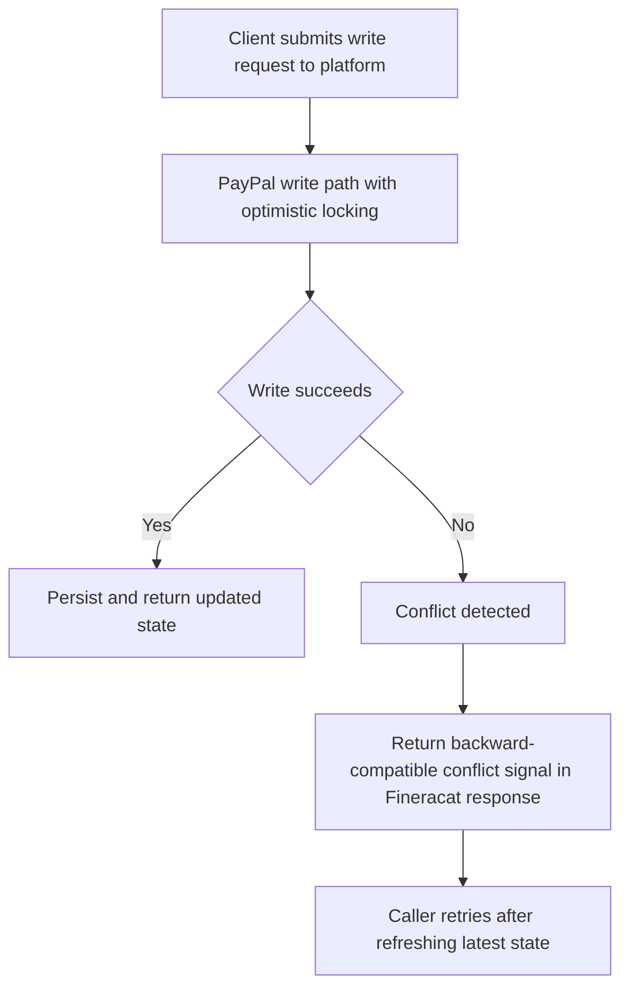

<!-- Labels: developer, data-integrity -->
# Write serialization

The Write serialization enhancement formalizes how Fineract handles writes that PayPal requires, by enforcing optimistic locking on those write paths and by modifying the response surfaced to the API caller in a backward-compatible way. The objective is to detect concurrent modification scenarios and provide a reliable signal that callers can use to retry, without breaking existing integrations or changing the visible request surface beyond the response behavior.

### Overview and intent
PayPal integration scenarios demand that writes are protected against lost updates due to concurrent modifications. To satisfy this, writes that PayPal relies upon are implemented with optimistic locking semantics. When a conflict is detected, the API response from the Fineracat component is extended in a backward-compatible manner to convey the failure, enabling the caller to retry the operation with updated data. This change is scoped to top-level write operations invoked by PayPal; there are no child write paths introduced within this enhancement.

### Scope and touched components
- Write paths involved in PayPal interactions: All top-level writes that PayPal requires are subject to optimistic locking checks.
- Persistence and locking behavior: The write operations are guarded by optimistic locking semantics at the persistence layer to detect concurrent modifications.
- Fineracat response surface: The response emitted by the Fineracat service is extended in a backward-compatible way to indicate an optimistic locking failure, allowing API callers to detect the condition and retry.
- Exclusions: No changes are introduced for child write operations; the scope remains focused on the PayPal-required top-level writes.
- Dependencies: The enhancement maintains the indirect dependency on main domain entities as described in the reference; the behavior is aligned with existing entity interactions and versioning expectations implicit in optimistic locking.

### Behavioral changes and lifecycle
- Enforced optimistic locking on eligible writes: For each PayPal-driven write, the system checks for concurrent modifications before applying updates. If there is no conflicting modification, the write completes and the system persists the new state as usual.
- Conflict detection and signaling: When a concurrent modification is detected, the system does not apply the write. Instead, it surfaces a conflict condition through the Fineracat response in a backward-compatible form. This allows the caller to recognize that a retry is required.
- Retry pathway without API change: Callers can continue using the same request payloads; the change lies in the response semantics that now include a detectable signal for optimistic locking conflicts. The caller then retrieves the latest state and retries the write with updated data, as standard to the integration.

### API surface and contract changes
- Surface unchanged for requests: The write request surface remains as-is for PayPal writes; there is no new endpoint or parameter exposure described in the verified scope.
- Response surface extension: The response from the Fineracat component is extended to indicate optimistic locking conflicts in a backward-compatible manner. The exact field naming or payload structure is not specified in the verified notes, but the behavioral contract is that a conflict condition can be detected by API callers to trigger a retry.
- No changes to serialization semantics beyond locking: The change is fundamentally about concurrency control and signaling, not about altering the data serialization format used for requests.

### Retry strategy and error signaling
- Retryable condition: An optimistic locking conflict is treated as a retryable scenario by design, signaled through the enhanced response. The caller may reissue the write after refreshing the latest state.
- Error signaling pattern: The system provides a retry signal in the response to indicate a lock conflict. The exact mechanism (field, code, or structure) is not specified in the verified notes, but the behavior is backward-compatible and detectable by the caller.
- Guidance for callers: When a conflict signal is observed, the caller should obtain the latest state and retry the write with updated data as standard to the business rules of the integration.

### Diagram: optimistic locking flow (verified behavior)

### Considerations and edge cases
- Concurrency control guarantees: Optimistic locking prevents concurrent writes from silently overwriting each other, so that only non-conflicting updates are committed.
- Backward compatibility: The response extension is designed to be backward compatible, so existing API clients continue to function while gaining the ability to detect locking conflicts and retry.
- Children writes: There are no child write paths affected by this enhancement; the scope is limited to PayPal-required top-level writes.
- Observability: The new signaling mechanism should be observable by integrators to implement reliable retry strategies, with clear expectations about when a retry is warranted.

### Migration and operational impact
- No client-facing API changes required for the request shape; clients continue to send the same payloads for PayPal writes.
- Clients must handle the new conflict signal to implement retries when standard.
- Internally, the system must verify that optimistic locking checks are performed for the targeted write paths and that the conflict signal is emitted consistently when conflicts occur.

### Summary of verified behavior
- PayPal write operations are protected with optimistic locking.
- The Fineracat response is extended in a backward-compatible way to signal optimistic locking conflicts.
- The enhancement is scoped to top-level PayPal write operations; no child writes are affected.
- A retry strategy is supported via the conflict signal, enabling clients to fetch the latest state and retry the write.