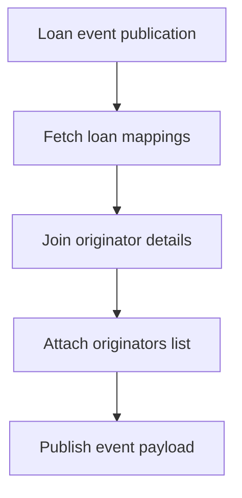

# Loan Originator Metadata

## Loan Originator Metadata

### Feature overview and goals

Loan originator metadata attributes loan income and revenue to a loan originator such as a merchant, broker, affiliate, platform, or channel for revenue share and reporting. The feature is optional and not all Fineract users use it. Originator ID, also known as Revenue Share ID, is stored as metadata at the loan level.

The following rules apply to loan originator metadata:

- Basic properties of the loan origination must be stored.
- The model supports multiple originators per loan because the API and event field is a list.
- Originator External ID is the Originator ID or Revenue Share ID used for reporting and sharing.
- Originator ID may be null or absent.
- No automatic revenue-share calculations are performed.
- No transformations or validation logic are applied to Originator ID beyond basic existence checks in the registry when using the registry model.
- Originator ID may be null for loans that are not originated by large merchants.
- No additional logic, validation, or transformations are applied to the Originator ID field.
- The Retrieve a Loan API must include the Originator ID in its response payload.
- Events must be extended when a tenant uses the loan origination function.
- Reporting must be extended when needed.

The loan origination module is optional with optional schema and optional event and report extensions. Event changes are backward compatible through optional fields.

### Module packaging and configuration

The loan origination feature is packaged as a separate Gradle/Maven module named fineract-loan-origination. You enable or disable it in application.properties using fineract.module.loan-origination.enabled, which defaults to false. A global configuration entry named enable_originator_creation_during_loan_application controls whether an originator can be created during loan application and also defaults to false. Liquibase changesets for the loan-origination module run after loan module changesets were executed.

### Originator registry model

The originator registry manages partner records including externalId, type, channel type, and status, and links them to loans without modifying the loan entity. Originator entities are conditionally created based on fineract.module.loan-origination.enabled being true.

| Column | Type | Notes |
| --- | --- | --- |
| id | PK, auto generated |  |
| originator_name | optional string | nullable |
| originator_type_cv_id | optional code value | MERCHANT, BROKER, AFFILIATE, PLATFORM |
| originator_external_id | required unique string | uniqueness validated |
| origination_channel_type_cv_id | optional code value | ONLINE, IN_STORE, API, AGGREGATOR |
| created_on, created_by, last_modified_on, last_modified_by | auto filled | audit columns |

| Column | Type | Notes |
| --- | --- | --- |
| id | PK |  |
| loan_id | FK to m_loan, required |  |
| originator_id | FK to m_loan_originator, required |  |
| created_on, created_by, last_modified_on, last_modified_by | auto filled | audit columns |

Originator status and code value rules:

- Originator status defaults to ACTIVE when not provided.
- Provided originator type and channel type code values must exist.
- Provided code values must be valid if applicable.

The m_loan_originator table stores originator details, and the m_loan_originator_mapping table stores mapping between originators and loans. The registry table stores canonical partner records with id (PK), originator_name (nullable), originator_external_id (required, unique), originator_type_cv_id (nullable), origination_channel_type_cv_id (nullable), status (ACTIVE/PENDING/INACTIVE), and audit columns. The association table supports 1:N or N:M design with id (PK) or composite (loan_id, originator_id), loan_id (FK to m_loan), originator_id (FK to m_loan_originator), and audit columns.

### Originator lifecycle API

You can create, view, update, and delete originator registry records through the originator APIs. The response returns both resourceId and resourceExternalId.

The fineract-loan-origination module exposes the following endpoints:

- POST /loan-originators creates an originator registry record.
- GET /loan-originators fetches originator registry records.
- PUT /loan-originators/{originatorId} and PUT /loan-originators/external-id/{originatorExternalId} update status and fields.
- DELETE /loan-originators/{originatorId} and DELETE /loan-originators/external-id/{originatorExternalId} delete originator registry records.

Duplicate originator external IDs are rejected.

### Attach and detach operations

You can attach an originator to a loan or detach one only while the loan is created but not yet approved. Both operations require the loan id and the originator id, and only ACTIVE status originators can be attached.

The following rules apply to attach and detach operations:

- Multiple originators can be attached to a single loan.
- An originator cannot be added twice to the same loan.
- An originator cannot be removed twice from the same loan.
- Id or externalId is mandatory for an originator entry.
- When Id is provided, the existing originator is attached to the loan.
- When ExternalId is provided, a new entry is created if not existing based on configuration and attached to the loan.
- The rest of the originator fields are optional and a new entry is created if not existing.

1. Call POST /loans/{loanId}/originators/{originatorId} to attach an originator to a loan.
2. Call DELETE /loans/{loanId}/originators/{originatorId} to detach an originator from a loan.
3. Call POST /loans/_{loanId}_/originators/_{originator_Id_}_ and variants with external-id to add originator to loan.
4. Call DELETE /loans/_{loanId}_/originators/_{originatorId}_ and variants with external-id to remove originator from loan.

The API returns the following status codes for attach and detach operations:

- HTTP 400 if a required parameter is missing or incorrect data format is provided.
- HTTP 403 for duplication related errors or if functionality is not enabled.
- HTTP 404 if the targeted loan or originator does not exist.

Attach and detach endpoints are secured with ATTACH_LOAN_ORIGINATOR and DETACH_LOAN_ORIGINATOR permissions.

### Fetching originators and loan details

You can fetch originators attached to a loan using GET /loans/{loanId}/originators or GET /loans/external-id/{loanExternalId}/originators. The loan id or external id must exist, otherwise the API returns HTTP 404. Fetching loan origination details requires the READ_LOAN permission.

Originator details appear in the following responses:

- The originators association response includes a list with fields id, name, status, typeId, externalId, channelTypeId.
- The Retrieve Loan API response includes originators: [...] list with registry fields id, name, status, typeId, externalId, channelTypeId.
- If no originator entries exist for a loan, the returned list is empty.
- If no originator entries exist, the originators list is empty in the loan details response.
- If the loan origination functionality is not enabled, the originators field is omitted from the loan details response.
- External business events include an optional originators array of records in LoanAccountDataV1.avsc and LoanTransactionDataV1.avsc.
- Originator details are returned when retrieving a loan with associations.
- API skeleton includes endpoint, request, and response for originator functionality.

Originators can be included when retrieving a loan using optional association parameters:

- Use associations=originators or associations=all with the Retrieve Loan API.
- Use associations=originators or associations=all with the loan details API.
- New module fineract-loan-origination exposes GET /loans/_{loanId}_/originators and /loans/external-id/_{loanExternalId}_/originators to fetch originators for loan.

### Loan creation integration

You can create and attach originators during loan creation by including the originators array in POST /loans. The system accepts and stores an Originator ID at loan level to identify the merchant or channel that originated the loan.

Each originator entry supports the following fields:

- externalId
- id
- name
- TypeId
- ChannelTypeId

When you provide originators in POST /loans:

- If id is provided, the system attaches the existing originator to the loan.
- If externalId is provided, the system attaches the existing originator or creates a new entry based on global configuration.
- name, typeId, and channelTypeId are optional and are used to create a new entry when the external ID does not exist yet.

### Permissions and HTTP errors

Originator endpoints require the CREATE_LOAN_ORIGINATOR, UPDATE_LOAN_ORIGINATOR, DELETE_LOAN_ORIGINATOR, READ_LOAN_ORIGINATOR, ATTACH_LOAN_ORIGINATOR, and DETACH_LOAN_ORIGINATOR permissions. The API returns HTTP 400 when a required parameter is missing or the data format is incorrect, HTTP 403 for duplication-related errors, functionality that is not enabled, or removal attempted on an already mapped originator, and HTTP 404 when provided values do not exist. Loan details association originators are added; partner details are fetched when originators or all association is provided.

| Endpoint | Method | HTTP 400 | HTTP 403 | HTTP 404 |
| --- | --- | --- | --- | --- |
| POST /loan-originators | POST | Missing required parameter or incorrect data format | Duplication related error | Originator type or channel type does not exist |
| PUT /loan-originators | PUT | Missing required parameter or incorrect data format | Duplication related error | Originator type or channel type does not exist |
| DELETE /loan-originators | DELETE |  |  | Provided targeted originator does not exist |
| POST /loans/_{loanId}_/originators/... | POST |  |  | Provided targeted loan or originator does not exist |
| DELETE /loans/_{loanId}_/originators/... | DELETE |  |  | Provided targeted loan or originator does not exist |
| GET /loans/_{loanId}_/originators | GET |  |  | Provided targeted loan does not exist |

### Business events and schemas

Loan originator details appear in business events so consumers can identify the originators attached to a loan or loan transaction. The originators field is optional and defaults to null to preserve backward compatibility.

Originator details are included in the following business events:

- Loan lifecycle business events.
- Loan transaction business events.
- LoanCharge business events, where originator details are optionally set and sent.

External business events use Avro schemas with the following optional additions:

- originators as an array of records in external business events.
- originators as an optional list in LoanAccountDataV1.avsc and LoanTransactionDataV1.avsc.
- OriginatorDetails alongside the originators field.

The originators list in LoanAccountDataV1.avsc contains the originators attached to the loan. Partner details are added into loan and loan transaction details external business events.

When a loan or loan transaction-centric event is published, the system builds the originators list as follows:

- Fetch the mapping(s) for the loan.
- Join the mappings with the originator registry to build the originators list.
- Attach the originators list into the event payload.

The Originator ID must be included in all Fineract events.

Loan creation originator handling validates incoming values, creates a new entry if applicable, and attaches the originator to the loan.

A standard solution must value Merchant or similar business partners based on actual income attributable to them.

### Reporting

Reporting attaches the originator external id to the Transaction Summary Report and Trial Balance Report, and the MerchantOriginator ID appears in both reports when the loan origination module is enabled.

Multiple originator external ids attached to a loan are concatenated into one string while keeping one row per entry.

- MySQL uses GROUP_CONCAT to concatenate multiple originator external ids.
- PostgreSQL uses STRING_AGG to concatenate multiple originator external ids.

### External asset owners service

The external asset owners service lets you create external owners through POST /v1/external-asset-owners. Each external id must be unique and non-null. A successful creation returns HTTP 200 with the created external id, while a duplicate external id returns HTTP 403 with a failure reason.

High parallel API asset owner transfers can cause external owner creation to fail due to race conditions.

- Internal retry logic in org.apache.fineract.investor.service.ExternalAssetOwnersWriteServiceImpl#getOwner retries fetching the owner when creation fails.

### Architecture and components

Loan originator components are registered through Spring conditional beans using @ConditionalOnProperty(name="fineract.module.loan-origination.enabled", havingValue="true").

The architecture supports attaching, detaching, and querying originators for a loan.

- The API layer includes LoanOriginatorApiResource.
- Application services include LoanOriginatorWritePlatformService for create, update, and delete operations, and LoanOriginatorReadPlatformService for lookup and listing by id or externalId.
- Domain components include the LoanOriginator entity and LoanOriginatorRepository.
- Integration adaptors include a LoanReadPlatformService extension as an association resolver, BusinessEventEnricher for LoanAccountData and LoanTransactionData events, and report-specific query extensions.
- Integration hooks cover loan retrieval association, business events enrichment, and reporting enrichment.

### Worked examples

A partner is registered in the loan-originator registry before it can be linked to a loan. The figures below are illustrative. The registry accepts name 'North Store', external ID 'ext-100', originator type MERCHANT, channel ONLINE, and status ACTIVE. The service verifies that external ID 'ext-100' is unique, confirms that the supplied type and channel code values exist, inserts one record into m_loan_originator with auto-filled audit columns, and returns the generated identifier and external ID. This example shows that originator creation validates uniqueness and code values before persisting. If the status is supplied as PENDING instead of ACTIVE, the record is created but cannot be attached to a loan until it becomes ACTIVE.

| Step | Action | Outcome |
| --- | --- | --- |
| Validate input | externalId ext-100, type MERCHANT, channel ONLINE | Unique external ID; valid codes |
| Insert record | m_loan_originator name, externalId, type, channel, status ACTIVE | Record id 13 created with audit columns |
| Return response | resourceId 13, resourceExternalId ext-100 | Client receives created reference |
| List originators | GET /loan-originators | Originator id 13 appears in list |

A loan with ID 1001 is created but not yet approved. An originator with ID 13 and external ID 'ext-100' is attached to it. Because the loan is still in the created state and not approved, the attach succeeds. A subsequent retrieval of the loan with associations returns the originator in the originators array. Attaching the same originator again is rejected as a duplicate. This example shows that attach/detach is allowed only before loan approval and that the mapping is stored in m_loan_originator_mapping.

| Step | Action | Outcome |
| --- | --- | --- |
| Check preconditions | loan 1001 not approved; originator 13 ACTIVE | Attach permitted |
| Check uniqueness | mapping (loan 1001, originator 13) absent | No duplicate mapping |
| Insert mapping | m_loan_originator_mapping loan_id 1001, originator_id 13 | Mapping record created with audit columns |
| Return response | resourceId 45, resourceExternalId ext-100 | Attach confirmed |
| Retrieve loan | GET /loans/1001?associations=originators | originators array contains id 13, externalId ext-100 |

When a loan lifecycle action occurs, the platform builds the base LoanAccountData event. If fineract.module.loan-origination.enabled is true, the business-event enricher appends the optional originators list to the payload before emission. The field defaults to null, preserving backward compatibility for consumers. External systems can read the attached originator external IDs to calculate revenue share outside Fineract. This example shows that the originators field is optional with default null in Avro schemas, so existing consumers remain compatible.

| Step | Action | Outcome |
| --- | --- | --- |
| Build base event | LoanAccountData payload for loan 1001 | Core loan fields populated |
| Enrich payload | Attach optional originators list | originators field added, default null if absent |
| Emit event | Publish to message broker | Downstream consumers receive originator IDs |
| Consume event | Read optional originators field | Revenue share attribution computed externally |

The Trial Balance and Transaction Summary reports are extended to surface originator attribution. Each report joins the loan to its originator mappings and concatenates multiple originator external IDs into one string per loan entry. MySQL uses GROUP_CONCAT and PostgreSQL uses STRING_AGG. If a loan has no originators, the column is empty. This example shows that multiple originator external IDs are concatenated into one string while keeping one entry per loan.

| Step | Action | Outcome |
| --- | --- | --- |
| Run report query | Join m_loan, mapping, m_loan_originator | Records include loan and originator data |
| Aggregate IDs | GROUP_CONCAT or STRING_AGG on externalId | One concatenated string per loan |
| Render export | Output column merchantOriginatorId | Report shows originator external IDs |
| Empty case | Loan with no mappings | Column returns empty |
