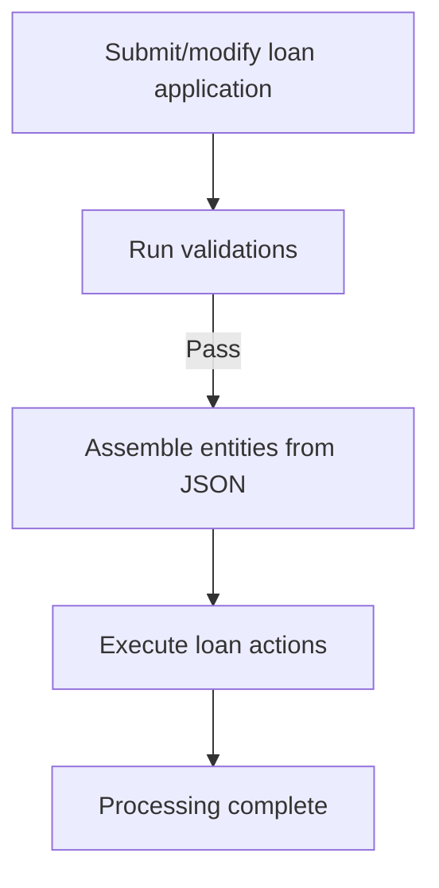

# Loan Entity Refactoring

## Loan Entity Refactoring

### Loan entity scope and responsibilities

The Loan entity holds only its fields, setters, getters and basic methods to manipulate its own state. It no longer contains a helpers class, JSON related data and logic, or methods that create DTOs or return data objects solely from incoming DTOs or data lists. Business logic is extracted into services, assemblers and mappers, and complex methods are split into smaller, well defined pieces that can be reused.

### External dependencies removed from the Loan entity

The Loan entity no longer depends on external transaction processing or lifecycle state machine components. Triggering transaction reprocessing happens in the caller service instead of inside the loan entity. The transient field accountNumberRequiresAutoGeneration is removed, and the caller decides whether an account number needs generation and passes it to the loan entity when applicable.

The following entity fields use their underlying enum as the data type instead of Integer:

- Loan entity fields: loanType, termPeriodFrequencyType, loanStatus and loanSubStatus.
- LoanTransaction entity field: typeOf.

A converter is used when the enum does not match with the ordinal value.

### Extraction of calculations and complex business logic

The system identifies calculations and complex business logic and extracts them into dedicated util or service classes. It splits the logic into smaller pieces and invokes each piece only when it is used and needed.

### Loan charge methods to extract or simplify

The Loan entity exposes three charge-related methods whose calculation logic must move to the caller service.

The following methods are affected:

- addLoanCharge performs charge amount calculation, reprocessing via SingleLoanChargeRepaymentScheduleProcessingWrapper, and loan status transition; these responsibilities move to the caller.
- removeLoanCharge keeps only the capability to remove a transaction from the loan if needed; all extra logic and calculations move to the caller service.
- removeOrModifyTransactionAssociatedWithLoanChargeIfDueAtDisbursement keeps only the capability to remove a transaction from the loan if needed; its calculation logic moves to the caller.

### Transaction processing methods to move

Several transaction processing methods move out of the Loan entity into ReprocessLoanTransactionsServiceImpl, while two charge-related methods split into smaller pieces and move into a service or util/assembler class.

The following methods move into ReprocessLoanTransactionsServiceImpl:

- The Loan entity method reprocessTransactions moves into ReprocessLoanTransactionsServiceImpl.
- The Loan entity method reprocessTransactionsWithPostTransactionChecks moves into ReprocessLoanTransactionsServiceImpl.
- The Loan entity method processPostDisbursementTransactions moves into ReprocessLoanTransactionsServiceImpl.

The following methods contain extensive and complex logic that splits into smaller pieces and moves into a service or util/assembler class:

- The Loan entity method handleChargeAppliedTransaction splits into smaller pieces and moves into a service or util/assembler class.
- The Loan entity method handleChargePaidTransaction splits into smaller pieces and moves into a service or util/assembler class.

### Loan schedule update methods

The Loan entity contains several schedule update methods that are lengthy, composite, or handle responsibilities outside the loan entity.

The following methods are candidates for extraction or simplification:

- updateLoanCharges is lengthy and complex and should be split into smaller pieces and moved into an assembler class.
- updateLoanSchedule(LoanScheduleModel) should use an assembler class to update loan installment periods, with incoming parameters being already calculated and updated installment periods rather than a model.
- Updating dependent and summary derived fields is out of scope of the loan period update call; the caller decides when to recalculate these fields.
- updateLoanSchedule(Collection<LoanRepaymentScheduleInstallment>) should not include the last two method calls; it is the caller's responsibility to decide when to update and recalculate amounts.
- updateLoanSummaryDerivedFields contains multiple calculations including calculateTotalOverpayment, calculateTotalRecoveredPayments, and updateLoanOutstandingBalances, and should only recalculate things when it makes sense.
- updateLoanSummaryAndStatus is composite and does 5-6 different things; it should be split up with clear knowledge of why and when it is called.
- updateOverdueScheduleInstallment should be moved to the LoanCharge entity.
- clearLoanInstallmentChargesBeforeRegeneration is not related to the loan entity and should be moved to the LoanCharge entity or the caller service.

### Other Loan entity methods to extract

Several Loan entity methods contain logic that belongs outside the entity, including state changes, event triggering, transaction creation, balance updates, schedule date updates, charge generation, and outstanding balance calculation. These methods are candidates for extraction into caller services, utility classes, or the LoanCharge entity.

The following Loan entity methods should be extracted or simplified:

- undoApproval allows internal state changes and field value updates, but change collection into a map, loan status change, and event triggering must be handled outside the Loan entity.
- handlePayDisbursementTransaction should move into the caller service or a utility class responsible for calculating and creating pay charge, paid-by relation, and transaction balance updates.
- doPostLoanTransactionChecks should split into smaller pieces with recalculation and full repayment or overpayment handling logic extracted into caller services.
- deriveDefaultInterestWaiverTransaction creates a new transaction and should move out of the Loan entity.
- updateLoanRepaymentScheduleDates contains complex logic that should move to the caller service.
- The duplicate updateLoanRepaymentScheduleDates method should be removed in favor of the other one.
- generateInstallmentLoanCharges calculates amounts and creates loan charges, and should move to the LoanCharge entity or a service.
- updateLoanOutstandingBalances contains complex logic that should be calculated by a utility class instead.

Additional refactoring rules for the Loan entity and related classes:

- Checking whether a loan status change should occur should be extracted out of the Loan entity, and the caller invokes it if applicable.
- Loan status change should be one of the last steps of any monetary transaction handling.
- Duplicate fields in LoanTransactionData should be identified and removed if possible without breaking the APIs.
- A Builder pattern should be introduced and unnecessary constructor calls removed in LoanTransactionData.
- Validations requiring complex calculations and multiple state changes before deciding whether to interrupt and revert an action may remain in the entity or move into a service.
- Validations are moved out of the Loan entity into Validator classes and are called as one of the first steps of actions such as loan creation, loan disbursement, and loan repayment.

### Module organization and dependencies

The fineract-progressive-loan module depends on the fineract-loan module, while common logic can remain in fineract-loan with injection points called from the progressive loan module. Loan-related logic moves from fineract-provider into fineract-loan, and common logic not directly belonging to the loan moves into fineract-core.

Logic belonging to the Progressive Loan moves into fineract-progressive-loan:

- Loan schedule generation
- Advance payment allocation
- Transaction processor
- Allocation rules

### Submit loan application processing

Submit/modify loan application processing groups validations, assembling from JSON command to entity or data objects, and actions on the loan such as generating a schedule, creating notes, GLIM, and calendar. Validations run before assembling and actions on the loan; incoming parameter validations throw PlatformApiDataValidationException and domain rule validations throw GeneralPlatformDomainRuleException. After validations pass, entities are assembled and actions on the loans are executed, including creating notes if applicable, creating calendar if applicable, GLIM, and saving account link.

Other loan application processing workflows follow the same pattern of validations, assembling, and actions on the loan:

- Approve loan application processing groups validations, assembling from JSON command to entity or data objects, and actions on the loans such as notes and calendar.
- Disburse loan application processing groups validations, assembling from JSON command to entity or data objects, and actions on the loans such as notes and calendar.
- Reject loan application processing groups validations, assembling from JSON command to entity or data objects, and actions on the loans such as notes and calendar.
- Withdraw loan application processing groups validations, assembling from JSON command to entity or data objects, and actions on the loans such as notes and calendar.

Some validations require loading the loan product or client before they can run.

- Some validations require loading the loan product or client.

