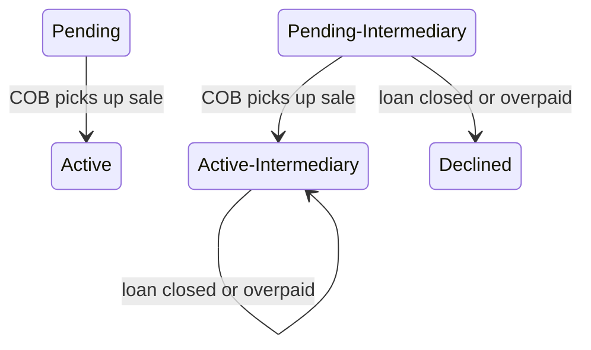
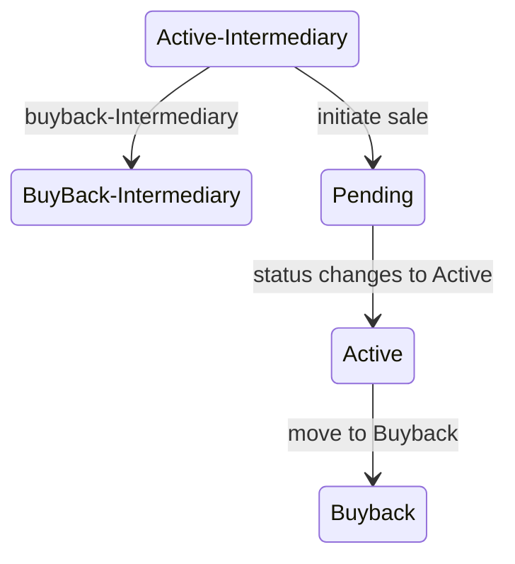
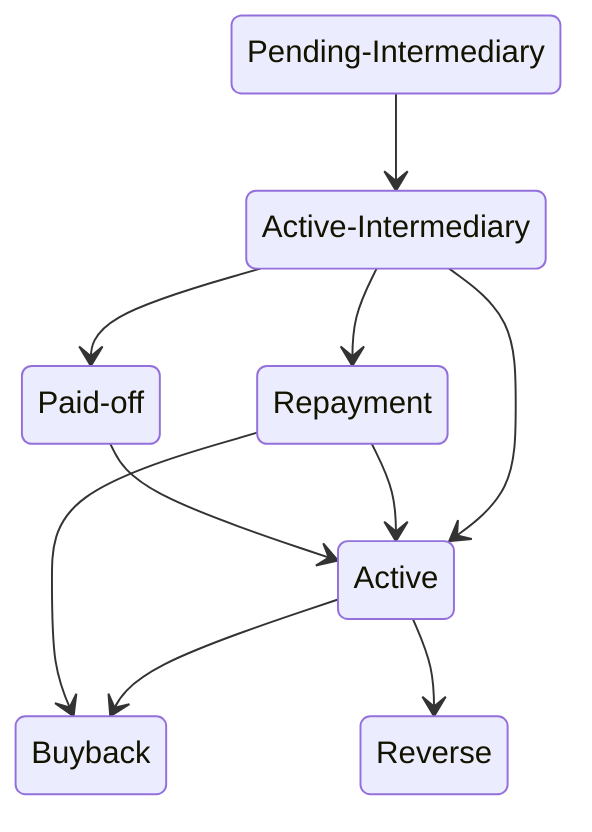

# Investor Module Enhancements

## Investor Module Enhancements

### Module overview and goals

The Investor Module Enhancement is also known as Danube 2.0. Its goal is to allow intermediate sale of the loan account for which the sale is not complete yet. Features discussed as out of scope or that might be revisited in a later release are listed separately.

### Status transitions and lifecycle

An intermediary sale lets you initiate a sale on an active loan account before the actual sale completes. The account moves from Pending-Intermediary to Active-Intermediary, then to Pending, then to Active.

The following status transitions are not allowed:

- Pending-Intermediary to Pending to Active.
- Pending-Intermediary to Active.
- Pending-Intermediary to Active-Intermediary to Decline.
- Pending-Intermediary to Active-Intermediary to Pending to Active to Decline.

The following behaviour applies to intermediary sales:

- Fineract supports sale as an on status right after initiation, transitioning from PENDING to ACTIVE.
- The Owner ID for intermediary transfer is passed by the user.

### COB processing of intermediary states

The COB job processes intermediary loan states during end-of-day processing. It advances Pending-Intermediary sales to Active-Intermediary and Pending sales to Active, and it declines Pending-Intermediary sales when the loan account is closed or overpaid.

COB processing rules for intermediary states:

- Active-Intermediary status is processed by COB.
- Active status is processed by COB.
- The COB job does not decline the Pending loan status even if the loan account is closed or overpaid.
- When the loan account is in Active-Intermediary state, it stays in the same state even if the loan is closed or overpaid.

### API-invoked statuses without accounting

Certain loan account statuses are invoked through API and create no accounting entries. Pending-Intermediary and Pending statuses are invoked directly through API. Decline status occurs when Active-Intermediary status is canceled by the user through API. Buyback status is invoked through API once the status is Active, and Buyback-Intermediary status is invoked through API once the status is Active-Intermediary. A loan account in a Pending state moves to Active even if the loan balance is zero or overpaid.

### Buyback rules

Buyback rules govern how loan accounts move into buyback states and how ownership transfers during asset sales.

The following status transitions apply to buyback and sale workflows:

- A loan with status Active can move to Buyback state.
- A loan with status Active-Intermediary can move to Buyback-Intermediary status.
- Buying back an Active-Intermediary loan account results in BuyBack-Intermediary status.
- Initiating a sale on an Active-Intermediary loan account results in Pending status.

The following rules apply to ownership transfer and accounting entries:

- When the status changes from Pending to Active and the loan has zero balance, no accounting entries are passed for zero amount, but the status transfers to the new asset owner and any new monetary transaction after that is tagged to the new asset owner.
- No accounting entries are created for zero amounts.
- The asset transfer record tracks status, owner, effective from, and effective to dates.

### Asset transfer lifecycles

The asset transfer lifecycle begins at Pending-Intermediary and moves to Active-Intermediary before reaching its terminal state.

| Lifecycle | Sequence |
| --- | --- |
| R1 | Pending-Intermediary -> Active-Intermediary -> Active -> Buyback |
| R1 | Pending-Intermediary -> Active-Intermediary -> Repayment -> Active -> Reverse |
| R1 | Pending-Intermediary -> Active-Intermediary -> Paid-off -> Active -> Reverse |
| R1 | Pending-Intermediary -> Active-Intermediary -> Repayment -> Buyback |
| R1 | Pending-Intermediary -> Active-Intermediary -> Repayment -> Active -> Reverse |
| R1 | Pending-Intermediary -> Active-Intermediary -> Repayment -> Buyback |

### Worked examples

Illustrative figures are used throughout this section. A loan with principal 1,000 is listed for intermediary sale to investor 999 on day 1; the status becomes PENDING-Intermediary and no accounting entries are posted. At COB the same day the status advances to ACTIVE-Intermediary and COB posts interest of 100 and fees of 50 to the interim owner. On day 5 investor 999 lists the loan to investor 10001; the status becomes PENDING owned by 10001 while ACTIVE-Intermediary remains owned by 999 until COB. At COB on day 5 the status moves to ACTIVE owned by 10001 and the outstanding principal of 1,000 is re-tagged to the new owner. On day 10 investor 10001 buys back the loan; the status becomes BUYBACK owned by 10001 with no accounting entries. If the loan balance were zero when the status moves from PENDING to ACTIVE, no accounting entries would be passed for the zero amount, but the status would still transfer to the new owner.

| Day | Event | Status | Owner | Balance | Entry |
| --- | --- | --- | --- | --- | --- |
| 1 | Initiate intermediary sale | PENDING-Intermediary | 999 | 1,000.00 | None |
| 1 (COB) | COB advances status | ACTIVE-Intermediary | 999 | 1,000.00 | Dr Interest 100 / Dr Fees 50 / Cr All 150 |
| 5 | Initiate second sale | PENDING | 10001 | 1,000.00 | None |
| 5 (COB) | COB advances status | ACTIVE | 10001 | 1,000.00 | Dr Principal 1,000 / Cr All 1,000 |
| 10 | Buyback by new owner | BUYBACK | 10001 | 1,000.00 | None |

A loan with principal 1,000 is ACTIVE-Intermediary owned by 999. On day 2 the borrower repays 150, made up of 100 principal and 50 fees; the repayment is tagged to owner 999 and the principal balance falls to 900. On day 5 the loan is transferred to ACTIVE owned by 10001. On day 10 the day-2 repayment is reversed; the reversal entries are tagged to owner 10001, the current owner at reversal time, and the principal balance returns to 1,000. If the reversal occurred before the transfer, the reversal would instead be tagged to owner 999.

| Day | Event | Status | Owner | Balance | Entry |
| --- | --- | --- | --- | --- | --- |
| 2 | Repayment of 150 (100 principal + 50 fees) | ACTIVE-Intermediary | 999 | 900.00 | Dr All 150 / Cr Principal 100 / Cr Fees 50 |
| 5 | Transfer to new owner | ACTIVE | 10001 | 900.00 | None |
| 10 | Repayment reversal | ACTIVE | 10001 | 1,000.00 | Cr All 150 / Dr Principal 100 / Dr Fees 50 |

A loan with principal 1,000 is fully repaid before the intermediary sale, so the balance is 0. On day 1 the sale to investor 999 creates PENDING-Intermediary with no accounting entries. At COB the balance is 0, so zero-amount entries are skipped and the status advances to ACTIVE-Intermediary owned by 999. On day 5 the loan is sold to investor 10001; the status becomes PENDING then ACTIVE owned by 10001, again with no accounting entries because the amount is zero. On day 10 a prior repayment of 210 is reversed; the reversal is posted under owner 10001 and the balance returns to 210. If the balance were positive at transfer, COB would post normal entries instead of skipping zero amounts.

| Day | Event | Status | Owner | Balance | Entry |
| --- | --- | --- | --- | --- | --- |
| 1 | Initiate intermediary sale | PENDING-Intermediary | 999 | 0.00 | None |
| 1 (COB) | COB with zero balance | ACTIVE-Intermediary | 999 | 0.00 | Zero entries skipped |
| 5 | Initiate second sale | PENDING | 10001 | 0.00 | None |
| 5 (COB) | COB with zero balance | ACTIVE | 10001 | 0.00 | Zero entries skipped |
| 10 | Reverse prior repayment of 210 | ACTIVE | 10001 | 210.00 | Dr Principal 200 / Dr Fees 10 / Cr All 210 |

A loan with principal 1,000, interest 100 and fees 50 is overpaid by 50 when the borrower repays 1,200 on day 2; the excess 50 is recorded as overpaid under owner 999 and the balance is -50. On day 5 the loan is transferred to owner 10001 while the balance is negative; COB re-tags the overpaid amount of 50 from owner 999 to owner 10001. On day 6 a credit balance reversal of 50 is posted under owner 10001, bringing the balance to 0. If the balance were positive at transfer, no overpaid account would be involved.

| Day | Event | Status | Owner | Balance | Entry |
| --- | --- | --- | --- | --- | --- |
| 2 | Repayment of 1,200 | ACTIVE-Intermediary | 999 | -50.00 | Dr All 1,200 / Cr Principal 1,000 / Cr Interest 100 / Cr Fees 50 / Cr Overpaid 50 |
| 5 | Transfer while negative | ACTIVE | 10001 | -50.00 | Dr Overpaid 50 (999) / Cr Overpaid 50 (10001) |
| 6 | Credit balance reversal | ACTIVE | 10001 | 0.00 | Dr Overpaid 50 / Cr All 50 |
