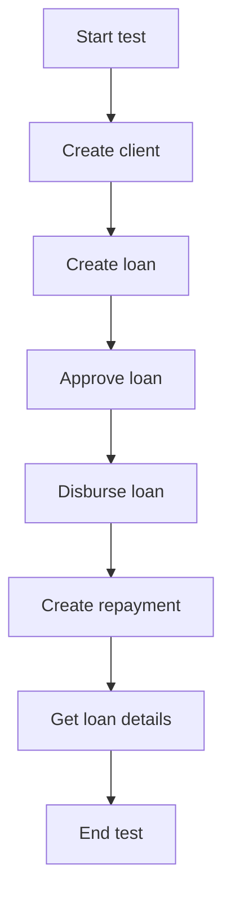

# COB Performance and Reliability

## COB Performance and Reliability

### COB processing scope

COB performance testing covers twelve workflow steps that run during end-of-day processing. The steps are ADD_PERIODIC_ACCRUAL_ENTRIES, LOAN_DELINQUENCY_CLASSIFICATION, ADD_CANCELLED_TAG, ADD_MATURED_TAG, CHECK_LOAN_REPAYMENT_DUE, CHECK_LOAN_REPAYMENT_OVERDUE, REPAYMENT_DUE_EVENT, CHECK_LOAN_ACCOUNT_NEGATIVE_BALANCE, LOAN_CHARGEOFF, POST_REPAYMENTS, APPLY_CHARGE_TO_OVERDUE_LOANS, and UPDATE_LOAN_AREARS_AGING.

### Performance test scenarios

The performance test creates a client and loan, approves and disburses the loan, and can be started from Jenkins. The enclosing transaction is set to TRUE, and the default load is 10 parallel users during 1 minute.

The performance test supports several scenarios:

- Create client, loan, approve disburse batch, create repayment equal to the disbursed amount, and get loan details.
- Create client, create loan, approve loan, disburse loan, create repayment equal to the disbursed amount, create a new loan for the same customer, approve loan, disburse the loan, and repay the loan.
- Batch create client, create loan, approve loan, disburse loan, create repayment of half the disbursed amount, create reverse repayment, add NSF fee, create goodwill credit of half the disbursed amount, and create merchant issued refund of half the disbursement.
- Batch create client, create loan, approve loan, disburse loan, create repayment of half the disbursed amount, create chargeback payment, add snooze fee, and create repayment of the outstanding balance plus $10.

The number of new loans for a client can be easily changed in the performance test.

### Performance test environment

The performance test environment mimics the customer side with an RDS DB instance db.r6g.4xlarge (1 write and 1 read scalable up to 2), EKS node instance m6i.2xlarge, an EKS node group sized from 6 to 10 instances, 4096Mi memory per instance, and an AMQ instance mq.m5.4xlarge.

The crpfineractserv deployment uses the following pod counts:

- Worker: 5, Reader: 5, Batch-manager: 1, Batch-worker: 5
- Worker: 5/10, Reader: 5/10, Batch-manager: 1, Batch-worker: 5/10 in another configuration

CPU for each instance ranges from 0.1 to 1.

Performance measures must report the following response times for each API call while keeping TPS:

- mean
- 95%
- 99%
- 99.9%

> **Note:** COB processing of approximately 536000 accounts caused the batch-manager pod to crash with an OOM error despite memory allocated to 85% of 8GB and G1GC strategy.

### COB job configuration

The Loan COB job's worker step uses a TaskExecutor to distribute work within a single JVM. You configure the executor's thread count through a property or environment variable, and the worker step's throttleLimit matches that thread count. The default thread count is 1.

### Partitioning

Partitioning splits loan processing into partitions defined by minimum and maximum loan IDs rather than by range. Partitions are created for loan ID ranges even when they contain no loans to process, and empty partitions are created for loan ID ranges between processed loans when gaps exist between loan IDs. The query in LoanItemReader filters locked loan IDs.

### Delinquency handling

Delinquency bucket configuration loads through a query rather than by traversing the Loan Product relationship. Delinquency range lifting logic and validation run only when a delinquency range has been applied to the loan. If the loan is not overdue, no delinquency range is applied.

### Database indexes

Liquibase creates database indexes at deploy to support COB batch processing and loan transaction lookups.

| Index | Table | Columns |
| --- | --- | --- |
| idx_batch_step_execution_step_name_job_execution_id | batch_step_execution | job_execution_id, step_name, start_time |
| idx_batch_job_execution_job_execution_id | batch_job_execution | job_execution_id |
| idx_batch_job_execution_job_instance_id | batch_job_execution | job_instance_id |
| Index on from_loan_transaction_id | m_loan_transaction_relation | from_loan_transaction_id |

### Database concurrency errors

Job execution can fail with a serialization error when concurrent updates occur during manual or cron execution. The strict transaction isolation may cause this error, and an EclipseLink DatabaseException with PostgreSQL error could not serialize access due to concurrent update can occur during job execution. Read Write batch instance separation is an acceptance criterion for the performance test environment.

### Lock handling

Lock handling determines whether COB or Inline COB can run against a locked loan.

The following rules apply to locked loans:

- If a loan is locked and there is any error attached to the lock, the prior execution of COB or Inline COB failed.
- Inline COB can be executed for locked loans if there is any error attached to the lock.
- When a monetary activity is triggered against a locked loan that has an error attached to the lock, the inline COB is triggered prior to the activity.

The database connection pool is initiated at startup before the first query.

Caching in Fineract for multi node environment is half done and not supported at the moment.

Cache invalidation on every node must happen if something got changed.

An AMQ multi producer setup is used to improve event sending performance while preserving event ordering.

The Reject Write API for COB supports Loan API calls with externalId in addition to Loan id.

The new tenant can be logged into.

Init scripts are completed to set up accounting and product(s) for the new tenant.

The CoB validation test breaks when CoB execution was not according to expected.

Notifications are enabled or disabled by a feature toggle from application properties, with default enabled.

When notifications are disabled, the backend should not check unread notifications, should not write notification records, and should not send notifications to the UI.

### COB validation schedule

Automated CoB validation runs daily for the current-1 business day. A new tenant is created for regular CoB testing on the new AWS account, and the performance test is scheduled daily in Jenkins to generate meaningful data for CoB.

### Worked examples

A COB job runs ADD_PERIODIC_ACCRUAL_ENTRIES for a loan with a principal of 1,000 and an annual interest rate of 12%, using 30-day months. Two job instances read the same outstanding balance at the same time, each computes the periodic accrual of 10.00, and attempts to write the updated balance. The figures are illustrative. This shows how strict transaction isolation rejects the second concurrent update and forces a retry.

| Step | Instance A | Instance B | Balance | Outcome |
| --- | --- | --- | --- | --- |
| Start | Reads 1,000.00 | Reads 1,000.00 | 1,000.00 | Both see the same balance |
| Accrue | Adds 10.00 | Adds 10.00 | 1,000.00 | Each computes 1,010.00 locally |
| Write A | Writes 1,010.00 | — | 1,010.00 | First write commits |
| Write B | — | Writes 1,010.00 | 1,010.00 | Second write fails with serialization error |
| Retry B | — | Reads 1,010.00 | 1,010.00 | Instance B reads the latest committed balance |
| Write B | — | Writes 1,020.00 | 1,020.00 | Final balance reflects both accruals |

COB creates partitions from the minimum and maximum loan ID, not from the actual range of IDs. A portfolio holds three loans with IDs 100, 300, and 500. The system divides the span from 100 to 500 into four equal partitions. The figures are illustrative. This shows that empty partitions are still created and processed, wasting memory in large batches.

| Partition | ID range | Loan IDs found | Loans processed | Empty |
| --- | --- | --- | --- | --- |
| 1 | 100–200 | 100 | 1 | No |
| 2 | 201–300 | 300 | 1 | No |
| 3 | 301–400 | — | 0 | Yes |
| 4 | 401–500 | 500 | 1 | No |
| Total | 100–500 | 100, 300, 500 | 3 | 1 |

A performance run measures Get Loan Details under a steady load of 450 transactions per second. For every API call the harness records mean, 95th, 99th, and 99.9th response times while preserving the target TPS. The figures are illustrative. This shows that percentile response times are reported per call while the aggregate TPS stays on target.

| API call | Mean (ms) | 95th (ms) | 99th (ms) | 99.9th (ms) | TPS |
| --- | --- | --- | --- | --- | --- |
| Get Loan Details | 120.00 | 200.00 | 300.00 | 450.00 | 450.00 |
| Get Repayment Summary | 150.00 | 240.00 | 360.00 | 540.00 | 300.00 |
| Create a new Loan | 300.00 | 480.00 | 720.00 | 900.00 | 50.00 |
| Total | — | — | — | — | 800.00 |
