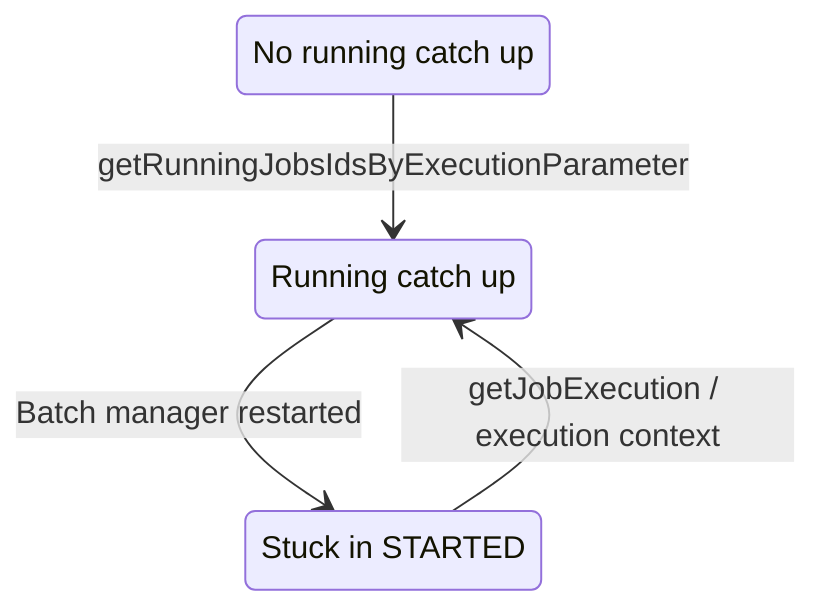

# Spring Batch Framework

## Spring Batch Framework

### Loan COB architecture and configuration

The Loan close of business (COB) architecture uses Spring Batch partitioned jobs and supports configurable business steps for loan processing. Inline COB execution for loan-related APIs is controlled by a configuration property.

The following rules apply to Loan COB configuration and behaviour:

- FineractPartitionedJob is removed and List<PartitionedJobProperty> is used instead.
- Soft locking is removed and the system relies only on the last_closed_business_date of Loan.
- ADD_PERIODIC_ACCRUAL_ENTRIES can be configured as a Loan COB business step and produces the same result as the standalone job.
- UPDATE_LOAN_ARREARS_AGEING can be configured as a Loan COB business step and produces the same result as the standalone job.
- Application properties enable or disable Loan COB to prevent dummy executions, and a conditional property prevents bean creation.
- A flag disables COB entirely regardless of COB step configuration.
- Inline COB execution or checks can be turned off by checking whether Loan COB is enabled.

### Inline COB execution and checks

Inline COB runs for a loan when its last closed business date does not match the actual COB business date. Regular COB workers ignore loans whose last closed business date matches the COB business date or that have a hard lock.

Inline COB execution is subject to the following limits:

- The number of items for an Inline job is restricted to 1000 items.
- Requests beyond the 1000 item limit receive an HTTP 400 response and an error code.
- The limit is hard coded.

Inline COB should be called only when it is reasonable. Monetary transactions are POSTed to the Loan API endpoint, but this may not be sufficient for Inline COB.

### COB job status and completion behavior

A CoB run completes successfully when it finishes normally. The Loan COB job can remain stuck with status STARTED and exit code UNKNOWN, and restarting it does not resolve that problem.

When there are no loans to process, the job finishes successfully with status COMPLETED.

- Job status is COMPLETED when no loans were to be processed.
- CoB executed with no loans to be processed finishes with success, status COMPLETED.

Catch-up behaviour is controlled by job parameters.

- Regular Loan COB having IS_CATCH_UP=true should not happen; only the Loan Catchup API sets jobParameters IS_CATCH_UP=true.
- Regular CoB runs without doing CoB catchup.
- CoB with any loans processed runs as earlier.

### Loan ID handling and memory usage

Spring Batch stores all Loan COB loan IDs in the batch_job_execution_context table, and the batch_step_execution_context contains the same loan ID data. For 540k loans, the IDs alone take up 30 MB of heap space on the application side and cause CPU intensive queries on the PostgreSQL side. Spring Batch should not store each and every loan ID in either context. Loan IDs are passed as described in Solution #2.

### Locking conflicts and duplicate key errors

The COB worker fails with a unique key error on m_loan_account_locks_pkey when it tries to insert a lock record owned by LOAN_COB_CHUNK_PROCESSING for a loan that already has an Inline COB lock. ActiveMQ does not replay the COB worker message after this duplicate key failure.

The same duplicate key error occurs when the Inline COB locks a loan before regular COB while loanLockingService.applyLock is processing that loan.

- A loan currently being locked by loanLockingService.applyLock(toBeProcessedLoanIds, LockOwner.LOAN_COB_CHUNK_PROCESSING) can be picked up by the Inline COB, which puts the lock before regular COB.
- Suggested solutions include removing all locked loans from toBeProcessedLoanIds so Inline COB locked accounts are skipped from locking.
- Another suggestion is to move the locking service logic into one of the processors in loanBusinessStep processor as a composite processor so only a chunk of accounts are locked at once.
- A further suggestion is to join the m_loan table with m_loan_account_locks table to exclude Inline COB locked accounts from FIND_ALL_NON_CLOSED_LOANS_BY_LAST_CLOSED_BUSINESS_DATE_AND_MIN_AND_MAX_LOAN_ID.

### Catch-up execution detection

Catch-up execution detection determines whether a Loan COB catch-up job is already running and identifies its business date. It applies when no running catch-up execution exists or when one is already active.

The system detects running catch-up executions as follows:

- When no running catch-up execution exists, the result is new IsCatchUpRunningDTO(false, null).
- Running catch-up COB execution IDs are fetched using jobExecutionRepository.getRunningJobsIdsByExecutionParameter with LoanCOBConstant.JOB_NAME, LoanCOBConstant.LOAN_COB_CUSTOM_JOB_PARAMETER_KEY, LoanCOBConstant.IS_CATCH_UP_PARAMETER_NAME, and "true".
- The first running catch-up execution ID is mapped through jobExplorer.getJobExecution, JobExecution.getExecutionContext, and executionContext.getString(LoanCOBConstant.BUSINESS_DATE_PARAMETER_NAME) to parse the business date as a LocalDate using ISO_DATE formatter.
- The method getRunningJobsIdsByExecutionParameter queries BATCH_JOB_INSTANCE, BATCH_JOB_EXECUTION, and BATCH_JOB_EXECUTION_PARAMS for job executions with status STARTED or STARTING, matching job name, custom job parameter key name, and long value from a subquery for custom job parameters, excluding job instances already completed for the same job name.

Override and failure behaviour for Loan COB catch-up processing includes:

- The loanRepository.findAllNonClosedLoansBehindByLoanIds call is updated to a service so it can be overridden.
- A new service is implemented to enable override of LoanCOBApiFilter filters.
- User Authentication used during Loan COB is not propagated to the StuckJob listener when a Loan COB job fails.
- A failed Loan COB job step that makes an API call generates org.apache.fineract.useradministration.exception.UnAuthenticatedUserException: null.
- The issue is handled if the Batch manager got restarted while its own batch step was executed and stuck in STARTED state and waiting in an endless loop.

