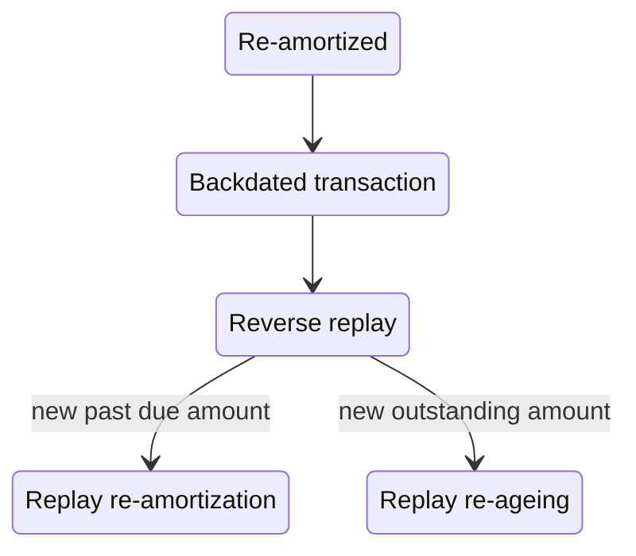
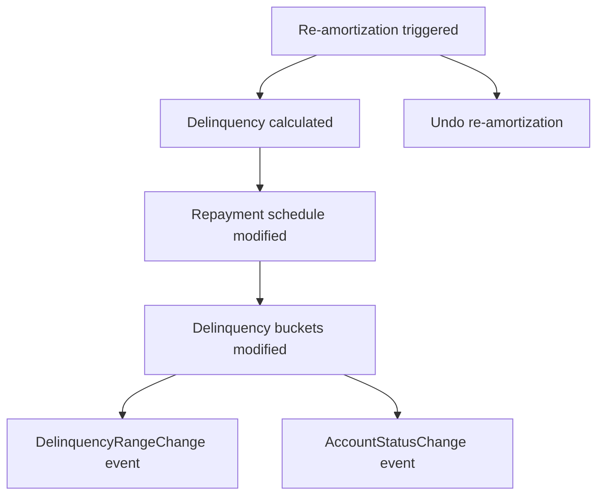

# Requirements and Scoping

## Re-amortization and Re-aging Requirements

### Purpose and scope

Re-amortization provides relief to customers with past due payments, while re-aging, also known as Settlement Plan, assists customers who are in duress around repaying their loans. Re-aging applies to loans that are overdue and past their maturity date. For re-aged unpaid installments, the schedule shows unpaid principal as zero, covering both regular installments and down-payment installments.

### Eligibility and account conditions

Re-amortization applies only to active loan accounts with a progressive repayment schedule handling or advance repayment strategy configured. Interest-bearing loan accounts are not eligible. Re-aging also requires progressive repayment schedule handling.

### Re-amortization date and timing

Re-amortization applies as of the current business date and is not allowed after the maturity date. The transaction date is always the actual business date, and no date or amount fields are required because re-amortization applies to the past due amount. The system does not mark the account explicitly as re-amortized.

### Amounts included in re-amortization

Re-amortization spreads the past due principal balance plus the current date due amount across the remaining future installments so there is no past due balance. No partial amount is re-amortized. Re-amortization is available only for progressive repayment schedule handling or advance repayment strategy.

### Installments affected by re-amortization

Re-amortization redistributes the loan amount across existing future installments without changing the maturity date.

The following rules define which installments are affected:

- Re-amortization applies only to future installments from the date it is applied.
- Installments falling on the same day as re-amortization are not re-amortized.
- The N+1 installment is not affected and receives no re-amortized amount.
- Future down-payment installments, if they exist, are considered for re-amortization.

### Principal-only redistribution

Re-amortization redistributes principal only. Outstanding fees or penalties remain outstanding for their particular installments and must be paid or waived by the user.

### Fees, penalties, charges, and interest

Re-amortization leaves charges and interest unchanged on their respective installments. Charges can be re-amortized in Fineract unless a business process prevents it. Re-amortization on the same day as an installment date includes that installment in the re-amortization.

### Schedule effects

The schedule shows unpaid principal as zero for unpaid installments on or before the re-amortized date. Re-amortization does not change the maturity date.

### Multiple re-amortization and undo

The system allows multiple re-amortizations on a loan account, but not on the same day. You can undo the last re-amortization only when no future payments have been made after it; undoing recalculates and replays the schedule.

### Backdated transactions and replay

Backdated transaction entries are allowed on a loan account that has been re-amortized. When any backdated transaction occurs, reverse replay is triggered and the re-amortization is reversed and replayed as per the new past due amount.

Reverse replay applies to the following backdated actions:

- Undo of old repayments.
- Backdated repayments.
- Backdated disbursements.
- Backdated charge additions.

If a backdated repayment arrives earlier than the re-amortization date, the new past due amount is re-amortized through reverse replay.

- The repayment schedule replays the re-amortization and installment amounts based on the new past due principal amount plus the current date due amount when an installment falls on the same day as the re-amortization.

### Delinquency and events

Delinquency calculation runs when re-amortization is triggered on the loan account and applies to installments that have an EMI amount. Re-amortization also triggers the DelinquencyRangeChange event and the AccountStatusChange event when the repayment schedule and delinquency buckets are modified. A user can undo re-amortization applied to the loan account.

### Transaction records and parameters

Re-amortization applies to a loan account through a new non-monetary transaction type called re-amortized, recorded as of the current business date to maintain the re-amortized amount for reprocessing. Re-aging creates a new set of installments for the same loan account from the principal outstanding pending on the loan account, starting any date after the existing maturity date or N+1 date and taking effect as of the current date only. For interest bearing loans, interest is recalculated based on the new principal balances and as per the loan configuration, although interest recalculation is on hold because progressive repayment schedule handling and advance repayment strategy do not currently support interest loan accounts. No explicit events or new parameters are required; delinquency change event and account change events will be triggered as schedule values and delinquency buckets would be changing.

Re-amortization requires one manual parameter and two system parameters.

- Manual parameter Reason field: a non-mandatory text field where the user can enter the reason for applying re-amortization.
- System parameter Reamortization Date: the system considers the current business date as the re-amortization date for schedule handling.
- System parameter Reamortization Amount: the system considers the sum of the full past due amount and current day due amount for re-amortization.

The re-amortized transaction type has the following characteristics.

- No JE entries are created for this transaction type.
- No explicit events or new parameters are required for re-amortization.
- A user can apply re-amortization on a loan account through the API.

### Re-aging parameters and schedule

Re-aging applies to a loan account and generates new installments from the full principal outstanding balance as of the current date, updating the maturity date according to the new schedule. You provide the frequency, re-age start date, and number of installments.

The following parameters are required to generate the new installments:

- Frequency, specified as a number of days, monthly, or weekly.
- Re-age start date.
- Number of installments.

### Re-aging charges, interest, and undo

Re-aging leaves any existing unpaid charge or interest in its respective installment unchanged, and Fineract performs no validation on those unpaid amounts. You can pay or waive them off before re-aging. If they remain unpaid after re-aging, future repayments collect the old pending interest or fees first. Interest on interest-bearing loans is recalculated based on the new schedule and loan configuration, and delinquency calculation is triggered when re-aging starts.

### Worked examples

A progressive-schedule loan has past due principal of 300 on the current business date. Three future monthly installments each carry 200 of principal. Re-amortization spreads the full 300 across the three future installments only; installments on or before the re-amortization date show zero unpaid principal, and the maturity date does not change. The figures are illustrative. If an installment falls on the re-amortization date, its due amount joins the re-amortized pool, but that installment itself is not rescheduled; only later installments receive the added principal.

| Installment | Principal before | Principal after |
| --- | --- | --- |
| Past due (on/before date) | — | 0.00 |
| Future installment 1 | 200.00 | 300.00 |
| Future installment 2 | 200.00 | 300.00 |
| Future installment 3 | 200.00 | 300.00 |
| Total future principal | 600.00 | 900.00 |

A re-amortization of 250 on 2/1/22 adds the past due amount to the single future installment due 2/15/22, raising its principal from 125 to 375. A backdated repayment of 125 is then posted on 2/2/22 with a transaction date of 1/15/22. Because the repayment predates the re-amortization, the re-amortization is reversed and replayed against the lower past due balance.

| Event | Date | Past due amount | Future installment principal |
| --- | --- | --- | --- |
| Re-amortization applied | 2/1/22 | 250.00 | 375.00 |
| Backdated repayment posted | 2/2/22 | 125.00 | — |
| Re-amortization replayed | 2/2/22 | 125.00 | 250.00 |

A loan is past its maturity date with 375 of unpaid principal. Re-aging creates a new schedule starting on a future date, with six monthly installments of 62.50 each. The maturity date moves to the last installment date, and unpaid charges or interest remain on their original installments. The figures are illustrative. If a repayment of 75 is made before re-aging, the balance drops to 300 and each of the six installments becomes 50.00 instead of 62.50.

| Installment | Due date | Amount |
| --- | --- | --- |
| 1 | 3/1/22 | 62.50 |
| 2 | 4/1/22 | 62.50 |
| 3 | 5/1/22 | 62.50 |
| 4 | 6/1/22 | 62.50 |
| 5 | 7/1/22 | 62.50 |
| 6 | 8/1/22 | 62.50 |
