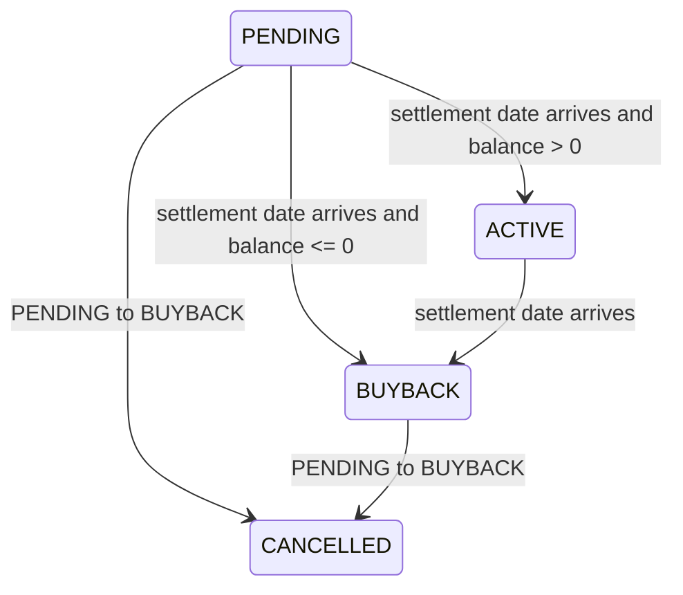

# BNPL

## Pay in 30 Days

### Delinquency history and overdue calculation

The delinquency history feature records changes made by the LDC job and tracks movement into and out of overdue buckets at DB or reporting level. Real-time repayment changes are added to the history only when that functionality is implemented. A feature toggle enables or disables the feature, and the grace period for delinquency classification is configurable for each product.

The default overdue calculation determines what appears on the loan account screens:

- The overdue summary amounts on the general tab summary screen are displayed based on the selected calculation.
- The loan status color (overdue or not) is displayed based on the selected calculation.
- The loan account overview screen displays 'Arrears By:' or 'Delinquent By:' based on the selected calculation.
- Users can configure whether the delinquency calculation or arrears calculation is displayed as the default overdue calculation.

The arrears and delinquency display configuration does not cover:

- Penalty calculation.
- Interest recalculation and compounding.

### Late fee slabs and fixed fees

Late fees use fixed fees for overdue amount ranges on loan charges with charge time type Overdue Fees and charge calculation Fixed fees for various slabs or ranges of overdue amount plus interest plus any fees. Administrators can add, edit, or remove rows defining overdue amount from, to, and fixed fee fields.

Slab ranges determine the late fee charge:

- Between 1 and X1 charges Z1.
- Between X1 and X2 charges Z2.
- Between X3 and X4 charges Z3.
- Greater than X3 charges Z4.

The system permits exceeding the approved or disbursed amount only by the configured percentage:

- The approved amount can go over by the configured percentage, not by 100% plus the additional configured percentage.
- If the approved amount is 1000 and it is allowed to go over by 10%, the maximum allowed total approved amount is 1100.

### Goodwill credit, payout refund, and merchant issued refund transactions

Goodwill Credit, Payout Refund, and Merchant Issued Refund transactions cannot be edited at API level, and transactions that have already been undone cannot be edited or undone again. Undoing these transactions remains possible at API level.

Chargeback behaviour for these transaction types follows these rules:

- Users can perform a chargeback for Goodwill Credit, Payout Refund, and Merchant Issued Refund transaction types.
- Chargeback is not allowed for reversed transactions.
- Error messages must be present for a chargeback amount of 0 and for amounts more than the allowed amount.

LoanTransactionData includes these duplicate field pairs and resource type fields:

- date vs transactionDate, transactionType vs type, and amount vs transactionAmount.
- resourceType and subResourceType are added in every place where applicable.

### Accrual transaction replay and events

Replaying an accrual transaction keeps the link between the original and replayed transactions, and when an accrual transaction is reverted and immediately replayed, the transactions are linked through LoanTransactionRelation. A transaction replayed event is triggered when an accrual transaction is replayed, while a LoanAccrualTransactionBusinessEvent is triggered when an accrual transaction is created or generated.

When client A and client B use the same idempotent key for the same action and entity name, client B receives client A's cached response. After undoing a waive transaction, the balance is recalculated to reflect the waived charge being reinstated.

### Credit and debit adjustments

Credit and debit adjustments appear on the repayment schedule and in the Retrieve loan API as summed amounts, and they are included in the Accounts changed event.

The outstanding amount and credit adjustment are calculated as follows:

- The outstanding amount equals original plus credit adjustments minus paid minus waived minus written-off.
- The credit adjustment column is the sum of all chargeback credits that happened on that loan account.

The submitted on date for a loan charge is the actual business date when the charge was added to the loan.

Swagger representation rules for backend types are:

- Backend IDs that are Long are represented as long in Swagger classes.
- Backend Lists are represented as List in Swagger classes, not Set.

> **Note:** JournalEntriesApiResource.retrieveAll fails via fineract-client because the Swagger response class is JournalEntryData.class while the response is wrapped in org.apache.fineract.infrastructure.core.service.Page.

### Loan ID and transaction ID validation

The API validates that a transaction ID belongs to the loan ID before processing the request. This applies to undoing transactions and to fetching, updating, paying, waiving, adjusting, and deleting loan charges, as well as transaction reversal, chargeback, undo loan charge transaction, and fetching loan details.

API write responses include the following fields:

- resourceId
- subResourceId
- resourceType
- subResourceType

BulkMessage behaviour:

- When a BulkMessage exceeds the ActiveMQ 100KB message size limit, it is split into multiple messages.

### Worked examples

A loan becomes overdue and the overdue amount is the sum of overdue principal, overdue interest and any overdue fees. The figures below are illustrative. A flat late fee is then selected by slab: 0 for an overdue amount from 1 to 10, 5 from 10 to 50, 12 from 50 to 100, and 20 above 100. The example shows that a larger overdue amount moves into a higher slab and incurs a larger flat charge.

| Overdue amount | Slab applied | Flat charge |
| --- | --- | --- |
| 5.00 | 1 to 10 | 0.00 |
| 25.00 | 10 to 50 | 5.00 |
| 75.00 | 50 to 100 | 12.00 |
| 150.00 | greater than 100 | 20.00 |

A product is configured to allow approval above the applied amount by 50 percent. A loan of 1,000 is approved and disbursed at 1,000. The system permits an additional 50 percent of 1,000, so the largest second disbursement is 500 and the largest total approved amount is 1,500. The example shows that the allowed increase is a percentage of the base amount, not 100 percent plus that percentage.

| Step | Amount | Check |
| --- | --- | --- |
| Approved and disbursed | 1000.00 | Base amount |
| Allowed increase (50%) | 500.00 | 0.50 × 1000 |
| Maximum total approved | 1500.00 | 1000 + 500 |
| Requested second disbursement | 1500.00 | Exceeds the 500 limit |
| Result | Rejected | Above the allowed additional amount |

The outstanding amount is the original amount plus credit adjustments minus payments minus waived and written-off amounts. Credit adjustments include refunds and goodwill credits; payments include repayments. The figures below are illustrative. The example shows that refunds and goodwill credits raise the outstanding amount while repayments lower it.

| Transaction | Column affected | Amount | Running outstanding |
| --- | --- | --- | --- |
| Original disbursement | Original | 1000.00 | 1000.00 |
| Repayment of 200 | total_payments | 200.00 | 800.00 |
| Goodwill credit of 100 | credit_adjustments | 100.00 | 900.00 |
| Refund of 50 | credit_adjustments | 50.00 | 950.00 |

## Pay in 3 and 4

### Asset externalization overview

Asset externalization supports loan sales to investors for the GPL portfolio of products and provides securitization concepts within Fineract core functionality. It supports Danube requirements for DE PayIn30 on the Fineract System and meets all data reporting obligations related to externalization enhancements.

Ownership and transactional changes happen as follows:

- Once a loan is sold to an investor, PayPal retains no ownership of the loan.
- Fineract supports ownership assignment throughout the life cycle of the loan.
- Ownership is submitted in real time to Fineract, with the actual update occurring as part of close of business (COB).
- Fineract publishes events for all ownership-related activities.
- Fineract provides POST and GET APIs to support ownership-related activities.

Asset externalization also covers accounting and reporting:

- It supports all accounting requirements for reporting and tracking GL activity for PayPal and non-PayPal-owned loans within Fineract.
- Fineract captures all monetary transaction GL entries according to PayPal's defined ownership.
- It supports real-time ownership and transactional changes related to asset sales via API and event publishing.

### Roles and permissions

The external owner is a legal entity that holds the investor persona. A Business Manager is an employee of the organisation who offers the loan to its customer, decides on asset sale, or works with data related to it. An auditor can see the history of a loan's ownership changes. Only users with the external investor module permission and super users can perform those actions. Only transfer initiation is captured by API.

### Transfer request fields and validation

Investor loan ownership transfer applies to loans with status ACTIVE only; any other status is rejected. The request requires Asset Owner ID, Purchase Price Ratio, and Settlement Date, and accepts an optional Sales Transaction ID. Settlement Date cannot be in the past.

| Field | Requirement | Constraint |
| --- | --- | --- |
| Asset Owner ID | Required | Any string, max 100 chars |
| Sales Transaction ID | Optional | Any string, max 100 chars; generated if not provided |
| Purchase Price Ratio | Required | Percentage between 0% and 100% |
| Settlement Date | Required | DATE; cannot be in the past |

Buyback Transfer ID identifies the buyback transfer and is different from the sale transfer ID. No transfer between owners occurs; transfer is only possible after buyback.

### Transfer lifecycle and statuses

An asset ownership transfer moves an asset portfolio from one owner to another. The effective date range is the period in which the ownership entry is valid, inclusively between its dates.

A transfer carries technical information and moves through the following statuses:

- Technical information includes the transfer timestamp, the effective date range from the submitted on date to 9999-12-31, and the transfer status.
- PENDING means the request has been made but not yet made active by the COB end of day.
- ACTIVE means the transfer is active and all journal entries are made against the investor.
- BUYBACK means the loan's ownership was bought back.
- DECLINED means the request was made but end of day has not passed and the loan was paid back or overpaid, so there is nothing for the investor to buy.
- CANCELLED means the request was made but cancelled before execution.

A successful transfer response includes the resource id, owner id, status PENDING, and sales transaction id, which is generated if not provided. A rejected transfer returns HTTP 403 with a reason.

### Buyback process

A business manager can buy back loans with pending ownership transfer from investors when the loan account becomes fraud or for any other reason. The buyback is another activity with an external Buyback Transfer ID.

The buyback API request requires these fields:

- Settlement date is mandatory.
- Transfer ID must be present.
- Owner ID can be null.
- Cancel does not require a settlement date; it always refers to the current PENDING transfer.

Buyback and sale settlement date equals the same day.

> **Note:** Cancelling buyback is not supported.

### Same-day sale and buyback rules

When a sale and a buyback happen on the same day, the sale occurs first and the buyback after. Both transfers are cancelled and two CANCELLED events are triggered, one for the SALE transfer and one for the BUYBACK transfer. No GL entries are created. A pending transfer blocks new transfer requests, and a second pending request fails on the API. Initiation followed by buyback followed by initiation followed by buyback in the same day prior to COB is not allowed.

### COB processing

Close of business processing completes asset ownership transfers when the settlement date arrives. The system evaluates the loan balance at close of business day to decide whether a transfer becomes active or declined.

COB processing applies the following rules to asset ownership transfers:

- Asset ownership transfer entries are created during COB using the balance at close of business day.
- No ownership change or journal entries occur when the loan balance is 0.00 or less than 0.00.
- The system makes a transfer active during COB when the settlement date arrives and the loan balance is greater than 0.
- The system makes a transfer declined during COB when the settlement date arrives and the loan balance is less than or equal to 0.
- The system makes journal entries when asset ownership status changes from PENDING to ACTIVE.
- The system makes journal entries when asset ownership status changes from ACTIVE to BUYBACK.
- For a PENDING to BUYBACK status change, both PENDING and BUYBACK transfers are cancelled, no journal entries are made, and no status change occurs as if nothing happened.

Restriction on transfer API calls when COB has not run until the settlement date must be the same as those of monetary activities.

### Sale scenarios

An asset sale on an active loan records ownership when no active ownership record exists and the loan account is ACTIVE. The system persists the Asset Owner ID, sale transaction ID, purchase price ratio, and date/time of ownership change, marks ownership as active, and publishes an ownership-change event. At COB, accounting posts using the closing balance with two journal entries: DR 145600 CR 112601 /112603 and DR 112601 /112603 CR 145600, and publishes events for the journal entries.

The same outcome applies to an active loan with inactive ownership records: validations require no active ownership record, previous inactive ownership records to exist, and the loan account to be ACTIVE. Ownership is marked active and the same fields are persisted, with an ownership-change event published. Accounting posts at COB using the closing balance and creates the same two journal entries, publishing events for them.

The system declines an asset sale in the following cases:

- The loan account is CLOSED and no active ownership record exists; no ownership changes are recorded.
- The loan balance at COB is 0.00 or the loan account state is CLOSED; no ownership changes are recorded and an event is published for the declined ownership change.
- The loan balance at COB is less than 0.00; no ownership changes are recorded and an event is published for the declined ownership change.
- An active ownership record already exists on the loan account; no ownership changes are recorded.
- The RT API call to Fineract SOR finds that the loan account is not found.

### Buyback scenarios

An asset buyback applies to an active loan with an active ownership record, a closed loan with an active ownership record, a FRAUD loan with an active FRAUD tag, or a loan account that cannot be found by the RT API call to Fineract SOR.

The following buyback scenarios are supported:

- For an active loan, validation requires an active ownership record and an ACTIVE loan account, and the outcome changes the active Asset Owner ID to inactive, persists it on the loan account, persists the Buyback transaction ID and Buyback amount memo, records the date/time of ownership change, marks ownership as inactive, and publishes an ownership-change event.
- For a closed loan, validation requires an active ownership record and a CLOSED loan account, but no ownership changes are recorded and the response is decline.
- For a FRAUD loan, validation requires no active ownership record and an active FRAUD tag, and the outcome changes the active Asset Owner ID to inactive, persists it on the loan account, persists the Buyback transaction ID and Buyback amount memo, records the date/time of ownership change, marks ownership as inactive, and publishes an ownership-change event.
- When no active ownership exists on the loan account, validation requires no active ownership record, no ownership changes are recorded, and the response is decline.
- When the RT API call to Fineract SOR finds that the loan account is not found, the response is decline.

Accounting impact applies to buybacks on active loans and FRAUD loans:

- Accounting posts at COB using the closing balance of the loan account.
- Two journal entries are created: DR 145600 CR 112601 /112603 and DR 112601 /112603 CR 145600.
- Events are published for the journal entries.

### GL entries and accounting

Fineract stores journal entry relationships to external owners so auditors can fetch owner journal entries and reporting queries stay simple without different posting dates during portfolio transfer. Storing these relationships requires creating a relationship entry when an external owner owns the entry and coupling the Accounting and Investor modules through internal business events. Investor ownership does not change GL entries; the investor appears only as a comment or tag on the same entries.

Account and Transaction changed events include the asset owner once the loan is actively owned by an external asset owner, although the API does not have to reflect this. PayPal provides daily investor accounting reports through the SOR.

Ownership rules for post-sale activity are as follows:

- Fees applied to a loan after sale are owned by the investor, not PayPal.
- All payment allocation rules remain the same before and after sale.
- Past due and delinquency tracking remain the same before and after sale.
- Charge-off rules remain the same as PayPal-owned loan accounts for investor-owned loan accounts.

Determination of loan statuses, assignment of loans to an investor, and buyback or reassignment of a loan are completed externally, not on the Fineract system.

| Transaction | GL entries at close of business |
| --- | --- |
| Sale | DR Loan/Fee Rec-Investor CR Loan/Fee Rec-PayPal, followed by CR 112601 /112603 - DR 146000 - PayPal CR 146000 - DR 112601 /112603 - Investor |
| Buyback | DR Loan/Fee Rec-PayPal CR Loan/Fee Rec-Investor, followed by DR 112601 /112603 - CR 146000 - PayPal DR 146000 - CR 112601 /112603 - Investor |

| Ownership change | Data stored in Fineract |
| --- | --- |
| Sale transaction | Asset Owner ID, Sales Transaction ID, Purchase price ratio, created timestamp, updated timestamp |
| Buyback transaction | Buyback Transfer ID, created timestamp, updated timestamp |
| Pending ownership change | Asset Owner ID, Sales Transaction ID, Purchase price ratio, Settlement date, created timestamp, updated timestamp |

A pending sales transaction remains pending until the settlement date arrives. On the settlement date, a batch process runs at close of business to create the sale transaction and move the loan balance from pending settlement to investor.

| Activity | GL entries |
| --- | --- |
| Activity posted in pending state for settlement | DR Cash Clearing-Investor CR Cash Clearing-PayPal DR Loan Rec-Pending Settlement CR Loan Rec-Investor |
| Original quoted price | DR Loan Rec-Investor CR Loan Rec-Pending Settlement |
| Pending ownership change | DR Loan Rec-Pending Settlement CR Loan Rec-PayPal |

### Post-sale loan behavior

The credit platform partner router identifies which system of record (SOR) holds the loan and routes traffic accordingly. Domains above the router do not need to know which SOR the loan is recorded on. The credit ETL domain manages any changes required for storing ownership details in Credit databases.

### Data persistence and events

The system persists externalisation status, externalisation requests and their outcomes, and the mapping between journal entries and external investors. It also extends existing events with owner information and emits a new event when ownership changes.

Persistence covers the following:

- Externalisation status persistence stores the loan ID, status, and effective date range with from and to dates.
- Externalisation request and history persistence stores incoming externalisation requests and executed externalisation request outcomes.
- A mapping table stores the relationship between journal entries and external investors; no direct relationship exists between a loan transaction and an external investor.
- The external investor for a transaction can be fetched based on the posting date or reverted-on date of the transaction and the external owner effective date range.
- Existing events are extended with owner information.
- A new event is emitted for an ownership change.

### API endpoints

The root endpoint /external-asset-owners supports asset transfer requests and ownership retrieval for loans identified by loan ID or loan external ID.

You can initiate and retrieve transfer requests using the following endpoints:

- POST /external-asset-owners/transfers/loans/<loan_id>?command=<action> initiates an asset transfer request for a target loan identified by loan id.
- POST /external-asset-owners/transfers/loans/external-id/<loan_external_id>?command=<action> initiates an asset transfer request for a target loan identified by loan external id.
- GET /external-asset-owners/transfers?transferExternalId=<transfer_external_id> fetches transfer requests by transfer external id.
- GET /external-asset-owners/transfers?loanId=<loan_id> fetches transfer requests by loan id.
- GET /external-asset-owners/transfers?loanExternalId=<loan_external_id> fetches transfer requests by loan external id.

You can retrieve asset ownership information and journal entries using the following endpoints:

- An API user can retrieve asset ownership information based on Loan ID (external id).
- An API user can retrieve asset ownership information based on the transfer ID.
- GET /external-asset-owners/transfers/external-id/{ownerExternalId}/journal-entries fetches transfer journal entries for an owner external id.
- GET /external-asset-owners/owners/external-id/{ownerExternalId}/journal-entries fetches owner journal entries for an owner external id.

### Worked examples

A business manager requests a sale of an active loan to an external investor. The figures are illustrative. The loan has a principal of 1,000.00 and a closing balance of 1,000.00 on the business date. The request carries Asset Owner ID INV-001, Purchase Price Ratio 100%, and a Settlement Date two days ahead. The API accepts the request, stores the transfer as PENDING, and generates a Sales Transaction ID. At close of business on the settlement date, the batch process flips the ownership to ACTIVE using the closing balance and posts the sale journal entries. This example shows the pending-to-active transition and the two COB journal entries for a full sale.

| Date | Event | Transfer status | Loan balance | Asset owner | Journal entries |
| --- | --- | --- | --- | --- | --- |
| March 10 | Sale requested | PENDING | 1,000.00 | PayPal | None |
| March 11 | End of day before settlement | PENDING | 1,000.00 | PayPal | None |
| March 12 | Close of business on settlement date | ACTIVE | 1,000.00 | INV-001 | DR 145600 CR 112601 /112603; DR 112601 /112603 CR 145600 |

A sale is requested on an active loan whose balance has already reached 0.00 before close of business. The API returns OK because the request itself is valid, but the COB batch finds a zero balance and declines the ownership change. No Asset Owner ID is persisted and no journal entries are posted; an event is published for the declined ownership change. If the balance were less than 0.00 instead of exactly 0.00, the outcome is identical: the transfer is declined and no ownership change is recorded. This example shows that a valid sale request still fails at COB when the closing balance is 0.00 or less.

| Date | Event | Transfer status | Loan balance | Asset owner | Outcome |
| --- | --- | --- | --- | --- | --- |
| March 10 | Sale requested | PENDING | 0.00 | PayPal | Accepted by API |
| March 10 | Close of business runs | DECLINED | 0.00 | PayPal | No ownership change; declined event published |

A loan is already owned by investor INV-001 with an ACTIVE transfer. A business manager initiates a buyback because the account is flagged as fraud. The request carries Buyback Transfer ID BB-001 and a Settlement Date equal to the current business date. At close of business, the ownership record is marked inactive, the Buyback Transaction ID is persisted, and the sale journal entries are reversed. This example shows that a buyback deactivates investor ownership and reverses the COB accounting entries.

| Date | Event | Ownership status | Loan balance | Asset owner | Journal entries |
| --- | --- | --- | --- | --- | --- |
| March 10 | Sale completed at close of business | ACTIVE | 1,000.00 | INV-001 | DR 145600 CR 112601 /112603; DR 112601 /112603 CR 145600 |
| March 11 | Buyback requested | PENDING | 1,000.00 | INV-001 | None until close of business |
| March 11 | Close of business runs | INACTIVE | 1,000.00 | PayPal | DR 112601 /112603 CR 145600; DR 145600 CR 112601 /112603 |

A sale transfer is left PENDING during the day. Before close of business, a buyback is requested for the same loan and the same settlement date. Because sale and buyback happen the same day, no GL entries are created; instead both transfers are cancelled and two CANCELLED events are published, one for the sale and one for the buyback. This example shows that same-day sale and buyback cancel each other without touching the ledger.

| Date | Event | Transfer status | Loan balance | Asset owner | Events published |
| --- | --- | --- | --- | --- | --- |
| March 10 | Sale requested | PENDING | 1,000.00 | PayPal | None |
| March 10 | Buyback requested same day | CANCELLED | 1,000.00 | PayPal | CANCELLED for sale; CANCELLED for buyback |
| March 10 | Close of business runs | CANCELLED | 1,000.00 | PayPal | No journal entries |
