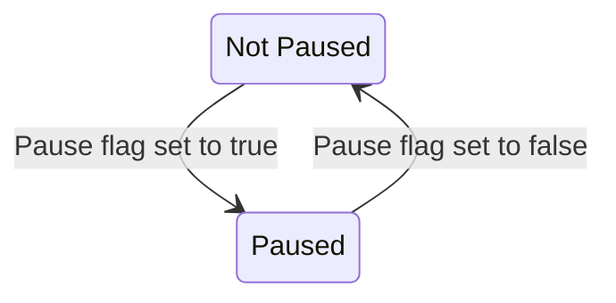

# Delinquency

## Delinquency Buckets

### Delinquency configuration and inheritance

You can configure delinquency at the installment level on a loan product. A loan inherits its loan product level delinquency configuration, and the delinquency bucket classification configuration remains the same at both levels. Selecting a delinquency bucket is optional when you create or update a loan product, both in the UI and in the backend.

### Delinquency calculation and storage

Delinquency calculation runs in real time and stores the bucket and related information for each loan: loan ID, instalment, bucket, outstanding amount, and first overdue date. The system does not keep a history of bucket changes.

When delinquency is evaluated at the instalment level, each overdue instalment is assigned to its respective delinquency bucket for the loan account and the loan is marked as delinquent.

- An instalment appears only in its current bucket; no history of the previous bucket is stored when it moves.
- The loan remains delinquent if any instalment is in a delinquency bucket, and the loan’s delinquency bucket is the longest overdue bucket.
- Paying one overdue instalment in full removes only that instalment from the delinquency bucket; the loan stays delinquent until every instalment leaves the bucket.
- Reverse or backdated repayments recalculate each instalment’s delinquency and reassign it to its new bucket.
- Close of business calculates delinquency buckets.

### Installment-level delinquency scope

Installment-level delinquency applies to down-payment installments and to charge-off tagged loan accounts. The installmentLevelDelinquency field is populated only when the related loan has the enableInstallmentLevelDelinquency flag turned on. Past due buckets configured for 1-3 days act as the grace period; separate grace options are not required. The topic covers installment-level delinquency scope only; configuration, calculation, aggregation, events, pausing, and collections programs are described elsewhere. Delinquency works normally for charge-off tagged loan accounts.

### Bucket aggregation and display

Multiple instalments can feed past due amounts into the buckets, and each bucket shows the aggregated amount for its range. A range with zero delinquent amount remains present in the response so the UI can draw the full table.

Empty ranges are not shown.

- Empty ranges are omitted from the bucket response.

### Delinquency event

The delinquency change event identifies a delinquent loan and its bucket information so collections can call customers to schedule repayment and for bureau reporting. It is an alternation or descendent of the Delinquency event.

The event fires when an installment-level delinquency bucket changes, either at close of business or through a payment.

- The loan enters a delinquency bucket.
- The loan moves from one delinquency bucket to another.
- The loan comes out of delinquency.
- Delinquency pause starts.
- Delinquency pause ends.

The event includes the following behaviour:

- When installment-level delinquency is enabled by configuration, the event reflects installment-level bucket changes.
- Only buckets with an outstanding amount are listed in the event.
- The event contains a field called delinquencyCalculationPaused.

### Event amount fields

| Field | Type | Amount | Source |
| --- | --- | --- | --- |
| amount.totalAmount | BigDecimal | Total amount for the installments | Σ loan.repaymentScheduleInstallments.getTotalOutstanding for installments in the current delinquency bucket |
| amount.principalAmount | BigDecimal | Principal amount for the installments | Σ loan.repaymentScheduleInstallments.getPrincipalOutstanding for installments in the current delinquency bucket |
| amount.interestAmount | BigDecimal | Interest amount for the installments | Σ loan.repaymentScheduleInstallments.getInterestOutstanding for installments in the current delinquency bucket |
| amount.feeAmount | BigDecimal | Fee amount for the installments | Σ loan.repaymentScheduleInstallments.getFeeChargesOutstanding for installments in the current delinquency bucket |
| amount.penaltyAmount | BigDecimal | Penalty amount for the installments | Σ loan.repaymentScheduleInstallments.getPenaltyChargesOutstanding for installments in the current delinquency bucket |

### Event loan identification fields

| Field | Type | Represents | Example | Source |
| --- | --- | --- | --- | --- |
| loanId | Long | ID of the loan account | 325 | loan.id |
| loanExternalId | String | External ID of the loan account | a4daa9a6-20ed-48e3-8fe8-b0c7d17ef633 | loan.externalId |
| loanAccountNo | String | Account number of the loan account | 000000001 | loan.accountNumber |
| currency | Currency | Currency of the loan account | EUR with decimalPlaces 6 | loan.loanRepaymentScheduleDetail.currency |

### Event bucket range fields

The installment delinquency buckets field holds a list of buckets, each carrying a delinquency amount and a delinquency range. The range identifies the bucket by ID, minimum and maximum age in days, and classification name. These values come from DelinquencyReadPlatformService#retrieveCurrentDelinquencyTag.

| Field | Type | Meaning | Example |
| --- | --- | --- | --- |
| installmentDelinquencyBuckets[n].delinquencyRange.id | Long | ID of the delinquency range | 1 |
| installmentDelinquencyBuckets[n].delinquencyRange.minimumAgeDays | Integer | Minimum age days configured for the delinquency range | 1 |
| installmentDelinquencyBuckets[n].delinquencyRange.maximumAgeDays | Integer | Maximum age days configured for the delinquency range | 3 |
| installmentDelinquencyBuckets[n].delinquencyRange.classification | String | Delinquency range name | Range 1 |

### Event bucket amount fields

Each delinquency bucket reports four amount fields as BigDecimal values: principal, fees, penalties, and interest, plus a total field that represents the combined delinquency amount for the bucket. These fields appear on installment delinquency buckets and are returned by the aggregated delinquency GET API.

| Field | Type | Meaning | Example |
| --- | --- | --- | --- |
| installmentDelinquencyBuckets[n].amount.principal | BigDecimal | Installment delinquency principal amount in the bucket | 250 |
| installmentDelinquencyBuckets[n].amount.fees | BigDecimal | Installment delinquency fee amount in the bucket | 25 |
| installmentDelinquencyBuckets[n].amount.penalties | BigDecimal | Installment delinquency penalties amount in the bucket | 5 |
| installmentDelinquencyBuckets[n].amount.interest | BigDecimal | Installment delinquency interest amount in the bucket | 0 |
| installmentDelinquencyBuckets[n].amount.total | BigDecimal | Total delinquency amount | 280 |

The m_loan_instalment_delinquency_tag_history table extends m_loan_delinquency_tag_history and stores delinquent installments, including the instalment sequence, outstanding amount, and first overdue date.

The installmentLevelDelinquency field delivers installment level delinquency per bucket ranges for CollectionData and GetLoansLoanIdDelinquencySummary classes.

### Worked examples

A loan product has installment-level delinquency enabled through the enableInstallmentLevelDelinquency flag. A loan of principal 1,000.00 with an annual interest rate of 12% is repaid in three monthly installments over 30-day months. The first installment of 343.33 is due on 1 January and remains unpaid on 5 January, four days past due. The configured buckets treat one to two days past due as grace and three to fourteen days past due as Bucket 1. The system evaluates the overdue installment, assigns it to Bucket 1, and marks the loan as delinquent. The figures in this example are illustrative.

| Installment | Due date | Check date | Days past due | Bucket | Past due amount | Loan status |
| --- | --- | --- | --- | --- | --- | --- |
| Installment 1 | 1 January | 5 January | 4 | Bucket 1 | 343.33 | Delinquent |
| Installment 2 | 1 February | 5 January | - | Not due | - | - |
| Installment 3 | 1 March | 5 January | - | Not due | - | - |
| Loan total |  |  |  | Bucket 1 | 343.33 | Delinquent |

The same loan continues. Installment 1 is paid in full on 6 January and leaves the delinquency bucket. Installment 2 of 340.00 is due on 1 February and remains unpaid on 20 February, nineteen days past due. Because nineteen days falls in the fifteen-to-twenty-nine-day band, Installment 2 moves to Bucket 2. The loan stays delinquent because at least one installment remains in a delinquency bucket, and the loan bucket becomes Bucket 2.

| Installment | Due date | Check date | Days past due | Bucket | Outstanding amount | Loan status |
| --- | --- | --- | --- | --- | --- | --- |
| Installment 1 | 1 January | 6 January | 5 | Cured | 0.00 | Delinquent |
| Installment 2 | 1 February | 20 February | 19 | Bucket 2 | 340.00 | Delinquent |
| Installment 3 | 1 March | 20 February | - | Not due | - | Delinquent |
| Loan total |  |  |  | Bucket 2 | 340.00 | Delinquent |

A loan has a down-payment installment of 250.00 due on 1 January and a regular installment of 343.33 due on 1 January. Both are unpaid on 5 January, four days past due, so both fall into Bucket 1 (three to fourteen days). The system aggregates their past due amounts into a single Bucket 1 total of 593.33. Buckets with no outstanding amount, such as Bucket 2 and Bucket 3, are still returned with a zero amount so the full range table can be drawn. The first range may be labeled D0 (past due) or Past Due depending on the view; the amounts are unchanged.

| Bucket | Minimum age days | Maximum age days | Installments | Total amount |
| --- | --- | --- | --- | --- |
| Past due (grace) | 1 | 2 | - | 0.00 |
| Bucket 1 | 3 | 14 | Down-payment, Installment 1 | 593.33 |
| Bucket 2 | 15 | 29 | - | 0.00 |
| Bucket 3 | 30 | 59 | - | 0.00 |
| Total |  |  |  | 593.33 |

The installmentLevelDelinquency field is populated only when the related loan has the enableInstallmentLevelDelinquency flag turned on. When Installment 2 moves from Bucket 1 to Bucket 2, or when delinquency calculation is paused or resumed, the system emits an installment-level delinquency event. The event is an alternation of the Delinquency event. It identifies the loan, carries the delinquencyCalculationPaused flag, and lists only buckets that have an outstanding amount. Each listed bucket includes its range identifier, age limits, classification, and the aggregated principal, interest, fee, penalty, and total amounts for the installments in that bucket.

| Field | Value | Source |
| --- | --- | --- |
| loanId | 1001 | loan.id |
| loanExternalId | L-EXT-0001 | loan.externalId |
| loanAccountNo | 0000001001 | loan.accountNumber |
| currency | EUR | loan.loanRepaymentScheduleDetail.currency |
| delinquencyCalculationPaused | false | calculation state |
| installmentDelinquencyBuckets | Bucket 2: principal 333.33, interest 6.67, total 340.00 | only buckets with outstanding amount |

## Pausing Delinquency

### Feature scope and availability

Delinquency pause stops delinquency recalculation for both loan-level and installment-level calculations while the pause is active. Only Pause and Resume actions are supported; re-ageing and reset are out of scope. The feature applies only to active loan accounts.

The following rules define the scope and availability of delinquency pause:

- A Boolean flag indicates whether delinquency calculation is paused for a given loan at request time; the flag is true when the current date falls between the pause period.
- Delinquency pause is a loan-level feature, not a loan product feature, and is mentioned in the Delinquency Settings of the loan.
- A pause can start today or later, must last at least a day with start before end, and overlapping pause periods are not allowed.
- A resume can only be used when there is an active pause; the resume date is always the current business date as start_date with no future resume possible, and the resume end_date must not be specified.
- The delinquency level configuration cannot be changed from installment to loan when there are active loans with installment delinquency buckets.
- Grace options for installment delinquency are not required; past due bucket will be configured for 1-3 days and treated as a grace period.
- A flag is required to indicate if delinquency is paused or not.
- There is an option to select the delinquency level (loan level or installment level) at the loan product level.
- The original requirement page for delinquency pause is Past Due (Arrears) and Multiple Delinquency Buckets.

### Pause and resume rules

You can pause delinquency for a loan account for a period that starts today or later and lasts at least one day. A loan account can have multiple pause periods, but they cannot overlap. Resume is available only while a pause is active, and the resume date becomes the pause end date.

Pause and resume rules:

- The pause start date must be today or later and must precede the end date.
- The end date cannot be the same as the start date.
- Resume uses the current business date as the start date; no future resume is possible.
- An end date must not be specified when resuming.
- Resume applies only to the current active pause period.
- If a pause is not manually resumed during its period, the system resumes it automatically after the period ends.
- A pause cannot be undone by updating or deleting it; you must use the resume action.

### Pause timing and backdating

A pause start date cannot be backdated and must be from the current date, while the end date can be any valid future date. If a pause period already exists, the new start date cannot be before the last pause period end date; otherwise it cannot be before the loan's first disbursement date. A new pause start date can start as of the old past end date if there was one, because pause days calculation works on N+1 days.

Backdated pauses behave as follows:

- Delinquency recalculation happens when a backdated pause is initiated.
- Delinquency recalculation happens as of the current date loan status even when a backdated pause is created.
- The pause flag at loan level is updated in real time when a backdated pause is created.
- The pause takes effect when the start date is backdated and the end date is in the future.
- Adding both pause start date and end date backdated has no effect.
- The pause works normally when both start date and end date are in the future or current date.

### Pause behavior during active pause

While delinquency is paused, the system does not evaluate delinquency and the delinquency bucket remains unchanged. Payment in full of delinquent amounts removes any delinquent state or tag even while delinquency is paused. COB does not perform delinquency calculation for loans with paused delinquency calculation.

### Resume behavior and recalculation

When you resume delinquency, the system recalculates delinquency at the next close of business. The resume date becomes the pause end date, and pause days are calculated only up to that date. If the business date equals the last day of the pause, delinquency recalculation happens.

### Repayment and loan status effects

Repaying a loan stops the delinquency pause because the loan is no longer in delinquency. Charge-off tagged loan accounts continue to follow normal delinquency behaviour, and charge off of the remaining balance is triggered for non-payment.

### Events

The system emits events when the delinquency pause flag changes state, including when it is set to true or false at the loan account level. The events carry the pause flag status, pause start date, and pause end date.

The COB job triggers a LoanDelinquencyRangeChangeBusinessEvent in these situations:

- A loan was not paused on the previous day but becomes paused today.
- A loan was in pause on the previous day but comes out of pause today.
- The pause flag changes its state.
- The calculated delinquency ranges change.
- The delinquency bucket changes.

When a pause resumes at the COB job:

- The system sets the pause flag of the loan account to false.
- The system includes the loan account in the delinquency calculation.

Additional event behaviour:

- A new event is emitted when the pause flag changes, but no new event is raised when delinquency actions are created.
- Backdated payments reverse and replay the loan account, which recalculates the pause and delinquency days.
- Creating a pause on 27 November with a start date of 25 November sends a loan account change event as of 27 November because a new pause period was added.

API pause requests:

- A delinquency pause requested through the API has start and end dates by default.
- A delinquency pause-resume requested through the API may occur because an early delinquency pause ended.

### Database schema

| Column | Type | Null | Description |
| --- | --- | --- | --- |
| id | BIGINT | NOT NULL | Primary key |
| loan_id | BIGINT | NOT NULL | Indexed association for the loan |
| action | VARCHAR(128) | NOT NULL | Enum type of the action, e.g. pause |
| start_date | Date | NOT NULL | Effective start of the action, inclusive |
| end_date | Date | NULL | Effective end of the action, inclusive |
| created_by | audit field | NOT NULL | Creator of the record |
| created_on_utc | audit field | NOT NULL | Creation timestamp in UTC |
| last_modified_by | audit field | NOT NULL | Last modifier of the record |
| last_modified_on_utc | audit field | NOT NULL | Last modification timestamp in UTC |

### Effective delinquency action query

The effective delinquency action query determines whether delinquency calculation is paused for a loan by selecting the most recent entry in m_loan_delinquency_action.

The query applies the following conditions:

- A pause entry qualifies when its end_date is not null and the business date falls between start_date and end_date inclusive.
- A resume entry qualifies when its end_date is null and the business date is on or after start_date.
- Results are ordered by created_on_utc descending and limited to one row.

The result determines delinquency calculation as follows:

- No result means delinquency calculation is enabled.
- A PAUSE entry means delinquency calculation is paused.
- A Resume entry means delinquency calculation is enabled.

The query completes in less than 50ms on 25 Mio entries for Maria, PostgreSQL, and MySQL.

COB takes past paused delinquency periods into account when calculating delinquency after a pause, and delinquency calculation running after the pause period takes into account the duration of the pause.

### Overlapping pauses

You can create multiple delinquency pauses for the same period when they share a start date but use different idempotency keys. Overlapping pauses are allowed, such as one pause from 12/10 to 12/25 and another from 12/13 to 12/18. A resume action on an overlapping date resumes both pauses.

Resume behaviour follows these rules:

- Multiple resumes are allowed for the same date when they use different idempotency keys.
- Reusing the same idempotency key returns an idempotent response.
- A resume action removes the pause on both overlapping pause periods.

Active, expired, or future delinquency pause information is sent in the event; if the loan never had a delinquency pause set, the fields remain empty.

### API endpoints

You can retrieve all delinquency actions for a loan and submit a new delinquency action for an existing loan. There is no endpoint to update or delete an existing delinquency action.

Delinquency actions endpoints support both loan ID and external identifier lookups:

- GET /loans/{loanid}/delinquency-actions retrieves all delinquency actions for a given loan.
- GET /loans/external-id/{loanExternalId}/delinquency-actions retrieves all delinquency actions for a given loan.
- POST /loans/{loanid}/delinquency-actions submits a new delinquency action.
- POST /loans/external-id/{loanExternalId}/delinquency-actions submits a new delinquency action.

The request body for submitting a delinquency action includes:

- action
- startDate
- endDate (not needed for resume)

The Loan read endpoint returns delinquency-related fields:

- delinquency calculation pause flag via GET /loans/{loanId} and GET /loans/external-id/{loanExternalId}
- delinquent and delinquencyRange via GET /loans/{loanId} and GET /loans/external-id/{loanExternalId}

### Loan read response fields

The system provides API support for establishing a pause delinquency flag on loan accounts. The loan read response reports whether delinquency calculation is paused and, when paused, the pause period start and end dates.

The response includes the following delinquency pause fields:

- delinquencyCalculationPaused is true when delinquency calculation is paused and false otherwise.
- delinquencyPausePeriodStartDate is the date the pause began.
- delinquencyPausePeriodEndDate is the date the pause ends.

CollectionDataV1 carries the delinquencyCalculationPaused boolean, populated from the current state through DelinquencyReadPlatformService and reflected in the loan business event serializer.

The event fields include delinquencyCalculationPaused, delinquencyPausePeriodStartDate, and delinquencyPausePeriodEndDate.

GET calls also return the delinquency state, including the current bucket and amount, and the number of times the loan has paused delinquency.

### Delinquency bucket rules

Delinquency buckets apply only when delinquency is not paused, the past due balance is greater than zero, and the effective days past due fall within the bucket range. Effective days past due equal days past due minus days paused.

Bucket 1 applies when effective days past due are at least 3 and less than 15.

- Bucket 1 assigns the DELINQUENT tag, removes the PAST DUE tag, sets the delinquency state to Bucket 1, and sets the delinquency amount to the past due amount.
- Bucket 2 applies when effective days past due are at least 15 and less than 30, sets the delinquency state to Bucket 2, and sets the delinquency amount to the past due amount.

The system retrieves all pause and resume entries for a loan, merges them into effective pause periods, excludes installment entries that overlap those periods, and calculates effective delinquency as the current date minus the unpaid installment date minus the sum of relevant pause days.

### Related delinquency settings

At the loan level, you can change the delinquency settings. The settings menu includes pause delinquency of the loan; re-age delinquency and reset delinquency are out of scope. Past due to D20 to D40 behavior can vary by product and market, and grace period impacts effects.

### Worked examples

An active loan with a principal of 1,000.00 has delinquency calculation enabled. The figures are illustrative. On business date 5 January a pause is created from 5 January to 10 January. On 8 January the pause is resumed, so the resume date becomes the pause end date. On 12 January a second pause runs from 12 January to 15 January. The effective delinquency action query returns the most recent entry for the loan: a pause entry with a non-null end date pauses calculation when the business date falls between start and end inclusive, while a resume entry with a null end date enables calculation from its start date onward. If no entry matches, calculation is enabled.

| Date | Action | Pause start | Pause end | Flag on date | Why |
| --- | --- | --- | --- | --- | --- |
| 5 January | Pause | 5 January | 10 January | TRUE | Pause period covers the date |
| 8 January | Resume | 8 January | — | FALSE | Resume date becomes pause end; resume entry has null end date |
| 10 January | — | — | — | FALSE | Most recent entry is the resume from 8 January |
| 12 January | Pause | 12 January | 15 January | TRUE | New non-overlapping pause period starts |
| 16 January | — | — | — | FALSE | Pause expired; no active pause or resume entry |

An active loan of 1,000.00 has an unpaid installment of 250.00 due on 1 January. Without a pause, the loan reaches Bucket 2 on 16 January at 15 days past due. A pause runs from 5 January to 14 January, so those ten days are removed from the overdue count. While paused, the bucket stays as is and no delinquency recalculation runs. On 15 January, the first business date after the pause, delinquency is recalculated using effective days past due equal to calendar days past due minus pause days.

| Date | Calendar days overdue | Pause days | Effective days overdue | Bucket | Tag |
| --- | --- | --- | --- | --- | --- |
| 1 January | 0 | 0 | 0 | Current | — |
| 4 January | 3 | 0 | 3 | Bucket 1 | DELINQUENT |
| 5 January | 4 | 0 | 4 | Bucket 1 | DELINQUENT (pause starts, frozen) |
| 14 January | 13 | 10 | 3 | Bucket 1 | DELINQUENT (frozen on last pause day) |
| 15 January | 14 | 10 | 4 | Bucket 1 | DELINQUENT (recalculated after pause) |
| 16 January | 15 | 10 | 5 | Bucket 1 | DELINQUENT (no escalation to Bucket 2) |

A loan is already delinquent when a backdated pause is created on the current business date of 10 January. The pause covers 5 January to 8 January, so the flag is set to true immediately and delinquency is recalculated as of the current date using the loan status on that date. The four pause days are subtracted from the overdue count. When the pause expires on 9 January, calculation resumes normally.

| Date | Event | Pause start | Pause end | Flag | Effective days overdue |
| --- | --- | --- | --- | --- | --- |
| 1 January | Installment due, unpaid | — | — | FALSE | 0 |
| 8 January | Seven days overdue | — | — | FALSE | 7 |
| 10 January | Backdated pause created | 5 January | 8 January | TRUE | 5 |
| 11 January | Pause expired | — | — | FALSE | 6 |
| 16 January | Fifteen days overdue | — | — | FALSE | 11 |

While a loan is paused, its delinquency bucket remains unchanged, but a payment in full of the past due amount still clears the delinquent state. An active loan of 1,000.00 is in Bucket 1 with 250.00 past due and the pause flag true. When 250.00 is paid, the past due balance becomes zero, the delinquency state returns to current, and the DELINQUENT tag is removed even though the pause remains active until its end date.

| Date | Event | Past due balance | Delinquency state | Tag | Pause flag |
| --- | --- | --- | --- | --- | --- |
| 5 January | Pause starts; loan in Bucket 1 | 250.00 | Bucket 1 | DELINQUENT | TRUE |
| 7 January | Payment of 250.00 posts | 0.00 | Current | — | TRUE |
| 10 January | Pause ends | 0.00 | Current | — | FALSE |

## Collections Programs

### Working Capital loan business events

Working Capital loans emit business events for the same actions as progressive loans. The details event contains common fields and Working Capital-specific fields.

| Lifecycle action | Business events |
| --- | --- |
| Create new loan | WorkingCapitalLoanCreatedBusinessEvent |
| Modify loan application | WorkingCapitalLoanApplicationModifiedBusinessEvent |
| Approve loan | WorkingCapitalLoanApprovedBusinessEvent, WorkingCapitalLoanStatusChangedBusinessEvent, WorkingCapitalLoanBalanceChangedBusinessEvent |
| Undo approval | WorkingCapitalLoanUndoApprovalBusinessEvent, WorkingCapitalLoanStatusChangedBusinessEvent, WorkingCapitalLoanBalanceChangedBusinessEvent |
| Reject loan | WorkingCapitalLoanRejectedBusinessEvent, WorkingCapitalLoanStatusChangedBusinessEvent |
| Disburse loan | WorkingCapitalLoanDisbursalBusinessEvent, WorkingCapitalLoanStatusChangedBusinessEvent, WorkingCapitalLoanBalanceChangedBusinessEvent |
| Charge-off | WorkingCapitalLoanChargeOffBusinessEvent |
| Undo charge-off | WorkingCapitalLoanUndoChargeOffBusinessEvent |
| Fully paid | WorkingCapitalLoanStatusChangedBusinessEvent, WorkingCapitalLoanBalanceChangedBusinessEvent |
| Overpaid | WorkingCapitalLoanStatusChangedBusinessEvent, WorkingCapitalLoanBalanceChangedBusinessEvent |

Monetary transactions and adding a charge emit balance change events.

- Monetary transactions emit WorkingCapitalLoanBalanceChangedBusinessEvent.
- Adding a charge emits WorkingCapitalLoanBalanceChangedBusinessEvent.

| Transaction scenario | Business event |
| --- | --- |
| Repayment | WorkingCapitalLoanRepaymentTransactionBusinessEvent |
| Goodwill credit | WorkingCapitalLoanGoodWillCreditTransactionBusinessEvent |
| Payout refund | WorkingCapitalLoanPayoutRefundTransactionBusinessEvent |
| Discount fee | WorkingCapitalLoanDiscountFeeTransactionBusinessEvent |
| Discount fee adjustment | WorkingCapitalLoanDiscountFeeAdjustmentTransactionBusinessEvent |
| Discount fee amortization | WorkingCapitalLoanDiscountFeeAmortizationTransactionBusinessEvent |
| Discount fee amortization adjustment | WorkingCapitalLoanDiscountFeeAmortizationAdjustmentTransactionBusinessEvent |
| Charge adjustment | WorkingCapitalLoanChargeAdjustmentBusinessEvent |
| Credit balance refund | WorkingCapitalLoanCreditBalanceRefundTransactionBusinessEvent |
| Disbursement | WorkingCapitalLoanDisbursalTransactionBusinessEvent |
| Charge-off | WorkingCapitalLoanChargeOffTransactionBusinessEvent |
| Accrual | WorkingCapitalLoanAccrualTransactionBusinessEvent |
| Accrual adjustment | WorkingCapitalLoanAccrualAdjustmentTransactionBusinessEvent |
| Write-off | WorkingCapitalLoanWriteOffTransactionBusinessEvent |

Adding a charge and journal entries trigger additional events.

- Adding a charge emits WorkingCapitalLoanAddChargeBusinessEvent.
- Journal entries trigger and use the same legacy events when a journal entry is created.

| Transaction scenario | Business event |
| --- | --- |
| Loan Disbursal | WorkingCapitalLoanDisbursalTransactionBusinessEvent |
| Payout Refund | WorkingCapitalLoanPayoutRefundTransactionBusinessEvent |
| Adding Fee | WorkingCapitalLoanAddChargeBusinessEvent |
| Waiving Fee | WorkingCapitalLoanAddChargeBusinessEvent |
| Adding Repayment | WorkingCapitalLoanRepaymentTransactionBusinessEvent |
| Repayment Reversal | WorkingCapitalLoanRepaymentTransactionBusinessEvent |
| GoodWill Credit | WorkingCapitalLoanGoodWillCreditTransactionBusinessEvent |
| GW Reversal | WorkingCapitalLoanGoodWillCreditTransactionBusinessEvent |
| Charge-off | WorkingCapitalLoanChargeOffTransactionBusinessEvent |
| Discount Fee Amortization | WorkingCapitalLoanDiscountFeeAmortizationTransactionBusinessEvent |
| Chargeback | WorkingCapitalLoanCreditBalanceRefundTransactionBusinessEvent |
| Balance Write-Off | WorkingCapitalLoanWriteOffTransactionBusinessEvent |
| Debt Sale | WorkingCapitalLoanWriteOffTransactionBusinessEvent |
| Account Closure | WorkingCapitalLoanWriteOffTransactionBusinessEvent |

| Delinquency scenario | Business event |
| --- | --- |
| Loan past due | WorkingCapitalLoanDelinquencyRangeChangeBusinessEvent |
| Loan comes out of past due | WorkingCapitalLoanDelinquencyRangeChangeBusinessEvent |
| Loan delinquent | WorkingCapitalLoanDelinquencyRangeChangeBusinessEvent |
| Loan comes out of delinquent | WorkingCapitalLoanDelinquencyRangeChangeBusinessEvent |
| Loan moves from one delinquency bucket to another | WorkingCapitalLoanDelinquencyRangeChangeBusinessEvent |
| Delinquency pause | WorkingCapitalLoanDelinquencyPauseBusinessEvent |
| Delinquency resume | WorkingCapitalLoanDelinquencyResumeBusinessEvent |
| Delinquency reschedule | WorkingCapitalLoanDelinquencyRescheduleBusinessEvent |
| Delinquency reset | WorkingCapitalLoanDelinquencyResetBusinessEvent |
| Undo delinquency reset | WorkingCapitalLoanDelinquencyUndoResetBusinessEvent |
| Delinquency disable | WorkingCapitalLoanDelinquencyDisableBusinessEvent |
| Delinquency enable | WorkingCapitalLoanDelinquencyEnableBusinessEvent |

| Breach scenario | Business event |
| --- | --- |
| Breach / not breach | WorkingCapitalLoanBreachChangeBusinessEvent |
| Near-breach | WorkingCapitalLoanNearBreachChangeBusinessEvent |
| Breach past due change | WorkingCapitalLoanBreachPastDueChangeBusinessEvent |
| Breach pause | WorkingCapitalLoanBreachPauseBusinessEvent |
| Breach resume | WorkingCapitalLoanBreachResumeBusinessEvent |
| Breach reschedule | WorkingCapitalLoanBreachRescheduleBusinessEvent |
| Breach reset | WorkingCapitalLoanBreachResetBusinessEvent |
| Undo breach reset | WorkingCapitalLoanBreachUndoResetBusinessEvent |
| Breach disable | WorkingCapitalLoanBreachDisableBusinessEvent |
| Breach enable | WorkingCapitalLoanBreachEnableBusinessEvent |

### LoanAccountDataV1 field mapping to table rows

| LoanAccountDataV1 source field | Row |
| --- | --- |
| getId | T2.R1 |
| getExternalId | T2.R2 |
| getStatus.getId | T2.R3 |
| getTimeline.getSubmittedOnDate | T2.R4 |
| derived field based on getTimeline.getClosedOnDate, getSummary.getTotalOutstanding, getTotalOverpaid | T2.R5 |
| getTimeline.getActualDisbursementDate | T2.R6 |
| getSummary.getPrincipalOutstanding, getSummary.getFeeChargesOutstanding, getSummary.getPenaltyChargesOutstanding, getSummary.getTotalOverpaid, getCharges[].getAmountOutstanding, list of charges | T2.R7 |
| getSummary.getChargeOffReason | T2.R8 |
| getSummary.getPrincipalDisbursed | T2.R9 |
| getDelinquent.getNextPaymentAmount | T2.R10 |

### LoanAccountDataV1 to WorkingCapitalLoanAccountDataV1 field mapping

LoanAccountDataV1 maps to WorkingCapitalLoanAccountDataV1 for shared account fields, status, client details, and selected summary totals. Fields tied to investor or loan-sale functionality, sub-status, and certain summary totals are excluded because Working Capital does not support them. Some summary fields map to different locations in the Working Capital model.

| LoanAccountDataV1 field | WorkingCapitalLoanAccountDataV1 field | Mapping |
| --- | --- | --- |
| id | id | Maps directly |
| accountNo | accountNo | Maps directly |
| externalId | externalId | Maps directly; ExternalId is a string (ExternalIdMapper) |
| externalOwnerId | excluded | No investor/loan-sale functionality in WC |
| settlementDate | excluded | No investor/loan-sale functionality in WC |
| purchasePriceRatio | excluded | No investor/loan-sale functionality in WC |
| status [LoanStatusEnumData] | status [LoanStatusEnumData] | Maps directly; reuses loan.v1.LoanStatusEnumDataV1 |
| subStatus [EnumOptionData] | excluded | No sub-status in WC |
| clientId | clientId | Maps directly |
| clientAccountNo | clientAccountNo | Maps directly |
| summary.totalCostOfLoan | excluded | Not in WC summary |
| summary.totalWaived | excluded | No waiver in WC summary |
| summary.totalWrittenOff | summary.totalWrittenOff | Maps directly |
| summary.totalOutstanding | summary.totalOutstanding | Maps directly |
| summary.totalOverdue | excluded | Overdue total is carried by delinquent.delinquentAmount |
| summary.totalRecovered | summary.totalRecovered | Maps directly |
| summary.overdueSinceDate | overdueSinceDate | Maps to top-level field |
| summary.writeoffReasonId | summary.writeoffReasonId | Maps directly |
| summary.writeoffReason | summary.writeoffReason | Maps directly |
| summary.totalMerchantRefund | excluded | Per-transaction-type totals are not in WC summary |

### Product field mapping and exclusions

When mapping LoanAccountDataV1 to WorkingCapitalLoanAccountDataV1, some product fields carry over while others are excluded because Working Capital has no equivalent product field.

| LoanAccountDataV1 field | WorkingCapitalLoanAccountDataV1 field | Mapping |
| --- | --- | --- |
| product.numberOfRepayments | excluded | No WC product equivalent |
| product.minNumberOfRepayments | excluded | No WC product equivalent |
| product.maxNumberOfRepayments | excluded | No WC product equivalent |
| product.repaymentEvery | product.repaymentEvery | Maps directly |
| product.repaymentFrequencyType [EnumOptionData] | product.repaymentFrequencyType [StringEnumOptionData] | WC uses StringEnumOptionDataV1; legacy uses EnumOptionDataV1 |
| product.interestRatePerPeriod | excluded | No WC product equivalent |
| product.minInterestRatePerPeriod | excluded | No WC product equivalent |
| product.maxInterestRatePerPeriod | excluded | No WC product equivalent |
| product.interestRateFrequencyType [EnumOptionData] | excluded | No WC product equivalent |
| product.annualInterestRate | excluded | No WC product equivalent |

### Delinquent buckets field mapping and exclusions

The delinquent.installmentDelinquencyBuckets mapping flattens the legacy delinquencyRange nesting onto the Working Capital element and replaces the legacy amount breakdown with a single delinquent amount.

| LoanAccountDataV1 field | WorkingCapitalLoanAccountDataV1 field | Behaviour |
| --- | --- | --- |
| delinquent.installmentDelinquencyBuckets.delinquencyRange.classification | delinquent.installmentDelinquencyBuckets.classification | Flattened from delinquencyRange onto the element. |
| delinquent.installmentDelinquencyBuckets.delinquencyRange.minimumAgeDays | delinquent.installmentDelinquencyBuckets.minimumAgeDays | Flattened from delinquencyRange onto the element. |
| delinquent.installmentDelinquencyBuckets.delinquencyRange.maximumAgeDays | delinquent.installmentDelinquencyBuckets.maximumAgeDays | Flattened from delinquencyRange onto the element. |
| delinquent.installmentDelinquencyBuckets.amount.totalAmount | delinquent.installmentDelinquencyBuckets.delinquentAmount | WC carries a single delinquent amount per range instead of the legacy principal/interest/fee/penalty breakdown. |

The following LoanAccountDataV1 fields are excluded from WorkingCapitalLoanAccountDataV1 because they are not carried by the WC element record:

- delinquent.installmentDelinquencyBuckets.amount
- delinquent.installmentDelinquencyBuckets.amount.principalAmount
- delinquent.installmentDelinquencyBuckets.amount.interestAmount
- delinquent.installmentDelinquencyBuckets.amount.feeAmount
- delinquent.installmentDelinquencyBuckets.amount.penaltyAmount
- delinquent.installmentDelinquencyBuckets.charges

### Written-off loan recovery payments

You can initiate a recovery payment transaction on a loan account in the written-off state. Recovery payment functionality works similarly to term loan payment processing. A recovery payment can be backdated, but not before the write-off date, and recovery payments can be reversed.

The following rules apply to recovery payments:

- The total recovery payment cannot exceed the amount of the written-off transaction.
- The loan balance remains 0 after a recovery payment.
- The loan remains written-off after a recovery payment.

> **Note:** Written-off is a final state; backdated monetary actions or undoing one should not really be allowed.

### Working Capital API and payment support

All available Working Capital APIs are supported by old fineract-client. Payment type is optional for working capital loans, and you can provide a payment type id that is assigned to the monetary transaction. The system assigns the provided payment type id to the monetary transaction for working capital loans.

### Delinquency and breach bucket overrides

You can override delinquency bucket configuration and breach bucket configuration during loan creation. Loan level overrides take precedence over product level defaults for both buckets. Changes to Repayment Percent are reflected in delinquency and breach evaluation.

Pre-calculated fields from Loan.java such as isApproved and isDisbursed are exposed to WorkingCapitalLoan.java when applicable.

Changes to delinquent amount or delinquent days amount do not trigger any event.

Payment type details can be fetched via the GET loan transaction details API.

Account Changed Event scenarios for Working Capital loans include loan creation, approval, loan cancellation, loan disbursement, adding a fee, adding or removing a tag specific to PayPal, reducing the repayment percentage, loan paid off, any monetary activity, any non-monetary activity such as charge-off or adding fraud, delinquency period end date, breach period end date, near breach period end date, and enrolling into any breach or delinquency program such as pause, reset or disable.

The accounting entry for reversal of a recovery payment is a mirror of the recovery payment accounting entry.
