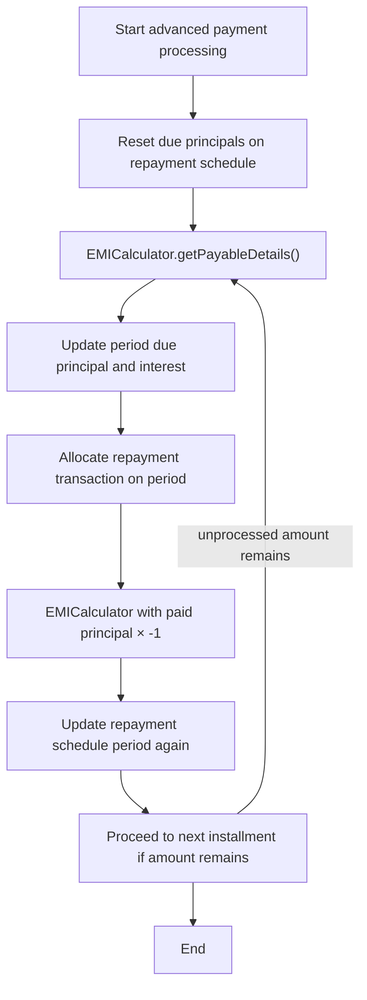
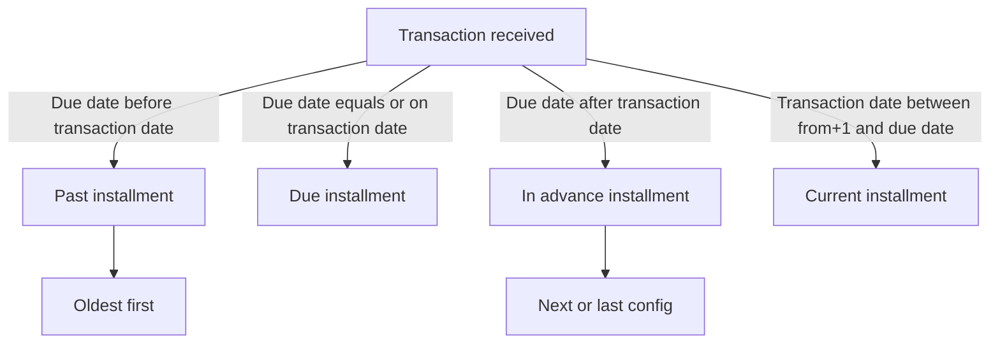
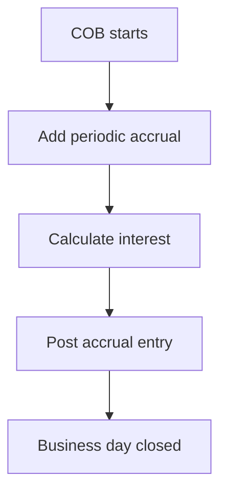
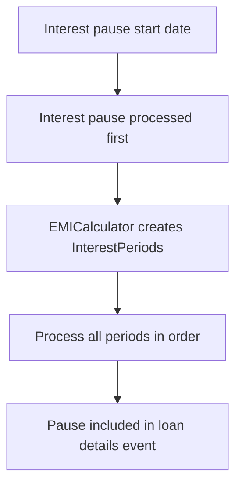
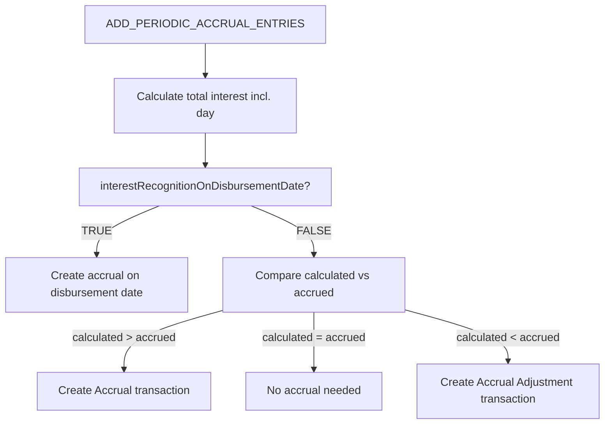

# Interest and Accruals

## Interest-Bearing Loan Products

Interest-bearing loan products support progressive configurations with product-specific validations. Allocation rules can be set or updated. PayPal offers two consumer-facing interest-bearing longer term installment lending products that are live in US and German markets.

Progressive loan disbursement and charge-off behaviour follows these rules:

- A multidisbursal progressive loan configured with one tranche allows creating two or more disbursements when 'Disallow Expected Disbursements' is disabled at loan level.
- Undo last disbursement returns a 403 error when the number of disbursements exceeds the number of tranches configured with disbursement details.
- Charge-off is prevented if there is any transaction after the charge-off date, but reversed transactions are excluded from this check.
- After a charge is waived and the waive loan charges transaction is undone, charge-off with an earlier date is allowed even though the charge still exists.
- The charge-off transaction should be reversed if the amount balance becomes zero after reprocessing.
- Interest pause should be forbidden for a progressive loan with interest recalculation enabled and interest rate zero.

Chargeback reversal (CBR) processing applies these rules:

- When a CBR is replayed and the overpayment amount is not lower than the CBR amount, reflect it as credit on the EmiModel and calculate interest based on the outstanding amount.
- CBR behaves like Chargeback, so the actual current installment EMI gets increased.
- When CBR is more than the overpayment amount, the loan schedule should be credited with the difference between CBR amount and overpayment amount, which in this situation is 100.

First installment interest recalculation and static limits behave as follows:

- Each day the 1st installment interest gets recalculated until the maturity date is reached.
- The effective rate limit is 0.09995.
- The loan start date is static at 1/1/23.
- The transaction range is static at 0.01 - 98.99.

A loan product validates the effective interest rate against a fixed ceiling of 0.09995. The loan start date is fixed at 1/1/23 and transaction amounts must fall within 0.01 to 98.99. When the converted effective rate exceeds the ceiling, the product configuration is rejected; otherwise it is accepted. The figures below are illustrative. Changing the term or nominal rate moves the effective rate across the boundary, flipping the result between SUCCESS and FAIL.

| Term (months) | Nominal rate | Effective rate | Limit | Result |
| --- | --- | --- | --- | --- |
| 3 | 0.10 | 0.1047 | 0.09995 | FAIL |
| 3 | 0.09 | 0.0938 | 0.09995 | SUCCESS |
| 6 | 0.09 | 0.0938 | 0.09995 | SUCCESS |

A disbursed loan of 1,000 can be overpaid by a repayment, creating a credit balance. A credit balance refund then pays out that excess and returns the outstanding balance to zero. If no credit exists, the refund cannot be created. Whether the repayment exceeds the balance determines whether a credit exists and thus whether a refund can be posted.

| Event | Amount | Balance |
| --- | --- | --- |
| Disbursement | 1,000.00 | 1,000.00 |
| Repayment | -1,100.00 | -100.00 |
| Credit Balance Refund | 100.00 | 0.00 |

When a repayment is reversed, interest accrual does not restart on the reversal date. It remains paused until the next scheduled installment date, at which point daily accrual resumes on the full outstanding balance. Moving the reversal date does not move the accrual restart date; only the next installment date matters.

| Date | Event | Balance | Interest accrued |
| --- | --- | --- | --- |
| Day 1 | Disburse 1,000 | 1,000.00 | 0.00 |
| Day 1 | Repay 400 | 600.00 | 0.00 |
| Day 5 | Reverse repayment | 1,000.00 | 0.00 |
| Day 15 | Next installment date | 1,000.00 | 10.00 |

A penalty charge added on the maturity date is accrued by COB at midnight, even if the loan principal was repaid earlier that day. The accrual is backdated to the penalty date and posted together with the next repayment that settles the charge. Adding the penalty before or after the principal repayment does not change the fact that COB accrues it at midnight on the maturity date.

| Date | Event | Principal | Penalty |
| --- | --- | --- | --- |
| Maturity | Repay 1,000 | 0.00 | 0.00 |
| Maturity | Add penalty 50 | 0.00 | 50.00 |
| Midnight COB | Post penalty accrual | 0.00 | 50.00 |

## EMI Calculation

### EMI adjustment and iteration

The system adjusts the EMI iteratively only once to avoid endless loops. If the new difference after reiteration is smaller than the original difference, the adjusted EMI is used; otherwise the reiteration is dropped and the original EMI is used.

The iterative EMI adjustment uses only these delta values:

- -0.01
- 0
- 0.01

For the community version, the EMI adjustment amount during iteration is `(Last installment EMI - calculated EMI) / number of remaining periods`.

The monthly payment is calculated for every payment except the last, which is just the rest of the balance.

The rate factor is adjusted just once per period to match the rounded interest amount for the period, and sub-interest periods work with that adjusted value.

When downpayment is enabled, the Principal component in the EMI calculation formula uses the Principal balance excluding the Downpayment amount, and this remains consistent even if the Downpayment installment is not paid.

For an interest bearing progressive loan with interest recalculation and down payment enabled, repayments on the down payment period do not call payInterest or payPrincipal methods on the EMICalculator because those payments are outside the ProgressiveLoanInterestScheduleModel calculation. The same rule applies to additional periods where the period due date is after the loan maturity date.

### Period options

Period options control how frequently repayments fall due. The default period options are daily, monthly, yearly and whole period, while weekly is an unusual period option.

### Rate factor formulas

The rate factor formula determines the rate factor used to calculate the monthly repayment amount. The formula varies by interest calculation type and by the configured interest rate frequency. A rate factor is calculated for each term of the loan. The monthly repayment amount uses the rate factors produced by these formulas.

| Interest calculation type | Rate factor formula |
| --- | --- |
| Monthly | 1+(rate of interest*(repaid every *days in month /days in year)*actual days in period/calculated days in period) |
| Weekly | 1+(rate of interest*(7*repaid every /days in year)*actual days in period/calculated days in period) |
| Daily | 1+(rate of interest*(repaid every /days in year)*actual days in period/calculated days in period) |

The interest rate frequency can change how the rate factor formula is applied:

- When the interest rate frequency is per month, the original per-year rate factor formula is multiplied by 12.
- When the interest rate frequency is per whole term, the rate factor is `1+(rate of interest*(actual number of days of loan (start date till actual maturity)/(calculated number of days of loan (start date till expected maturity)))`.

Rate factor = `1+(rate of interest *(days /year)`.

### Interest calculation types

Interest calculation type SAME AS REPAYMENT PERIOD applies interest based on the repayment period. Installment interest is principal balance * (1-ratefactor).

Other interest calculation types use these formulas:

- Daily interest equals yearly interest rate/365 * number of days in the installments.
- Monthly interest rate equals yearly interest rate/12 * number of months.
- Weekly interest rate equals yearly interest rate/52 * number of weeks in the installment.
- Declining balance interest equals principal balance * interest rate.
- Installment interest equals principal balance * interest rate/year * days gap.

### Day-count and year configurations

Day-count and year configurations control how Fineract measures periods and accrues interest for EMI calculations. You can combine different month and year settings, such as 360/30, 365/ACTUAL, and 366/ACTUAL.

The month type and year type each have fixed options:

- 30 DAYS assumes one month is 30 days long; ACTUAL uses the actual number of days in the month.
- The number of days in a year can be 360, 364, 365, or ACTUAL (365 or 366 in a leap year).
- Repayment every can be DAYS (such as 30 DAYS), WEEKS (such as 2 WEEKS), or MONTHS (such as 1 MONTHS), which determines the periods.

To generate the full amortization schedule, the system loops through each term, calculates the rate factor using days in the current month, calculates fi using the rate factor from the previous iteration, uses the product of all rate factors and fn to calculate the monthly payment, then iterates through each term again using the monthly payment to calculate principal and interest payments for each term. Interest for the term is `(rate factor - 1) * remaining balance`, and the principal payment is the monthly payment minus the interest payment for that term. On the last term, the monthly payment is the rest of the remaining balance and might not equal previous payments.

### Advanced payment processing

The advanced payment transaction processor resets the due principals on the repayment schedule before reprocessing transactions, including the disbursement transaction, and applies transactions and charges one by one.

The processor follows this sequence:

- It retrieves payable details using EMICalculator.getPayableDetails.
- It updates the repayment schedule period due principal and due interest.
- It allocates the repayment transaction on that period.
- It calls EMICalculator with paid principal times -1 as a balance correction.
- It updates the repayment schedule period again from the model.
- It proceeds to the next installment if unprocessed amount remains.

The transaction processor does not calculate the EMI itself; it calls EMICalculator and updates the repayment periods, principal due, interest due, and related fields based on the generated model.

### Payment allocation order

Payments allocate to installments in this order: past installments, due installments, in-advance installments, then the current installment. Past installments are processed oldest first, while in-advance installments are processed according to configuration.

### Partial and advance repayment handling

Partial and advance repayments change how interest and principal are applied to loan periods. When a repayment fully covers a period, the principal due is updated and the period closes. Interest is calculated only on payable outstanding accumulated interest up to the current date.

The following rules govern how repayments affect periods and interest:

- If the repayment amount fully pays the period, the principal due amount changes and the period closes.
- When a period closes due to full repayment, interest for the upcoming period is calculated from the current date plus one day, and that date belongs to the upcoming period.
- Remaining due interest is recalculated based on the new outstanding loan balance.
- If principal repayment is so large that remaining interest cannot be recognised on the current period, the interest moves to the next period.
- When interest moves to the next period, interest for the upcoming period is calculated from the current date plus one day, and that date belongs to the upcoming period.
- If an advance payment closes one or more periods without any payable interest, the same rules apply.
- If an advance installment is also the current installment, payable detail calculates how much interest to pay per transaction date.
- For a future installment whose from date is on or after the transaction date, payable interest is 0 and all payment can go to principal based on the EMI.
- If EMICalculator sees that balance correction exceeds EMI minus payable interest minus projected interest, projected interest cannot be recognised on this period and moves to the next one.
- When projected interest moves to the next period, principal due is the already recognised interest amount and the period remains outstanding with 1 cent of principal.
- The next period calculates interest based on the new outstanding loan balance from current date plus one day to the next due date.
- If excessive payment or pay-off happens multiple times, interest is pushed to the next installment and recalculated based on the newer outstanding loan balance until the last period.
- If all principal is fully paid, interest naturally becomes 0.

The system also handles these scenarios:

- A second disbursement arrives within the paid installment period.
- A second disbursement arrives on an early-paid loan where the last installment EMI would be reduced.
- An advance payment is adjusted to the last installment.
- A second disbursement occurs on the same date as an installment date.

> **Note:** EMI cannot be changed unless it is the last unpaid period and must be amended due to early repayments.

### EMI formula

The EMI equals (ratefactor^n * principal) / fn.

### Worked examples

A 1,000.00 principal loan at a 12% annual interest rate is repaid in 3 monthly installments using 30-day months and a 360-day year. The figures are illustrative. The monthly rate factor is 1 + (0.12 * 30 / 360) = 1.01. The EMI is (1.01^3 * 1,000.00) / (1 + 1.01 + 1.01^2) = 340.02. Interest each period is opening balance * (rate factor - 1). The final payment is the remaining balance plus its interest. The schedule shows a constant EMI for the first two periods and a final payment equal to the remaining balance plus interest, so the loan amortizes to zero.

| Due date | Opening balance | Interest | Payment | Principal paid | Closing balance |
| --- | --- | --- | --- | --- | --- |
| 2/1/24 | 1,000.00 | 10.00 | 340.02 | 330.02 | 669.98 |
| 3/1/24 | 669.98 | 6.70 | 340.02 | 333.32 | 336.66 |
| 4/1/24 | 336.66 | 3.37 | 340.03 | 336.66 | 0.00 |
| Total |  | 20.07 | 1,020.07 | 1,000.00 |  |

A 1,000.00 principal loan at a 12% annual interest rate receives a 250.00 downpayment on 1/1/24, reducing the balance to 750.00 before the first installment. The loan is repaid in 3 monthly installments using 30-day months and a 360-day year. The downpayment amount is excluded from the principal used in the EMI formula, so the EMI is calculated on 750.00. The monthly rate factor is 1.01 and the EMI is (1.01^3 * 750.00) / (1 + 1.01 + 1.01^2) = 255.02. The downpayment reduces the opening balance and the principal base for the EMI, while interest accrues only on the remaining balance after the downpayment.

| Due date | Opening balance | Interest | Payment | Principal paid | Closing balance |
| --- | --- | --- | --- | --- | --- |
| 2/1/24 | 750.00 | 7.50 | 255.02 | 247.52 | 502.48 |
| 3/1/24 | 502.48 | 5.02 | 255.02 | 250.00 | 252.48 |
| 4/1/24 | 252.48 | 2.52 | 255.00 | 252.48 | 0.00 |
| Total |  | 15.04 | 765.04 | 750.00 |  |

A loan disburses 1,000.00 on 1/1/24 and a second 500.00 on 2/1/24 after the first installment. The annual rate is 12%, months are 30 days, and the year is 360 days. The first installment is calculated on the initial 1,000.00 balance over the original term. When the second disbursement arrives, the outstanding balance rises and the EMI is recalculated for the remaining two installments using the same rate factor of 1.01. A mid-schedule disbursement increases the outstanding balance, and the EMI is recalculated for the remaining periods on the new balance.

| Event | Opening balance | Interest | Payment | Principal paid | Disbursement | Closing balance |
| --- | --- | --- | --- | --- | --- | --- |
| 2/1/24 installment | 1,000.00 | 10.00 | 340.02 | 330.02 |  | 669.98 |
| 2/1/24 disbursement | 669.98 |  |  |  | 500.00 | 1,169.98 |
| 3/1/24 installment | 1,169.98 | 11.70 | 593.78 | 582.08 |  | 587.90 |
| 4/1/24 final | 587.90 | 5.88 | 593.78 | 587.90 |  | 0.00 |
| Total |  | 27.58 | 1,527.58 | 1,500.00 | 500.00 |  |

A 1,000.00 principal loan at a 12% annual interest rate is repaid every 15 days over 3 installments using a 360-day year. This is an unusual period option, so the rate factor uses the actual days in the period: 1 + (0.12 * 15 / 360) = 1.005. The EMI is (1.005^3 * 1,000.00) / (1 + 1.005 + 1.005^2) = 336.67. With a daily or weekly calculation type the only change is the rate factor formula; the amortization steps are identical. Non-monthly frequencies use a rate factor based on actual days in the period divided by days in the year, while the balance, interest, and principal steps follow the same declining-balance pattern.

| Due date | Opening balance | Interest | Payment | Principal paid | Closing balance |
| --- | --- | --- | --- | --- | --- |
| 1/16/24 | 1,000.00 | 5.00 | 336.67 | 331.67 | 668.33 |
| 1/31/24 | 668.33 | 3.34 | 336.67 | 333.33 | 335.00 |
| 2/15/24 | 335.00 | 1.68 | 336.68 | 335.00 | 0.00 |
| Total |  | 10.02 | 1,010.02 | 1,000.00 |  |

## Interest Rates by Balance Status

Interest rate configuration by balance status lets you set rates for Past due, Current, and Future balances across Fees, Penalties, Interest, and Principal balance types at the loan product level. This configuration is limited to the Advance repayment strategy type. Interest is calculated only on Current Principal Balance, which is total principal balance minus past due principal balance, and never on past due principal amount.

When the loan setting to not calculate interest on past due principal balances is active and the first instalment is not paid on time:

- Interest is not calculated on past due principal balances.
- The interest balance of the second instalment does not change.

## 366-Day Year Interest

For a multi-year loan, daily interest uses 365 days in non-leap years and 366 days in leap years. Users can configure the yearly interest calculation to consider leap years.

Two configuration options control when a 366-day year applies:

- One option uses 366 days when the loan has a leap year and 365 days for non-leap years.
- A second option considers 366 days only if the installment falls in February, otherwise 365 days.

If rescheduling moves an interest period to include 29 February, interest is recalculated from 1 January to the current date because it is now a 366-day year.

## Leap Year Interest Calculation

Leap year interest calculation applies to progressive loans when days in year is configured to Actual. You choose how the system treats a leap year using a dropdown on the loan product that is inherited at loan level. The dropdown defaults to FULL_LEAP_YEAR and is only available when Actual is set for days in year.

The dropdown offers two options:

- FULL_LEAP_YEAR uses 366 days in year for a leap year and 365 days otherwise.
- FEB_29_PERIOD_ONLY uses 366 days in year only for the period that contains 29 February and 365 days otherwise.

When days in year is configured to Actual, 366 days is considered only for the period that contains 29 February; otherwise 365 days is considered, even if the year is a leap year.

The rate factor formula is `Interest rate * DAYS IN MONTH / DAYS IN YEAR`.

Overdue loans and additional installments do not affect leap year handling:

- Overdue loans do not change anything and interest is not recalculated after the maturity date.
- Additional installments do not change the maturity date and do not trigger interest recalculation.

After reschedule, if the maturity date is now on or after 29 February and FEB_29_PERIOD_ONLY is selected, the interest of the period which now contains 29 February is recalculated.

A progressive loan uses ACTUAL days in year and ACTUAL days in month, and the loan product leap-year option is set to FEB_29_PERIOD_ONLY. The figures are illustrative: principal 1,000.00, annual interest rate 12.00%, three monthly installments, disbursed on 1 December 2023 with payments on 1 January 2024, 1 February 2024 and 1 March 2024. Interest for a period equals opening balance multiplied by the annual rate, multiplied by days in the period, divided by days in the year for that period. The period from 1 February to 1 March contains 29 February 2024, so it uses 366 days in the year; the other periods use 365 days. If FULL_LEAP_YEAR were selected instead, every period in this leap year would use 366 days and total interest would be 20.17 rather than 20.22.

| Period | From | To | Days | Days/yr | Open bal. | Interest | Installment | Principal | Close bal. |
| --- | --- | --- | --- | --- | --- | --- | --- | --- | --- |
| 1 | 1 Dec 2023 | 1 Jan 2024 | 31 | 365 | 1000.00 | 10.19 | 340.00 | 329.81 | 670.19 |
| 2 | 1 Jan 2024 | 1 Feb 2024 | 31 | 365 | 670.19 | 6.83 | 340.00 | 333.17 | 337.02 |
| 3 | 1 Feb 2024 | 1 Mar 2024 | 29 | 366 | 337.02 | 3.20 | 340.22 | 337.02 | 0.00 |
| Total |  |  |  |  |  | 20.22 | 1020.22 | 1000.00 |  |

A progressive loan uses ACTUAL days in year and ACTUAL days in month with the default leap-year option FULL_LEAP_YEAR. The figures are illustrative: principal 1,000.00, annual interest rate 12.00%, three monthly installments, disbursed on 1 December 2022 with payments on 1 January 2023, 1 February 2023 and 1 March 2023. Because 2023 is not a leap year, FULL_LEAP_YEAR applies 365 days in the year to every period; 366 days would be used only in a leap year. This shows that FULL_LEAP_YEAR uses 366 days only when the calendar year is a leap year; otherwise all periods use 365 days.

| Period | From | To | Days | Days/yr | Open bal. | Interest | Installment | Principal | Close bal. |
| --- | --- | --- | --- | --- | --- | --- | --- | --- | --- |
| 1 | 1 Dec 2022 | 1 Jan 2023 | 31 | 365 | 1000.00 | 10.19 | 340.00 | 329.81 | 670.19 |
| 2 | 1 Jan 2023 | 1 Feb 2023 | 31 | 365 | 670.19 | 6.83 | 340.00 | 333.17 | 337.02 |
| 3 | 1 Feb 2023 | 1 Mar 2023 | 28 | 365 | 337.02 | 3.10 | 340.12 | 337.02 | 0.00 |
| Total |  |  |  |  |  | 20.12 | 1020.12 | 1000.00 |  |

A progressive loan uses ACTUAL days in year and ACTUAL days in month with FEB_29_PERIOD_ONLY. The figures are illustrative: principal 1,000.00, annual interest rate 12.00%, monthly installments, disbursed on 1 January 2024. After a reschedule, the maturity date is on or after 29 February 2024, so the period that now contains 29 February is recalculated using 366 days in the year; periods before and after it keep 365 days. This shows that after reschedule the recalculated February period uses 366 days while adjacent periods remain on 365 days under FEB_29_PERIOD_ONLY.

| Period | From | To | Days | Days/yr | Open bal. | Interest | Installment | Principal | Close bal. |
| --- | --- | --- | --- | --- | --- | --- | --- | --- | --- |
| 1 | 1 Jan 2024 | 1 Feb 2024 | 31 | 365 | 1000.00 | 10.19 | 340.00 | 329.81 | 670.19 |
| 2 | 1 Feb 2024 | 1 Mar 2024 | 29 | 366 | 670.19 | 6.37 | 340.00 | 333.63 | 336.56 |
| 3 | 1 Mar 2024 | 1 Apr 2024 | 31 | 365 | 336.56 | 3.43 | 339.99 | 336.56 | 0.00 |
| Total |  |  |  |  |  | 19.99 | 1019.99 | 1000.00 |  |

## Interest Waivers

Interest waivers apply to interest balances first. You can configure the Payment Waiver transaction in the Advance Payment Strategy at loan product level, both at product creation and when modifying the product. Payment allocations for the Payment Waiver transaction type can also be configured at loan product level at creation and modification. When Advanced payment allocation is set, allocation rules can be configured for the Interest Payment Waiver transaction.

The Interest Payment Waiver transaction follows these rules:

- The Interest Payment Waiver transaction amount must obey the payment allocation order set at the advance allocation strategy.
- Reverse replay works the same for the Interest Payment Waiver transaction type as for any other transaction type.
- Charge-back can be done on the Interest Payment Waiver transaction type.
- The Interest Payment Waiver transaction type works the same as the goodwill credit transaction and refund transaction.
- Repayment schedule allocation for Payment Waiver happens as per the advance repayment strategy set, same as goodwill credit and refund transaction allocations.
- Reverse replay allocation for Payment Waiver works the same as for goodwill credit and refund transactions.

Accounting entries for the Payment Waiver transaction depend on whether the loan account is charge-off.

| Account status | Debit | Credit |
| --- | --- | --- |
| Non charge-off | Income from Interest (GL 404000) for the total amount entered | Loan portfolio (GL 112601), Interest Receivable (GL 112603), Fees Receivable (GL 112603), Penalties Receivable (GL 112603), and Overpayment (GL 245000) for their respective allocated portions |
| Charge-off | Income from Interest (GL 404000) for the total amount entered | Income from charge-off Interest (GL 404001) for principal, interest, fees, and penalties portions, and Overpayment (GL 245000) for the overpayment portion |

Reversing a Payment Waiver transaction swaps the debit and credit sides.

| Account status | Debit | Credit |
| --- | --- | --- |
| Non charge-off | Loan portfolio (GL 112601), Interest Receivable (GL 112603), Fees Receivable (GL 112603), Penalties Receivable (GL 112603), and Overpayment (GL 245000) for their respective allocated portions | Income from Interest (GL 404000) for the total amount |
| Charge-off | Income from charge-off Interest (GL 404001) for principal, interest, fees, and penalties portions, and Overpayment (GL 245000) for the overpayment portion | Income from Interest (GL 404000) for the total amount |

You can manage Interest Payment Waiver transactions through the API as follows:

- A user can pass a new Interest Payment Waiver transaction on an Active or Closed loan account through the API.
- A user can undo or modify a posted Interest Payment Waiver transaction.
- The new Interest Payment Waiver transaction type is sent back in the loan product template call.
- The Interest Payment Waiver transaction is posted via the Loans transaction API endpoint /loans/<loan_id>/transactions?command=interestPaymentWaiver.
- The loan transaction template for Interest Payment Waiver includes transaction date, transaction amount, payment type, external id, and note.

The Interest Payment Waiver transaction can be reverted and can be replayed in case of changing allocation.

Illustrative figures only. A loan is disbursed and a Payment Waiver is posted before the first installment is due. Interest waivers apply to interest balances first, and the remainder reduces principal under the advance allocation strategy. The setup uses a principal of 1,000, an annual interest rate of 12%, 30-day months, and three monthly installments. A Payment Waiver of 250 is posted after one month of interest has accrued. Changing the advance allocation strategy from adjusting the next installment to adjusting the last installment does not change the waiver split, but it changes the due amount shown on future installments.

| Event | Amount | Interest | Principal | Balance |
| --- | --- | --- | --- | --- |
| Disbursement | 1,000.00 | — | 1,000.00 | 1,000.00 |
| Interest accrued | 10.00 | 10.00 | — | 1,000.00 |
| Payment Waiver | 250.00 | 10.00 | 240.00 | 760.00 |
| Balance after waiver | — | — | — | 760.00 |

A fee is charged on the loan, and a Payment Waiver is then allocated across interest, principal, and the fee. Payment allocation rules allow a unique allocation order for the interest waiver transaction type. The setup uses a principal of 1,000, one month of interest at 12% per year, and a fee of 10.00. A Payment Waiver of 40.00 is posted.

| Event | Amount | Interest | Principal | Fee | Balance |
| --- | --- | --- | --- | --- | --- |
| Disbursement | 1,000.00 | — | 1,000.00 | — | 1,000.00 |
| Interest accrued | 10.00 | 10.00 | — | — | 1,000.00 |
| Fee added | 10.00 | — | — | 10.00 | 1,010.00 |
| Payment Waiver | 40.00 | 10.00 | 20.00 | 10.00 | 980.00 |
| Balance after waiver | — | — | — | — | 980.00 |

A Payment Waiver is reversed, and a repayment is replayed under the same advance repayment strategy. Reverse replay works the same for the Interest Payment Waiver transaction type as for any other transaction type, and charge-back is supported on this transaction type. The setup uses a principal of 1,000. A waiver of 10 is allocated to interest, then reversed, and a repayment of 240 is replayed allocating 220 to principal and 20 to interest.

| Event | Amount | Interest | Principal | Balance |
| --- | --- | --- | --- | --- |
| Disbursement | 1,000.00 | — | 1,000.00 | 1,000.00 |
| Payment Waiver | 10.00 | 10.00 | — | 1,000.00 |
| Waiver Reversal | -10.00 | -10.00 | — | 1,000.00 |
| Repayment Replayed | 240.00 | 20.00 | 220.00 | 780.00 |
| Balance after replay | — | — | — | 780.00 |

After a loan is fully repaid, a Payment Waiver can still be posted. The amount allocates to any outstanding interest and the remainder to overpayment. The setup uses a principal of 1,000 that has been repaid to zero, with 10.00 of interest still due. A Payment Waiver of 20.00 is posted.

| Event | Amount | Interest | Principal | Overpayment | Balance |
| --- | --- | --- | --- | --- | --- |
| Disbursement | 1,000.00 | — | 1,000.00 | — | 1,000.00 |
| Repayments to date | -1,000.00 | — | -1,000.00 | — | 0.00 |
| Interest due | 10.00 | 10.00 | — | — | 0.00 |
| Payment Waiver | 20.00 | 10.00 | — | 10.00 | 0.00 |
| Balance after waiver | — | — | — | — | 0.00 |

## Interest Refunds

### Interest Refund overview

Fineract calculates and posts an interest refund when a merchant refund posts, so customers are charged interest only on the net purchase amount. The system creates an Interest Refund transaction whenever a configured refund type transaction is triggered on a progressive, interest-bearing loan. Interest Refund configuration is optional for a progressive, interest-bearing loan product.

The following configuration and behaviour apply to Interest Refunds:

- Available refund transactions are Payout refund and Merchant issued refund.
- Multiple transaction types can be selected for Interest Refund configuration.
- Backend configuration maps which transactions trigger Interest Refund transaction creation when a loan product is created or modified.
- A submitted loan inherits the Interest Refund configuration from its loan product.
- Interest Refund transaction triggering configuration can be stored on a loan product.
- Allocation rules can be defined for an Interest Refund transaction.
- The Progressive loan product Interest Refund tab selects one of both refund transaction types to control when an Interest Refund transaction is created with the right balance.

The API exposes Interest Refund support as follows:

- A new transaction type for Loan is introduced: Interest Refund.
- When a new loan product is created, template options for Interest Refund list the supported refund transactions.
- Loan product template retrieval returns the supported options for configuring when an Interest Refund transaction is created.

Journal entries are passed for an Interest Refund transaction for a loan account, and the Interest Refund transaction is posted as a credit adjustment type Interest Refund.

### Transaction creation and business events

The system creates an Interest Refund transaction when the configured refund transaction occurs, and raises a business event when that transaction is created. Payment allocation rules support unique allocation for this transaction type, and the advanced payment allocation processor handles it.

### Payment allocation

An interest refund is applied to interest accrual first, and any overpayment is treated as a refund to principal controlled by payment allocation rules. The Advanced payment allocation processor (AdvancedPaymentScheduleTransactionProcessor) handles the transaction allocations, and the interest refund transaction type is considered for payment allocation when it is created.

When the refund exceeds a disbursement record, allocation proceeds as follows:

- Apply the refund to the oldest disbursement.
- Work forward in time through subsequent disbursement records.

### Interest refund calculation

The system recalculates total interest to date for the loan by processing each day and applying the interest refund to interest accrual first, with any overpayment treated as a refund to principal. The adjusted principal balance cannot be less than 0.00.

The daily recalculation follows these rules:

- For each day, new outstanding loan balance (principal) equals disbursements minus applicable refund.
- New principal multiplied by the daily periodic interest rate equals new interest accrual for that date.
- Interest refund equals original interest accrual minus new interest accrual.

When processing disbursements and refunds:

- The system applies the refund to the oldest disbursement and works forward in time when the refund is greater than the disbursement record.
- For each day, disbursements minus applicable refund equals new principal.

The balance of the interest refund is calculated properly.

### Transaction reversal and reprocessing

When a Merchant Issued Refund or Payout Refund transaction is reverted, the related Interest Refund transaction is reverted as well. A RELATED relationship links the two transactions so the Interest Refund transaction can be reversed automatically when its related Refund transaction is reversed.

Transaction relations and replay behaviour work as follows:

- Merchant Issued Refund points to the Interest Refund transaction if that Interest Refund transaction was created first.
- When a Merchant Issued Refund transaction is reverse-replayed, the related Interest Refund transaction is marked as reverse-replayed automatically to keep the original transaction order.
- The RELATED relationship between Merchant Issued Refund or Payout Refund and the related Interest Refund transaction is reestablished after reverse-replay.
- A REPLAYED relationship happens automatically.
- When both the Merchant Issued Refund transaction and the related Interest Refund transaction are reverted, LoanAdjustTransactionBusinessEvent is triggered for both.

During loan transaction reprocessing, interest amounts may change as follows:

- The originally calculated Interest Refund transaction amount might need to be recalculated, and if the new amount differs from the previous one, it needs to be reverse-replayed.
- If a previous repayment got reversed, the interest due amounts might change, and the calculated interest due and interest refund amount might need to be changed.

> **Note:** LoanAdjustTransactionBusinessEvent is triggered for a reverted Interest Refund transaction.

### Use cases UC1-UC9

Interest refund use cases cover full refunds for UC1 through UC5 and partial refunds for UC6 through UC9.

| Use case | Disbursements | Refund type | Timing | Reference |
| --- | --- | --- | --- | --- |
| UC1 | Single | Full | Within first installment period | R16 |
| UC2 | Single | Full | After first installment period | R17 |
| UC3 | Single | Full | After all installments are paid | R18 |
| UC4 | Multiple, same day | Full | Within first installment period | R19 |
| UC5 | Multiple, different days | Full | Within first installment period | R20 |
| UC6 | Multiple, different days | Full | After first installment period | R21 |
| UC7 | Multiple, different days | Full | After all installments are paid | R22 |
| UC8 | Single | Partial | Within first installment period | R23 |
| UC9 | Single | Partial | After first installment period | R24 |

### Use cases UC10-UC16

| Use case | Disbursements | Refund timing |
| --- | --- | --- |
| UC10 | Single disbursement | Partial refund after all installments are paid |
| UC11 | Multiple disbursements on the same day | Partial refund within the first installment period |
| UC12 | Multiple disbursements on different days | Partial refund within the first installment period |
| UC13 | Multiple disbursements on different days | Partial refund after the first installment period |
| UC14 | Multiple disbursements on different days | Partial refund after all installments are paid |
| UC15 | Single disbursement | Multiple partial refunds within the first installment period |
| UC16 | Single disbursement | Multiple partial refunds after the first installment period |
| UC17 | Single disbursement | Multiple partial refunds after all installments are paid |

### Use cases UC17-UC23

Use cases UC17 through UC23 cover interest refund scenarios for single and multi disbursement loans with multiple partial refunds across different timing windows.

The use cases are:

- UC17 is a single disbursement scenario with multiple partial refunds after all installments are paid.
- UC18 is a multi disbursement scenario with same days and multiple partial refunds within the first installment period.
- UC19 is multi disbursements on different days with multiple partial refunds within the first installment period.
- UC20 is multi disbursements on different days with multiple partial refunds after the first installment period.
- UC21 is multi disbursements on different days with multiple partial refunds after all installments are paid.
- UC22 is multi disbursements on different days with multiple partial refunds crossing multiple installment periods.
- UC23 is a single disbursement scenario with multiple partial refunds within the first installment period and a one time payment prior to refund.
- UC1 is a single disbursement, full refund within the first installment period.

Loan parameters for UC17 and UC18 are:

- UC17 is a 6 month installment loan with monthly payments of 171.67.
- UC18 is a 6 month installment loan with monthly payments of 171.56.

Reference codes for UC18 through UC23 are:

- UC18 uses R33.
- UC19 uses R34.
- UC20 uses R35.
- UC21 uses R36.
- UC22 uses R37.
- UC23 uses R38.

### Use case details UC08-UC14

Use cases UC02 through UC14 cover interest refunds across single and multi-disbursement loans, timed within the first installment period, after the first installment period, or after all installments are paid. Use cases UC08 through UC14 cover partial refunds; each applies a fixed daily periodic rate. UC10 is a 12 month installment loan with monthly payments of 87.90.

| Use case | Disbursement pattern | Refund timing | Daily periodic rate |
| --- | --- | --- | --- |
| UC02 | Single disbursement | After first installment period |  |
| UC03 | Single disbursement | After all installments are paid |  |
| UC04 | Multi disbursements, same day | Within first installment period |  |
| UC05 | Multi disbursements, different days | Within first installment period |  |
| UC06 | Multi disbursements, different days | After first installment period |  |
| UC07 | Multi disbursements, different days | After all installments are paid |  |
| UC08 | Single disbursement | Within the first installment period | 0.0002736986 |
| UC09 | Single disbursement | After the first installment period | 0.0002736986 |
| UC10 | Single disbursement | After all installments are paid | 0.0002736986 |
| UC11 | Multi disbursements on the same day | Within the first installment period | 0.02736986% |
| UC12 | Multi disbursements on different days | Within the first installment period | 0.02736986% |
| UC13 | Multi disbursements on different days | After the first installment period | 0.02736986% |
| UC14 | Multi disbursements on different days | After all installments are paid | 0.02736986% |

### Use case details UC15-UC23

Use cases UC15 through UC23 describe interest refund scenarios for single and multiple disbursements across different repayment periods. Interest refund is applied to interest accrued. The table includes columns for First Refund and Second Refund adjusted principal balance, adjusted interest accrued, and difference.

The use cases cover the following scenarios:

- UC15 is a single disbursement with multiple partial refunds within the first installment period, with a daily periodic rate of 0.0002736986 and monthly payments of 91.67 over six months.
- UC16 is a single disbursement with multiple partial refunds after the first installment period.
- UC17 is a single disbursement with multiple partial refunds after all installments are paid.
- UC18 is multiple disbursements on the same days with multiple partial refunds within the first installment period.
- UC20 is multiple disbursements on different days with multiple partial refunds after the first installment period.
- UC21 is multiple disbursements on different days with multiple partial refunds after all installments are paid.
- UC22 is multiple disbursements on different days with multiple partial refunds crossing multiple installment periods.
- UC23 is a single disbursement with multiple partial refunds within the first installment period and a one-time payment prior to refund.

### Use case loan parameters

Refund use cases UC1 through UC23 cover single and multi disbursements, full and partial refunds, single and multiple refunds, timing within the first installment period, after the first installment period, after all installments are paid, crossing multiple installment periods, and one time payment prior to refund.

Merchant issued refund and payout refund handling is extracted out into its own handling separate from Repayment handling.

Example loan configurations include:

- UC20 is a 6 month installment loan with monthly payments of 171.56 and a daily periodic rate of 0.02736986%.
- UC21 is a 6 month installment loan with monthly payments of 171.56 and a daily periodic rate of 0.02736986%.
- UC22 is a 6 month installment loan with monthly payments of 171.56 and a daily periodic rate of 0.02736986%.
- UC23 is a 6 month installment loan with monthly payments of 171.59.

### Journal entries for non charge-off accounts

For non charge-off loan accounts, the system posts journal entries for each allocated portion of an interest refund.

| Entry | GL account | Amount |
| --- | --- | --- |
| Debit Income from Interest | 404000 Interest Income | Total amount calculated to be refunded |
| Credit Loan portfolio | 112601 Loans Receivable | Total principal portion allocated |
| Credit Interest Receivable | 112603 Fees/Interest Receivable | Total interest portion allocated |
| Credit Fees Receivable | 112603 Fees/Interest Receivable | Total fees portion allocated |
| Credit Penalties Receivable | 112603 Fees/Interest Receivable | Total penalties portion allocated |
| Credit Overpayment | 245000 Overpayment account | Total overpayment portion allocated |

### Reversal entries for non charge-off accounts

A reversal entry for a non charge-off loan account credits Income from Interest GL 404000 Interest Income for the total amount calculated to be refunded.

| Debit GL | Amount |
| --- | --- |
| Loan portfolio GL 112601 Loans Receivable | Total principal portion which got allocated |
| Interest Receivable GL 112603 fees/Interest Receivable | Total interest portion which got allocated |
| Fees Receivable GL 112603 fees/Interest Receivable | Total fees portion which got allocated |
| Penalties Receivable GL 112603 fees/Interest Receivable | Total penalties portion which got allocated |
| Overpayment GL 245000 Overpayment account | Total overpayment portion which got allocated |

### Journal entries for charge-off accounts

| Account | Amount | Entry |
| --- | --- | --- |
| Income from Interest GL 404000 Interest Income | Total amount entered for Payment Waiver transaction | Debit |
| Income from charge-off Interest GL 404001 Interest income charge off | Total principal portion allocated | Credit |
| Income from charge-off Interest GL 404001 Interest income charge off | Total interest portion allocated | Credit |
| Income from charge-off Interest GL 404001 Interest income charge off | Total fees portion allocated | Credit |
| Income from charge-off Interest GL 404001 Interest income charge off | Total penalties portion allocated | Credit |
| Overpayment GL 245000 Overpayment account | Total overpayment portion allocated | Credit |

### Reversal entries for charge-off accounts

| GL account | Entry | Amount |
| --- | --- | --- |
| 404000 Interest Income | Credit | Total amount entered for Payment Waiver transaction |
| 404001 Interest income charge off | Debit | Total principal portion which got allocated |
| 404001 Interest income charge off | Debit | Total interest portion which got allocated |
| 404001 Interest income charge off | Debit | Total fees portion which got allocated |
| 404001 Interest income charge off | Debit | Total penalties portion which got allocated |
| 245000 Overpayment account | Debit | Total overpayment portion which got allocated |

### Worked examples

When a Merchant Issued Refund posts on a progressive, interest-bearing loan, the system creates an Interest Refund transaction as a credit adjustment. A customer receives a single disbursement of 1,000.00 on 1 January. The loan uses a 10% annual interest rate, a daily periodic rate of 0.000274, and 30-day months. A Merchant Issued Refund of 500.00 posts on 1 January, so interest is charged only on the remaining 500.00. The figures are illustrative.

This merges a refund within the first installment period with one after the first period; the only change is that a later refund applies to a lower principal balance after repayments, so the interest base and refund amount are smaller.

| Date | Principal balance | Daily interest | Interest accrued PTD | Adjusted principal | Adjusted interest PTD | Interest refund PTD |
| --- | --- | --- | --- | --- | --- | --- |
| 1-Jan | 1,000.00 | 0.27 | 0.27 | 500.00 | 0.14 | 0.13 |
| 2-Jan | 1,000.00 | 0.27 | 0.54 | 500.00 | 0.28 | 0.26 |
| 10-Jan | 1,000.00 | 0.27 | 2.70 | 500.00 | 1.40 | 1.30 |
| Total |  |  | 2.70 |  | 1.40 | 1.30 |

The Interest Refund transaction is applied to the oldest disbursement first, working forward in time when the refund exceeds a disbursement record. A loan has two disbursements on different days: 500.00 on 1 January and 500.00 on 7 January, bringing the principal to 1,000.00. The daily periodic rate is 0.000274. A Merchant Issued Refund of 250.00 posts on 10 January, after the first installment period, and reduces the oldest disbursement to 250.00.

This merges refunds within and after the first installment period across multiple disbursements; the refund is always applied to the oldest disbursement first, working forward, so the timing of disbursements determines which portion is reduced.

| Date | Principal balance | Daily interest | Refund applied | Adjusted principal | Adjusted daily interest | Interest refund PTD |
| --- | --- | --- | --- | --- | --- | --- |
| 1-Jan | 500.00 | 0.14 | – | – | – | – |
| 7-Jan | 1,000.00 | 0.27 | – | – | – | – |
| 10-Jan | 1,000.00 | 0.27 | 250.00 | 750.00 | 0.21 | 0.06 |
| 20-Jan | 1,000.00 | 0.27 | – | 750.00 | 0.21 | 0.66 |

Each Interest Refund transaction reduces the adjusted principal, which cannot fall below 0.00, and any overpayment is treated as a refund to principal under the payment allocation rules. A single disbursement of 1,000.00 posts on 1 January with a daily periodic rate of 0.000274. A first Merchant Issued Refund of 500.00 posts on 1 January, and a second Merchant Issued Refund of 250.00 posts on 10 January.

This merges single, multiple, and post-installment refunds; each additional refund further reduces the adjusted principal, which never drops below 0.00.

| Date | Principal balance | Daily interest | Adjusted principal | Adjusted daily interest | Daily interest refund | Interest refund PTD |
| --- | --- | --- | --- | --- | --- | --- |
| 1-Jan | 1,000.00 | 0.27 | 500.00 | 0.14 | 0.13 | 0.13 |
| 5-Jan | 1,000.00 | 0.27 | 500.00 | 0.14 | 0.13 | 0.65 |
| 10-Jan | 1,000.00 | 0.27 | 250.00 | 0.07 | 0.20 | 0.85 |
| 15-Jan | 1,000.00 | 0.27 | 250.00 | 0.07 | 0.20 | 1.85 |

When the configured refund transaction occurs, an Interest Refund transaction is created and a LoanAdjustTransactionBusinessEvent is raised. A single disbursement of 1,000.00 posts on 1 January with a daily periodic rate of 0.000274. A Merchant Issued Refund of the full 1,000.00 posts on 5 January, within the first installment period, so the adjusted principal falls to 0.00 and the accrued interest is credited in full.

This merges a full refund within the first period with one after all installments; when the principal is fully refunded, adjusted principal and interest fall to zero and the full accrued interest is credited.

| Date | Principal balance | Daily interest | Interest accrued PTD | Applicable refund | Adjusted principal | Interest refund PTD |
| --- | --- | --- | --- | --- | --- | --- |
| 1-Jan | 1,000.00 | 0.27 | 0.27 | – | – | – |
| 2-Jan | 1,000.00 | 0.27 | 0.54 | – | – | – |
| 5-Jan | 1,000.00 | 0.27 | 1.35 | 1,000.00 | 0.00 | 1.35 |
| Total |  |  | 1.35 | 1,000.00 | 0.00 | 1.35 |

## Enhanced Accrual Handling

When an interest recalculation situation emerges, the system calculates an ADJUSTMENT transaction to avoid too many reverse-replaying efforts.

## Accrual Rework

### Accrual job and posting schedule

The interest accrual job creates accrued interest daily but does not make it due and payable until the next billing cycle due date. Interest calculation runs daily by default.

Accrual posting follows these rules:

- The accrual job allows certain loan statuses and balances to be excluded based on defined setups.
- The accrual job calculates interest based on balances and rates established during loan creation.
- Daily interest accrues and is held in a bucket until the next billing cycle, when it becomes due and part of the total balance due on the loan.
- Accruals calculate interest from the last accrued date or disbursement date until the current accrual date.
- Accruals are posted on loan accounts through the periodic accrual posting job as per the set period.
- If the accrual posting period is monthly, the accrual entry posts every month; if daily, it posts every day.
- The accrual entry posts interest, fees, and penalties calculated for that posting period.

The Add Periodic Accrual Transactions job runs during end-of-day processing:

- With the COB job, the “Add periodic accrual” business step executes as part of closing the actual business day.
- The Add Periodic Accrual Transactions job and business step calculate and create accrual and accrual adjustment transactions during COB.
- The accrual entry posts along the repayment that closes the loan account if any amount was not accrued from the last accrued date.
- The “Accrual - Adjustment” transaction type can be created by the “Add periodic accruals” business step when extra income was recognized and needs explicit correction of the total amount.

### Accrual processing components

Accrual creation and recalculation run through a common component that handles all accrual actions and calculations, rather than living in the Loan entity or separate services. LoanAccrualsProcessingServiceImpl performs accrual calculations, while AddPeriodicAccrualEntriesBusinessStep applies the periodic accrual business step. These components manage accrual processing for interest-bearing loan products. The service and business step together drive accrual entry creation and recalculation across the loan lifecycle.

### Accrual entry creation and persistence

Accrual entries and related inserts such as "paid by" must be created through JPA rather than native queries so that the managed Loan entity stays consistent with the L2 cache. JPA handles accrual entry creation without explicitly flushing or refreshing entities to fetch database changes. The system provides a unique posted interest transaction type so interest transactions impacting the loan balance are recorded and returned as part of monetary activity.

Accrual entry creation may occur through native query in the following implementations:

- LoanAccrualWritePlatformServiceImpl method addAccrualAccounting
- loanWritePlatformServiceGPARepositoryImpl method disbirseLoan

Native query creation of accrual entries has these effects:

- The managed Loan entity in the L2 cache is left unaware and requires a refresh before it can be used.
- Entity manager changes must be flushed before executing native queries so reads see uncommitted data.

Accrual adjustment transaction is a new transaction type.

### Accrual adjustments

Backdated repayments, reversals of backdated repayments, backdated disbursements, and reversed previous repayments trigger recalculation of the accrual amount, and recognized income may change as a result. The system adjusts differences to the latest accrual transaction only and does not reverse-replay accruals.

The Add periodic accruals job creates an Accrual or Accrual - adjustment transaction for every business day so that no gaps occur.

- When the adjustment accrual amount is higher than the already posted amount, the job creates an Accrual transaction for the current date with the higher amount.
- When the adjustment accrual amount is lower than the already posted amount but not lower than the latest accrual amount, the job creates an Accrual transaction for the current date with the lower amount.
- When the adjustment accrual amount is lower than both the already posted amount and the latest accrual amount, the negative difference is posted as an Accrual - adjustment transaction.
- An Accrual - adjustment transaction decreases the accrued portions on the repayment schedule and can deduct the accrual amount effectively.

Accrual adjustment logic compares total accrued amounts against calculated accrued amounts up to the current date and does not base calculation on the period due date. Daily accrual calculation does not use doubles.

### Backdated activity and recalculation

Backdated monetary activity triggers recalculation of accruals without reversing and replaying them as a side effect of any action. The system checks the interest_recalculated_on field to decide whether to use the history entry or the actual one when interest recalculation happened on the current date.

The following rules govern backdated activity and recalculation:

- Backdated repayment requires no manual action; the Add periodic accruals business step calculates the proper accrual transaction.
- Backdated monetary activity is handled and recalculated properly for transitions between Closed obligations met and Overpaid in both directions.
- The relationship between LoanTransaction and LoanRepaymentScheduleInstallment may be updated to point to the right installment, and new relations may be created when backdated transactions, charges, or reversals cause an accrual transaction amount to partially belong to multiple installments.
- Missing LoanTransaction-to-installment relationships do not cause issues if accrual amounts are calculated dynamically and applied to installments dynamically.

### Charge-off loans

The system generates interest accruals as usual for loan accounts marked as charge-off, and accounting legs remain the same for those accounts.

> **Note:** The system avoids any reverse-replay around interest accruals.

### Unsupported features

The following features are not supported:

- Transaction reverse-replay is not supported.
- Early or late repayment with interest recalculation is not supported.
- Real-time accrual recalculation or adjustment is not supported; recalculation occurs during COB job or “Add periodic Accrual transactions” job execution.

### COB and income recognition

Income recognition happens at end of day as part of the periodic accrual job. The job runs ADD_PERIODIC_ACCRUAL_ENTRIES followed by LOAN_INTEREST_RECALCULATION.

### Transaction and repayment rules

Transaction and repayment rules govern when accrual entries and reversals occur during charge creation, repayments, and end-of-day processing.

The system applies the following transaction and repayment rules:

- The LOAN_INTEREST_RECALCULATION step does not reverse and replay the accrual.
- Creating a charge does not create accrual and does not reverse repayment.
- During COB, the system creates accrual and reverses and replays repayment.
- The system reverses a final accrual transaction only when future payable interest or charges exist on the loan; otherwise the accrual transaction was correct and is not reversed.
- A transaction with a negative amount is always a bug.
- The system does not create unusual accrual adjustments or accrual transactions when a repayment was made in advance.
- When charge-accrual-date is set to submitted-date for a backdated loan whose current date is later than the installment due date, the system still creates the accrual transaction on the charge submitted date.
- The progressive loan schedule generator always produces at least one InterestPeriod per RepaymentPeriod, and RepaymentPeriod.interestPeriods is never empty for a loan in ACTIVE status.
- AddPeriodicAccrualEntriesTasklet completes the batch without NoSuchElementException and posts accrual entries for all eligible loans.

| Configuration | Purpose |
| --- | --- |
| business date | Identifies the balance before interest recalculation happened. |

When interest is recalculated, the actual day interest portion on the old interest due is recognized using m_loan_repayment_schedule_history.

### Worked examples

A loan of 1,200.00 is disbursed on day 1 at an annual interest rate of 12% with 30-day months, so monthly interest is 12.00 and daily interest is 0.40. The accrual posting period is daily, and the billing cycle due date is day 30. The AddPeriodicAccrualEntriesTasklet posts 0.40 to the accrued bucket each day; the bucket is not due until day 30, when the accumulated interest becomes payable. These figures are illustrative. The example shows that daily accrual accumulates in a bucket and becomes due only on the billing cycle due date.

| Day | Daily accrual | Accrued bucket | Due interest | Loan balance |
| --- | --- | --- | --- | --- |
| 1 | 1,200.00 disbursed | 0.00 | 0.00 | 1,200.00 |
| 2 | 0.40 | 0.40 | 0.00 | 1,200.00 |
| 15 | 0.40 | 5.60 | 0.00 | 1,200.00 |
| 30 | 0.40 | 0.00 | 11.60 | 1,200.00 |
| 31 | 0.40 | 0.40 | 11.60 | 1,200.00 |

A loan of 3,000.00 is disbursed on day 1 at an annual interest rate of 12% with 30-day months, so daily interest is 1.00. Daily accruals post from day 2 through day 10, totaling 9.00. On day 10, a backdated repayment of 1,000.00 principal is applied effective day 6, reducing the balance to 2,000.00 and the daily rate to 0.67. The correct accrual through day 10 is 7.35. Because 7.35 is lower than the already posted 9.00 but not lower than the latest accrual of 1.00, the AddPeriodicAccrualEntriesTasklet posts a new Accrual transaction for the current date with the lower amount and does not reverse or replay earlier entries. To identify whether to use the history entry or the actual one, the job checks interest_recalculated_on. The example shows that backdated activity triggers recalculation and the next accrual entry carries the corrected amount without reversing prior postings.

| Day | Transaction | Amount | Accrued amount | Loan balance |
| --- | --- | --- | --- | --- |
| 2 | Accrual | 1.00 | 1.00 | 3,000.00 |
| 5 | Accrual | 1.00 | 4.00 | 3,000.00 |
| 6 | Repayment | 1,000.00 principal | 4.00 | 2,000.00 |
| 10 | Accrual | 1.00 | 9.00 | 2,000.00 |
| 10 | Corrected accrual | 7.35 | 7.35 | 2,000.00 |

A loan of 1,200.00 is disbursed on day 1 at an annual interest rate of 12% with 30-day months, so monthly interest is 12.00 and daily interest is 0.40. The billing cycle due date is day 30. If the accrual posting period is daily, the job posts 0.40 each day and 11.60 becomes due on day 30. If the accrual posting period is monthly, no daily entries post and a single entry of 12.00 posts on day 30, making 12.00 due. The monthly setting recognizes one extra day of interest compared with daily posting. The example shows that the posting period setting controls whether interest accumulates daily or posts as a single monthly amount, changing the due interest by 0.40.

| Day | Daily bucket | Daily due | Monthly entry | Monthly due | Loan balance |
| --- | --- | --- | --- | --- | --- |
| 1 | 0.00 | 0.00 | 0.00 | 0.00 | 1,200.00 |
| 15 | 5.60 | 0.00 | 0.00 | 0.00 | 1,200.00 |
| 30 | 0.00 | 11.60 | 12.00 | 12.00 | 1,200.00 |
| 31 | 0.40 | 11.60 | 0.00 | 12.00 | 1,200.00 |

A loan of 3,000.00 is disbursed on day 1 at an annual interest rate of 12% with 30-day months, so daily interest is 1.00. The last regular accrual posts on day 20, bringing accrued interest to 19.00. The loan is closed on day 25 with a repayment of 3,000.00. Because five days of interest from day 21 through day 25 have not been accrued, a final accrual of 5.00 posts together with the closing repayment. The same accrual behavior applies to charge-off loans, and the accounting legs remain unchanged. The example shows that any unaccrued interest is posted as a final accrual when the loan closes, including for charge-off accounts.

| Day | Transaction | Amount | Accrued interest | Loan balance |
| --- | --- | --- | --- | --- |
| 1 | Disbursement | 3,000.00 | 0.00 | 3,000.00 |
| 20 | Accrual | 1.00 | 19.00 | 3,000.00 |
| 25 | Repayment | 3,000.00 | 0.00 | 0.00 |
| 25 | Final accrual | 5.00 | 24.00 | 0.00 |

## Accrual Activity on Instalment Dates

Accrual activity is a non-monetary transaction type posted on an installment due date for the installment's income portions, such as interest, fees and penalties income. It applies only to active loans on the installment due date and only when accrual activity posting is enabled at loan product level. The transaction has no accounting entries and no effect on balances or repayment schedule changes.

The following rules govern accrual activity posting and reversal:

- If a loan is pre-closed, one accrual activity entry is posted as of the last transaction date.
- If a pre-closed loan is re-opened due to new disbursement or chargeback, accrual activity is created for the next installments up to the current date, with interest calculated from previously posted accrual activity on the earlier preclose date.
- When a loan is fully paid or overpaid earlier than planned, a final accrual activity transaction is created that includes all income portions up to that date.
- If the loan is reopened, the previously created accrual activity transaction must be reverted.
- If a pre-closed loan is re-opened due to new disbursement or chargeback, the accrual activity created on the date it was fully paid must be reverted.
- The accrual activity transaction is reversed and replayed whenever the income portion amount changes during schedule recalculations, like any other transaction.
- The system stores and sends both previous and new income portion values during reverse and replay.

Configuration and job behaviour are as follows:

- Accrual activity configuration is available when accrual accounting is enabled.
- Configuration at loan product level is required to enable or disable accrual activity transaction posting.
- By default the accrual activity posting job is not enabled.
- The job checks whether actual business date minus one day equals the due date of any installment of a loan, only for loans where accrual activity posting on the loan product is enabled.
- If such an installment is found and no existing accrual activity transaction exists for that installment, the job calculates the total accruals of that installment and creates a new transaction.

Additional processing rules:

- During transaction and charge reprocessing, if accrual balances changed on the installment, the original accrual activity transaction must be reverted and a new transaction created.
- Transaction reverse-replaying must be supported for accrual activity transactions.
- Creating a backdated transaction on a product with interest recalculation enabled results in an error.

A loan of 1,200 with an annual interest rate of 12% is repaid in three monthly installments using 30-day months. Interest accrues on the declining balance at 1% per month. While the loan is active, the system posts one non-monetary accrual activity transaction on each installment due date for the installment's income portion, which is the interest amount. The figures are illustrative. This example shows that accrual activity equals the interest portion and is posted once per active installment due date.

| Date | Event | Balance before | Interest | Principal | Accrual activity | Balance after |
| --- | --- | --- | --- | --- | --- | --- |
| 1/1 | Disbursement | 0.00 | 0.00 | 1200.00 | — | 1200.00 |
| 2/1 | Installment due | 1200.00 | 12.00 | 400.00 | 12.00 | 800.00 |
| 3/1 | Installment due | 800.00 | 8.00 | 400.00 | 8.00 | 400.00 |
| 4/1 | Installment due | 400.00 | 4.00 | 400.00 | 4.00 | 0.00 |

The same 1,200 loan is pre-closed on the first installment due date. The customer pays the full outstanding principal of 1,200 plus the interest portion of 12.00. Because the loan is no longer active after that date, the system posts exactly one accrual activity transaction as of the last transaction date, covering all income portions up to that date. No accrual activity is posted for the later installment dates. This example shows that a pre-close produces a single final accrual activity entry and suppresses later installment-date postings.

| Date | Event | Balance before | Interest | Principal | Accrual activity | Balance after |
| --- | --- | --- | --- | --- | --- | --- |
| 1/1 | Disbursement | 0.00 | 0.00 | 1200.00 | — | 1200.00 |
| 2/1 | Pre-close | 1200.00 | 12.00 | 1200.00 | 12.00 | 0.00 |
| 3/1 | Next due date (closed) | 0.00 | 0.00 | 0.00 | — | 0.00 |

The loan is pre-closed on 2/1 with an accrual activity entry of 12.00. On 3/1 it is re-opened because of a new disbursement of 600. The system reverts the previously created final accrual activity entry. On the next installment due date, 4/1, interest is calculated on the reopened balance of 600 at 1% per month, producing an accrual activity entry of 6.00. A chargeback re-open follows the same reverse-and-repost pattern with a different balance movement. This example shows that re-opening reverts the pre-close accrual entry and resumes accrual activity on the new balance from the next installment date.

| Date | Event | Balance before | Interest | Principal | Accrual activity | Balance after |
| --- | --- | --- | --- | --- | --- | --- |
| 1/1 | Disbursement | 0.00 | 0.00 | 1200.00 | — | 1200.00 |
| 2/1 | Pre-close | 1200.00 | 12.00 | 1200.00 | 12.00 | 0.00 |
| 2/1 | Revert final accrual activity | 0.00 | 0.00 | 0.00 | -12.00 | 0.00 |
| 3/1 | New disbursement (re-open) | 0.00 | 0.00 | 600.00 | — | 600.00 |
| 4/1 | Installment due | 600.00 | 6.00 | 200.00 | 6.00 | 400.00 |

A product with interest recalculation enabled and accrual activity posting enabled uses an annual interest rate of 12% on a declining balance with cumulative schedule processing. A loan of 1,000 has three monthly installments. The first installment is originally scheduled with an interest portion of 10.00, so an accrual activity transaction of 10.00 is posted on the due date. During a schedule recalculation the interest portion for the second installment changes from 7.00 to 9.00. The system reverses the original accrual activity transaction for that installment and replays it with the new amount, storing both the previous value (7.00) and the new value (9.00). The accrual activity has no accounting entries and does not alter balances or the repayment schedule. This example shows that an income-portion change reverses the original accrual activity and replays it with the new value while preserving both previous and new amounts.

| Date | Event | Balance before | Interest | Principal | Accrual activity | Balance after |
| --- | --- | --- | --- | --- | --- | --- |
| 2/1 | Original posting | 1000.00 | 10.00 | 300.00 | 10.00 | 700.00 |
| 3/1 | Original posting | 700.00 | 7.00 | 300.00 | 7.00 | 400.00 |
| 3/1 | Reversal (recalculation) | 400.00 | -7.00 | 0.00 | -7.00 | 400.00 |
| 3/1 | Replay (recalculation) | 400.00 | 9.00 | 0.00 | 9.00 | 400.00 |
| 4/1 | Final installment | 400.00 | 4.00 | 400.00 | 4.00 | 0.00 |

## Pausing and Resuming Accruals

### Eligibility and scope

Interest pause applies only to progressive loans with recalculate interest set to true. Cumulative loan schedule type is out of scope.

### Pause dates and validation

You can pause interest between any dates in the loan lifecycle by providing a start date and an end date. A backdated start date is allowed. No interest is calculated and no accrual transaction is posted for days to which the pause applies. Multiple pauses can occur in a loan lifecycle, but they cannot overlap.

The following validation rules apply to an interest pause:

- Start date and end date must both be provided.
- The end date cannot be earlier than the start date.
- The end date cannot go beyond the maturity date.
- The pause calculation remains the same for pay-off, charge-off, and reschedule calculations.
- The pause period cannot be less than 1 day.

| Rule | Requirement |
| --- | --- |
| Start date | Can be any date but cannot be on or after the maturity date |
| End date | Cannot be earlier than the start date and cannot go beyond the maturity date |
| Equal start and end dates | Pauses interest for only that day |

### Interest calculation behavior

An interest pause stops interest accrual for the full pause period. No interest accrual transaction is posted between the pause start date and end date, both dates inclusive. When the pause ends, accrual resumes at the loan's defined interest rate with the next COB processing.

The pause is implemented as two interest rate changes:

- The interest rate changes to 0 from the pause start date, inclusive.
- The interest rate returns to the original amount from the pause end date, inclusive.

### Multiple pauses and lifecycle rules

A loan can have multiple interest pauses during its lifecycle, but pauses must not overlap. You can create or update an interest pause only when the loan is active. The system does not provide a resume option for an interest pause.

### Backdated pauses and recalculation

You can set a backdated start date for an interest pause. If repayments fall between the backdated start date and the pause date, those repayments are reversed and replayed, triggering recalculation. The system performs an accrual adjustment at the next COB if any difference in interest recognition results from the backdated pause.

The following rules apply to interest pauses:

- The pause start date is inclusive and the pause end date is inclusive for interest pause calculation.
- The EMI amount does not change during an interest pause.
- The last unpaid installment amount might be lower due to an interest pause.

### Charges and penalties

An interest pause affects only charges and penalties calculated from interest. Charges based on % amount, % principal amount, or flat amounts are not affected, and charges and penalties independent of interest remain unchanged during a pause.

Interest-based charges and penalties behave as follows during a pause:

- Charges based on interest are recalculated with 0 interest.
- Penalties based on late payment of interest become 0.
- Only charges or penalties created based on % interest are reversed and replayed based on new interest.

Updating or deleting an interest pause has this effect:

- Interest based charges are reset.

### Database model and events

Interest pauses are stored as loan term variations of type INTEREST_PAUSE and appear as loan details data on loan events. The system processes each pause as an event on its start date, where it is the first action processed that day. Audit fields record who created or updated each pause and when. The EMICalculator creates InterestPeriods to cover interest calculation changes for paused days, and when a pause spans multiple repayment periods, all relevant periods are processed in order.

The m_loan_term_variations table defines each interest pause.

| Column | Value | Nullable |
| --- | --- | --- |
| loan_id | References the loan | No |
| term_type | INTEREST_PAUSE | No |
| applicable_date | Start date | No |
| decimal_value | NULL | Yes |
| date_value | End date | No |
| is_specific_to_installment | FALSE | No |
| is_active | Boolean | No |
| applied_on_loan_status | 300 (ACTIVE) | No |
| parent_id | NULL | Yes |

### Update, delete, and reprocessing

You can update or delete an existing interest pause. Deletion is a logical deletion, and update validation follows the same rules as creation, including the prohibition on overlapping pauses. After either change, transactions must be reprocessed to reflect the updated pause periods. No resume option is required.

The loan details API GET /v1/loans/<loanId> returns all active loan term variations including interest pause periods when association=all.

### Create interest pause API

You create an interest pause for a loan using either the loan identifier or the external loan identifier. The request body contains startDate, endDate, dateFormat, and locale, and all fields are mandatory. A successful creation returns HTTP 200 with a resourceId representing the loan term variations id.

The API rejects invalid or mismatched dates and dates outside the loan term with the following errors:

- An invalid date or one not matching the date format returns HTTP 400: The parameter date is invalid based on the dateFormat: yyyy-MM-dd and locale: en provided.
- A start date earlier than the loan start date returns HTTP 403: Interest pause start date cannot be earlier than loan start date.
- An end date later than the loan maturity date returns HTTP 403: Interest pause end date cannot be later than loan maturity date.
- An end date not later than the start date returns HTTP 403: Interest pause end date must be later than the interest pause start date.

You can list existing pauses for a loan using either identifier, and the results are ordered by startDate ascending. Each pause in the response includes id, startDate, endDate, dateFormat, and locale.

### Delete interest pause API

You delete an existing interest pause by calling DELETE /v1/loans/{loanId}/interest-pauses/{loan-term-variation-id} with no request body. The call returns no response body.

The delete operation returns the following responses:

- A successful delete returns HTTP 204.
- Deleting a non-existent interest pause returns HTTP 404.
- Deleting an interest pause on a closed loan returns HTTP 403 with message 'Loan is not active'.

### Update interest pause API

You can update an existing interest pause by sending a PUT request to /v1/loans/{loanId}/interest-pauses/{loan-term-variation-id}.

The request body includes the following fields:

- startDate
- endDate
- dateFormat
- locale

The response body includes:

- resourceId
- changes

### Worked examples

A progressive loan with recalculate interest enabled is disbursed on 1 January with a principal of 900, an annual interest rate of 12%, a 360-day year, and 30-day months. Interest accrues at 0.30 per day. The user pauses interest from 11 January to 13 January inclusive. The figures in this example are illustrative. Interest is zero on the pause days, no accrual transaction is posted for 11 January through 13 January, and accrual resumes at the original rate on 14 January.

| Period | Balance | Days | Rate | Interest | Cumulative interest | Accrual posted |
| --- | --- | --- | --- | --- | --- | --- |
| 1 Jan – 10 Jan | 900.00 | 10 | 12% | 3.00 | 3.00 | Yes |
| 11 Jan – 13 Jan | 900.00 | 3 | 0% | 0.00 | 3.00 | No |
| 14 Jan – 30 Jan | 900.00 | 17 | 12% | 5.10 | 8.10 | Yes |
| 30 Jan total | 900.00 | 30 | — | 8.10 | 8.10 | — |

A progressive loan with recalculate interest enabled is disbursed on 1 January with a principal of 900 and an annual interest rate of 12%. A repayment of 300 is made on 20 January. The user then creates a backdated interest pause from 15 January to 17 January inclusive. Because the pause starts before the repayment, the repayment is reversed and replayed with the pause applied, and an accrual adjustment is posted for the difference in interest recognition.

| Period | Balance | Days | Interest | Cumulative interest | Repayment | Closing balance | Note |
| --- | --- | --- | --- | --- | --- | --- | --- |
| 1 Jan – 14 Jan | 900.00 | 14 | 4.20 | 4.20 | — | 900.00 | Normal accrual |
| 15 Jan – 17 Jan | 900.00 | 3 | 0.00 | 4.20 | — | 900.00 | Paused |
| 18 Jan – 20 Jan | 900.00 | 3 | 0.90 | 5.10 | — | 900.00 | Resumed |
| 20 Jan repayment (replayed) | 900.00 | — | 5.10 | 5.10 | 300.00 | 605.10 | Reversed and replayed with pause |
| 20 Jan repayment (without pause) | 900.00 | — | 6.00 | 6.00 | 300.00 | 606.00 | Comparison only |

A progressive loan with recalculate interest enabled is disbursed on 1 January with a principal of 900 and an annual interest rate of 12%. The user creates two non-overlapping pauses: 11 January to 13 January and 21 January to 23 January. Overlapping pauses are not allowed.

| Period | Balance | Days | Interest | Cumulative interest | Status |
| --- | --- | --- | --- | --- | --- |
| 1 Jan – 10 Jan | 900.00 | 10 | 3.00 | 3.00 | Accruing |
| 11 Jan – 13 Jan | 900.00 | 3 | 0.00 | 3.00 | Paused |
| 14 Jan – 20 Jan | 900.00 | 7 | 2.10 | 5.10 | Accruing |
| 21 Jan – 23 Jan | 900.00 | 3 | 0.00 | 5.10 | Paused |
| 24 Jan – 30 Jan | 900.00 | 7 | 2.10 | 7.20 | Accruing |
| 30 Jan total | 900.00 | 30 | 7.20 | 7.20 | — |

A progressive loan with recalculate interest enabled is disbursed on 1 January with a principal of 600, an annual interest rate of 12%, and two monthly installments of 300 principal each. The user pauses interest from 11 January to 13 January inclusive. The EMI amount stays the same, but the lower interest reduces the principal paid in the first installment, so the final installment is smaller and total interest is lower.

| Installment | Opening balance | Interest | EMI | Principal | Closing balance | Note |
| --- | --- | --- | --- | --- | --- | --- |
| 1 February | 600.00 | 5.40 | 306.00 | 300.60 | 299.40 | Pause days 11–13 Jan |
| 1 March | 299.40 | 2.99 | 302.39 | 299.40 | 0.00 | Final installment lower |
| Totals | — | 8.39 | 608.39 | 600.00 | — | EMI unchanged on first installment |

## Early and Late Repayment Interest

### Early and late repayment interest behavior

Interest for the loan adjusts based on early repayment or late payments, and those adjustments affect the final payment on the plan.

Early repayment reduces the principal balance, so less interest accrues over the remaining life of the loan and the schedule is not re-amortized.

- The reduced interest impacts the last not yet paid installment, which is relatively lower than the other installment EMIs.
- Late payments charge additional interest on the higher balance, so the last not yet fully paid installment EMI is relatively higher than the other installment EMIs.

### Early repayment interest calculation and collection

When you make an early repayment, the system recalculates interest as of the transaction date and collects it as part of that installment period. The collected interest becomes the interest portion of that installment period.

Early repayment interest is handled as follows:

- Interest is recalculated and collected as of the transaction date where the early payment happens.
- Payable interest collected as of the early repayment date is the interest of that installment period.
- Calculated interest is collected only for early payments with adjust-to-next-installment configurations.
- Early partial payments collect the recalculated interest of that installment period as of the payment date, and the collected interest becomes the interest portion of that installment period.
- Early payment of an EMI or greater amount closes the installment period with interest recalculated.
- Remaining installments are recalculated based on the principal balance as of that installment period, and the interest amount is adjusted accordingly.
- If the only installment not yet paid is the current installment, the payable interest is calculated and must be paid.
- If the installment is a future installment but not the current one, there is no payable interest because there were no past days.
- Any advance amounts out of early repayments are allocated to the next installment based on the configuration set.

### Late repayment interest calculation and collection

For late repayments, interest is calculated and collected only until the installment date, and payable interest for the late period matches the repayment schedule interest due balance. Repayments made after the maturity date collect the installment interest they fulfill, and remaining installments are recalculated based on the new principal balance with interest adjusted accordingly. Late repayments do not extend interest collection beyond the installment date.

### Advance payment allocation

Advance amounts from early repayments are allocated to the next installment or the last installment based on the configuration set. When the early payment uses the adjust-to-last-installment configuration, only principal is collected and no interest is collected. Advance amounts from late repayments are adjusted to the next installment, the last installment, or split between them according to the configuration. A repayment can be late for some periods and pay some periods in advance.

### Schedule recalculation

The system recalculates the repayment schedule for early repayments based on the new outstanding loan balance, which is the total outstanding principal. Interest is adjusted accordingly for the remaining installments. Reverse replay of all transaction types, including accruals, is considered during recalculation.

For in-advance payments, the system amends the final unpaid period instead of changing earlier periods:

- The EMI of the last unpaid period is amended so the change takes effect only at the end of the loan term.
- The EMIs of all other periods remain unchanged.
- If the last installment was fully paid, the system amends the last-but-one period instead.

Recalculation is also based on the new outstanding loan balance (total outstanding principal).

### Progressive interest bearing loan product configuration

A progressive interest bearing loan product supports early and late payment situations when interest recalculation is enabled. For these products, the Advance payments adjustment type must be set to Adjust last, unpaid period, which is the only supported rule for progressive loans.

### Interest accrual and rate factor formulas

Interest accrues daily on the principal balance. Recalculation runs only until the maturity date and does not continue after it. No installment is created for late repayments. If an N+1 installment exists, whether recalculation still runs until the actual maturity date is open.

| Repayment frequency | Rate factor formula |
| --- | --- |
| Monthly | 1+(rate of interest*(repaid every *days in month /days in year)*actual days in period/calculated days in period) |
| Weekly | 1+(rate of interest*(7*repaid every /days in year)*actual days in period/calculated days in period) |
| Daily | 1+(rate of interest*(repaid every /days in year)*actual days in period/calculated days in period) |

Period options include default and unusual choices:

- Default period options are monthly, yearly, and whole period.
- Unusual period options are daily and weekly.

EMI and overdue collection rules:

- EMI is calculated by deducting the downpayment principal from principal balance even when the downpayment transaction is not paid.
- Overdue interest is collected before principal.

### Required product settings for early and late payment recalculation

Early and late payment recalculation requires four product settings: Interest calculation Period set to Daily, Recalculate Interest enabled, Frequency Interval for Recalculation set to 1, and Frequency for recalculate outstanding principal set to Daily.

### Required product settings for early, last installment payment recalculation

Early, last installment payment calculations and interest recalculations require four product settings. Interest calculation Period must be Daily, Recalculate Interest must be Enabled, Frequency Interval for Recalculation must be 1, and Frequency for recalculate outstanding principal must be Daily.

### Repayment transaction allocation rules

Repayment and any repayment-like transaction amounts must be allocated properly. The repayment transaction future installment allocation rule must be set to Last installment.

Interest recalculation uses the following settings:

- Interest calculation period is Daily.
- Recalculate Interest is Enabled.
- Frequency Interval for Recalculation is 1.
- Frequency for recalculate outstanding principal is Daily.

Early partial payments follow these rules:

- Early partial payments collect the recalculated interest of that installment period as of the payment date.
- The collected interest becomes the interest portion of that installment period.
- Payable interest of the current installment is the total interest for the past days of the current installment plus the daily interest of the current date.

### Worked examples

Early repayment (illustrative figures). A loan of principal 1,000.00 at 12% annual interest (1% per 30-day month) is due in 3 monthly installments. Installment 1 is paid on time: interest 10.00, principal 333.33, closing balance 666.67. Ten days into the next month the borrower repays the full outstanding amount early. Interest is recalculated as of the payment date and collected only for the 10 days elapsed (666.67 x 1% x 10/30 = 2.22), so the payoff is 668.89 and the loan closes with no further installments. This shows early repayment lowers total interest to 12.22 versus 20.00 scheduled and removes the remaining installments.

| Date | Event | Opening balance | Interest | Principal | Closing balance |
| --- | --- | --- | --- | --- | --- |
| 1/1/24 | Disbursement | 1,000.00 | - | - | 1,000.00 |
| 2/1/24 | Installment 1 paid | 1,000.00 | 10.00 | 333.33 | 666.67 |
| 2/10/24 | Early payoff | 666.67 | 2.22 | 666.67 | 0.00 |
| - | Totals | - | 12.22 | 1,000.00 | - |

Late repayment of a mid-term installment. A loan of principal 1,000.00 at 12% annual interest (1% per 30-day month) is due in 3 monthly installments of 300.00 principal plus interest on the opening balance. Installment 1 is paid on time, leaving 700.00. Installment 2 is due on 3/1/24 but is paid 15 days late, on 3/15/24, for the scheduled total of 307.00. Overdue interest is collected before principal: 7.00 scheduled interest plus 3.50 late interest (700.00 x 1% x 15/30) equals 10.50 interest, leaving 296.50 to reduce principal. The balance falls only to 403.50, so the final installment rises to 407.54 while the earlier installments stay unchanged.

| Date | Event | Opening balance | Interest | Principal | Total | Closing balance |
| --- | --- | --- | --- | --- | --- | --- |
| 1/1/24 | Disbursement | 1,000.00 | - | - | - | 1,000.00 |
| 2/1/24 | Installment 1 paid on time | 1,000.00 | 10.00 | 300.00 | 310.00 | 700.00 |
| 3/15/24 | Installment 2 paid 15 days late | 700.00 | 10.50 | 296.50 | 307.00 | 403.50 |
| 4/1/24 | Installment 3 (final) paid | 403.50 | 4.04 | 403.50 | 407.54 | 0.00 |
| - | Totals | - | 24.54 | 1,000.00 | 1,024.54 | - |

Late final installment paid after maturity. A loan of principal 1,000.00 at 12% annual interest (1% per 30-day month) is due in 3 monthly installments. Installments 1 and 2 are paid on time, leaving 400.00 for the final installment due on 4/1/24. The borrower pays the final installment 15 days late, on 4/15/24, after maturity. The last unpaid period collects its scheduled interest of 4.00 plus 2.00 late interest (400.00 x 1% x 15/30), so the final installment is amended to 406.00 while the earlier installments keep their EMIs.

| Date | Event | Opening balance | Interest | Principal | Total | Closing balance |
| --- | --- | --- | --- | --- | --- | --- |
| 1/1/24 | Disbursement | 1,000.00 | - | - | - | 1,000.00 |
| 2/1/24 | Installment 1 paid on time | 1,000.00 | 10.00 | 300.00 | 310.00 | 700.00 |
| 3/1/24 | Installment 2 paid on time | 700.00 | 7.00 | 300.00 | 307.00 | 400.00 |
| 4/15/24 | Installment 3 paid late after maturity | 400.00 | 6.00 | 400.00 | 406.00 | 0.00 |
| - | Totals | - | 23.00 | 1,000.00 | 1,023.00 | - |

See also: [EMI Calculation](confluence-link:Interest%20and%20Accruals#emi-calculation).

## Interest Rate Changes

### Eligibility and timing

You can change the interest rate on an active loan account at any point during the loan life cycle. The change applies only to a future date, starting from the current date plus one day.

The following rules apply to interest rate changes:

- You can select any future date in the repayment schedule for the change.
- The change can take effect on day 1, day 15, or the final day of the schedule.
- Only one operation is supported at a time; a due date change counts as a separate reschedule operation.
- The account must be active.

### Effective date and scope

An interest rate change takes effect from the applied date itself and does not affect interest or accruals for earlier dates. A user cannot apply an interest rate change for the same start date more than once.

### Impact on installments and EMI

An interest rate change affects only future non-paid installments; installments already paid keep their EMI and interest amounts unchanged.

The system applies the following rules when an interest rate changes:

- EMI is recalculated based on the new interest rate and may be reduced or increased.
- Fully paid periods are excluded from EMI changes and recalculation.
- The calculated EMI and last installment EMI difference are kept minimal.
- Advanced payment allocation supports interest rate change through LoanTermVariations.
- When a loan is overdue by one installment, the EMI value is 17.01.
- When a loan is overdue by two installments, the EMI value is 17.01.

Interest rate changes affect only EMI; installments remain the same.

### Recalculation strategy

The system recalculates the repayment schedule with the new interest rate based on the recalculation strategy and configuration. Interest rate changes use existing reschedule functionality and recalculate from the rescheduleFromDate.

### Rate value and inheritance

You can provide any interest rate value without restriction. A newly created interest rate cannot be modified, and its interest frequency inherits the frequency from the loan product.

### Progressive loans

Progressive loans support interest rate changes only on active loan accounts, and schedule generation supports the change through LoanTermVariations.

The following rules apply to interest rate changes on Progressive loans:

- You can change the interest rate when the date belongs to an installment that was already fully paid.
- If the first installment period falls between 1 Jan and 1 Feb and was fully paid, you can change the interest rate on any date between 1 Jan and 1 Feb, including 11 Jan or later.
- Existing validations that do not allow changing interest rate on an installment which was fully paid are lifted for Progressive loans with interest recalculation.
- Backdated repayments and reversals are allowed after interest modification.

### Interest rate periods and history

Installments before the interest rate change date keep the old interest rate, while installments from that date onward use the new interest rate. Interest refunds calculate earlier installments on the old rate and the next installment on the new rate. Use LoanAccountData.interestRatesPeriods to view interest rate periods.

### Business events

The system publishes a loan account changed event when an interest rate changes, and the event contains the new interest rate.

The event triggered depends on the type of reschedule:

- For a reschedule that changes the due date of an installment or any reschedule other than an interest rate change, the system triggers LoanRescheduledDueAdjustScheduleBusinessEvent.
- For a reschedule that changes the interest rate from an installment, the system triggers a new business event type that contains the loan account details.

The logic that determines which event to trigger for each reschedule event is enhanced.

### API request and response

You call the reschedule API endpoint to change the interest rate on a loan. The request supplies the new rate and related reschedule details, and the response returns identifiers for the rescheduled loan.

The reschedule request includes these fields:

- rescheduleFromDate
- rescheduleReasonId
- submittedOnDate
- newInterestRate
- dateFormat
- locale
- loanId

The reschedule response includes these fields:

- officeId
- clientId
- loanId
- resourceId

### Loan details data

The loan details event lists the interest rates for the loan so you can see what the interest rates are. Loan details include emiAmountVariations, which shows the changes, and loanTermVariations, which contains all loan term variations with no filtering by type. LoanTermVariations is also returned as part of the Loan Account Data V1 business external events.

During schedule generation and reprocessing, the system fetches all loan term variations of interest rate (Type=2), applies them on the loan periods, and calculates the proper EMI and interest.

- During schedule generation, the system fetches all loan term variations of interest rate (Type=2), applies them on the loan periods, and calculates the proper EMI and interest.
- During reprocessing, the system fetches all loan term variations of interest rate (Type=2), applies them on the loan periods, and calculates the proper EMI and interest.

When an interest rate change happens in the middle of the period, the system calculates the proper interest amount and changes the EMI based on the diff of last installment and calculated EMI, similar to disbursement logic.

### Worked examples

A borrower takes a loan of 1,000.00 at 12.00% annual interest, repayable in 3 monthly installments of 340.00, with 30-day months. The first installment is paid on time at the old rate. On the day after the first installment, the interest rate is changed to 6.00% annual for all future installments. The paid installment keeps the old rate and amount; only the unpaid installments are recalculated at the new rate. These figures are illustrative. If the rate change is applied on the last installment day instead, no future installments remain to be recalculated, so the EMI stays unchanged.

| Installment | Due date | Opening balance | Interest rate | Interest | EMI | Principal | Closing balance |
| --- | --- | --- | --- | --- | --- | --- | --- |
| 1 | Day 30 | 1,000.00 | 12.00% | 10.00 | 340.00 | 330.00 | 670.00 |
| 2 | Day 60 | 670.00 | 6.00% | 3.35 | 337.51 | 334.16 | 335.84 |
| 3 | Day 90 | 335.84 | 6.00% | 1.68 | 337.52 | 335.84 | 0.00 |
| Total |  |  |  | 15.03 | 1,015.03 | 1,000.00 |  |

A borrower takes a loan of 1,000.00 at 12.00% annual interest, repayable in 3 monthly installments of 340.00, with 30-day months. On day 15, before the first installment is due, the borrower makes an early payment of 170.00. Interest for the first 15 days is charged at the old rate. On day 31, after the first installment is paid, the interest rate is changed to 6.00% annual for the remaining installments. The early payment and the first installment keep the old rate; the new EMI is calculated on the reduced balance. These figures are illustrative. If the early payment is made after the rate change instead, the payment is applied at the new rate and the recalculated EMI is based on the balance after that payment.

| Event | Date | Opening balance | Interest rate | Interest | Amount | Principal | Closing balance |
| --- | --- | --- | --- | --- | --- | --- | --- |
| Early payment | Day 15 | 1,000.00 | 12.00% | 5.00 | 170.00 | 165.00 | 835.00 |
| Installment 1 | Day 30 | 835.00 | 12.00% | 4.18 | 340.00 | 335.82 | 499.18 |
| Installment 2 | Day 60 | 499.18 | 6.00% | 2.50 | 251.46 | 248.96 | 250.22 |
| Installment 3 | Day 90 | 250.22 | 6.00% | 1.25 | 251.47 | 250.22 | 0.00 |
| Total |  |  |  | 12.93 | 1,012.93 | 1,000.00 |  |

A borrower takes a loan of 1,000.00 at 12.00% annual interest, repayable in 3 monthly installments of 340.00, with 30-day months. The first installment is not paid by day 30 and remains overdue. On day 31, the interest rate is changed to 6.00% annual. The overdue installment is settled on day 60 at the original EMI and with interest split between the old and new rates. Future installments are recalculated at the new rate. These figures are illustrative. If only one installment is overdue instead of two, the overdue EMI still stays at the original value and only the remaining schedule is recalculated.

| Event | Date | Opening balance | Interest rate | Interest | EMI | Principal | Closing balance |
| --- | --- | --- | --- | --- | --- | --- | --- |
| Installment 1 (overdue) | Day 60 | 1,000.00 | 12.00% then 6.00% | 15.00 | 340.00 | 325.00 | 675.00 |
| Installment 2 | Day 60 | 675.00 | 6.00% | 3.38 | 337.51 | 334.13 | 340.87 |
| Installment 3 | Day 90 | 340.87 | 6.00% | 1.70 | 342.57 | 340.87 | 0.00 |
| Total |  |  |  | 20.08 | 1,020.08 | 1,000.00 |  |

See also: [Early and Late Repayment Interest](confluence-link:Interest%20and%20Accruals#early-and-late-repayment-interest), [EMI Calculation](confluence-link:Interest%20and%20Accruals#emi-calculation).

## Backdated Rate Changes

### Scope and eligibility

You can change the interest rate from any date on or after the first disbursement date. This applies only to progressive loans. A user can make this change from any date from the first disbursement date onward.

### Rate change behavior

A backdated interest rate change takes effect from the applied date itself. The EMI is recalculated from the date the interest rate was changed, and the system recalculates the repayment schedule with a new EMI and interest from the interest applied schedule date, while the number of installments remains unchanged. Only progressive loans support changing the interest rate from zero or to zero.

Backdated rate changes affect installments as follows:

- Backdating can be done on already paid installments.
- Backdated paid installments and unpaid or partial paid installment EMIs change according to the new calculated EMI.
- Installment multiples are used and respected during EMI amount calculation.

Every progressive loan uses the EMI calculator and model to calculate the repayment schedule even when the interest rate is zero.

### Transaction reversal and replay

When interest rates change with a backdated effective date, the system reverses and replays transactions to apply the new rate from that date. Accrual adjustments occur during reverse replay as part of the close of business process.

Reverse replay applies in these situations:

- Installments paid are reverse replayed using the new interest rate from the applied date.
- Transactions are reverse replayed when any allocation changes.
- Accrual adjustments are performed during reverse replay as part of the close of business process.

### Charged-off loans

You can apply a backdated interest modification to a loan that is charged off. The behaviour is unchanged whether the charge-off configuration is set to regular or to Zero interest after charge-off.

If a repayment made before charge-off is reversed and replayed because of the backdated interest modification, the accounting entries follow standard accounting rules rather than charge-off accounting rules.

- If a repayment made before charge-off is reversed and replayed because of the backdated interest modification, the accounting entries follow standard accounting rules rather than charge-off accounting rules.

### Closed and overpaid loans

Backdated interest modification is allowed on closed loans and on loans that are overpaid with a complete charge-based reversal (CBR).

When backdated interest changes on closed loans, the system applies the following behaviour:

- The system performs a chronological reverse-replay and allocates the schedule and transactions accordingly.
- The modification can change the loan status, such as ACTIVE to CLOSED or OVERPAID, or CLOSED to OVERPAID.
- Backdated interest modification remains allowed even when the loan account has had an asset owner change.
- If a repayment made before the asset owner change is reversed and replayed because of the backdated interest modification, the accounting entries for both the reversed transaction and the replayed transaction carry the tag of the current asset owner.
- Any action that triggers recalculation on a CBR loan treats CBR as a credit transaction during reverse-replay, and the same logic applies when backdated interest modification is allowed on CBR loan accounts.

> **Note:** Backdated interest modification can be kept open on closed loans.

### Events and documentation

The system fires a loan balance changed business event when a backdated rate change alters the loan balance, and fires a loan status changed business event if the status changes. Documentation covers any configuration affecting backdated interest modification and the API endpoints involved.

Installment fulfillment status is tracked per date.

- Installments are marked as not fulfilled when overdue.
- The first installment is marked as fulfilled and subsequent installments are marked as not fulfilled when overdue.

### Worked examples

Situation: a progressive loan is disbursed, the first installment is paid, and then the interest rate is changed backdated to the disbursement date. The figures are illustrative. A loan of principal 1,000.00 carries an annual interest rate of 12% (1.00% per month) and is repaid in 3 monthly installments over 30-day months. The first installment is paid under the old rate. The day after that payment, the rate is changed backdated to disbursement, from 12% to 6% per year (0.50% per month). Interest takes effect from the applied date itself. The schedule is recalculated with a new EMI and new interest from the applied date, while the number of installments remains three. The paid installment is reversed and replayed at the new rate, changing its interest and principal portions and restating the balance. The example shows that a backdated rate change recalculates the whole schedule from the applied date, reverses and replays the paid installment at the new rate, and keeps the installment count fixed.

| Installment | Opening balance | Interest | Principal | EMI | Closing balance |
| --- | --- | --- | --- | --- | --- |
| 1 (replayed) | 1,000.00 | 5.00 | 331.67 | 336.67 | 668.33 |
| 2 | 668.33 | 3.34 | 333.33 | 336.67 | 335.00 |
| 3 | 335.00 | 1.68 | 335.00 | 336.68 | 0.00 |
| Totals |  | 10.02 | 1,000.00 | 1,010.02 |  |

Situation: a progressive loan that has been charged off remains eligible for a backdated interest rate change. A loan of principal 1,000.00 carries an annual interest rate of 12% (1.00% per month) and is repaid in 3 monthly installments over 30-day months. The loan is charged off after the first installment is paid. On a later business date, the rate is changed backdated to the disbursement date, from 12% to 6% per year (0.50% per month). Interest takes effect from the applied date itself. The schedule is recalculated with a new EMI and new interest from the applied date, and the number of installments stays at three. If repayments made before charge-off are reversed and replayed, the accounting entries for the reversed transaction and the replayed transaction follow standard accounting rules, not charge-off accounting rules. The result is unchanged whether the charge-off configuration is set to regular or to zero interest after charge-off. The example shows that charge-off does not block a backdated rate change, that reversed and replayed pre-charge-off repayments use standard accounting entries, and that the outcome is identical for both charge-off configurations.

| Installment | Original EMI | Original Interest | Original Principal | New EMI | New Interest | New Principal |
| --- | --- | --- | --- | --- | --- | --- |
| 1 (paid before charge-off) | 339.99 | 10.00 | 329.99 | 336.67 | 5.00 | 331.67 |
| 2 | 339.99 | 6.70 | 333.29 | 336.67 | 3.34 | 333.33 |
| 3 | 340.09 | 3.37 | 336.72 | 336.68 | 1.68 | 335.00 |
| Totals | 1,020.07 | 20.07 | 1,000.00 | 1,010.02 | 10.02 | 1,000.00 |

Situation: a progressive loan that has been closed can still be changed backdated. A loan of principal 1,000.00 carries an annual interest rate of 12% (1.00% per month) and is repaid in 3 monthly installments over 30-day months. The loan reaches a zero balance and is closed. After closure, the rate is changed backdated to the disbursement date, from 12% to 6% per year (0.50% per month). Interest takes effect from the applied date itself. The system performs a chronological reverse-replay: transactions are reversed in date order and then replayed under the new rate, and the schedule and transactions are allocated accordingly. The number of installments remains three. The recalculation can change the loan status, for example from CLOSED to OVERPAID if the new schedule produces a credit balance. The example shows that closure does not block a backdated rate change, that the system replays transactions chronologically under the new rate, and that the loan status may move to overpaid.

| Installment | Opening balance | Interest | Principal | EMI | Closing balance |
| --- | --- | --- | --- | --- | --- |
| 1 (replayed) | 1,000.00 | 5.00 | 331.67 | 336.67 | 668.33 |
| 2 | 668.33 | 3.34 | 333.33 | 336.67 | 335.00 |
| 3 | 335.00 | 1.68 | 335.00 | 336.68 | 0.00 |
| Totals |  | 10.02 | 1,000.00 | 1,010.02 |  |

Situation: a progressive loan that is overpaid and has a completed credit balance reversal (CBR) can still be changed backdated. A loan of principal 1,000.00 carries an annual interest rate of 12% (1.00% per month) and is repaid in 3 monthly installments over 30-day months. The first installment is paid. An overpayment creates a credit balance and the CBR transaction completes. After CBR, the rate is changed backdated to the disbursement date, from 12% to 6% per year (0.50% per month). Interest takes effect from the applied date itself. The schedule is recalculated with a new EMI and new interest from the applied date, and the number of installments stays at three. Any recalculation triggered on the CBR loan treats the CBR as a credit transaction during reverse-replay. The example shows that an overpaid loan with completed CBR remains eligible for backdated rate changes and that the CBR is treated as a credit transaction during reverse-replay.

| Installment | Opening balance | Interest | Principal | EMI | Closing balance |
| --- | --- | --- | --- | --- | --- |
| 1 (replayed) | 1,000.00 | 5.00 | 331.67 | 336.67 | 668.33 |
| 2 | 668.33 | 3.34 | 333.33 | 336.67 | 335.00 |
| 3 | 335.00 | 1.68 | 335.00 | 336.68 | 0.00 |
| Totals |  | 10.02 | 1,000.00 | 1,010.02 |  |

## First-Day Interest

### Day 0 interest behaviour

The disbursement date is Day 0 for interest purposes, and interest is calculated and accrued on that day at end of day based on the actual total outstanding principal at end of day. Intra-day actions such as repayment affect the daily interest amount, and payable interest stays in sync with the daily periodic accrual calculation. On Day 0 a full repayment can be done without paying any interest before end of day.

The following rules apply to Day 0 interest behaviour:

- A customer can fully repay on the disbursement date without any obligation to pay interest.
- The 0th day of a loan repayment period is not excluded from interest calculation.
- The disbursement date is Day 1 of the repayment period as well as Day 0 from an interest point of view.

### Repayment period date boundaries

For new repayment period dates, the from date is exclusive for most actions but inclusive for interest, while the due date is inclusive for most actions but exclusive for interest. On the due date, actions belong to the period whose due date they fall on, except interest. The due date and the following repayment period from date are the same, with no date gaps. Interest runs from the from date through the day before the due date.

### Interest charged from date configuration

The interest charged from date controls when interest recognition starts for Progressive loan schedule types. A loan product flag, interestChargedFromDisbursementDate, determines whether interest starts on the disbursement date or the day after it. The related setting interest-charged-from-date-same-as-disbursal-date can override this behaviour.

| interestChargedFromDisbursementDate | interest-charged-from-date-same-as-disbursal-date | Interest charged from date |
| --- | --- | --- |
| FALSE | FALSE | Disbursement date + 1 day |
| TRUE | FALSE | Disbursement date |
| FALSE | TRUE | Disbursement date |
| TRUE | TRUE | Disbursement date |

When interestChargedFromDisbursementDate is NULL or FALSE, the system uses disbursement date plus one day, which is the old way.

When interestChargedFromDisbursementDate is TRUE, the system uses disbursement date for calculating the interest balance, temporarily increasing it by one day during calculation.

### Progressive loan accrual allocation

For progressive loans, the system dynamically allocates the interest amount of each accrual transaction across repayment periods in order of instalment number.

The allocation follows these rules:

- The system allocates as much as possible on each period from oldest to newest, up to the charged interest amount for that period.
- Relationships between accrual transactions and repayment schedule instalments might be removed for a progressive schedule.
- The total of positive Accrual transaction balances and negative Accrual Adjustment balances cannot exceed the charged interest on the repayment schedule.

### Day 0 versus Day 1 interest totals

Charging interest from Day 0 or Day 1 produces the same total payable interest until the maturity date is excluded from interest calculation. Day 0 is included and the last day is maturity date minus one.

### Interest recognition timing and accrual

Interest recognition timing decides when interest accrues and when it becomes payable. The system recognises interest as part of end-of-day processing on one day and makes it payable at start-of-day the next day, which expedites accrual. For loans where interest recognition on the disbursement date is enabled, recognition happens on Day 0 at end of day; otherwise it happens on Day 1 at end of day as the legacy default. This behaviour applies only to progressive loan schedule types.

Interest charging starts according to the disbursement-date setting:

- When interestRecognitionOnDisbursementDate is TRUE, interest charging starts from Day 0 at end of day and interest is calculated based on current date + 1.
- When interestRecognitionOnDisbursementDate is not provided or FALSE, interest charging starts from Day 1 at end of day and interest is calculated based on current date.

You can update interestRecognitionOnDisbursementDate only while the loan has been created but not yet approved or disbursed.

### Partial period rate factor

The partial period rate factor decides how interest accrues for a partial period when interest recognition starts on the disbursement date. It applies when interestRecognitionFromDisbursementDate is true.

The partial period rate factor logic behaves as follows:

- When interestRecognitionFromDisbursementDate is true, the logic includes the very first day (from date) and excludes the due date.
- When interestRecognitionFromDisbursementDate is not true, no amendments are made to the partial period rate factor logic.

Interest calculation from Day 0 (the disbursement date) is supported based on configuration. The number of days in month and year is considered according to the configuration.

Legacy interest recognition starting date is primarily controlled by interestChargedFromDate if provided during loan creation; secondly by interest-charged-from-date-same-as-disbursal-date global configuration parameter; otherwise it starts with disbursement date + 1 day.

The field is stored on loan product level and can be overridden when the loan is created. It is copied or overridden on loan creation from the loan product.

Additional scenarios can be created where the disbursement date is not 1 Jan and maybe have backdated transactions or reversed transactions.

### Daily accrual calculation and transaction creation

Each day at end of day, the Loan COB runs the ADD_PERIODIC_ACCRUAL_ENTRIES business step to calculate and create the daily Accrual transaction for the day being closed. The total interest amount includes interest for that day. If interestRecognitionOnDisbursementDate is TRUE, COB creates an accrual transaction with daily interest on the disbursement date end of day.

The system compares the calculated total interest accrual amount with the total already accrued interest and acts as follows:

- If the calculated amount is higher, it creates an Accrual transaction for the difference and allocates the accrued amount on repayment instalments from oldest to newest.
- If the calculated amount is equal, it accrues no interest.
- If the calculated amount is lower, it creates an Accrual Adjustment transaction for the difference and lifts the accrued amount from instalments from newest to oldest.

Daily interest uses the following calculation inputs:

- Daily interest for the current date being closed uses an up to date ProgressiveLoanInterestScheduleModel and ProgressiveEmiCalculator.
- Total interest till date uses an up to date ProgressiveLoanInterestScheduleModel and ProgressiveEmiCalculator.
- An alternative calculation multiplies actual total outstanding principal by the interest rate for one day based on days in year configuration, but the model and EMICalculator are the safest course.

When interestRecognitionOnDisbursementDate is TRUE, calculated daily interest is based on current date plus one day with the EMICalculator.

### Worked examples

The figures are illustrative. A progressive loan is disbursed on 1 January with principal 360.00, an annual interest rate of 12.00%, a 360-day year and 30-day months. The product has interestChargedFromDisbursementDate set to TRUE and interestRecognitionOnDisbursementDate set to TRUE, so the system recognises interest at end of Day 0. Daily interest is 360.00 × 12.00% ÷ 360 = 0.12. Interest accrued at end of Day 0 becomes payable at start of Day 1, and payable interest stays in sync with the daily accrual. This shows that Day 0 accrues interest, is not payable until the next start of day, and payable interest stays in sync with the daily accrual.

| Date | Day | Opening balance | Daily interest | Accrued at EOD | Payable from next SoD | Closing balance |
| --- | --- | --- | --- | --- | --- | --- |
| 1 January | Day 0 | 360.00 | 0.12 | 0.12 | 0.12 | 360.00 |
| 2 January | Day 1 | 360.00 | 0.12 | 0.12 | 0.24 | 360.00 |
| 3 January | Day 2 | 360.00 | 0.12 | 0.12 | 0.36 | 360.00 |

A customer draws the same 360.00 loan on 1 January and repays the full principal intra-day on Day 0. Because the repayment is processed before end of day, the end-of-day balance is zero, so no interest accrues for Day 0 and no interest is owed on any later day. A full repayment on the disbursement date creates no interest obligation.

| Date | Day | Opening balance | Repayment | EOD balance | Daily interest | Accrued at EOD | Payable from next SoD | Closing balance |
| --- | --- | --- | --- | --- | --- | --- | --- | --- |
| 1 January | Day 0 | 360.00 | 360.00 | 0.00 | 0.00 | 0.00 | 0.00 | 0.00 |
| 2 January | Day 1 | 0.00 | 0.00 | 0.00 | 0.00 | 0.00 | 0.00 | 0.00 |

On 1 January the same 360.00 loan is disbursed and the customer repays 120.00 intra-day on Day 0. The end-of-day balance is 240.00, so Day 0 interest is 240.00 × 12.00% ÷ 360 = 0.08 instead of 0.12. An intra-day repayment on Day 0 reduces the balance used for that day's interest.

| Date | Day | Opening balance | Repayment | EOD balance | Daily interest | Accrued at EOD | Payable from next SoD | Closing balance |
| --- | --- | --- | --- | --- | --- | --- | --- | --- |
| 1 January | Day 0 | 360.00 | 120.00 | 240.00 | 0.08 | 0.08 | 0.08 | 240.00 |
| 2 January | Day 1 | 240.00 | 0.00 | 240.00 | 0.08 | 0.08 | 0.16 | 240.00 |

The flag interestChargedFromDisbursementDate decides whether interest charging starts on the disbursement date or the following day. With the flag TRUE on a 360.00 loan disbursed on 1 January, Day 0 is included and the last interest day is the day before the due date, here 31 January, so the period holds 31 interest days of 0.12 each. With the flag FALSE, charging starts on 2 January instead, but because the due date itself is excluded, the total interest to maturity is unchanged.

| Date | Day | Opening balance | Daily interest | Accrued at EOD | Payable from next SoD | Closing balance |
| --- | --- | --- | --- | --- | --- | --- |
| 1 January | Day 0 | 360.00 | 0.12 | 0.12 | 0.12 | 360.00 |
| 2 January | Day 1 | 360.00 | 0.12 | 0.12 | 0.24 | 360.00 |
| 31 January | Day 30 | 360.00 | 0.12 | 0.12 | 3.72 | 360.00 |

## Real-Time Charge Accruals

Charge accruals can be recognized either immediately when a charge transaction posts or at the end of the business day as part of the Close of Business job. The timing depends on the charge accrual time setting for the loan product, and the selected setting applies consistently to all applicable charge accrual transactions.

Working Capital Loans and Progressive Loans each support two charge accrual time options:

- Working Capital Loans use `wcl-charge-accrual-time`; Progressive Loans use `pl-charge-accrual-time`.
- Real-Time creates a charge accrual entry at the time the applicable charge transaction is posted.
- EOD creates a charge accrual entry through the EOD process based on the configured `charge-accrual-date`.
- The default value for both configurations is EOD.

When Real-Time is selected, accrual behaviour differs from the legacy end-of-day approach:

- Legacy and current Apache Fineract behavior recognizes income at the end of the business day as part of the Close of Business job, creating only one aggregate Accrual transaction based on any charges, fees, or penalties.
- Given `wcl-charge-accrual-time=Real-Time`, when a new charge (fee or penalty) is added, an accrual transaction with the charge amount is created immediately; in case of multiple charges, multiple accrual transactions are created.
- Working capital loans support natively multiple accrual transactions per day.

A working capital loan with a principal of 1,000.00 has `wcl-charge-accrual-time` set to Real-Time. On day 5, a fee charge of 50.00 is added to the loan. The figures are illustrative. When the charge is added, the system creates one accrual transaction for 50.00 immediately; the Close of Business job adds no further accrual for that charge.

| Event | Charge amount | Accrual posted | Timing | Accrued balance |
| --- | --- | --- | --- | --- |
| Loan disbursed | 0.00 | 0.00 | — | 0.00 |
| Fee charge added | 50.00 | 50.00 | Immediate | 50.00 |
| Close of Business | 0.00 | 0.00 | End of day | 50.00 |

The same working capital loan of 1,000.00 keeps `wcl-charge-accrual-time` set to Real-Time. On day 5, a fee of 50.00 and a penalty of 30.00 are added to the loan. Each charge creates its own accrual transaction immediately, so the day ends with two accrual transactions and an accrued balance of 80.00. With the deferred setting instead, the Close of Business job would create a single aggregate accrual of 80.00 for the two charges.

| Event | Charge amount | Accrual posted | Timing | Accrued balance |
| --- | --- | --- | --- | --- |
| Loan disbursed | 0.00 | 0.00 | — | 0.00 |
| Fee charge added | 50.00 | 50.00 | Immediate | 50.00 |
| Penalty charge added | 30.00 | 30.00 | Immediate | 80.00 |
| Close of Business | 0.00 | 0.00 | End of day | 80.00 |

A working capital loan of 1,000.00 with `wcl-charge-accrual-time` set to Real-Time receives a fee of 50.00 on day 5, a penalty of 30.00 later on day 5, and a fee of 20.00 on day 6. Because working capital loans support multiple accrual transactions per day natively, each charge posts its own accrual immediately and the accrued balance carries forward day to day.

| Day | Charge added | Accrual posted | Timing | Accrued balance |
| --- | --- | --- | --- | --- |
| 5 | Fee 50.00 | 50.00 | Immediate | 50.00 |
| 5 | Penalty 30.00 | 30.00 | Immediate | 80.00 |
| 6 | Fee 20.00 | 20.00 | Immediate | 100.00 |
