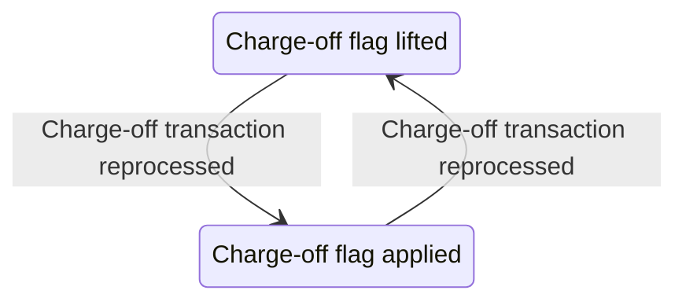
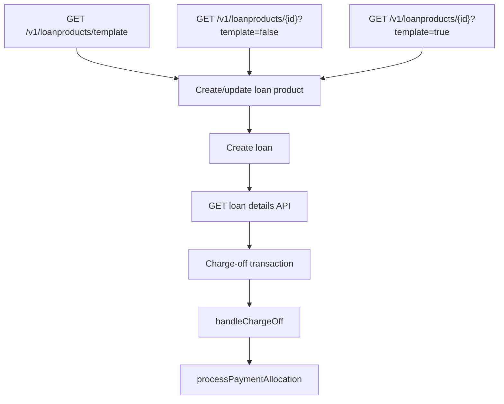
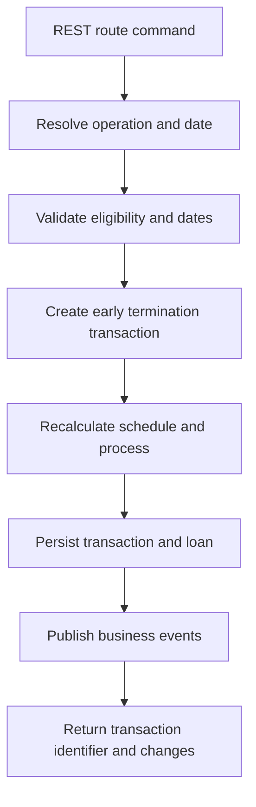
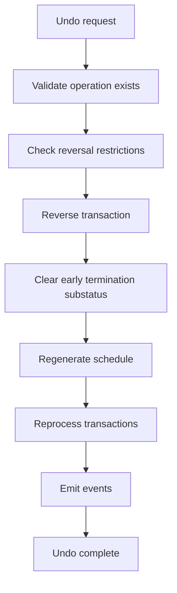

# Recovery and Closure

## Charge-Off

### Charge-off overview

Charge-off is an accounting treatment that marks a loan as charged off without closing it or changing its balance. The loan remains active, all transactions and calculations continue to work normally, and existing APIs return data unchanged.

### Charge-off accounting entries

Charge-off accounting entries depend on whether the loan is flagged as fraud or non-fraud and on the portion being charged off: interest, fees, penalty, charge adjustment, unallocated credit, or OCA repayment. Each portion maps to specific debit and credit GL accounts.

| Scenario | Portion | Debit account | Credit account | Additional accounts |
| --- | --- | --- | --- | --- |
| Charge off Fraud | Interest | Interest income charge off | Interest Receivable | charge-off interest income on both sides |
| Charge off Fraud | Fees | Fee Charge off | Fee Receivable | charge-off fees Income on both sides |
| Charge off Fraud | Penalty | Fee Charge off | Fee Receivable | charge-off Penalty Income |
| Charge off Non Fraud | Interest | Interest income charge off | Interest Receivable | charge-off interest income on both sides |
| Charge off Non Fraud | Fees | Fee Charge off | Fee Receivable | charge-off fees Income on both sides |
| Charge off Non Fraud | Penalty | Fee Charge off | Fee Receivable | charge-off Penalty Income |
| Charge adjustment | Fees | Fee Income | Fee Charge off | income from fees and charge-off fees Income referencing R25 |
| Charge adjustment | Unallocated Credit (UNC) | Fee Income | Other Credit liability | income from fees and Overpayment Liability |
| Charge adjustment | Penalty | Fee Income | Fee Charge off | income from penalties and charge-off Penalty Income |
| OCA Repayment | Interest | Other receivables | recoveries | fund source /advance accounting and Income from Recovery payment |
| OCA Repayment | Fees | Other receivables | recoveries | fund source /advance accounting and Income from Recovery payment |
| OCA Repayment | Unallocated Credit (UNC) | Other receivables | Other Credit liability | fund source /advance accounting and Overpayment Liability |
| OCA Repayment | Penalty | Other receivables | recoveries | fund source /advance accounting and Income from Recovery payment |

### GL account mappings

Charge-off GL account mappings assign each charge-off-related account to a general ledger account and account type.

| GL account | Account name | Account type |
| --- | --- | --- |
| 112601 | Loans Receivable | Asset |
| 145023 | Suspense/Clearing account | Suspense/clearing account |
| 112603 | Fee Receivable | Asset |
| 245000 | Other Credit liability | Liability |
| 744003 | Principal bal adjustment | Expense |
| 404001 | Interest income charge off | Income |
| 404007 | Fee Income | Income |
| 404011 | Fee Income | Income |
| 404000 | Interest income | Income |
| 145800 | Other receivables | Asset |

### Transaction posting rules

Adding charges after charge-off is not allowed, and there are no fees or penalties for any charged-off loan. Accounting entries remain the same for both cash based and accrual based accounting types.

A charge-off loan allows chargeback, refunds, and other special case transactions, and CBR is allowed after charge-off.

- The SOR does not restrict any transactions against a charge-off loan.
- CBR is allowed after charge-off, though very unlikely.

### Transaction reversal rules

You can reverse a transaction dated before the charge-off transaction, and reversing such a transaction increases or decreases the charge-off amount during replay, such as increasing the charge-off amount when reversing a repayment. A transaction dated before the charge-off date cannot be added. Reverse replay of a charge-off transaction keeps the distribution up to date.

Journal entry rules depend on the transaction date relative to the charge-off date:

- Transactions dated before the charge-off date follow the standard accounting journal entry rules.
- Transaction changes dated after the charge-off date follow the charge-off accounting journal entry rules.

The current implementation has these limitations:

- Journal entries are created in bulk at the end of reverse replay and cannot distinguish pre-charge-off from post-charge-off entries.
- Strategies for creating journal entries include posting GL entries one by one per transaction or in bulk for pre-charge-off and post-charge-off periods.
- No reversal and replay of the charge-off occurs when the payment occurs after the charge-off.

Charge-off transaction dating rules:

- A charge-off transaction can be backdated but cannot be dated before the last transaction date.

### Interest accrual

On interest-bearing loan accounts, interest accrual stops when the account is charged off, and no interest calculation occurs beyond the charge-off date. Accrual resumes when the charge-off status is reversed, starting from the date accrual was previously stopped.

### Charge-off reversal

You can reverse a charge-off only when the charge-off was applied in error, as a remediation or exception process rather than as business-as-usual activity. Reversal is not supported if any transactions exist after the charge-off transaction. A second charge-off on an already charged-off account returns a validation error on the API, and the same restriction applies to undoing a charge-off.

Undoing a charge-off behaves as follows:

- Undo charge-off does not require any parameter.
- You can provide reverseExternalId when undoing a charge-off, and the system stores it on the transaction.
- A transaction can be fetched by external id, but this is not the reverse external id.
- The loan reschedule feature is disabled for charge-off marked loan accounts.
- Restructuring of installments is not allowed for charge-off loan accounts.
- The amount marked as charge-off is the loan balance as of the current date.

> **Note:** Once a loan is charged off, the charge-off status is never removed, even if the customer cures or settles their balance.

### Events

The system raises a charge-off event whenever a charge-off happens for a loan account, at the time the loan is marked to CHARGE-OFF. The event includes the fees and charges array. The new charge-off transaction has no impact on the loan balance and acts as a dummy transaction linking to charge-off accounting entries.

The Loan API exposes charge-off status through the following field:

- is charged off true/false field indicates whether a loan is charged off.

### Transaction accounting entries

| Transaction type | Debit account | Credit account |
| --- | --- | --- |
| Loan Disbursement Principal Cash Out | 112601 | 145023 |
| Transaction Refund/Provisional Credit Interest - Repayment Cash in | 145023 | 112603 |
| Transaction Refund/Provisional Credit Late Fee Payment Cash in | 145023 | 112603 |
| Transaction Refund/Provisional Credit NSF Fee Payment Cash in | 145023 | 112603 |
| Transaction Refund/Provisional Credit Snooze Fee Payment Cash in | 145023 | 112603 |
| Transaction Refund/Provisional Credit Principal Payment Cash in | 145023 | 112601 |
| Transaction Refund/Provisional Credit Unallocated Credit (UNC) Cash in | 145023 | 245000 |
| Transaction Refund/Provisional Credit Interest - Repayment Cash in with Charged off Flag Y | 145023 | 404001 |
| Transaction Refund/Provisional Credit Late Fee Payment Cash in with Charged off Flag Y | 145023 | 404008 |
| Transaction Refund/Provisional Credit NSF Fee Payment Cash in with Charged off Flag Y | 145023 | 404008 |
| Transaction Refund/Provisional Credit Snooze Fee Payment Cash in with Charged off Flag Y | 145023 | 404008 |
| Transaction Refund/Provisional Credit Principal Payment Cash in with Charged off Flag Y | 145023 | 744007/740037 |
| Transaction Refund/Provisional Credit Unallocated Credit (UNC) Cash in with Charged off Flag Y | 145023 | 245000 |
| Transaction Refund/Provisional Credit Interest - Repayment Cash Out with Reversal Indicator Y | 112603 | 145023 |
| Transaction Refund/Provisional Credit Late Fee Payment Cash Out with Reversal Indicator Y | 112603 | 145023 |
| Transaction Refund/Provisional Credit NSF Fee Payment Cash Out with Reversal Indicator Y | 112603 | 145023 |
| Transaction Refund/Provisional Credit Snooze Fee Payment Cash Out with Reversal Indicator Y | 112603 | 145023 |
| Transaction Refund/Provisional Credit Principal Payment Cash Out with Reversal Indicator Y | 112601 | 145023 |
| Transaction Refund/Provisional Credit Unallocated Credit (UNC) Cash Out with Reversal Indicator Y | 245000 | 145023 |
| Transaction Refund/Provisional Credit Interest - Repayment Cash Out with Reversal Indicator Y and Charged off Flag Y | 404001 | 145023 |
| Transaction Refund/Provisional Credit Late Fee Payment Cash Out with Reversal Indicator Y and Charged off Flag Y | 404008 | 145023 |
| Transaction Refund/Provisional Credit NSF Fee Payment Cash Out with Reversal Indicator Y and Charged off Flag Y | 404008 | 145023 |
| Transaction Refund/Provisional Credit Snooze Fee Payment Cash Out with Reversal Indicator Y and Charged off Flag Y | 404008 | 145023 |
| Transaction Refund/Provisional Credit Principal Payment Cash Out with Reversal Indicator Y and Charged off Flag Y | 744007/740037 | 145023 |
| Transaction Refund/Provisional Credit Unallocated Credit (UNC) Cash Out with Reversal Indicator Y and Charged off Flag Y | 245000 | 145023 |
| Good Will Interest - Repayment No Cash | 404001 | 112603 |
| Good Will Late Fee Payment No Cash | 744003 | 112603 |
| Good Will NSF Fee Payment No Cash | 744003 | 112603 |
| Good Will Snooze Fee Payment No Cash | 744003 | 112603 |
| Good Will Principal Payment No Cash | 744003 | 112601 |
| Good Will Unallocated Credit (UNC) No Cash | 744003 | 245000 |
| Good Will Interest - Repayment No Cash with Charged off Flag Y | 404001 | 744008 |
| Good Will Late Fee Payment No Cash with Charged off Flag Y | 744003 | 744008 |
| Good Will NSF Fee Payment No Cash with Charged off Flag Y | 744003 | 744008 |
| Good Will Snooze Fee Payment No Cash with Charged off Flag Y | 744003 | 744008 |
| Late Fee Waiver Late Fee Payment No Cash | 404007 | 112603 |
| Late Fee Waiver Late Fee Payment No Cash with Charged off Flag Y | 404007 | 404008 |
| Late Fee Waiver Late Fee Payment No Cash with Reversal Indicator Y | 112603 | 404007 |
| Late Fee Waiver Late Fee Payment No Cash with Reversal Indicator Y and Charged off Flag Y | 404008 | 404007 |
| NSF Fee Waiver NSF Fee Payment No Cash | 404007 | 112603 |
| NSF Fee Waiver NSF Fee Payment No Cash with Charged off Flag Y | 404007 | 404008 |
| NSF Fee Waiver NSF Fee payment No Cash with Reversal Indicator Y | 112603 | 404007 |
| NSF Fee Waiver NSF Fee payment No Cash with Reversal Indicator Y and Charged off Flag Y | 404008 | 404007 |
| Auto Payment Late Fee Payment Cash in | 145023 | 744008 |
| Auto Payment NSF Fee Payment Cash in | 145023 | 744008 |
| Auto Payment Snooze Fee Payment Cash in | 145023 | 744008 |
| Auto Payment Principal Payment Cash in | 145023 | 744008 |
| Auto Payment Unallocated Credit (UNC) Cash in | 145023 | 245000 |
| Auto Payment Late Fee Payment Cash Out | 112603 | 145023 |
| Auto Payment NSF Fee Payment Cash Out | 112603 | 145023 |
| Auto Payment Snooze Fee Payment Cash in | 112603 | 145023 |
| Auto Payment Principal Payment Cash Out | 112601 | 145023 |
| Auto Payment Unallocated Credit (UNC) Cash Out | 245000 | 145023 |
| Auto Payment Late Fee Payment Cash Out | 744008 | 145023 |
| Auto Payment NSF Fee Payment Cash Out | 744008 | 145023 |
| Auto Payment Snooze Fee Payment Cash in | 744008 | 145023 |
| Auto Payment Principal Payment Cash Out | 744008 | 145023 |
| Scheduled Payment Late Fee Payment Cash in | 145023 | 112603 |
| Scheduled Payment NSF Fee Payment Cash in | 145023 | 112603 |
| Scheduled Payment Snooze Fee Payment Cash in | 145023 | 112603 |
| Scheduled Payment Principal Payment Cash in | 145023 | 112601 |
| Scheduled Payment Unallocated Credit (UNC) Cash in | 145023 | 245000 |
| Scheduled Payment Late Fee Payment Cash in | 145023 | 744008 |
| Scheduled Payment NSF Fee Payment Cash in | 145023 | 744008 |
| Scheduled Payment Snooze Fee Payment Cash in | 145023 | 744008 |
| Scheduled Payment Principal Payment Cash in | 145023 | 744008 |
| Scheduled Payment Late Fee Payment Cash Out | 112603 | 145023 |
| Scheduled Payment NSF Fee Payment Cash Out | 112603 | 145023 |
| Scheduled Payment Snooze Fee Payment Cash Out | 112603 | 145023 |
| Scheduled Payment Principal Payment Cash Out | 112601 | 145023 |
| Scheduled Payment Unallocated Credit (UNC) Cash Out | 245000 | 145023 |
| Apply Fee Return Late Fee Payment No Cash | N/A | N/A |
| Apply Fee Return Late Fee Payment No Cash | Y | N/A |

### Duplicate transaction accounting entries

| Transaction | Debit account | Credit account |
| --- | --- | --- |
| Loan Disbursement Principal Cash Out | 112601 | 145023 |
| Transaction Refund/Provisional Credit Late Fee Payment Cash in | 145023 | 112603 |
| Transaction Refund/Provisional Credit NSF Fee Payment Cash in | 145023 | 112603 |
| Transaction Refund/Provisional Credit Snooze Fee Payment Cash in | 145023 | 112603 |
| Transaction Refund/Provisional Credit Principal Payment Cash in | 145023 | 112601 |
| Transaction Refund/Provisional Credit Unallocated Credit (UNC) Cash in | 145023 | 245000 |
| Transaction Refund/Provisional Credit Late Fee Payment Cash in with Y | 145023 | 404008 |
| Transaction Refund/Provisional Credit NSF Fee Payment Cash in with Y | 145023 | 404008 |
| Transaction Refund/Provisional Credit Snooze Fee Payment Cash in with Y | 145023 | 404008 |
| Transaction Refund/Provisional Credit Principal Payment Cash in with Y | 145023 | 744007/740037 |

### Simplified transaction accounting entries

Simplified transaction accounting entries define the debit and credit general ledger accounts for each transaction type, with different account mappings when the loan carries the charged off flag. The system applies these entries to disbursements, refunds, provisional credits, reversals, good will adjustments, waivers, auto payments, and scheduled payments.

| Transaction | Condition | Debit account | Credit account |
| --- | --- | --- | --- |
| Loan Disbursement Principal Cash Out | None | 112601 | 145023 |
| Transaction Refund/Provisional Credit Late Fee Payment Cash in | None | 145023 | 112603 |
| Transaction Refund/Provisional Credit NSF Fee Payment Cash in | None | 145023 | 112603 |
| Transaction Refund/Provisional Credit Snooze Fee Payment Cash in | None | 145023 | 112603 |
| Transaction Refund/Provisional Credit Principal Payment Cash in | None | 145023 | 112601 |
| Transaction Refund/Provisional Credit Unallocated Credit (UNC) Cash in | None | 145023 | 245000 |
| Transaction Refund/Provisional Credit Late Fee Payment Cash in | Charged off Flag Y | 145023 | 404008 |
| Transaction Refund/Provisional Credit NSF Fee Payment Cash in | Charged off Flag Y | 145023 | 404008 |
| Transaction Refund/Provisional Credit Snooze Fee Payment Cash in | Charged off Flag Y | 145023 | 404008 |
| Transaction Refund/Provisional Credit Principal Payment Cash in | Charged off Flag Y | 145023 | 744007/740037 |
| Transaction Refund/Provisional Credit Unallocated Credit (UNC) Cash in | Charged off Flag Y | 145023 | 245000 |
| Transaction Refund/Provisional Credit Late Fee Payment Cash Out | Reversal Indicator Y | 112603 | 145023 |
| Transaction Refund/Provisional Credit NSF Fee Payment Cash Out | Reversal Indicator Y | 112603 | 145023 |
| Transaction Refund/Provisional Credit Snooze Fee Payment Cash Out | Reversal Indicator Y | 112603 | 145023 |
| Transaction Refund/Provisional Credit Principal Payment Cash Out | Reversal Indicator Y | 112601 | 145023 |
| Transaction Refund/Provisional Credit Unallocated Credit (UNC) Cash Out | Reversal Indicator Y | 245000 | 145023 |
| Transaction Refund/Provisional Credit Late Fee Payment Cash Out | Reversal Indicator Y and Charged off Flag Y | 404008 | 145023 |
| Transaction Refund/Provisional Credit NSF Fee Payment Cash Out | Reversal Indicator Y and Charged off Flag Y | 404008 | 145023 |
| Transaction Refund/Provisional Credit Snooze Fee Payment Cash Out | Reversal Indicator Y and Charged off Flag Y | 404008 | 145023 |
| Transaction Refund/Provisional Credit Principal Payment Cash Out | Reversal Indicator Y and Charged off Flag Y | 744007/740037 | 145023 |
| Transaction Refund/Provisional Credit Unallocated Credit (UNC) Cash Out | Reversal Indicator Y and Charged off Flag Y | 245000 | 145023 |
| Good Will Late Fee Payment No Cash | None | 744003 | 112603 |
| Good Will NSF Fee Payment No Cash | None | 744003 | 112603 |
| Good Will Snooze Fee Payment No Cash | None | 744003 | 112603 |
| Good Will Principal Payment No Cash | None | 744003 | 112601 |
| Good Will Unallocated Credit (UNC) No Cash | None | 744003 | 245000 |
| Good Will Late Fee Payment No Cash | Charged off Flag Y | 744003 | 744008 |
| Good Will NSF Fee Payment No Cash | Charged off Flag Y | 744003 | 744008 |
| Good Will Snooze Fee Payment No Cash | Charged off Flag Y | 744003 | 744008 |
| Late Fee Waiver Late Fee Payment No Cash | None | 404007 | 112603 |
| Late Fee Waiver Late Fee Payment No Cash | Charged off Flag Y | 404007 | 404008 |
| NSF Fee Waiver NSF Fee Payment No Cash | None | 404007 | 112603 |
| NSF Fee Waiver NSF Fee Payment No Cash | Charged off Flag Y | 404007 | 404008 |
| Auto Payment Late Fee Payment Cash in | Charged off Flag Y | 145023 | 744008 |
| Auto Payment NSF Fee Payment Cash in | Charged off Flag Y | 145023 | 744008 |
| Auto Payment Snooze Fee Payment Cash in | Charged off Flag Y | 145023 | 744008 |
| Auto Payment Principal Payment Cash in | Charged off Flag Y | 145023 | 744008 |
| Auto Payment Unallocated Credit (UNC) Cash in | Charged off Flag Y | 145023 | 245000 |
| Auto Payment Late Fee Payment Cash Out | Reversal Indicator Y | 112603 | 145023 |
| Auto Payment NSF Fee Payment Cash Out | Reversal Indicator Y | 112603 | 145023 |
| Auto Payment Principal Payment Cash Out | Reversal Indicator Y | 112601 | 145023 |
| Auto Payment Unallocated Credit (UNC) Cash Out | Reversal Indicator Y | 245000 | 145023 |
| Auto Payment Late Fee Payment Cash Out | Reversal Indicator Y and Charged off Flag Y | 744008 | 145023 |
| Auto Payment NSF Fee Payment Cash Out | Reversal Indicator Y and Charged off Flag Y | 744008 | 145023 |
| Auto Payment Principal Payment Cash Out | Reversal Indicator Y and Charged off Flag Y | 744008 | 145023 |
| Auto Payment Unallocated Credit (UNC) Cash Out | Reversal Indicator Y and Charged off Flag Y | 245000 | 145023 |
| Scheduled Payment Late Fee Payment Cash in | None | 145023 | 112603 |

### Charge-off product configuration

Charge-off product configuration adds new account mapping parameters to the loan product. These parameters are optional for GL mapping, but a loan account must map them before it can use the charge-off feature.

The following installment due date applies:

- The installment due date is 31/01/2022.

### Charge-off initiation and user interface

You initiate a charge-off from the Loan details page using the Charge-off button. If the loan is already charged-off, the Undo charge-off button appears only when there is an active charge off.

Charge-off uses the following supported fields:

- transactionDate
- note
- locale
- dateFormat
- chargeOffReasonId
- externalId

Charge-off input parameters are:

- charge-off date (date field)
- charge-off reason (drop down, optional)
- note (string, optional)
- externalId (string, optional)

The API surface for charge-off consists of:

- the Loan transaction API with the charge-off command
- the Loan API extended by a charge-off flag
- the undo-charge-off command for reversal

### Charge-off accounting mappings

Loan product accounting mappings define where charge-off amounts post. Charge-off expense maps to Credit Loss/Bad Debt, charge-off expense - fraud maps to Credit Loss/Bad Debt Fraud, and charge-off interest income maps to Interest income charge off, all with GL Type Expense or Income as applicable. Charge-off fees income and charge-off penalty income both map to Fee Charge off with GL Type Income.

Goodwill credit mappings post interest income to GL 404001 and fees income and penalties income to GL 404008, each with GL Type Income.

| Mapping | Destination | GL Type |
| --- | --- | --- |
| Charge-off expense | Credit Loss/Bad Debt | Expense |
| Charge-off expense - fraud | Credit Loss/Bad Debt Fraud | Expense |
| Charge-off interest income | Interest income charge off | Income |
| Charge-off fees income | Fee Charge off | Income |
| Charge-off penalty income | Fee Charge off | Income |
| Goodwill credit interest income | GL 404001 | Income |
| Goodwill credit fees income | GL 404008 | Income |
| Goodwill credit penalties income | GL 404008 | Income |

New GL mapping fields for charge-off appear in loan product Accounting mapping, and the existing parameter name goodwill credit in expense category is renamed to Expenses from goodwill credit.

### Scheduled payment cash-in postings

| Payment type | Charged off flag | Debit account | Credit account |
| --- | --- | --- | --- |
| NSF Fee Payment Cash in | N | 145023 | 112603 |
| Snooze Fee Payment Cash in | N | 145023 | 112603 |
| Principal Payment Cash in | N | 145023 | 112601 |
| Unallocated Credit (UNC) Cash in | N | 145023 | 245000 |
| Late Fee Payment Cash in | Y | 145023 | 744008 |
| NSF Fee Payment Cash in | Y | 145023 | 744008 |
| Snooze Fee Payment Cash in | Y | 145023 | 744008 |
| Principal Payment Cash in | Y | 145023 | 744008 |
| Unallocated Credit (UNC) Cash in | Y | 145023 | 245000 |

### Scheduled payment cash-out reversal postings

Scheduled payment cash-out reversals post to the suspense account 145023, with the debit account determined by the fee or payment type. Late fee, NSF fee, snooze fee, principal, and unallocated credit reversals each use a different debit account.

| Reversal type | Debit account | Credit account |
| --- | --- | --- |
| Late fee payment cash out | 112603 | 145023 |
| NSF fee payment cash out | 112603 | 145023 |
| Snooze fee payment cash in | 112603 | 145023 |
| Principal payment cash out | 112601 | 145023 |
| Unallocated credit cash out | 245000 | 145023 |

### Charge-off event and schema extensions

The charge-off event is an alternation or descendent of LoanTransactionBusinessEvent and is triggered whenever a charge-off happens. The LoanTransactionDataV1 Avro schema is extended with the unpaidCharges field of type List<UnpaidCharge>. Each entry identifies an unpaid charge group by its charge id and name, and reports the summed outstanding amount for all unpaid charges relating to that charge group.

### Charge-off processing and reversal behavior

The charge-off template includes a charge-off date field. The charge-off flag is lifted and reapplied only when the charge-off transaction is reprocessed.

### Worked examples

A loan is disbursed for a principal of 1,000.00. A fee of 100.00 is later assessed, bringing the total balance to 1,100.00. When the loan is marked for charge-off, the charge-off amount is automatically set to the loan balance as of that date, 1,100.00, and cannot be edited. The system posts a new charge-off transaction that is a dummy entry: it links to charge-off accounting entries but does not change the loan balance. The loan remains ACTIVE, isChargedOff becomes true, and a charge-off business event is emitted. Interest accrual stops on the charge-off date. The figures in this example are illustrative. Changing the portion from non-fraud to fraud changes the debit account to the fraud expense account and flags the transaction as fraud, but the charge-off amount and balance behaviour stay the same.

| Step | Event | Charge-off amount | Loan balance | isChargedOff | Interest accrual |
| --- | --- | --- | --- | --- | --- |
| 1 | Disburse principal | — | 1,000.00 | false | Accruing |
| 2 | Assess fee receivable | — | 1,100.00 | false | Accruing |
| 3 | Post charge-off | 1,100.00 | 1,100.00 | true | Stopped |

The same loan is now charged off with a balance of 1,100.00 and a charge-off amount of 1,100.00. A repayment of 300.00 is posted after the charge-off date. Because the payment is after the charge-off, the system does not reverse or replay the charge-off transaction, and the charge-off amount stays at 1,100.00. The repayment reduces the loan balance to 800.00 and uses charge-off accounting: it debits Suspense/Clearing (145023) and credits Interest income charge off (404001). An attempt to undo the charge-off is blocked because a transaction exists after the charge-off. If the repayment were dated before the charge-off instead, the system would reverse-replay the charge-off and adjust the charge-off amount.

| Step | Event | Payment | Loan balance | Charge-off amount | isChargedOff | Accounting entry |
| --- | --- | --- | --- | --- | --- | --- |
| 1 | Charge-off posted | — | 1,100.00 | 1,100.00 | true | Dr 404001 / Cr 112603 |
| 2 | Interest repayment after charge-off | 300.00 | 800.00 | 1,100.00 | true | Dr 145023 300.00 / Cr 404001 300.00 |
| 3 | Undo charge-off attempted | — | 800.00 | 1,100.00 | true | Blocked: transaction after charge-off |

A loan is disbursed for 1,000.00 on 1 January. A repayment of 400.00 is made on 15 May, reducing the balance to 600.00. On 1 June the loan is charged off; the charge-off amount is set to 600.00. On 10 June the 15 May repayment is reversed with a date before the charge-off. The system reverse-replays: it backs out the charge-off, restores the balance to 1,000.00, and replays the charge-off so the charge-off amount becomes 1,000.00. The loan remains ACTIVE and isChargedOff stays true throughout. If the reversed transaction were dated after the charge-off, no reverse-replay would occur and the charge-off amount would remain unchanged.

| Step | Date | Event | Loan balance | Charge-off amount | isChargedOff |
| --- | --- | --- | --- | --- | --- |
| 1 | 1-Jan | Disburse principal | 1,000.00 | — | false |
| 2 | 15-May | Repayment 400.00 | 600.00 | — | false |
| 3 | 1-Jun | Post charge-off | 600.00 | 600.00 | true |
| 4 | 10-Jun | Reverse pre-charge-off repayment | 1,000.00 | 1,000.00 | true |

A loan with a balance of 1,000.00 is charged off on 1 June in error. Interest accrual stops on that date. Because no transaction was posted after the charge-off, the charge-off tag can be reversed. Undo charge-off requires no mandatory parameter, though an optional reverseExternalId may be stored on the transaction. After undo, isChargedOff returns to false, the loan remains ACTIVE, and interest accrual resumes from 1 June. A second charge-off is then possible because the account is no longer marked as charged off. If any transaction existed after the charge-off, undo charge-off would be blocked.

| Step | Event | isChargedOff | Interest accrual | reverseExternalId |
| --- | --- | --- | --- | --- |
| 1 | Disburse principal | false | Accruing | — |
| 2 | Post charge-off in error | true | Stopped from 1-Jun | — |
| 3 | Undo charge-off | false | Resumed from 1-Jun | Optional ID stored |

See also: [Repayment and Allocation: Payment Allocation Strategies](confluence-link:Repayment%20and%20Allocation#payment-allocation-strategies).

## Charge-Off Balances

### Charge-off behavior options and product eligibility

Charge-off behavior options are Regular, Zero interest after charge-off, and Accelerate maturity to charge-off date. The behavior is stored with the product definition, and support for the selected behavior is validated for the loan product. A Charge-off behavior selector appears on the Setting >> Loan schedule page. The behavior applies only to Progressive loan products where interest is not zero; interest recalculation is not relevant and repayment interest is irrelevant, with all methods working the same way and interest calculated till the charge-off date. If a loan product is not progressive or does not have interest or interest recalculation is not enabled, only REGULAR charge-off behaviour is supported.

Accelerate maturity availability depends on the product type:

- Accelerate maturity is available for interest bearing, progressive loan products.
- Accelerate maturity is optionally available for non-interest bearing, progressive loan products.

### General charge-off mechanics

Charge-off makes the full loan balance due on the day of charge-off so the full balance is collectible, unless the loan is already past its maturity date. Interest is calculated only to the day of charge-off. Charge-off cannot occur on a future date and must be the latest transaction on the loan account. Reversal reestablishes the previous loan schedule and produces the same schedule as before charge-off. Accounting follows charge-off rules and sends relevant account changed events. Charge-off activity does not affect N+1 installments. Backdated repayments and reversals trigger reverse-replay of all transactions and the charge-off transaction.

### Charge-off date and period handling

The charge-off date determines which period the charge-off belongs to. The period from date is exclusive and the period due date is inclusive.

The system applies the following rules when handling charge-off dates and periods:

- For a progressive loan product with interest recalculation not enabled, interest is calculated till the charge-off date using (total interest of the period) / (number of days of the period) * (number of days till charge-off date), with the period from date exclusive and the charge-off date inclusive.
- Principal due on the period increases by the difference between the original interest of the period and the new interest of the period after charge-off.
- The due date of the current period changes to the charge-off date and all future periods are removed.
- Interest calculation and interest accrual stop from the day after the charge-off date.

### Interest recalculation during charge-off

Interest recalculation applies only to loans where interest recalculation is enabled, and it changes only how interest is calculated up to the charge-off date.

The system processes transactions differently depending on when monetary activity occurs relative to the charge-off date:

- For interest recalculation loans, transactions before the charge-off date are reprocessed using AdvancedPaymentScheduleTransactionProcessor.reprocessProgressiveLoanTransactions to obtain ProgressiveLoanInterestScheduleModel, then EMICalculator calculates the due interest for the current period.
- Backdated repayment or other monetary activity triggers transaction reprocessing and works out of the box.
- Repayment or other monetary activity after charge-off is not reprocessed; ProgressiveLoanInterestScheduleModel and EMICalculator are not used, existing repayment periods are used instead, and the transaction is processed as if the loan does not do interest recalculation.

### Installment and balance changes

When a loan is charged off before maturity, future installments are removed and the actual installment is amended with the charge-off transaction date, containing the total principal and charges amount from the removed future installments. The N+1 balance goes to the recalculated installment. If a chargeback comes, N+1 is created.

When accelerate maturity to charge-off date is set and the loan is charged off:

- A new final installment is created with the charge-off date as due date containing all future balance.
- Installments after the charge-off date are removed.
- Interest pending till the charge-off date is added to the new final installment.
- No interest is calculated for the new last and final installment.

Future fees are waived rather than dropped or moved to the newly created final installment.

### Charge handling during charge-off

Charge handling behaves the same for every charge-off behavior and whether interest recalculation is enabled or disabled. Charges already paid or waived are not affected by charge-off. Unpaid charges added before, on, or after the charge-off date become part of the charge-off amount and remain unpaid to be collected as part of coming payments. If any unpaid charge associated with the charge-off is waived, the charge-off transaction is reverse-replayed. For a progressive, interest-bearing loan with interest recalculation enabled and charge-off behavior accelerate maturity date, if a charge with a due date after the charge-off date exists, the charge's due date becomes the N+1 installment due date.

### Accrual and interest recognition after charge-off

Accrual stops on charged-off loans, and interest is recognized only up to the charge-off date as the charge-off interest portion amount. When accrual recalculation is triggered after charge-off, the accrual or accrual adjustment transaction date is the charge-off transaction date.

Backdated charge-offs and repayments trigger real-time accrual reversal or recalculation as follows:

- When a charge-off is backdated, all accrual entries with a transaction date after the charge-off transaction date are reversed real-time.
- When interest recognition from disbursement date is TRUE and the charge-off transaction date is 13th Jan, accrual entries with transaction dates 13th Jan and 14th Jan are reversed.
- When interest recognition from disbursement date is FALSE and the charge-off transaction date is 13th Jan, accrual entries with transaction date 14th Jan are reversed.
- When a charged-off progressive loan has a backdated repayment or an earlier repayment reverted, accruals are recalculated real-time and an accrual or accrual adjustment transaction is posted if applicable.

Immediate interest recognition at charge-off depends on loan type and recognition setting:

- When a progressive loan is charged-off, the actual not yet accrued daily interest is immediately recognized and an accrual transaction is posted if there is any payable non-recognized interest.
- When a cumulative loan is charged-off, the actual not yet accrued daily interest is immediately recognized and an accrual transaction is posted if there is any payable non-recognized interest.
- When interest recognition from disbursement date is FALSE, the missing daily interest accrual is calculated and created because accrual will not be done anymore after charge-off.
- When interest recognition from disbursement date is TRUE and this is the first time the charge-off transaction is created, no accrual transaction is generated immediately because there is no difference between accrued interest and payable interest.

Charge-off journal entries and transaction ordering:

- When charge-off reason is FRAUD and Credit Loss/Bad Debt Fraud is configured, the configured GL account is used for charge-off journal entries.
- GL entry columns include Interest portion, Interest income charge off, Fee Receivable, charge-off interest income, and Interest Receivable.
- The new accrual or accrual adjustment transaction is created on the charge-off date before the charge-off transaction itself timestamp-wise when charge-off amounts changed.

Charge-off scenarios include:

- S1 charge-off on due date scenario covers charge-off on the due date.
- S5 charge-off after one installment is overdue scenario is listed.

### Worked examples

A progressive, interest-bearing loan with interest recalculation disabled uses regular charge-off behaviour. The figures are illustrative: principal 1,000.00, annual interest 12% (1% per 30-day month), three monthly installments. The first installment is paid at the end of month 1, leaving 666.67. The loan is charged off on day 15 of month 2, before maturity, so the full outstanding balance becomes due and interest accrues only to the charge-off date.

| Event | Date | Amount | Principal | Interest | Balance |
| --- | --- | --- | --- | --- | --- |
| Disbursement | Month 1 day 1 | 1,000.00 | — | — | 1,000.00 |
| Installment 1 paid | Month 1 day 30 | 343.33 | 333.33 | 10.00 | 666.67 |
| Charge-off | Month 2 day 15 | 670.01 | 666.67 | 3.34 | 0.00 |
| Total collected | — | 1,013.34 | 1,000.00 | 13.34 | — |

The example shows that charge-off before maturity accelerates the full balance to the charge-off date and removes future installments.

When the loan has already reached maturity, charge-off does not accelerate a schedule that no longer has future installments. Using the same illustrative loan, assume installments 1 and 2 are paid, leaving 333.34 outstanding after month 2. The loan is charged off on day 10 of month 4, after maturity, so only the outstanding balance is collectible and no new installment is created.

| Event | Date | Amount | Principal | Interest | Balance |
| --- | --- | --- | --- | --- | --- |
| Disbursement | Month 1 day 1 | 1,000.00 | — | — | 1,000.00 |
| Installment 1 paid | Month 1 day 30 | 343.33 | 333.33 | 10.00 | 666.67 |
| Installment 2 paid | Month 2 day 30 | 340.00 | 333.33 | 6.67 | 333.34 |
| Charge-off after maturity | Month 4 day 10 | 333.34 | 333.34 | 0.00 | 0.00 |
| Total collected | — | 1,016.67 | 1,000.00 | 16.67 | — |

The example shows that after maturity the full balance is not accelerated; only the outstanding amount is due.

A charge-off reversal reestablishes the previous loan schedule exactly. Starting from the illustrative loan in the first example, the loan is charged off on day 15 of month 2 and reversed on day 20 of month 2. The balance returns to 666.67 and installments 2 and 3 are reinstated with their original amounts.

| Event | Date | Amount | Principal | Interest | Balance |
| --- | --- | --- | --- | --- | --- |
| Charge-off | Month 2 day 15 | 670.01 | 666.67 | 3.34 | 0.00 |
| Reversal | Month 2 day 20 | — | — | — | 666.67 |
| Installment 2 reinstated | Month 2 day 30 | 340.00 | 333.33 | 6.67 | 333.34 |
| Installment 3 reinstated | Month 3 day 30 | 336.67 | 333.34 | 3.33 | 0.00 |

The example shows that reversal reproduces the schedule that existed before charge-off.

Unpaid charges with a due date on or before the charge-off date are added to the charge-off amount, while future fees are waived rather than moved to a final installment. Using the same illustrative loan, after installment 1 the balance is 666.67. An unpaid charge of 20.00 is due on the charge-off date, day 15 of month 2, and a future fee of 10.00 scheduled after that date is waived.

| Event | Date | Total | Principal | Interest | Charge | Balance |
| --- | --- | --- | --- | --- | --- | --- |
| Installment 1 paid | Month 1 day 30 | 343.33 | 333.33 | 10.00 | 0.00 | 666.67 |
| Charge-off | Month 2 day 15 | 690.01 | 666.67 | 3.34 | 20.00 | 0.00 |
| Future fee waived | Month 3 day 1 | 0.00 | 0.00 | 0.00 | 0.00 | 0.00 |
| Total collected | — | 1,033.34 | 1,000.00 | 13.34 | 20.00 | — |

The example shows that unpaid charges are collected as part of charge-off while future fees are waived.

## Charge-Off Interest Accruals

### Charge-off behaviour overview

Charge-off behaviour determines how a loan product handles interest when a loan is charged off. The options are Regular (the default), Zero interest after charge-off, and Accelerate maturity to charge-off date.

The following rules govern charge-off behaviour:

- Charge-off behaviour is stored on the loan product definition as a new field.
- Loan product configuration is stored at loan level.
- Charge-off behaviour applies only to Progressive loan products where interest is not zero; interest recalculation is not relevant and repayment interest is irrelevant, with interest calculated till the charge-off date.
- If a loan product is not progressive or does not have interest or interest recalculation is not enabled, only REGULAR charge-off behaviour is supported.
- On loan level, the charge-off behaviour cannot be updated.
- If charge-off behaviour changes on the product, existing loan accounts remain unaffected.
- If the charge-off behaviour variable is not set, the default is REGULAR.
- If the charge-off behaviour variable is set, it is validated as a valid value using ENUM validation with the string name.
- Whether charge-off behaviour is supported for the loan product is validated.

The UI exposes charge-off behaviour as follows:

- The loan product Settings page includes a Charge-off behaviour selector located after the down payment section.
- The charge-off behaviour selector is available on the UI for loan products.
- On the UI, when a loan is opened, the Account details section may show the charge-off behaviour value.

### Interest accrual and schedule adjustment at charge-off

Once a loan charges off, interest accruals stop and the schedule is adjusted to remove interest projections on future periods and to proportionally decrease interest on the current period where charge off occurred. Interest till charge-off date = (total interest of the period) / (number of days of the period) * (number of days till charge-off date). The period from date is exclusive and the charge-off date is inclusive.

The following rules apply to interest and principal adjustments at charge off:

- All future interest is set to 0.
- Principal due on the period increases by the difference between the original interest of the period and the new interest after charge-off.
- Principal due amount increases by the amount of interest that got removed.
- On the last unpaid installment, principal due is set to the remaining loan balance.
- For loans with interest recalculation enabled, only the way of calculating interest till the charge-off date changes; the rest is the same.
- Charge off zero interest behavior applies when the loan product is progressive and interest recalculation is disabled.
- With 0 interest after charge off setting, at the time charge off is applied, interest becomes 0 post charge off and new interest is calculated for the partial period on the current instalment till charge off date.
- No interest is added for charged-off loans with 0 interest.
- Interest is added when a loan has a reverted charged-off transaction.

A new schedule is created with proper interest: 0 for future instalments and fractional interest for the current instalment till the charge-off date. Once accounting entries have posted for charge off, no further interest accruals can occur on the loan; any further debit or credit adjustments post charge off go through the charged off accounting treatment.

> **Note:** Accelerate maturity to charge-off date comes later.

### Charge-off reversal and restoration

Reversing a charge off restores the original schedule and interest, resumes interest accrual, and re-adds accruals for past items. Any repayment reversal before charge off reverses or replays the charge off and increases the charged off principal and interest amounts.

### Post-charge-off transactions and reprocessing

After a loan charges off, monetary activity is handled differently depending on whether it occurs before or after the charge-off transaction. Transactions before the charge-off transaction can recalculate interest, while transactions after it must not trigger interest recalculation. For a progressive loan with interest recalculation enabled, any transaction after charge-off is processed as if interest recalculation is disabled. Interest accrual can be suspended once a loan charges off for interest-bearing products. Charged interest is calculated until the charge-off date and reflected on the charge-off transaction, including for periods closed and marked fully paid by early repayment where interest for remaining days is recognized in the next period.

Backdated repayment or other monetary activity triggers reprocessing as follows:

- Use AdvancedPaymentScheduleTransactionProcessor.reprocessProgressiveLoanTransactions to reprocess the transactions.
- Transactions before the charge-off transaction recalculate interest.
- Transactions after the charge-off transaction must not trigger interest recalculation.

Repayment or other monetary activity after charge-off is processed as follows:

- Do not reprocess all transactions.
- Use existing repayment periods.
- Process the transaction as if the loan does not do interest recalculation.

Charge-off transaction requirements for early repayment scenarios:

- For a progressive interest-bearing loan product with interest recalculation enabled and Zero interest after Charge-off strategy, when an early repayment fully pays an installment and the loan is later charged off, the charge-off transaction must contain the proper interest portion.
- Charge-off calculation logic must calculate charged interest until the charge-off date and reflect it on the charge-off transaction, including for periods closed and marked fully paid by early repayment where interest for remaining days is recognized in the next period.

> **Note:** New charge-off options for non-interest bearing, progressive loan products are optional and deferred.

### Scheduled jobs exclusion

Scheduled jobs skip loans that have an unreverted charge-off transaction. When a charge-off loan is reversed, the accrual job runs and creates the accruals. The affected jobs are Accrual Activity Posting, Add Accrual Transactions, Add Accrual Transactions For Loans With Income Posted As Transactions, Add Periodic Accrual Transactions, and Recalculate Interest for Loans.

### Charge-off accounting and GL mapping

Charge-off accounting can be mapped to expense GL accounts by charge-off reason code. A new Advance Accounting rule maps charge-off reason code with accounting mapping, and users can map charge-off reasons to any expense GL account dropdown. When an Advanced Accounting Rule is configured, it takes priority over the default Charge-off Expense or Charge Off Fraud Expense configuration; otherwise the system falls back to the original configuration based on the fraud flag set at the loan account.

Configuration rules for mapping charge-off reason codes to GL accounts:

- Users can map one or multiple charge-off reason codes to GL account(s).
- For one charge off reason code, only one GL account can be configured.
- The same GL account can be configured for multiple charge off reasons.
- Only Expense accounts can be configured.
- chargeOffReasonCodeValueId must be a valid, existing id of a charge-off reason code value.
- expenseGLAccountId must be a valid, existing Expense GL account id.
- The same reason code cannot be configured twice.
- Backend validation is performed.
- A Charge-off reason code value configured on any loan product as an Advanced Accounting Rule cannot be deleted.
- When an Advanced Accounting Rule is mapped, the default mapping for fraud flag is overridden.
- A new Advanced Accounting Rule configuration is added to UI and backend to map charge-off reason code with accounting mapping.
- Charge off reason id should be Long, not Integer.

Workflow elements for charge-off accounting:

- Change schedule future interest to $0.
- No accrual job.
- Transaction and validation of journal entries.

Deletion guard for charge-off reason code values:

- When a Charge-off reason code value is to be deleted, the system checks whether it was configured on any loan product as an Advanced Accounting rule for Charge-off reason; if so, it does not let it be deleted.

### APIs and UI configuration

You configure charge-off behaviour on a loan product through the loan product APIs, and the loan details API returns the charge-off behaviour value for a loan. Charge-off calculation and allocation are handled in AdvancedPaymentScheduleTransactionProcessor#handleChargeOff.

The loan product request supports charge-off configuration through the following fields and endpoints:

- Creating or updating a loan product includes the field 'chargeOffReasonsToExpenseMappings', a list of mappings with 'chargeOffReasonCodeValueId' and 'expenseGLAccountId'.
- The loan product fetch details response returns the same 'chargeOffReasonsToExpenseMappings' field and containing mapping.
- GET /v1/loanproducts/template returns all available configuration options needed to create and configure a new loan product on UI.
- GET /v1/loanproducts/{loanProductId}?template=false returns the loan product details of a specific loan product with no template details.
- GET /v1/loanproducts/{loanProductId}?template=true returns the loan product details of a specific loan product and all available configuration options needed to update a loan product.
- The loan product template API call and loan product details with template details API call return all available charge-off reason code values as List<CodeValueData> chargeOffReasonOptions.
- CodeValueReadPlatformService.retrieveCodeValuesByCode("ChargeOffReasons") can be used to collect charge-off reason code values.
- The loan template API returns all options of the charge-off behaviour.

Testing scenarios cover creating a loan product with the new field, creating one without it, updating the field on a loan product, creating a new loan and checking the loan details API returns the charge-off strategy, and creating a new loan then updating the field on the loan product and verifying the charge-off strategy was not changed at loan level via the loan details API.

Interest recalculation around the charge-off transaction uses different processors depending on timing:

- Before the charge-off transaction, EmiCalculator is used to recalculate interest for early or late repayment via AdvancedPaymentScheduleTransactionProcessor#handlingPaymentAllocationForInterestBearingProgressiveLoan.
- After the charge-off transaction, AdvancedPaymentScheduleTransactionProcessor#processPaymentAllocation is used instead of the interest recalculation method.

### Worked examples

Example figures are illustrative. A progressive, interest-bearing loan uses a principal of 1,000.00, an annual interest rate of 12 percent (1 percent per month), three monthly installments, and 30-day months. The loan charges off on day 15 of the second installment period. With the zero-interest-after-charge-off setting, interest accruals stop at charge-off: the current period keeps interest only for the days up to and including the charge-off date, every future period is set to zero interest, and the interest removed from the current period is added to its principal due. Interest till the charge-off date equals the period interest divided by the period days multiplied by the days till the charge-off date, so 6.70 divided by 30 multiplied by 15 gives 3.35. The example shows that future interest is removed, the current period is re-priced to the partial-period interest, and the removed interest is added to principal while the balance still reaches zero.

| Period | Due date | EMI | Principal due | Interest | Balance |
| --- | --- | --- | --- | --- | --- |
| 1 | 1/30 | 340.00 | 330.00 | 10.00 | 670.00 |
| 2 (charge-off) | 2/15 | 340.00 | 336.65 | 3.35 | 333.35 |
| 3 (last, unpaid) | 3/30 | 333.35 | 333.35 | 0.00 | 0.00 |
| Totals |  | 1,013.35 | 1,000.00 | 13.35 |  |

A progressive loan with daily interest calculation and the zero-interest-after-charge-off setting is disbursed on day 1 with a principal of 1,000.00 and an annual interest rate of 18 percent, so daily interest is 1,000.00 multiplied by 18 percent divided by 360, which is 0.50. An early repayment on day 15 fully repays the first 30-day period: interest for days 1 to 15 is recognized at repayment, and interest for the remaining days 16 to 30 is deferred to the next period. The loan charges off on day 31. The charge-off transaction must carry the charged interest up to and including the charge-off date, including the deferred interest from the already-paid period. The charge-off transaction therefore includes 8.00 of interest even though the first period was already marked fully paid by the early repayment.

| Item | Days | Daily interest | Amount |
| --- | --- | --- | --- |
| Early-repayment interest (period 1, days 1-15) | 15 | 0.50 | 7.50 |
| Deferred interest (period 1, days 16-30) | 15 | 0.50 | 7.50 |
| Charge-off day interest (day 31) | 1 | 0.50 | 0.50 |
| Total interest on charge-off transaction |  |  | 8.00 |

A loan is charged off with a principal portion of 1,000.00, interest of 50.00, fees of 20.00 and a penalty of 10.00. Charge-off accounting is differentiated by charge-off reason: with the fraud reason the principal debit posts to the fraud expense GL account, and with the delinquent reason it posts to the standard bad-debt expense GL account. Interest, fees and penalty postings are identical for both reasons. When no advanced accounting rule exists, the system falls back to the fraud-flag default, Charge Off Expense or Charge Off Fraud Expense. With the delinquent reason only the principal debit GL account changes, to Credit Loss/Bad Debt; every other posting is unchanged.

| Portion | Debit account | Debit | Credit account | Credit |
| --- | --- | --- | --- | --- |
| Principal | Credit Loss/Bad Debt Fraud | 1,000.00 | Loans Receivable | 1,000.00 |
| Interest | Interest income charge off | 50.00 | Fee Receivable | 50.00 |
| Fees | Fee Charge off | 20.00 | Fee Receivable | 20.00 |
| Penalty | Fee Charge off | 10.00 | Fee Receivable | 10.00 |
| Totals |  | 1,080.00 |  | 1,080.00 |

An advanced accounting rule maps a charge-off reason code to an expense GL account, and that mapping takes priority over the default Charge Off Expense or Charge Off Fraud Expense configuration. chargeOffReasonCodeValueId must reference an existing charge-off reason code, expenseGLAccountId must reference an existing expense GL account, the same reason code cannot be mapped twice, and one GL account may serve several reasons. A reason code used in a configured rule cannot be deleted. The table shows how the principal debit GL account is resolved for a fraud charge-off of 1,000.00. When a rule exists for the charge-off reason, its GL account is used instead of the default; otherwise the fraud-flag default applies.

| Advanced rule configured? | Reason | Principal debit GL | Resolution source |
| --- | --- | --- | --- |
| No | Fraud | Credit Loss/Bad Debt Fraud | Default fraud-flag fallback |
| Yes | Fraud | Charge-off Fraud | Configured rule takes priority |
| Yes | Delinquent | Charge-off | Configured rule takes priority |

See also: [Charge-Off Balances](confluence-link:Recovery%20and%20Closure#charge-off-balances).

## Charge-Off Interest Due

### Charge-off scope and validation

Charge-off applies to interest-bearing loans that use the progressive allocation strategy. The system charges off interest balances at charge-off so accounting entries follow the defined accounting policy, and it posts any collections on charged-off interest balances so recoveries reach the correct GL. Interest due at the time of charge-off charges off to interest income charge-off because accounting uses different GLs after charge-off. No further disbursement is allowed from the time of charge-off. Validation confirms that the charge-off transaction appears in the list of transactions.

### Charge-off accounting mappings

Charge-off accounting mappings determine how interest, fees, penalties, and unallocated credit are posted for each charge-off type.

| Charge-off type | Interest portion | Fees portion | Penalty portion | Unallocated credit |
| --- | --- | --- | --- | --- |
| Charge off Fraud | Interest income charge off | Fee Charge off with Fee Receivable and charge-off fees Income | Fee Charge off with Penalty Receivable and charge-off Penalty Income | Not mapped |
| Charge off Non Fraud | Interest income charge off | Fee Charge off with Fee Receivable and charge-off fees Income | Fee Charge off with Penalty Receivable | Not mapped |
| Charge adjustment | Not mapped | Fee Income with Other Credit liability and income from fees | Fee Income with Fee Charge off and income from penalties | Not mapped |
| OCA Repayment | Other receivables with recoveries and fund source/advance accounting | Other receivables with recoveries and fund source/advance accounting | Other receivables with recoveries and fund source/advance accounting | Other Credit liability with fund source/advance accounting |

### Transaction refund and provisional credit mappings

Transaction Refund/Provisional Credit mappings define the debit and credit accounts for cash in and cash out entries across principal, interest, late fee, NSF fee, snooze fee, and unallocated credit types. Some mappings apply only when a flag is set to Y, and others require both flags set to Y. Mappings marked as in development are not yet available.

| Entry type | Direction | Flags | Debit account | Debit mapping | Credit account | Credit mapping | Status |
| --- | --- | --- | --- | --- | --- | --- | --- |
| Loan Disbursement Principal Cash Out | Cash Out | - | 112601 | Loan portfolio debit | 145023 | Fund source credit | - |
| Interest - Repayment Cash In | Cash In | - | 145023 | Fund source debit | 112603 | Interest Receivable credit | - |
| Late Fee Payment Cash In | Cash In | - | 145023 | Fund source debit | 112603 | Penalties Receivable credit | - |
| NSF Fee Payment Cash In | Cash In | - | 145023 | Fund source debit | 112603 | Fees Receivable credit | - |
| Snooze Fee Payment Cash In | Cash In | - | 145023 | Fund source debit | 112603 | Fees Receivable credit | - |
| Principal Payment Cash In | Cash In | - | 145023 | Fund source debit | 112601 | Loan portfolio credit | - |
| Unallocated Credit (UNC) Cash In | Cash In | - | 145023 | Fund source debit | 245000 | Over payment liability credit | - |
| Interest - Repayment Cash In | Cash In | Y | 145023 | Fund source debit | 404001 | Income from ChargeOff Interest credit | in development |
| Late Fee Payment Cash In | Cash In | Y | 145023 | Fund source debit | 404008 | Income from ChargeOff Penalty credit | in development |
| NSF Fee Payment Cash In | Cash In | Y | 145023 | Fund source debit | 404008 | Income from ChargeOff Fees credit | in development |
| Snooze Fee Payment Cash In | Cash In | Y | 145023 | Fund source debit | 404008 | Income from ChargeOff Fees credit | in development |
| Principal Payment Cash In | Cash In | Y | 145023 | Fund source debit | 744007/740037 | ChargeOff Expense/Charge Off Fraud Expense credit | in development |
| Unallocated Credit (UNC) Cash In | Cash In | Y | 145023 | Fund source debit | 245000 | Over payment liability credit | in development |
| Interest - Repayment Cash Out | Cash Out | Y | 112603 | Interest Receivable debit | 145023 | Fund source credit | - |
| Late Fee Payment Cash Out | Cash Out | Y | 112603 | Penalties Receivable debit | 145023 | Fund source credit | - |
| NSF Fee Payment Cash Out | Cash Out | Y | 112603 | Fees Receivable debit | 145023 | Fund source credit | - |
| Snooze Fee Payment Cash Out | Cash Out | Y | 112603 | Fees Receivable debit | 145023 | Fund source credit | - |
| Principal Payment Cash Out | Cash Out | Y | 112601 | Loan portfolio debit | 145023 | Fund source credit | - |
| Unallocated Credit (UNC) Cash Out | Cash Out | Y | 245000 | Over payment liability debit | 145023 | Fund source credit | - |
| Interest - Repayment Cash Out | Cash Out | Y and Y | 404001 | Income from ChargeOff Interest debit | 145023 | Fund source credit | in development |
| Late Fee Payment Cash Out | Cash Out | Y and Y | 404008 | Income from ChargeOff Penalty debit | 145023 | Fund source credit | in development |
| NSF Fee Payment Cash Out | Cash Out | Y and Y | 404008 | Income from ChargeOff Fees debit | 145023 | Fund source credit | in development |
| Snooze Fee Payment Cash Out | Cash Out | Y and Y | 404008 | Income from ChargeOff Fees debit | 145023 | Fund source credit | in development |
| Principal Payment Cash Out | Cash Out | Y and Y | 744007/740037 | ChargeOff Expense/Charge Off Fraud Expense debit | 145023 | Fund source credit | in development |
| Unallocated Credit (UNC) Cash Out | Cash Out | Y and Y | 245000 | Over payment liability debit | 145023 | Fund source credit | in development |

### Goodwill credit mappings

Goodwill credit mappings define the debit and credit accounts used when a goodwill credit is applied without cash. The accounts depend on the charge type and whether the recovery repayment flag is set.

| Charge type | Debit account | Credit account | Debit meaning | Credit meaning | Flag |
| --- | --- | --- | --- | --- | --- |
| Good Will Interest - Repayment No Cash | 404001 | 112603 | Income from Goodwill Credit Interest | Interest Receivable | Not Y |
| Good Will Late Fee Payment No Cash | 404008 | 112603 | Income from Goodwill Credit Penalty | Penalties Receivable | Not Y |
| Good Will NSF Fee Payment No Cash | 404008 | 112603 | Income from Goodwill Credit Fees | Fees Receivable | Not Y |
| Good Will Snooze Fee Payment No Cash | 404008 | 112603 | Income from Goodwill Credit Fees | Fees Receivable | Not Y |
| Good Will Principal Payment No Cash | 744003 | 112601 | Expense from Goodwill Credit | Loan portfolio | Not Y |
| Good Will Unallocated Credit (UNC) No Cash | 744003 | 245000 | Expense from Goodwill Credit | Over payment liability | Not Y |
| Good Will Interest - Repayment No Cash | 404001 | 744008 | Income from Goodwill Credit Interest | Income from Recovery Repayment | Y |
| Good Will Late Fee Payment No Cash | 404008 | 744008 | Income from Goodwill Credit Penalty | Income from Recovery Repayment | Y |
| Good Will NSF Fee Payment No Cash | 404008 | 744008 | Income from Goodwill Credit Fees | Income from Recovery Repayment | Y |
| Good Will Snooze Fee Payment No Cash | 404008 | 744008 | Income from Goodwill Credit Fees | Income from Recovery Repayment | Y |
| Good Will Principal Payment No Cash | 744003 | 744008 | Expense from Goodwill Credit | Income from Recovery Repayment | Y |

### Late fee waiver mappings

| Flag combination | Debit account | Credit account | Debit mapping | Credit mapping |
| --- | --- | --- | --- | --- |
| None | 404007 | 112603 | Income from Penalties | Penalties Receivable |
| Y | 404007 | 404008 | Income from Penalties | Income from ChargeOff Penalty |
| Y | 112603 | 404007 | Penalties Receivable | Income from Penalties |
| Y and Y | 404008 | 404007 | Income from ChargeOff Penalty | Income from Penalties |

### NSF fee waiver mappings

| Condition | Debit account | Credit account | Mapping |
| --- | --- | --- | --- |
| NSF Fee Waiver NSF Fee Payment No Cash | 404007 | 112603 | Income from Fees debit and Fees Receivable credit |
| NSF Fee Waiver NSF Fee Payment No Cash with flag Y | 404007 | 404008 | Income from Fees debit and Income from ChargeOff Fees credit |
| NSF Fee Waiver NSF Fee Payment No Cash with flag Y | 112603 | 404007 | Fees Receivable debit and Income from Fees credit |
| NSF Fee Waiver NSF Fee Payment No Cash with flags Y and Y | 404008 | 404007 | Income from ChargeOff Fees debit and Income from Fees credit |

### Auto payment mappings

Auto payment mappings define the debit and credit accounts for each payment type, with flag Y directing recovery repayment income to account 744008 instead of the standard receivable accounts.

| Payment type | Direction | Flags | Debit account | Credit account | Debit mapping | Credit mapping |
| --- | --- | --- | --- | --- | --- | --- |
| Interest - Repayment | Cash in |  | 145023 | 112603 | Fund source | Interest Receivable |
| Late Fee Payment | Cash in |  | 145023 | 112603 | Fund source | Penalties Receivable |
| NSF Fee Payment | Cash in |  | 145023 | 112603 | Fund source | Fees Receivable |
| Snooze Fee Payment | Cash in |  | 145023 | 112603 | Fund source | Fees Receivable |
| Principal Payment | Cash in |  | 145023 | 112601 | Fund source | Loan portfolio |
| Unallocated Credit (UNC) | Cash in |  | 145023 | 245000 | Fund source | Over payment liability |
| Interest - Repayment | Cash in | Y | 145023 | 744008 | Fund source | Income from Recovery Repayment |
| Late Fee Payment | Cash in | Y | 145023 | 744008 | Fund source | Income from Recovery Repayment |
| NSF Fee Payment | Cash in | Y | 145023 | 744008 | Fund source | Income from Recovery Repayment |
| Snooze Fee Payment | Cash in | Y | 145023 | 744008 | Fund source | Income from Recovery Repayment |
| Principal Payment | Cash in | Y | 145023 | 744008 | Fund source | Income from Recovery Repayment |
| Unallocated Credit (UNC) | Cash in | Y | 145023 | 245000 | Fund source | Over payment liability |
| Interest - Repayment | Cash Out | Y | 112603 | 145023 | Interest Receivable | Fund source |
| Late Fee Payment | Cash Out | Y | 112603 | 145023 | Penalties Receivable | Fund source |
| NSF Fee Payment | Cash Out | Y | 112603 | 145023 | Fees Receivable | Fund source |
| Snooze Fee Payment | Cash Out | Y | 112603 | 145023 | Fees Receivable | Fund source |
| Principal Payment | Cash Out | Y | 112601 | 145023 | Loan portfolio | Fund source |
| Unallocated Credit (UNC) | Cash Out | Y | 245000 | 145023 | Over payment liability | Fund source |
| Interest - Repayment | Cash Out | Y and Y | 744008 | 145023 | Income from Recovery Repayment | Fund source |
| Late Fee Payment | Cash Out | Y and Y | 744008 | 145023 | Income from Recovery Repayment | Fund source |
| NSF Fee Payment | Cash Out | Y and Y | 744008 | 145023 | Income from Recovery Repayment | Fund source |
| Snooze Fee Payment | Cash Out | Y and Y | 744008 | 145023 | Income from Recovery Repayment | Fund source |
| Principal Payment | Cash Out | Y and Y | 744008 | 145023 | Income from Recovery Repayment | Fund source |
| Unallocated Credit (UNC) | Cash Out | Y and Y | 245000 | 145023 | Over payment liability | Fund source |

### Scheduled payment mappings

Scheduled payment cash mappings record repayment cash against Fund source debit and the relevant receivable, liability, or recovery income credit account. Scheduled payment fee return mappings apply when no cash is received. Flag Y mappings route the same payment types to Income from Recovery Repayment credit and are in development.

| Mapping | Debit account | Credit account | Credit meaning | Status |
| --- | --- | --- | --- | --- |
| Scheduled Payment Interest - Repayment Cash | 145023 | 112603 | Interest Receivable | Implemented |
| Scheduled Payment Late Fee Payment Cash | 145023 | 112603 | Penalties Receivable | Implemented |
| Scheduled Payment NSF Fee Payment Cash | 145023 | 112603 | Fees Receivable | Implemented |
| Scheduled Payment Snooze Fee Payment Cash | 145023 | 112603 | Fees Receivable | Implemented |
| Scheduled Payment Principal Payment Cash | 145023 | 112601 | Loan portfolio | Implemented |
| Scheduled Payment Unallocated Credit (UNC) Cash | 145023 | 245000 | Over payment liability | Implemented |
| Scheduled Payment Interest - Repayment Cash with flag Y | 145023 | 744008 | Income from Recovery Repayment | In development |
| Scheduled Payment Late Fee Payment Cash with flag Y | 145023 | 744008 | Income from Recovery Repayment | In development |
| Scheduled Payment NSF Fee Payment Cash with flag Y | 145023 | 744008 | Income from Recovery Repayment | In development |
| Scheduled Payment Snooze Fee Payment Cash with flag Y | 145023 | 744008 | Income from Recovery Repayment | In development |
| Scheduled Payment Principal Payment Cash with flag Y | 145023 | 744008 | Income from Recovery Repayment | In development |
| Scheduled Payment Unallocated Credit (UNC) Cash with flag Y | 145023 | 245000 | Over payment liability | In development |

Fee return mappings with no cash received apply as follows:

- Apply Fee Return Late Fee Payment No Cash with N/A values maps to R290.
- Apply Fee Return Late Fee Payment No Cash with flag Y and N/A values maps to R291.

### Worked examples

An interest-bearing loan with a principal of 1,000 and an annual interest rate of 12% has three monthly installments over 30-day months. After the first installment, 10.00 of interest is due. The loan is charged off, so the interest due is transferred to Interest income charge off. The figures are illustrative. This example shows that interest due at charge-off moves to Interest income charge off and the receivable balance clears to zero.

| Step | Debit account | Credit account | Amount | Receivable balance |
| --- | --- | --- | --- | --- |
| Interest accrued | Receivable account (112603) | Interest income (404000) | 10.00 | 10.00 |
| Charge-off interest due | Interest income charge off (744003) | Receivable account (112603) | 10.00 | 0.00 |

After the loan is charged off, the borrower pays 5.00 toward the charged-off interest balance. The system posts the cash to the suspense clearing account and Other receivables, then applies the recovery against the charged-off interest. This example shows that collections on charged-off interest post to Other receivables and clear against the charge-off income account.

| Step | Debit account | Credit account | Amount | Other receivables balance |
| --- | --- | --- | --- | --- |
| Cash received | Suspense/Clearing (145023) | Other receivables (145800) | 5.00 | 5.00 |
| Recovery applied | Other receivables (145800) | Interest income charge off (744003) | 5.00 | 0.00 |

## Write-Off

Write-off accounting applies when a loan is written off. If the loan was already charged off, the receivable GL account is not credited again; instead, charge-off expense accounts are used for principal, interest, fee and penalty. If the loan was not charged off, no changes are required and everything works as expected.

Write-off reasons and their GL mappings are configured at loan product level.

- The write-off reason field is optional.
- A user can map write-off reasons to any expense GL account via dropdown.
- Multiple write-off reason to expense GL mappings can be configured, but the same reason code cannot be configured twice.
- For one write-off reason code, only one GL account can be configured.
- The same GL account can be configured for multiple write-off reasons.
- When advance accounting is mapped for a write-off reason and that reason is used, the mapped GL account is used instead of the default mapping.
- When a loan product has no write-off reason configurations set and a loan is written off with a write-off reason, the default mapping is shown.
- On loan product level, adding the same write-off reason twice with different expense accounts is prohibited and should show an error on submit.

The write-off reason mapping uses two fields.

| Field | Requirement |
| --- | --- |
| writeOffReasonCodeValueId | Must be a valid, existing id of a write-off reason code value. |
| expenseGLAccountId | Must be a valid, existing Expense GL account id. |

The API exposes write-off reason configuration through the following endpoints.

- The Loan product request includes writeOffReasonsToExpenseMappings list with writeOffReasonCodeValueId and expenseGLAccountId fields.
- The writeOffReasonsToExpenseMappings field and its mappings must be returned in the loan product fetch details response.
- GET /v1/loanproducts/template returns all available configuration options needed to create and configure a new Loan product on UI.
- GET /v1/loanproducts/{loanProductId}?template=false returns the loan product details of a specific loan without template details.
- GET /v1/loanproducts/{loanProductId}?template=true returns the loan product details and all available configuration options needed to update a loan product.
- The Loan product template API and loan product details with template details API return all available write-off reason code values as List&lt;CodeValueData&gt; writeOffReasonOptions.
- A new Advance Accounting rule maps write-off reason code with accounting mapping.
- The writeOffReasonsToExpenseMappings list includes writeOffReasonCodeValueId and expenseGLAccountId fields.

An existing write-off transaction can be reversed using the undo write-off command.

- The API loans/1/transactions?command=undowriteoff is used for reversing an existing Write-off transaction.
- The API loans/external-id/123123123-12312321312-12313123/transactions?command=undowriteoff is used for reversing an existing Write-off transaction.

## Contract Termination Feature

### Eligibility and permissions

Contract termination applies to an active loan that is not already contract terminated and not charged-off. A user with contract termination permission can perform it through the API or the UI.

The following conditions must hold for Contract Termination:

- The loan has Active status.
- The loan is a Progressive loan.
- The loan is not already marked as Contract terminated.
- The loan sub status is not CONTRACT_TERMINATED.
- The loan is not charged-off.
- The user has contract termination permission.

1. Invoke Contract Termination from the UI for an active loan.
2. Call the API using command=contract-termination on an active loan.

The Template API returns all outstanding balances till the current date, the same as prepay loan.

### Transaction characteristics

Contract termination creates a non-monetary transaction of type CONTRACT_TERMINATION as of the current date. No backdating or future dating is allowed.

The following characteristics apply to contract termination:

- No transaction date is required; the current business date is used and cannot be edited.
- No payment type or payment details are required.
- No transaction amount is required; no amount is displayed and the amount cannot be edited.
- External ID is supported.
- Note is supported.
- The transaction has no allocation rules.
- The template API returns outstanding balances till the current date.

The loan product API exposes CONTRACT_TERMINATION as a new loan transaction type.

### Schedule and maturity changes

Contract termination accelerates all installments so they become due on the contract terminated date, which becomes the new maturity date. The repayment schedule is recalculated, future installments are removed, and outstanding balances move to the current installment.

Charges and installments after termination are handled as follows:

- Charges with a due date after the new maturity date move to an additional installment.
- Charges after maturity apply on an additional installment.
- The N+1 installment is not impacted by termination.

### Financial impact and accruals

Contract termination sets the due amount to interest through the Contract Terminated Date plus the principal outstanding balance, and accrual and accrual activity stop after termination with no future accruals. Contract termination balances calculation follows the charge-off balances calculation.

### Post-termination operations

After contract termination, you can make backdated payments and reverse transactions before or after termination. Charge-off and charge-backs are allowed on terminated loan accounts, but contract termination is not supported on charged-off loans. N+1 charges are allowed after the termination date. Charge-off does not change the repayment schedule.

Charge-off timing rules:

- Charge-off is allowed after contract termination.
- Charge-off before contract termination is not allowed.
- Charge-off does not change the repayment schedule.

### Loan status and sub-status

Contract termination leaves the loan status ACTIVE and sets the loan sub-status to CONTRACT_TERMINATED. Additional contract termination is not allowed.

### Delinquency and charges

Delinquency bucketing continues under the new accelerated schedule, and days past due are calculated from the new due dates.

### Post-maturity termination behavior

When contract termination occurs after the maturity date, existing installments and the maturity date remain unchanged, and interest calculation stops at the maturity date rather than continuing to the termination date.

### Reversal and undo

You can reverse or undo a contract termination. The system reverse-replays the termination transaction, recalculates new balances, regenerates the repayment schedule, and reapplies all transactions accordingly. Backdated payments and reversals are allowed after contract termination, and the termination is reverse-replayed and adjusted accordingly.

Reversal behaviour:

- Backdated transactions trigger reverse-replay.
- The system regenerates the schedule if a transaction occurred before the termination date.
- Reverse-replay handling is similar to charged-off loans with acceleration.
- Current date accrual is created similarly as it happens at charge-off.
- Loan sub-status is removed after reversal.
- A loan can be terminated again after reversal.
- If a transaction occurred before the contract termination date, the system regenerates the schedule and applies all transactions, similarly as for a charged-off loan with the accelerate maturity date strategy.

Reversal input:

- Notes can be provided during reversal.
- An external ID can be provided during reversal.

> **Note:** You can undo the contract termination through the user interface.

> **Note:** S9-1-Charge on Contract Termination applies when the due date is before the contract termination date.

### Events and notifications

Contract Termination fires external business events and does not create an accounting entry activity.

The system fires these events during Contract Termination:

- Account Changed event is triggered during the Contract Termination activity.
- LoanContractTerminationPostBusinessEvent is fired as a new external business event.
- LoanBalanceChangedBusinessEvent is fired as an existing external business event.

During reversal, the system fires these events:

- LoanAdjustTransactionBusinessEvent is fired as an adjustment business event.
- LoanBalanceChangedBusinessEvent is fired as an existing business event.

Contract Termination follows these rules:

- No Accounting entry Activity is created for Contract Termination.
- The N+1 Installment has no impact from Contract Termination.

Start Contract Termination from the UI.

1. Select More.
2. Select Contract Termination.

### Worked examples

A loan of 1,000.00 carries a 12% annual interest rate, a 30-day month, and three monthly installments. The first installment is paid on its due date, leaving 669.98 outstanding. Contract termination is then processed on the second due date. The figures in this example are illustrative.

| # | Date | Event | Principal due | Interest due | Amount due |
| --- | --- | --- | --- | --- | --- |
| 1 | Month 1 due | Installment paid | 330.02 | 10.00 | 340.02 |
| 2 | Month 2 due | Contract termination | 669.98 | 6.70 | 676.68 |
| 3 | - | Future installments removed | - | - | - |

All future installments are accelerated to the termination date, the maturity date becomes the termination date, and the termination amount equals outstanding principal plus interest accrued to that date.

The same loan of 1,000.00 has a 50.00 charge added on the first due date, with the charge due on the second due date. After the first installment is paid, 669.98 remains outstanding. Contract termination is processed on the second due date.

| # | Date | Event | Principal due | Interest/Charge due | Amount due |
| --- | --- | --- | --- | --- | --- |
| 1 | Month 1 due | Installment paid | 330.02 | 10.00 | 340.02 |
| 2 | Month 1 due | Charge added | - | 50.00 | 50.00 |
| 3 | Month 2 due | Contract termination | 669.98 | 56.70 | 726.68 |

If the charge were due after the new maturity date, it would appear on a separate additional installment instead of being included in the termination amount.

The same loan of 1,000.00 has the first installment paid, leaving 669.98 outstanding. Contract termination can be processed on the second due date or delayed to the third due date; the only difference is the termination date.

| # | Date | Event | Principal outstanding | Interest accrued | Amount due |
| --- | --- | --- | --- | --- | --- |
| 1 | Month 1 due | Installment paid | 669.98 | 10.00 | 340.02 |
| 2 | Month 2 due | Contract termination | 669.98 | 6.70 | 676.68 |
| 3 | Month 3 due | Contract termination (later date) | 669.98 | 13.40 | 683.38 |

Moving the termination date from Month 2 to Month 3 adds one more month of interest (6.70) to the amount due.

The same loan of 1,000.00 has the first installment paid. Contract termination on the second due date sets the sub-status to CONTRACT_TERMINATED and accelerates the schedule. A reversal then removes the sub-status and restores the original schedule, after which the loan can be terminated again.

| # | Date | Event | Sub-status | Schedule | Eligible for termination |
| --- | --- | --- | --- | --- | --- |
| 1 | Month 2 due | Contract termination | CONTRACT_TERMINATED | Accelerated to Month 2 | No |
| 2 | Month 2 due | Reversal | (removed) | Original schedule restored | Yes |
| 3 | Month 3 due | Second contract termination | CONTRACT_TERMINATED | Accelerated to Month 3 | No |

Reversal removes the CONTRACT_TERMINATED sub-status, reapplies the schedule, and makes the loan eligible for termination once more.

## Future-Dated Termination and Loan Withdrawal

### Feature overview

Contract termination supports a user-selected transaction date, including a future date before the loan's current maturity date. Loan withdrawal is a distinct transaction type that means early termination of an existing loan and remains distinguishable from withdrawal of a loan application. It shares date validation, interest calculation, and transaction processing with contract termination while allowing business processes to distinguish the two.

### Transaction date handling

You can supply a transaction date as the effective date for contract termination or loan withdrawal. Interest accrues up to that date using the loan's configured calculation conventions. When you omit the date, the system uses the current tenant business date. UI and API apply the same business rules, and server validation is authoritative.

The transaction date is optional and supports explicit parsing controls.

- transactionDate is an optional effective date and defaults to the tenant business date when omitted.
- dateFormat is the format used to parse the supplied date.
- locale is the locale used for date parsing.
- An explicitly supplied date that cannot be parsed fails validation and does not fall back to the business date.

### Date validation rules

Contract termination accepts the current business date and eligible future dates and rejects past dates. Loan withdrawal accepts the current business date, eligible future dates, and eligible past dates. Malformed dates and unsupported parameters are rejected with meaningful errors.

The following date rules apply to both contract termination and loan withdrawal:

- A future transaction date must be strictly earlier than the loan’s current maturity date.
- A future date equal to or later than the current maturity date is rejected.
- Same-day termination after maturity retains existing behavior.
- The maturity comparison is skipped when maturity is absent.
- The maturity boundary applies specifically to future dates.

Contract termination date rules:

- Contract termination is rejected when D < B.
- Contract termination is allowed when D = B, subject to existing eligibility rules.
- Contract termination is allowed when B < D < M.
- Contract termination is rejected when D > B and D ≥ M.
- Contract termination is rejected for a past date.

Loan withdrawal date rules:

- Loan withdrawal is allowed when D < B only when D ≥ L and D ≥ C.
- Loan withdrawal is allowed when D = B, subject to existing eligibility rules.
- Loan withdrawal is allowed when B < D < M.
- Loan withdrawal is rejected when D > B and D ≥ M.
- A past date is permitted only when it does not precede the latest relevant transaction or charge submission.
- A withdrawal date earlier than the last user transaction date excluding amortization is rejected.
- A withdrawal date earlier than the submission date of any active charge is rejected.

Same-day ordering rules:

- For a past-dated withdrawal, equal dates are permitted by the current date comparisons.
- Existing transaction ordering determines ordering within the same day.

### Eligibility and permissions

Future-dated termination preserves existing loan eligibility, permission, and transaction processing restrictions. The prohibition on backdated transactions applies to contract termination.

Eligibility requirements for future-dated termination:

- The loan must be open.
- The client or group must be active.
- The loan must have a progressive repayment schedule.
- Existing loan eligibility restrictions apply.
- The remaining existing eligibility checks apply.
- Whether such a loan should permit future termination remains a business-rule decision.

### Transaction types and identifiers

| Operation | Transaction type | Transaction type ID | Loan substatus |
| --- | --- | --- | --- |
| Contract termination | CONTRACT_TERMINATION | 38 | CONTRACT_TERMINATION — 900 |
| Loan withdrawal | LOAN_WITHDRAWAL | 48 | LOAN_WITHDRAWAL — 901 |

Loan withdrawal is a distinct transaction type, and its label appears in transaction history and API responses. Transaction responses, history, reporting, and event mappings retain the distinction between contract termination and loan withdrawal. The system reuses these existing identifiers.

### Shared early termination service

Contract termination and loan withdrawal share one early termination service. Each operation supplies its own transaction type, loan substatus, validation rules, and business events, while the shared service checks eligibility, creates transactions, updates substatus, and coordinates processing.

The shared service applies the following rules:

- The service uses the selected date as the transaction’s effective date.
- Schedule and transaction processing calculate the financial consequences at that date.
- Schedule and transaction services calculate interest and allocation using the selected effective date.
- Persistence and event infrastructure store results and publish the appropriate balance and operation events.

The progressive loan validator validates supported request parameters and operation-specific date rules.

Operation-specific validation, transaction types, and events remain explicit alongside the shared processing.

### Processing model

A future-dated termination or withdrawal request is processed immediately when submitted, without a scheduled job waiting for the selected date. The transaction is recorded with its future effective date, and the loan substatus is updated. Existing interest, rounding, allocation, and schedule calculation logic is reused, and permission and maker-checker mechanisms apply where configured. The transaction, loan changes, and related accounting changes persist within the existing transaction boundary, preserving the effective transaction date, transaction type, external identifier, notes, and existing command audit information.

### Interest and schedule calculation

Interest and schedule calculation uses the selected transaction date throughout the early termination calculation and applies existing calculation conventions for principal, fees, penalties, and transaction allocation.

The system applies the following rules during interest and schedule calculation:

- For interest-bearing loans with interest recalculation enabled, regenerate the repayment schedule and reprocess transactions with the new transaction.
- Otherwise, process the new transaction through the existing latest-transaction path.
- Calculate interest up to the selected transaction date using the product’s existing day-count, rounding, and date-boundary conventions.
- Verify that subsequent business-date processing does not introduce interest beyond the effective termination date contrary to the revised schedule.
- Ensure the revised schedule and outstanding balances reflect early termination.

### REST routes and command flow

REST resources route contract termination, withdrawal, and undo commands, and command handlers invoke the corresponding early termination service operation. Changes to this feature follow its existing command integration; if the feature is separately migrated to CommandDispatcher, additions must follow the typed command infrastructure described in the repository guidance. The routes POST /fineract-provider/api/v1/loans/{loanId}?command=undoContractTermination and POST /fineract-provider/api/v1/loans/{loanId}?command=undoLoanWithdrawal are preserved.

1. Resolve the operation and transaction date from the UI or API request.
2. Validate loan eligibility and date rules.
3. Create the early termination transaction.
4. Recalculate the schedule and process the transaction.
5. Persist the transaction and loan changes.
6. Publish existing business events.
7. Return the transaction identifier and changes.

The command accepts optional transaction fields:

- externalId is an optional external transaction identifier, subject to existing validation.
- note is an optional transaction note.

The response returns the existing command processing result containing the created transaction identifier, loan identifier, and applicable changes.

### Undo flow

The undo flow reverses a contract termination or loan withdrawal, clears the early termination substatus, regenerates the schedule where applicable, reprocesses transactions, and emits the corresponding events. Undo validates that the matching operation exists and satisfies existing reversal restrictions, including that the termination transaction is the last user transaction.

| Command | Endpoint |
| --- | --- |
| contractTermination | POST /fineract-provider/api/v1/loans/{loanId}?command=contractTermination |
| loanWithdrawal | POST /fineract-provider/api/v1/loans/{loanId}?command=loanWithdrawal |

### Client validation and error messages

Client-side validation improves feedback, and the API repeats all required checks. Each validation failure keeps operation-specific context so clients can identify the failed action.

The API rejects a supplied date or termination date when it fails one of these checks:

- A supplied date that cannot be parsed produces error suffix invalid.date.format.
- A contract termination date before the business date produces error suffix cannot.be.before.business.date.
- A future date on or after the maturity date produces error suffix must.be.before.maturity.date.
- A withdrawal date before the last relevant transaction date produces error suffix cannot.be.before.last.transaction.date.
- A withdrawal date before an active charge submission date produces error suffix cannot.be.before.charge.submitted.on.date.

### Accepted and rejected date scenarios

The system accepts or rejects a termination or withdrawal request based on the requested date relative to the business date and maturity date, and on whether all relevant transactions and charge submissions have already occurred.

Date outcomes are:

- A request dated before the business date is rejected.
- A request dated on the business date is accepted when eligible.
- A future date before maturity is accepted when eligible.
- A future date equal to maturity is rejected.
- A future date after maturity is rejected.
- A historical withdrawal after all relevant transactions and charge submissions is accepted under the working interpretation.
- A historical withdrawal before a relevant transaction is rejected.
- A historical withdrawal before an active charge submission is rejected.

LoanEarlyTerminationServiceImpl contains both operations and shared processing, and it uses the legacy command pipeline.

### Processing steps

1. Validate the supported request parameters.
2. Parse the transaction date.
3. Use the tenant business date when the date is omitted.
4. Reject the request when an explicitly supplied date is invalid.
5. Load the loan and validate eligibility.
6. Run operation-specific request validation.
7. Resolve the effective transaction date and external identifier.
8. Create the appropriate early termination transaction.
9. Set the corresponding loan substatus.
10. Process the financial consequences.
11. Attach a note when supplied.
12. Persist the transaction.
13. Publish the balance-change and operation-specific post-business events.
14. Return the command processing result.

### Worked examples

Illustrative figures only. A loan of principal 1,000.00 carries an annual interest rate of 12%, uses a 360-day year and 30-day months, and is repaid in 3 monthly installments. The tenant business date is 15 January 2026. Contract termination is requested on that same business date, before the first installment falls due on 1 February 2026. Interest accrues from disbursement on 1 January 2026 to the termination date.

Interest is calculated to the selected termination date using the configured day-count convention, and the outstanding balance is reduced to zero.

| Date | Event | Opening balance | Interest | Principal | Amount | Closing balance |
| --- | --- | --- | --- | --- | --- | --- |
| 1 January 2026 | Disbursement | 0.00 | 0.00 | 1,000.00 | 0.00 | 1,000.00 |
| 15 January 2026 | Contract termination | 1,000.00 | 5.00 | 1,000.00 | 1,005.00 | 0.00 |

A future-dated early termination is requested on 1 March 2026 for the same 1,000.00 loan, while the tenant business date is 15 January 2026 and maturity is 1 April 2026. The selected date is strictly earlier than maturity, so it is accepted. The same financial schedule applies whether the operation is contract termination or loan withdrawal; the only difference is the recorded transaction type and loan substatus. Contract termination uses CONTRACT_TERMINATION, transaction type ID 38, and loan substatus CONTRACT_TERMINATION — 900. Loan withdrawal uses LOAN_WITHDRAWAL, transaction type ID 48, and loan substatus LOAN_WITHDRAWAL — 901.

A future date before maturity is accepted; interest accrues to the selected date and the operation type is recorded explicitly.

| Date | Event | Opening balance | Interest | Principal | Amount | Closing balance |
| --- | --- | --- | --- | --- | --- | --- |
| 1 January 2026 | Disbursement | 0.00 | 0.00 | 1,000.00 | 0.00 | 1,000.00 |
| 1 March 2026 | Early termination | 1,000.00 | 20.00 | 1,000.00 | 1,020.00 | 0.00 |

A loan of principal 1,000.00 was disbursed on 1 January 2026. The tenant business date is 1 April 2026, and no repayments or charges have been posted. Loan withdrawal is requested with a past transaction date of 15 March 2026. Because the withdrawal date is not earlier than the last relevant transaction on 1 January 2026 and no active charge submission precedes it, the past date is permitted. Contract termination would reject the same past date.

A past date is allowed for loan withdrawal only when it does not precede the latest relevant transaction or charge submission.

| Date | Event | Opening balance | Interest | Principal | Amount | Closing balance |
| --- | --- | --- | --- | --- | --- | --- |
| 1 January 2026 | Disbursement | 0.00 | 0.00 | 1,000.00 | 0.00 | 1,000.00 |
| 15 March 2026 | Loan withdrawal | 1,000.00 | 24.67 | 1,000.00 | 1,024.67 | 0.00 |

Date validation runs before any financial calculation. The tenant business date is 15 January 2026, the loan matures on 1 April 2026, and the last relevant transaction was posted on 10 January 2026. Each row tests one proposed transaction date against the operation-specific rules.

The validator rejects malformed or out-of-range dates with operation-specific error suffixes and never falls back to the business date for an unparseable input.

| Step | Operation | Proposed date | Rule | Comparison | Result |
| --- | --- | --- | --- | --- | --- |
| 1 | Contract termination | 10 January 2026 | D < B | 10 Jan < 15 Jan | Rejected: cannot.be.before.business.date |
| 2 | Contract termination | 15 January 2026 | D = B | 15 Jan = 15 Jan | Accepted when eligible |
| 3 | Contract termination | 1 March 2026 | B < D < M | 15 Jan < 1 Mar < 1 Apr | Accepted when eligible |
| 4 | Contract termination | 1 April 2026 | D = M | 1 Apr = 1 Apr | Rejected: must.be.before.maturity.date |
| 5 | Loan withdrawal | 10 January 2026 | D < B but D >= L and D >= C | 10 Jan < 15 Jan, 10 Jan >= 10 Jan | Accepted when eligible |
| 6 | Loan withdrawal | 5 January 2026 | D < B and D < L | 5 Jan < 15 Jan and 5 Jan < 10 Jan | Rejected: cannot.be.before.last.transaction.date |
